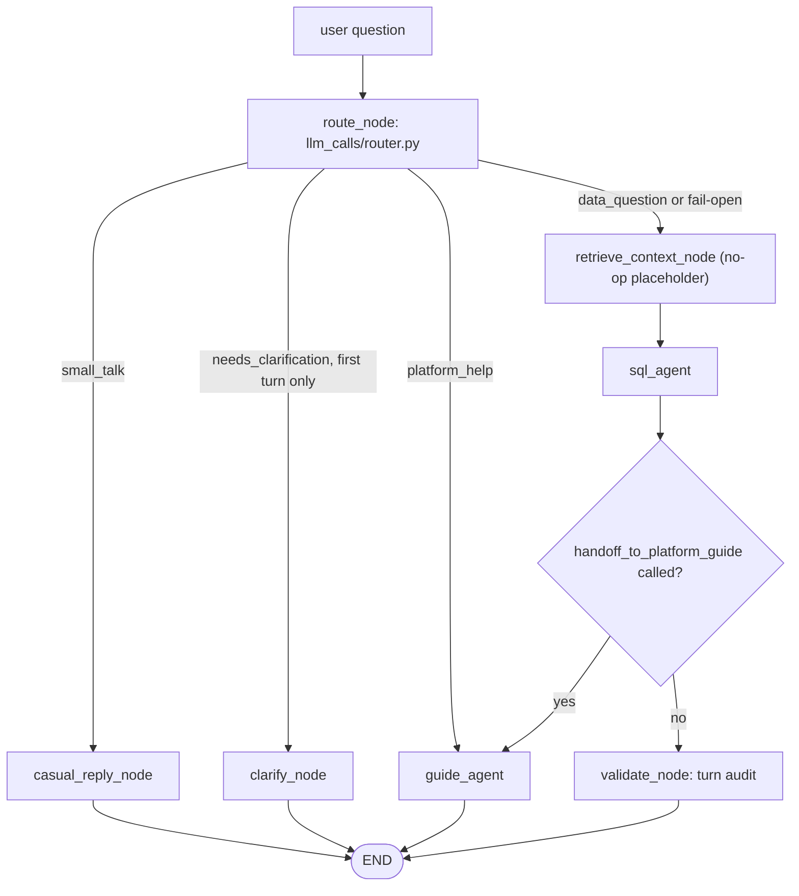
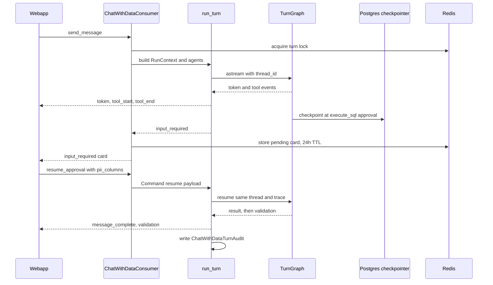

# AI features: Chat with Data and ai-llm-service

Dalgo has two unrelated AI stacks. Keep them apart:

| | Chat with Data (Copilot) | `ai-llm-service` |
|---|---|---|
| Lives in | the Django backend, package `backend/ddpui/core/ai/` | a separate FastAPI + Celery repo directory, `ai-llm-service/` |
| Transport | WebSocket (`/wss/chat-with-data/<session_id>/`) plus REST | HTTP with an API key in the `Authorization` header, polled by backend Celery tasks |
| Models | Anthropic / OpenAI chat models through LangChain, called in-process | OpenAI file search (v0) or the Kaapi AI platform (v1), behind Celery tasks |
| Used for | asking questions of the org warehouse; creating charts, dashboards, metrics, KPIs and reports in chat | summarizing failed pipeline/Airbyte logs and summarizing warehouse query results |

Chat with Data never calls `core/llm_service.py`; it calls model providers directly from `core/ai`. Report summaries and dashboard-scoped chat once lived in `core/ai` but were removed (2026-08-18, deferred to a follow-up) - they are not live features, and only ghosts of them remain in old migrations.

## Chat with Data: the `core/ai` package

`backend/ddpui/core/ai/CLAUDE.md` is the maintained map of the package and should be updated whenever an agent, tool or `llm_call` is added. The folders:

| Folder / file | Responsibility |
|---|---|
| `agent/` | One module per agent (`chat_data_agent.py`, `platform_guide_agent.py`) plus shared loop infrastructure: `base.py` (model factory), `middleware.py`, `hitl.py`, `run_context.py`, `context_builder.py`, `checkpointer.py` |
| `chat/` | The turn pipeline: `turn_graph.py`, `turn_runner.py`, `sessions.py`, `history.py`, `org_memory.py` |
| `llm_calls/` | One-shot cheap-model calls: `router.py`, `sql_reflection.py`, `turn_audit.py`, `session_title.py` |
| `tools/` | Everything an agent can call, registered by name in `registry.py` |
| `guards/` | Deterministic SQL safety (`sql_guard.py`, `pii_rewrite.py`) with no LLM involved |
| `messages/` | The single interpreter of tool artifacts and message content (`artifacts.py`) |
| `evals/` | Golden-set eval runner and scorers |
| `prompts.py`, `toolsets.py`, `constants.py`, `typed_dicts.py`, `tracing.py` | All prompts, per-agent tool groups and UI labels, shared settings, typed dicts for graph state/WS events, Langfuse tracing |

### The turn pipeline

A turn is a hand-built LangGraph (`build_turn_graph` in `chat/turn_graph.py`) whose parent state is `TurnState` (`messages`, `question`, `route`, `has_history`, `validation`). The two agents are `create_agent` graphs mounted as subgraph nodes; only the parent is compiled with the checkpointer and the subgraphs inherit it.

The question is routed, then either answered by a short-circuit node, the guide agent, or the SQL agent followed by an audit.

Behavior worth knowing before changing anything:

- **Routing is fail-open.** `route_question` classifies with a cheap model (`FAST_MODEL`); any error, timeout or unparseable reply becomes `data_question`/`simple`. The router also receives a line saying which agent wrote the previous answer so short follow-ups ("yes", "make it monthly") stay in the right lane. A deterministic regex backstop forces `platform_help` for unmistakable creation phrasings ("create a KPI...", "chart this") even if the model misroutes or fails open.
- **Clarification may only divert the first turn.** With any history, the agent (which holds the whole conversation) handles ambiguity itself. `needs_clarification` with no clarification text falls back to a casual reply.
- **Mid-turn handoff.** If a creation request reaches the SQL agent anyway, it calls `handoff_to_platform_guide`; `after_sql_agent` detects that ToolMessage in the current turn segment and continues the *same* turn in the guide agent. The handoff path skips `validate_node` because the audit is text-to-SQL specific.
- **`retrieve_context_node` is a named no-op** reserved for table-card retrieval, so the graph shape will not change when it is filled in.
- **Brains are injected.** `route_fn`, `casual_reply_fn` and `validate_fn` are passed into `build_turn_graph` (the runner passes its own module globals) so tests can patch them per turn and there is no circular import. `validate_fn=None` skips the audit (evals score answers themselves).

### The two agents

- **SQL agent** (`agent/chat_data_agent.py`) answers questions *from* data. Tools: `list_schemas`, `list_tables`, `get_table_details`, `lookup_column_values`, `execute_sql`, `ask_user`, `handoff_to_platform_guide`. Middleware order: `sql_retry_limiter`, dynamic org system prompt, `trim_history`, `clear_old_tool_results`, then the human-in-the-loop middleware.
- **Platform guide agent** (`agent/platform_guide_agent.py`) works *on* the platform: explains features from docs.dalgo.org (`get_dalgo_help`), lists inventory, and creates charts, dashboards, metrics, KPIs and reports (`create_*`, `add_charts_to_dashboard`). It has no `execute_sql` or `lookup_column_values`, and no `sql_retry_limiter`.

Both agents share one checkpointed thread. A creation tool is "the REST endpoint minus HTTP": it builds the API's own request schema and calls the same service method, so audit logging, sharing cascades and default-dashboard behavior live in the service, not in the tool or endpoint.

### Safety: guards, reflection, audit

These three checks are different things and must not be conflated:

| Check | File | When | Can it block? |
|---|---|---|---|
| Guard | `guards/sql_guard.py` | before every query, pure code (sqlglot AST) | yes - raises `GuardError` |
| Reflection | `llm_calls/sql_reflection.py` | before queries on the complex lane only (`ctx.complexity == "complex"`) | yes - returns the SQL to the model for revision |
| Audit | `llm_calls/turn_audit.py` | after the answer | no - yields a caveat only |

`sql_guard.validate` requires exactly one statement whose root is a SELECT or set operation, rejects any forbidden node anywhere in the tree (a `DELETE` inside a CTE is still a `DELETE`; also `INTO`, `FOR UPDATE`, `COPY`, `SET`, etc.), requires every physical table to be schema-qualified with a schema in the allowlist, and injects or clamps `LIMIT` (a smaller user-written limit is kept). Its error messages are written for the model to read and self-correct.

`execute_sql` is the only path to the warehouse. Its order is: PII hashing rewrite, guard, reflection (complex lane), execution. Postgres gets a `statement_timeout` on the pooled connection; BigQuery relies on the `LIMIT` clamp. Warehouse errors come back as tool text (`Query failed: ...`, `SQL rejected: ...`) rather than exceptions so the model can retry. `sql_retry_limiter` counts those prefixes since the user's last message and, after `MAX_SQL_ATTEMPTS` (5) failures, appends an apology and jumps to `end`. `RECURSION_LIMIT` (160 graph steps) is only the runaway backstop; re-check `test_realistic_discovery_turn_fits_in_the_recursion_limit` in `test_agent_loop.py` whenever middleware is added. `trim_history` and `clear_old_tool_results` shrink only the model *request*, never the checkpointed conversation the UI replays.

Design rules that are enforced in code:

- **Fail-open for helpers, fail-loud for deliverables.** Router, reflection, audit and title failures let the turn continue; an approved creation tool reports its real error into the chat.
- **The model never sees org identifiers or credentials.** All org-specific values travel in `RunContext` (`agent/run_context.py`), built server-side by `agent/context_builder.py` - the only module here that reads the ORM and resolves warehouse credentials. Allowed schemas default to every non-system schema (excluding `information_schema`, `airbyte_internal`, `pg_*`, `_airbyte*`), unless an admin pins `ChatWithDataOrgConfig.allowed_schemas`. See [Warehouses](warehouses.md) for the client the context wraps.
- **The warehouse is read-only.** Creation tools write Dalgo metadata only.
- **Org memory is reference, not instructions.** Admin-curated text (`ChatWithDataOrgConfig.memory_text`, at most `MAX_ORG_MEMORY_CHARS` = 5000) is rendered into both system prompts inside an injection-disclaimed tag.

### Human in the loop and PII

`agent/hitl.py` implements two pause kinds over one mechanism (LangChain `HumanInTheLoopMiddleware` plus the Postgres checkpointer):

- **approval** - `execute_sql` and `lookup_column_values` on the SQL agent, and every creation tool on the guide agent (`SQL_APPROVAL_TOOLS`, `GUIDE_APPROVAL_TOOLS` in `toolsets.py`), wait for approve/cancel. Pure metadata lookups are deliberately not gated.
- **question** - `ask_user` never executes; the user's typed reply becomes the tool result.

A pause surfaces as an `input_required` WebSocket event. The graph state is durable in Postgres and the pending card is stored in Redis (`chat_with_data:pending_input:<session_id>`, 24h TTL). A reconnecting client gets the card re-sent on connect, and `Command(resume=...)` continues the turn as the same Langfuse trace. If the Redis record lapses, the next message simply re-triggers the same interrupt.

There is no PII detection. For `execute_sql` and `lookup_column_values` the approval card lists every `schema.table.column` the query would read; the user ticks the PII ones, and `guards/pii_rewrite.py` wraps those projections in the warehouse's hash function at the source (so CTEs and subqueries are covered). If the column list cannot be built the card carries `columns: null` and the consumer refuses approval server-side (fail-closed). Ticked columns arrive from the browser, are narrowed to what the card offered (`_allowed_pii_columns`), land in `RunContext.pii_columns` for that resume only, and are not persisted or audited. PII typed into the chat box itself is not protected.

### Transport: REST, WebSocket consumer, runner

REST (`api/chat_with_data_api.py`, mounted at `/api/chat-with-data/`): `GET /status`, `GET`/`PUT /settings`, session CRUD, and `GET /sessions/{id}/messages` (history replayed from the checkpointer by `chat/history.py`). Every endpoint is gated by `@has_permission(["can_use_chat_with_data"])`, which is the single permission for chat, settings and tools (admin roles only); creation tools do no further RBAC.

Availability (`chat/sessions.get_status`) is: org `CHAT_WITH_DATA` feature flag enabled **and** an `OrgWarehouse` exists. `OrgPreferences.llm_optin` deliberately does not gate chat - flipping the Copilot toggle in settings is the org's consent - though it still gates other AI features. Sessions (`ChatWithDataSession`) are org-scoped, soft-deleted rows holding a `thread_id` into the checkpointer; message content lives only in the checkpointer. Titles are generated after the first exchange.

`ChatWithDataConsumer` (`websockets/chat_with_data_consumer.py`, routed in `urls.py` as `wss/chat-with-data/<int:session_id>/`) is the first async consumer in the codebase, because streaming needs `astream` on the event loop. On connect it reads the `access_token` cookie (the query-string token fallback of the older webapp is deliberately unsupported), validates the JWT, loads the `OrgUser` for the `orgslug` query param, checks permission and `get_status`, and loads the session; failures close with `NO_TOKEN`, `INVALID_TOKEN` or `FORBIDDEN` codes. Inbound messages are parsed into `ChatClientMessage`:

- `send_message` - starts a turn, or, if a card is pending, answers the `ask_user` question (resume with the text) or cancels a pending approval and passes the typed text as a redirect.
- `resume_approval` - approve or cancel with `pii_columns`.

The model per turn is `resolve_selected_model`, which only accepts ids from `MODEL_OPTIONS` whose provider key is set and otherwise uses the default - the client string is never trusted. A Redis turn lock (`chat_with_data:turn_lock:<session_id>`, 180s TTL) prevents concurrent turns on a session and cannot wedge it permanently if a consumer crashes.

`run_turn` in `chat/turn_runner.py` streams the compiled graph with `stream_mode=["messages","updates"]` and `subgraphs=True` and translates chunks into typed events: `token` (only from the agent `model` node, so router/auditor output never leaks), `tool_start`/`tool_end`, `message_complete`, `validation`, `input_required`, `error`; the consumer adds `title_updated`. Every run ends with `message_complete`, `input_required` or `error`, and always writes a `ChatWithDataTurnAudit` row with status `completed`, `failed`, `aborted` (cancellation) or `paused`, plus SQL queries, tools called, token usage, latency, router intent and validation.

The sequence shows a turn that pauses for SQL approval and resumes on the same thread.

### Tracing, models, configuration

- Models are chosen per job by env var with a default through `agent/base.py`: `CHAT_WITH_DATA_MODEL` (agents, default `claude-sonnet-5`), and `CHAT_WITH_DATA_ROUTER_MODEL`, `_VALIDATOR_MODEL`, `_REFLECTION_MODEL`, `_TITLE_MODEL` (default `claude-haiku-4-5`). The model id picks the provider (`claude-*` needs `ANTHROPIC_API_KEY`, `gpt-*` needs `OPENAI_API_KEY`). `DALGO_DOCS_BASE_URL` points `get_dalgo_help` at the docs site.
- Langfuse tracing (`tracing.py`) is off unless `LANGFUSE_PUBLIC_KEY` and `LANGFUSE_SECRET_KEY` are set, and a tracing failure can never break a turn. One question is one trace across pause/resume. Span and generation names in `STAGE_SPANS`/`GENERATION_NAMES` are referenced by Langfuse dashboards - treat them as an API. `LANGFUSE_MASK_TOOL_RESULTS` replaces tool outputs (which can contain warehouse rows) with a length stub. The handler is hand-rolled over the Langfuse v2 low-level client because the dbt stack pins `protobuf<5`; a Python 3.10 shim (`TurnCallbackDispatcher`, and `_SyncHumanInTheLoopMiddleware` in `hitl.py`) works around missing context propagation and is removable on Python 3.11+.
- Conversation memory is an `AsyncPostgresSaver` over a small psycopg3 pool (1-4 connections) separate from Django's connections. Create its tables once per environment with `manage.py chat_with_data_setup`; Langfuse dashboards come from `manage.py chat_with_data_dashboards --org <slug>`.

### Extending

- **New tool:** one module in `tools/` using `@register_tool`, add it to `_TOOL_MODULES` in `registry.py`, the owning agent's tuple (and approval tuple if it should pause) in `toolsets.py`, and a label in `TOOL_LABELS`. `test_toolsets.py` fails on unknown names or missing labels. The agent graph does not change; `tools/chart_tools.py` is the template.
- **New agent:** a module in `agent/` assembled with `create_agent` and the shared middleware, like `platform_guide_agent.py`; its prompt goes in `prompts.py` and tool tuples in `toolsets.py`. Wiring it into routing means touching `turn_graph.py` and the router.
- **Types rule:** data arriving from outside (browser, LLM reply, Redis, eval files) is parsed with Pydantic schemas; dicts LangGraph checkpoints stay plain dicts typed in `typed_dicts.py`, because a Pydantic object in a checkpoint pins its import path into every saved thread.
- **One artifact contract:** tools attach structured results to messages and only `messages/artifacts.py` interprets them, so the live stream, audit and history replay cannot disagree.

### Evals and tests

`core/ai/evals/` replays golden JSONL questions through the real agent via `manage.py chat_with_data_eval` and pushes scores to Langfuse. `eval_routing` and `eval_sql_correct` (gold SQL and agent SQL both executed and compared) are gates; the LLM-judge scores are informational and must not veto a merge. Unit tests live in `backend/ddpui/tests/core/ai/` (run `uv run pytest ddpui/tests/core/ai -v`); the ones that pin the most behavior are `test_turn_graph.py` (routing and handoff), `test_turn_runner.py` (event translation and audit), `test_sql_guard.py`, `test_hitl.py`, `test_pii_rewrite.py`, `test_router.py` and `test_toolsets.py`. The original design lives under `harness/features/chat-with-data/v1/` (`spec.md`, `plan.md`, `research.md`, `tasks.md`); see [Feature specs and harness](../concepts/feature-specs-and-harness.md). Note the spec's v1 scope ("no creation from chat", "Anthropic only") is historical - creation, a second agent and OpenAI models have since been added.

## Webapp chat UI

The page is `webapp/app/chat-with-data/page.tsx`, with components in `webapp/components/chat-with-data/` (`ChatPane`, `MessageBubble` with the approval card, `ResultTable`, `SqlBlock`, `ToolProgress`, `ConversationDock`, `ChatComposer`) and the Copilot settings screen in `components/settings/copilot/`. See [Webapp](webapp.md) for the surrounding app.

- The page first reads `/status` and renders a blocked state for `feature_disabled` or `no_warehouse` (a legacy `llm_consent_required` is kept only for older backends). The open thread id lives in the `?session=` URL param; a new session is created on first send and the typed question is queued until its socket is up. History comes from the REST messages endpoint (`historyToChatMessages`).
- `useChatWithData` owns the socket through `useBackendWebSocket`, which wraps `react-use-websocket`, builds the URL via `generateWebSocketUrl` (cookie auth, `orgslug` query param), reconnects up to 3 times, and does not retry on auth close codes 4001/4003/4004 (`WS_CLOSE_CODES` must match backend `WebsocketCloseCodes`).
- `applyChatEvent` is a pure reducer that applies each WS event to the trailing assistant placeholder; one turn is in flight at a time, matching the backend lock. Typing while an approval is pending marks it "redirected"; a re-sent card on reconnect gets its own bubble (`mergeHistoryKeepingPendingCard`).
- The approval card holds the PII ticks in component state and sends them with `resume_approval`; approval is disabled when the backend reports the column list unavailable.

## ai-llm-service

`ai-llm-service/` is a small standalone service: a FastAPI app (`main.py`) plus Celery workers on a single `llm` queue with Redis as broker, result backend and session store. All work is queued as Celery tasks and the caller polls.

Authentication: routers under `/api` and `/api/v1` depend on `authenticate_user`, which compares the `Authorization` header with the service's `API_KEY` env var. The backend sends `LLM_SERVICE_API_KEY` in that header (see `core/llm_service.py`); neither value belongs in the wiki or source control. `/health` is unauthenticated. The Kaapi callback routes (`/api/v1/callbacks/collection-ready` and `/llm-answer`) sit outside the API-key dependency and instead verify an HMAC-SHA256 signature over `timestamp.body` using `KAAPI_WEBHOOK_SECRET`, rejecting timestamps more than 300 seconds off.

File-search flow (the only feature):

1. `POST file/upload` creates or extends a session (a Redis-stored `OpenAISessionState`) and stores the document - to a temp dir for v0, or to Kaapi for v1.
2. `POST file/query` with `assistant_prompt` and a list of `queries` enqueues a Celery task and returns `task_id` and `session_id`. The session locks after the first query.
3. `GET /api/task/{task_id}` reports Celery status, result and error.
4. `DELETE file/search/session/{session_id}` enqueues cleanup.

Two implementations coexist. The unversioned `/api` routes (tasks `query_file`, `close_file_search_session`) drive OpenAI's Assistants API directly with the service's `OPENAI_API_KEY`. The `/api/v1` routes (`query_file_v1`) go through the Kaapi AI platform: create a vector-store collection, wait for the `collection-ready` webhook to land `vector_store_id` on the Redis session, then fire each query sequentially, chained by `conversation_id`, waiting for each `llm-answer` webhook (120s timeouts, polling the session every 3s). Webhook handlers only validate and mutate the session; the Celery task is the orchestrator. `close_file_search_session_v1` best-effort deletes Kaapi documents then removes the session. Tests in `ai-llm-service/tests/` are only a placeholder; see [Prefect proxy and ai-llm-service testing](../testing/prefect-proxy-and-ai-llm-service.md).

### How the backend calls it

`backend/ddpui/core/llm_service.py` is a thin client configured by `LLM_SERVICE_API_URL`, `LLM_SERVICE_API_KEY` and optional `LLM_SERVICE_API_VER` (empty selects the legacy `/api/...` path, `v1` selects `/api/v1/...`). Its flow is `upload_text_as_file` / `upload_json_as_file` -> `file_search_query_and_poll` (post queries, then `poll_llm_service_task` every 5s until a terminal Celery state, raising on FAILURE/REVOKED/REJECTED) -> `close_file_search_session`. Task polling always uses the unversioned `/api/task/<id>` endpoint.

Only two backend Celery tasks (in `celeryworkers/tasks.py`) use it, both persisting an `LlmSession` (`models/llm.py`) and reporting through `SingleTaskProgress`:

- `summarize_logs` (and `trigger_log_summarization_for_failed_flow`, which skips flow runs that already have a summary) uploads pipeline or Airbyte-sync logs and asks for the primary error and remediation steps, using the `AssistantPrompt` of type `log_summarization`.
- `summarize_warehouse_results` runs a SQL query on the warehouse, uploads the rows as CSV and asks the user's prompt, using the `long_text_summarization` prompt; zero rows is a failure.

These tasks run on the backend's Celery workers - see [Background work](background-work.md) - and the AI-data-analysis and log-summarization features are the ones still gated by `OrgPreferences.llm_optin`.
