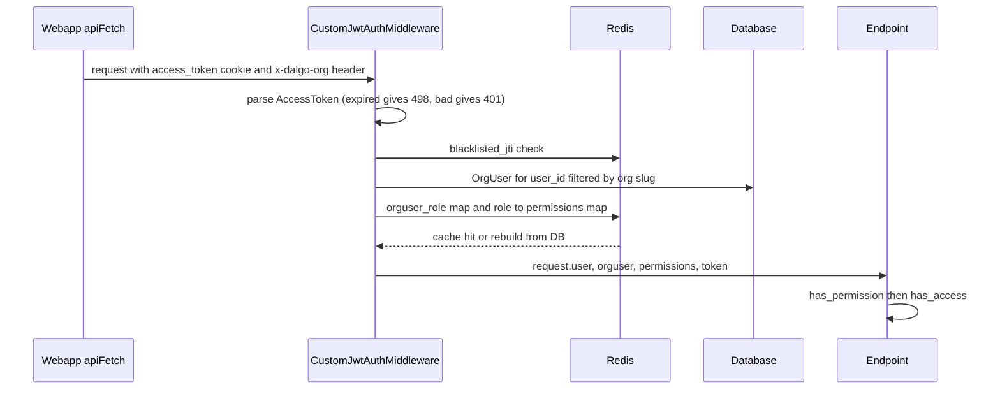
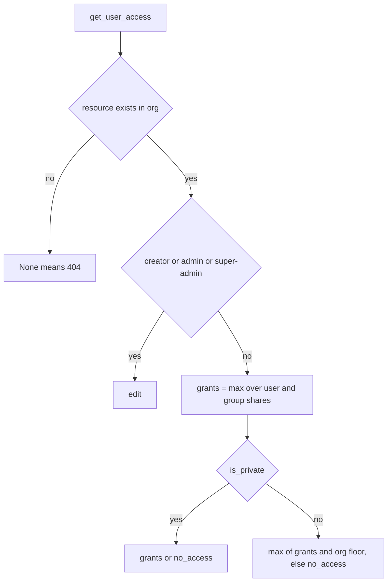

# Auth, orgs, roles and permissions

Dalgo's backend has three stacked access layers. Each answers a different question, and an endpoint can use more than one:

1. **Authentication** – who is calling, and in which org? A JWT in an httpOnly cookie plus an `x-dalgo-org` header resolve to an `OrgUser` ([`auth.py`](../../backend/ddpui/auth.py)).
2. **Role permissions (RBAC)** – may this role perform this *kind* of action? `@has_permission([...])` checks permission slugs derived from the user's `Role`.
3. **Per-resource access** – may this person view or edit *this* dashboard, chart, report or KPI? `@has_access(...)` and the resolver in [`core/access/`](../../backend/ddpui/core/access/access_control.py) combine ownership, admin role, explicit shares and org-wide defaults.

See [Backend layers](./backend-layers.md) for where these decorators sit in the API → core → model stack, [Webapp](./webapp.md) for the client, and [Domain model](../concepts/domain-model.md) for `Org`/`OrgUser` in context.

## Identity model

- A Django `User` can belong to several orgs. Each membership is one `OrgUser` row ([`models/org_user.py`](../../backend/ddpui/models/org_user.py)): `user`, `org` (nullable), and `new_role` (FK to `Role`, `SET_NULL`). There is at most one `OrgUser` per user per org.
- `Org.slug` ([`models/org.py`](../../backend/ddpui/models/org.py)) is the value clients send in `x-dalgo-org`.
- `Role`, `Permission` and `RolePermission` ([`models/role_based_access.py`](../../backend/ddpui/models/role_based_access.py)) form the RBAC tables. `RoleSlug` enumerates `super-admin`, `admin`, `analyst`, `member`. `Role.level` is an integer rank used for "cannot grant above your own level" checks. `auth.py` still exports deprecated aliases `ACCOUNT_MANAGER_ROLE` (= admin) and `GUEST_ROLE` (= member) for old imports.
- Users also have `UserAttributes` (`can_create_orgs`, `is_platform_admin`, etc.) returned by `lookup_user` at login.
- `OrgUserGroup` / `OrgUserGroupMember` model named groups of org users; a member row points at an active `OrgUser` or a pending `Invitation`.

## Request authentication

`CustomJwtAuthMiddleware` (an ninja `HttpBearer`) is installed as the default `auth=` of the main `NinjaAPI` in [`routes.py`](../../backend/ddpui/routes.py), so every route is authenticated unless it opts out with `auth=None` (login, token refresh). The separate `public_api` has no auth.



Caption: authentication and permission resolution for one request.

Key behaviours in `authenticate`:

- **Token source.** `__call__` reads the `access_token` cookie first; if absent it falls back to the normal `Authorization: Bearer` path. An expired token raises HTTP **498**, which the webapp treats as "refresh and retry"; any other malformed/bad-signature token raises 401 so the user must log in again.
- **Revocation.** Logout stores the token's `jti` in Redis as `blacklisted_jti:<jti>` with a TTL equal to its remaining lifetime (`blacklist_jti_in_redis`). A blacklisted access or refresh token is rejected with 401.
- **Org resolution.** `OrgUser` is looked up for the token's `user_id`. If the `x-dalgo-org` header is present the query is narrowed to that org slug; if the header is absent, the **first** `OrgUser` of the user is used. A header for an org the user does not belong to finds no `OrgUser` and ends in 401. An `OrgUser` with `org=None` yields 400 "register an organization first".
- **Permissions via Redis.** The access token carries an `orguser_role_key` claim (`orguser_role:<user_id>`). Redis holds `{orguser_id: role_id}` under that key and `{role_id: [permission slugs]}` under `ROLE_PERMISSIONS_REDIS_KEY` (default `dalgo_permissions_key`). Missing or corrupt entries are rebuilt from the database (`set_roles_and_permissions_in_redis` reads every `RolePermission`). The middleware then sets `request.user`, `request.orguser`, `request.permissions` and `request.token`.

### Login, refresh, logout

Cookie flow lives in [`api/user_org_api.py`](../../backend/ddpui/api/user_org_api.py):

- `POST /api/v2/login/` validates credentials with `CustomTokenObtainSerializer`, then sets `access_token` and `refresh_token` cookies (`httponly`, `secure`, `samesite`, from `COOKIE_*` settings). It also writes an `AUTH`/`LOGIN` audit row. The older `POST /api/login/` returns the tokens in the JSON body instead.
- `CustomTokenObtainSerializer.get_token` rebuilds the user's `{orguser_id: role_id}` map in Redis on **every login and refresh** (so newly created `OrgUser`s are picked up), seeds the role→permissions map if absent, and adds the `orguser_role_key` claim.
- `POST /api/v2/token/refresh` reads the refresh cookie, rejects blacklisted refresh tokens, and sets a fresh `access_token` cookie.
- `POST /api/logout/` blacklists both tokens and deletes both cookies.
- `POST /api/v2/iframe-token/` mints a two-minute access token for iframe embedding, reusing `get_token` so the custom claim is present.

## Roles and permissions

### Seed fixtures

Roles and permissions are data, not code. Three Django fixtures in [`backend/seed/`](../../backend/seed/001_roles.json) define them:

| File | Role |
|---|---|
| `001_roles.json` | the `Role` rows (slug, display name, level) |
| `002_permissions.json` | the catalog of `Permission` slugs such as `can_view_orgusers` |
| `003_role_permissions.json` | the `RolePermission` join rows that grant slugs to roles |

They are loaded with `python manage.py loaddata seed/*.json`; [`scripts/post-deploy.sh`](../../backend/scripts/post-deploy.sh) runs migrate → loaddata → `create-system-orguser` → `clear_role_permissions`. Tests load the same three files through a session `seed_db` fixture (see [Backend pytest](../testing/backend-pytest.md)).

Because `auth.py` caches the role→permission map in Redis, **changing seed data or `RolePermission` rows has no effect until the cache key is cleared** (`python manage.py clear_role_permissions`, which supports `--dry-run`); the next request rebuilds it. Per-user role maps refresh at login. The `migrate_rbac_v2_roles` command converts pre-v2 databases (account-manager and pipeline-manager collapsed into `admin`, guest into `member`) and deliberately does not touch Redis; fresh installs get the collapsed role set straight from the fixtures. The webapp mirrors the role and permission slugs by hand in [`lib/rbac.tsx`](../../webapp/lib/rbac.tsx), so a new slug must be added in both places.

### `has_permission`

```python
@router.get("/organizations/users")
@has_permission(["can_view_orgusers"])
def get_organization_users(request): ...
```

`has_permission(slugs)` wraps a sync or async view (it preserves coroutine-ness so Ninja awaits correctly) and requires that `request.permissions` is a **superset** of all listed slugs. Two things are easy to get wrong:

- The decorator's inner check catches its own 403 and re-raises it as **HTTP 404 "unauthorized"**. A caller missing a permission therefore sees 404, not 403. This is a known, still-open quirk tracked in the resource-sharing `tasks.md` (M13): the frontend cannot distinguish "missing" from "not permitted" on these routes.
- `has_permission` is what makes `request.orguser` meaningful to downstream code; `has_access` explicitly says it must be stacked under it.

For non-HTTP code (WebSocket consumers, services) `orguser_has_permission(orguser, slug)` queries `RolePermission` directly.

### Role-level guard rails

Beyond slugs, several flows compare `Role.level`: you cannot assign a role above your own (`post_modify_orguser_role`), cannot invite a role above yours (`invite_user_v1`), cannot update or delete a user with a higher role (`put_organization_user_v1`, `delete_orguser_v1`), and cannot change your own role. Deleting an `OrgUser` first reassigns the dashboards, charts, metrics, KPIs, report snapshots and alerts they created to the acting admin, so nothing is orphaned ([`core/orguserfunctions.py`](../../backend/ddpui/core/orguserfunctions.py)).

`GET /api/currentuserv2` returns every `OrgUser` of the caller with `new_role_slug` and the role's permission list; this is the payload the webapp builds all UI gating from.

## Per-resource access control

Role permissions say what a role may do in general. Sharing decides *which* content objects someone can see or change.

### Model

- `ResourceShare` ([`models/resource_share.py`](../../backend/ddpui/models/resource_share.py)) is one grant: `resource_type` + string `resource_id` (a deliberately soft pointer, not a FK), a principal (`user` or `group`, or a pending `Invitation`), and `access_level` (`view`, `edit`, or `no_access`). `parent` is a self-FK that marks **cascade rows** derived from a dashboard share. Partial unique constraints prevent duplicate direct grants and duplicate cascade rows.
- `AccessRequest` records a "request access" ask; only one pending request per user and resource is allowed.
- Shareable types are registered in one table, `RTYPES` in [`shareable_types.py`](../../backend/ddpui/core/access/shareable_types.py): dashboard, chart, report (`ReportSnapshot`) and KPI. Adding a type means adding an entry there and a `ResourceType` value. `get_resource` is org-scoped, so cross-org resources look identical to missing ones.
- Each shareable model has `created_by` (the **owner**, nullable and set to NULL if the creator's `OrgUser` is deleted) and `is_private`. Org-wide defaults live in `OrgPreferences`: `default_analyst_level`, `default_member_level` (the **floor**), and `allow_public_sharing`.

### Resolution rules

[`access_control.py`](../../backend/ddpui/core/access/access_control.py) is the single decision point, exposed as `get_user_access` (one resource), `get_user_access_map` (batch, avoids N+1 on lists), `accessible_filter` (the same rule as one ORM `Q` for list queries) and `get_access_map_for_resource` (inverse, used by the transfer-ownership picker).



Caption: effective access for one orguser on one resource.

Notes that matter when changing this code:

- Creator or admin always gets `edit` (`ownership.is_creator_or_admin`). Admin means role slug `admin` or `super-admin`.
- Grants from the user's own row and all of their groups are **max-merged** (`max_access_level`). The module docstring still describes a user-over-group precedence with `no_access` as an explicit deny; the implemented resolver uses max-merge, as recorded in the resource-sharing tasks (M1c).
- The floor applies only to non-private resources and depends on role: `analyst` uses `default_analyst_level`, everything else uses `default_member_level`. A missing `OrgPreferences` row falls back to the model's defaults.
- `accessible_filter` pushes the rule into SQL so inaccessible rows never leave the database; list services (charts, reports, KPIs) combine it with `get_user_access_map` to annotate each row's `access_level`.

### `has_access`

`has_access(rtype, required_level, get_resource_id=lambda kwargs: ...)` in `auth.py` gates single-resource endpoints (it requires the caller to say how to read the id from the endpoint kwargs, and reads **kwargs only** – positional calls fail with 400). It maps outcomes to HTTP: missing or cross-org resource → 404; resource exists but level is `no_access` → 403; level below `required_level` → 403. On success it sets `request.access_level`. Usage stacks it under `has_permission`, for example the report view endpoint in `report_api.py`.

### Sharing API, cascade and ownership

[`api/access_api.py`](../../backend/ddpui/api/access_api.py) is mounted at `/api/access/` and is a thin HTTP layer over [`core/access/resource_share.py`](../../backend/ddpui/core/access/resource_share.py) and [`ownership.py`](../../backend/ddpui/core/access/ownership.py):

- `GET/POST /{rtype}/{id}/grants`, `PATCH/DELETE .../grants/{share_id}` – list, bulk add/update, change level, revoke. Edit-holders (not only owners) may re-share. `GrantError` and `OwnershipError` become 400s. Notification failures are logged and never fail the call.
- `PATCH .../general-access` – switch a resource between `internal`, `private` and `public` (public only for dashboards and reports, and only when the org allows it). Floor-only editors cannot change visibility, and a chart or KPI cannot be made less visible than a dashboard that contains it. Toggling public generates a share token once and keeps it dormant after disabling; only changes to `is_public` write an audit row.
- `POST .../transfer-ownership` and `GET .../candidates` – owner or admin only; the recipient must already have effective Edit, unless an admin "takeover" strips the previous owner's direct shares.
- `POST/GET .../request-access` and `.../respond` – request, list pending, approve (creates a direct user grant) or decline; same-level requests return 409 but view→edit upgrades are allowed.

**Dashboard cascade.** Sharing a dashboard materialises child `ResourceShare` rows for every chart and KPI in its tabs (`sync_dashboard_cascade`), so inner components become accessible at the same level. The owner gets an automatic self-share at Edit that cascades only at View. Cascade rows cannot be edited directly (`update_grant` rejects them) and a direct grant at or below the inherited level is refused. The sync must run whenever dashboard shares or tabs change.

**Invitations.** Sharing with a brand-new email creates an `Invitation` and an invitation-backed share via `invite_user_v1`; `accept_invitation_v1` promotes pending group memberships and pending shares to real `OrgUser` principals and then re-syncs dashboard cascades.

## Audit logs (brief)

Security-relevant events (login, logout, role changes, org-user deletion, public-link toggles) are recorded through `create_audit_log` in [`core/audit_log_service.py`](../../backend/ddpui/core/audit_log_service.py). It writes an `AuditLog` row ([`models/audit_log.py`](../../backend/ddpui/models/audit_log.py)) on a daemon background thread and never raises, so auditing cannot break the caller; the row keeps `orguser_email` so history survives user deletion. Scope, event coverage and retention are specified under [`harness/features/audit_logs`](../../harness/features/audit_logs/spec.md) (all milestones in its `v1/tasks.md` are checked).

## Webapp side

- [`lib/api.ts`](../../webapp/lib/api.ts) sends cookies on every call (`credentials: 'include'`), adds `x-dalgo-org` from `localStorage.selectedOrg`, and on 498 performs one shared refresh via `/api/v2/token/refresh` then retries; a failed refresh or any 401 calls `handleAuthFailure` (clear state, go to `/login`, except on public share pages). Errors carry `.status` so callers can tell 403 from others.
- [`components/auth-guard.tsx`](../../webapp/components/auth-guard.tsx) fetches `/api/currentuserv2`; success means authenticated, picks the stored org slug (or the first) and redirects to `/login` otherwise.
- [`stores/authStore.ts`](../../webapp/stores/authStore.ts) holds `orgUsers`, `selectedOrgSlug` and `getCurrentOrgUser()`, which selects the `OrgUser` for the chosen org. Logout clears local/session storage and the SWR cache.
- [`lib/rbac.tsx`](../../webapp/lib/rbac.tsx) exposes `useRbac()`, `RoleGuard` (page-level, defaults to the NoAccess screen) and `PermissionGuard` (action-level, hides by default). These are UX only; the backend decorators are the real enforcement. Resource-level UI should use the `access_level` returned by list and detail APIs rather than role permissions.

## Specs, plans and build status

Under [`harness/features/access-control`](../../harness/features/access-control/resource-sharing/v1/tasks.md) (see [Feature specs and harness](../concepts/feature-specs-and-harness.md)):

| Feature | Status per its `tasks.md` / README |
|---|---|
| [`role-collapse`](../../harness/features/access-control/role-collapse/tasks.md) | Milestones 1–7 and pre-merge tests checked; only "remove worktrees after merge" is open. |
| [`resource-sharing/v1`](../../harness/features/access-control/resource-sharing/v1/tasks.md) | Engine, ownership transfer, request access, cascade, private toggle, access badges, alert ownership transfer (alerts do not use the sharing engine) and view→edit upgrade are checked. **Partly built:** some test items remain unchecked (core `test_access_control.py` unit tests, floor-hierarchy validation tests, a few cascade scenarios). Two group-endpoint gaps are still open: rename/add/remove-member endpoints lack the creator-or-admin gate, and Members cannot list groups. Both are tracked as strict `xfail` tests. The 404-for-403 quirk in `has_permission` is also still open. Bulk share was cut from v1. |
| [`dataset-access`](../../harness/features/access-control/dataset-access/README.md) | Scope stub only, not planned or built. |
| [`rls-access`](../../harness/features/access-control/rls-access/README.md) | Scope stub only, not planned or built. |

## Tests

- [`tests/core/test_auth.py`](../../backend/ddpui/tests/core/test_auth.py) – middleware cases: success with org header, invalid token, no org, empty Redis cache rebuild, blacklisted JTI.
- [`tests/api_tests/test_access_api.py`](../../backend/ddpui/tests/api_tests/test_access_api.py) – the large suite for grants, cascade, private/public, transfer, request access, floors and cleanup.
- [`tests/core/test_rbac_v2_roles.py`](../../backend/ddpui/tests/core/test_rbac_v2_roles.py) – asserts the seeded role→permission sets for the collapsed roles.
- Endpoints using `has_access` must be called with keyword args in tests.

## Extension checklist

- **New permission:** add to `002_permissions.json`, grant it in `003_role_permissions.json`, add to `PERMISSIONS` in `lib/rbac.tsx`, gate the endpoint with `@has_permission`, then run `clear_role_permissions` in each environment (and a data migration or management command for existing databases).
- **New shareable resource type:** add a `ResourceType`, an `RTYPES` entry, `created_by` and `is_private` fields, list-query `accessible_filter` integration, `@has_access` on detail endpoints, and share/request cleanup on delete.
- **New audited action:** call `create_audit_log` with an `AuditLogResourceType` and `AuditLogAction` after the mutation, never including secrets in `resource_fields`.
