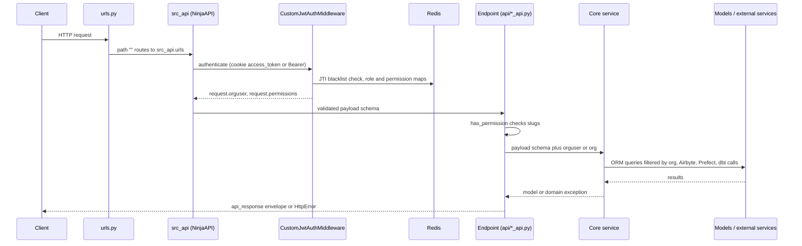

# Backend layers: API, core, schemas, models

The Dalgo backend (`backend/ddpui`) is a Django + Django Ninja application. It is a multi-tenant ELT control plane that talks to Airbyte (ingest), Prefect (orchestration), dbt (transforms) and customer warehouses. The written project guide is `backend/.claude/CLAUDE.md`, with detail in `backend/.claude/skills/` (`api-endpoint`, `coding-standards`, `service-delegation`, `typed-schemas`). This page explains the structure those documents describe and checks it against the code.

## The layers and the one-way rule

Dependency direction is **API → core → models**. Nothing flows back up.

| Layer | Location | Responsible for | Should not |
|---|---|---|---|
| API | `ddpui/api/{module}_api.py` | HTTP I/O, `@has_permission`, Ninja payload validation, mapping exceptions to HTTP, `api_response` wrapping | business logic, ORM queries, external calls |
| Core | `ddpui/core/{module}/{module}_service.py` (+ `*_operations.py`, `exceptions.py`) | business logic, orchestration, transactions, schema validation before external calls | HTTP concerns, building API responses |
| Schemas | `ddpui/schemas/{module}_schema.py` | request/response contracts, `from_model()` conversion, typed shapes for JSONFields | business logic, DB operations |
| Models | `ddpui/models/*.py` | table definitions, relationships, simple methods | business logic, API concerns, `to_json`/`to_dict` |
| Exceptions | `core/{module}/exceptions.py` (or defined in the service module) | feature-specific error classes | HTTP status codes, which the API layer maps |

External-service clients sit beside this stack as modules imported by core: `ddpui.ddpairbyte.airbyte_service`, `ddpui.ddpprefect.prefect_service` and the warehouse client factory. They are called as module attributes (`airbyte_service.create_source(...)`), not through re-exported names.

The reason for the layering is testability and a single source of truth. Core services can be tested without HTTP. The `service-delegation` skill adds that each domain entity (metric, KPI, alert, chart) has one owning service. Code that needs "what is KPI X worth" asks `KPIService` rather than rebuilding the query. This stops two views of the same value from drifting apart.

### Honest layout note: legacy and parallel locations

The `core/{module}/` package layout is the newer convention. The code base also contains:

- **Legacy flat modules in `ddpui/core/`**: `orgfunctions.py`, `orguserfunctions.py`, `orgtaskfunctions.py`, `pipelinefunctions.py`, `transformfunctions.py`, `warehousefunctions.py`, `dbtfunctions.py`, `visualizationfunctions.py`, plus `dbtautomation_service.py`, `git_manager.py`, `audit_log_service.py` and `llm_service.py`. These are `*functions.py` modules of free functions next to the package folders (`core/kpi/`, `core/metric/`, `core/orchestrate/`, `core/alerts/`, `core/reports/`, `core/access/`, `core/ai/` and others).
- **A second service location, `ddpui/services/`**: `chart_service.py`, `dashboard_service.py`, `favorite_service.py`, `org_cleanup_service.py`, `superset_service.py`, `warehouse_service.py`. These are business-logic modules that were not moved under `core/`. The `service-delegation` skill names both `core/<entity>/<entity>_service.py` and `services/<entity>_service.py` as places an owning service may live.

When looking for an entity's logic, check `core/<entity>/`, then `services/`, then the flat `core/*functions.py` files. New work should use `core/{module}/`.

## Request flow

Caption: the path of one authenticated request from `urls.py` to the data layer and back.

Step by step:

1. `ddpui/urls.py` mounts `src_api.urls` and `public_api.urls` at the empty prefix, next to `admin/`, `healthcheck`, `prometheus/` and a dbt docs view. WebSocket consumers (data insights, Airbyte checks, chat with data) are listed in `ws_urlpatterns` in the same file.
2. `ddpui/routes.py` builds `src_api = NinjaAPI(..., auth=auth.CustomJwtAuthMiddleware())`. Auth is therefore on by default for every router.
3. `CustomJwtAuthMiddleware` (in `ddpui/auth.py`) reads the `access_token` cookie, or falls back to the Bearer header. It maps an expired token to HTTP 498 (the frontend's cue to refresh) and any other bad token to 401. It rejects tokens whose JTI is blacklisted in Redis (logout), loads the `User` and the `OrgUser`, optionally narrowed by the `x-dalgo-org` header, and resolves the role's permission slugs from Redis. The cache is rebuilt from `RolePermission` rows on a miss. It sets `request.orguser`, `request.permissions` and `request.token`. See [Auth, orgs and permissions](auth-orgs-permissions.md).
4. Ninja validates the body against the endpoint's schema annotation.
5. `@has_permission([...])` checks that `request.permissions` is a superset of the required slugs. A denial surfaces as **404 "unauthorized"**, not 403, because the inner 403 is swallowed by a bare `except` and re-raised as 404. The decorator also keeps `async def` views async so Ninja awaits them (regression test: `tests/api_tests/test_has_permission_async.py`).
6. The endpoint passes the payload schema plus `request.orguser` (or `orguser.org`) to a core service, catches the service's domain exceptions and re-raises them as `HttpError` with `from err`.
7. The endpoint returns its result through `api_response`.

Some endpoints opt out of JWT auth with `auth=None`: login, token refresh, password reset, email verification, invite acceptance, the Airbyte OAuth callback and the two webhooks in `webhook_api.py`. The webhooks authenticate with an `X-Notification-Key` header compared to an environment variable and queue a Celery task (see [Background work](background-work.md)). The OAuth callback relies on a short-lived Redis state nonce. `public_api` is a second `NinjaAPI` with no auth at all, for shared dashboards and the trial-signup flow.

## Routers mounted in routes.py

Each `ddpui/api/*_api.py` file defines one `{module}_router = Router()`. `routes.py` imports them all, assigns `.tags` for the OpenAPI docs at `/api/docs`, and mounts them with `src_api.add_router(prefix, router)`. Examples:

| Prefix | Router |
|---|---|
| `/api/airbyte/`, `/api/dbt/`, `/api/transform/`, `/api/warehouse/` | integration modules |
| `/api/prefect/` and `/api/prefect/tasks/` | `pipeline_router` and `orgtask_router` |
| `/api/charts/`, `/api/dashboards/`, `/api/filters/`, `/api/reports/` | visualization modules |
| `/api/metrics/`, `/api/kpis/`, `/api/alerts/`, `/api/access/` | metrics, KPIs, alerts, resource sharing |
| `/api/chat-with-data/` | chat with data |
| `/api/` | `user_org_router` (users, orgs, login) |
| `/webhooks/` | `webhook_router` |

Adding an endpoint to an existing router needs no change to `routes.py`. A new module needs an import, a tag and an `add_router` line. The end-to-end recipe is in [Add an endpoint and webapp feature](../workflows/add-endpoint-and-webapp-feature.md).

## Response envelope and error handling

`ddpui/utils/response_wrapper.py` defines `api_response(success, data=None, message=None)`. It returns a plain dict `{"success": ..., "message"?: ..., "data"?: ...}`. If `data` has `model_dump`, it is dumped, so a Pydantic or Ninja schema instance can be passed directly. The generic `ApiResponse[T]` schema is used as `response=ApiResponse[WidgetResponse]` so OpenAPI documents the envelope. `message` and `data` are omitted when `None`.

Errors travel as exceptions, not envelopes. `routes.py` registers three handlers on `src_api`:

| Exception | Response |
|---|---|
| Ninja `ValidationError` (request payload invalid) | 422, `{"detail": exc.errors}` |
| Pydantic `ValidationError` (response validation) | 500, `{"detail": exc.errors()}` |
| any other `Exception` | 500, `{"detail": str(exc)}` |

`HttpError` raised by an endpoint is handled by Ninja itself. Core code raises feature-specific exceptions and never HTTP codes. The API layer maps them using the convention from the `api-endpoint` skill: not-found to 404, validation to 400, permission to 403, external-service failures to 502 or 500, and anything else logged and returned as a generic 500. `core/orchestrate/pipeline_service.py` shows the pattern: `PipelineNotFoundError`, `PipelineValidationError` (400), `PipelineConfigurationError` (422) and `PipelineServiceError` (500) are mapped in `pipeline_api.py`. Note that the unexpected-error branch there returns `str(error)` to the client, which is looser than the "generic message" guidance.

## Logging

Modules create `logger = CustomLogger("ddpui.module_name")`. `CustomLogger` is a thin backward-compatible subclass of `DalgoLogger` in `utils/unified_logger.py`. The logger:

- writes JSON via `StructuredFormatter` (timestamp, level, logger, message, caller module/function/file/line, thread, and exception type, message and stack trace);
- sends records up to WARNING to stdout and ERROR and above to stderr, and sets propagation off to avoid duplicate lines;
- adds a rotating file handler (10 MB, 5 backups, under `ddpui/logs`) only when `ENABLE_FILE_LOGGING=True`;
- uses DEBUG when `settings.DEBUG` is set, INFO otherwise;
- logs `error()` with a stack trace automatically.

The "auto org/user correlation" works by walking up to 10 stack frames and reading local variables named `orguser`, `org` or `user`. The formatter emits `org_slug` and `user_id` from those. Code that does not hold such a local gets no org context. There is no request-ID middleware in `settings.MIDDLEWARE`. `request_id` is only printed if a caller passes it in `extra`, so do not assume log lines carry a request correlation id.

## Non-negotiable invariants

These come from `backend/.claude/CLAUDE.md`. Each exists for a concrete reason.

1. **API → core → models, one way.** Keeps HTTP out of business logic so services stay reusable from Celery tasks, WebSocket consumers and tests.
2. **Every query filters by `request.orguser.org`.** Every domain object has an `org` FK. The org comes from the authenticated `OrgUser`, never from client-supplied ids. Multi-tenancy is enforced in services (`Widget.objects.get(id=..., org=org)`, as `PipelineService` does with `OrgDataFlowv1.objects.filter(org=org, ...)`), not by the framework. A missing filter is a cross-tenant data leak.
3. **Every endpoint has `@has_permission([...])`.** No exceptions, even internal ones. Permission slugs come from the role fixtures (`001_roles.json`, `002_permissions.json`, `003_role_permissions.json`). Resource-level sharing is layered on top with `@has_access(rtype, level, get_resource_id=...)`, stacked under `has_permission` because it relies on `request.orguser`.
4. **Every endpoint returns `api_response(success=True, data=..., message=...)`.** Never a raw dict. The frontend can then rely on one envelope.
5. **Schemas validate at boundaries.** Inbound payloads are validated by Pydantic through Ninja. Schemas with `extra="forbid"` validate data before any dbt, Airbyte or Prefect call, so unknown or misspelled keys fail loudly instead of being forwarded. The typed-schemas skill adds: parse a JSONField into its schema once at the boundary, and use attribute access instead of `cfg.get("x")`.
6. **No local imports.** All imports at the top of the file, except documented circular-import or slow-dependency cases. `auth.py` itself has one deliberate late import for that reason.
7. **No `to_json`/`to_dict` on models.** Response schemas expose `from_model()`.
8. **Core feature `__init__.py` stays empty.** No re-exports and no `__all__`.
9. **Service signatures take a payload schema plus org/orguser context.** Avoid `func(a, b, c, ...)` for fields that belong together in a schema. Single-value lookups such as `get_widget(id, org)` are fine.
10. **Chain exceptions with `from err`** (or `from None` to suppress deliberately). A bare `raise NewError(...)` in an `except` block loses the traceback.

## Where the code differs from the rules

The invariants are the target. Reading the code shows they are applied unevenly, so check the surrounding module before copying its style.

- **`api_response` is not universal.** Only `alert_api`, `chat_with_data_api`, `kpi_api`, `metric_api`, `report_api` and `user_org_api` import it. Most other routers, including `pipeline_api.py`, return the service result or a response schema directly (for example `return result`, or `response=KPIResponse`). The webhook endpoints return `{"status": "ok"}`. Treat the envelope as required for new endpoints, but do not assume existing endpoints follow it. A frontend call needs to know which shape that endpoint uses.
- **`@has_permission` is near-universal but not total.** Endpoints with `auth=None` (above) skip it by design, because they run before a user context exists.
- **API files sometimes touch the ORM.** `pipeline_api.py` imports `OrgTask` and `ConnectionMeta` and queries them in helper functions for audit-log labels. It also imports `prefect_service`, `airbyte_service` and a Celery task directly. The thin-API rule is a direction of travel, not a guarantee.
- **Models still have `to_json`.** Several models (`airbyte.py`, `dashboard.py`, `flow_runs.py`, `org_plans.py`, `org_preferences.py`, `tasks.py`, `userpreferences.py`) retain `to_json`. The rule applies to new code.
- **`extra="forbid"` is used selectively.** It appears on a few schemas, such as `KPIExtraConfig` in `schemas/kpi_schema.py` and the Redis-stashed OAuth shapes (`OAuthStateData`, `GoogleTokens`, `OAuthRefData`) in `core/oauth/google_oauth_service.py`. The Prefect payload schemas in `ddpprefect/schema.py` do not set it. Follow the rule when adding a payload that is forwarded to an external system.
- **Unexpected-error handling differs by module.** `pipeline_api.py` has a catch-all that logs and re-raises 500 with the message. `kpi_api.py` has no catch-all and relies on the global handler in `routes.py` for anything unmapped.

## Models package

<!-- openwiki: broken internal link [django-migrations.md] file "django-migrations.md" does not exist. Fix the href or restore the target, then delete this comment. -->
`ddpui/models/__init__.py` re-exports a subset of models for convenience. It also imports a second group of models "not for API use" so Django always registers them (`CanvasLock`, `PrefectFlowRun`, `Notification`, `OrgPlans`, `UserPreferences`, chat-with-data models and others). Without that import, any process that skipped the feature code did not know those tables existed, and Django's test-database flush (TRUNCATE) failed on their foreign keys. `MapLayer` is deliberately not imported, because it has no migration and registering it breaks test-database creation. When adding a model, import its module here if some processes might not otherwise load it, and follow [Django migrations](django-migrations.md) for the schema change. The entities themselves are described in [Domain model](../concepts/domain-model.md).

## Extending safely

- New HTTP feature: add `schemas/{module}_schema.py`, `core/{module}/{module}_service.py` with `exceptions.py`, `api/{module}_api.py` with `{module}_router`, then mount it in `routes.py`. Never name a router plain `router`.
- Cross-domain value: call the owning service. Extend it with a sibling method if it lacks what you need.
- Run tooling through `uv run` (`uv run pytest ddpui/tests -v`, `uv run black .`, `uv run pylint ddpui/`).
- Tests live under `ddpui/tests/` in `api_tests/`, `core/`, `services/`, `schema_tests/`, `models/`, `websockets/` and others. Permission and role fixtures load through the `seed_db` fixture. Long-running work belongs in Celery, not in a request (see [Background work](background-work.md)).
