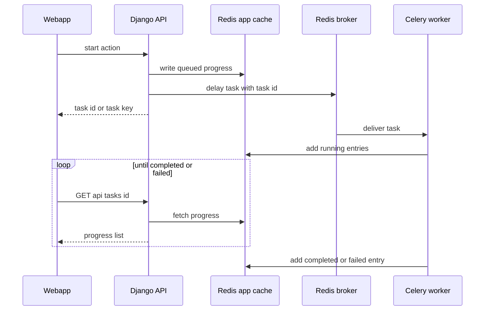
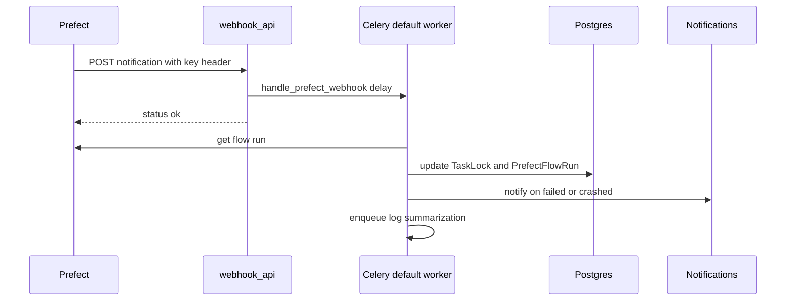

# Background work: Celery and Redis

Anything slow, scheduled or driven by an external callback in the Django backend (`backend/ddpui`) runs as a **Celery task**. Redis plays three separate roles here: it is the Celery broker, it holds the RedBeat schedule, and it is the app-level store where tasks write progress that the webapp polls. Durable coordination (`TaskLock`, alert claims) lives in Postgres, not Redis.

Related pages: [Backend layers](backend-layers.md), [Orchestration](orchestration.md) (Prefect side of the webhook), [Metrics, KPIs and alerts](metrics-kpis-alerts.md) (alert evaluation), [Local services and dependencies](../operations/local-services-and-dependencies.md).

## Celery app and Redis layout

`backend/ddpui/celery.py` is the single source of Celery configuration. Its docstring says not to add `CELERY_*` variables to `settings.py`; new settings go on `app.conf`. `ddpui/__init__.py` re-exports the app as `celery_app`, so `celery -A ddpui ...` finds it.

Each Redis concern gets its own numbered DB, defined once in `utils/redis_db.py` (`RedisDB`):

| DB | Enum | Used for |
|---|---|---|
| 0 | `BROKER` | Celery task messages |
| 1 | `BEAT` | RedBeat schedule state |
| 2 | `RESULTS` | Celery result backend (`AsyncResult`) |
| 3 | `CHANNELS` | Django Channels layer for websockets (`settings.CHANNEL_LAYERS`) |
| 4 | `APP_CACHE` | Task progress, auth caches, ad-hoc keys |

Host and port come from `REDIS_HOST` / `REDIS_PORT` (defaults `localhost:6379`).

Configuration worth knowing (all in `celery.py`):

- **Queues.** Default queue is `default`. `run_dbt_commands` is routed to `canvas_dbt`; `clone_trial_org_task` and `delete_expired_trial_orgs` to `trial_clone`; `alerts.dispatch_due_alerts` and `alerts.evaluate_alert` to `alerts`. The comments say long dbt jobs, trial teardown and time-sensitive alerts must not starve each other or the default queue.
- `worker_prefetch_multiplier = 1` (fair distribution).
- Task-lifecycle events are emitted (`worker_send_task_events`, `task_send_sent_event`) so celery-exporter or Flower can see timings.
- **Beat** uses `redbeat.RedBeatScheduler` with `redbeat_redis_url` on DB 1, replacing the file-based scheduler that could corrupt on hard kills.

### Processes

The compose files in `docker/` run separate processes from one backend image: a `default` worker (`-Q default`), a `canvas_dbt` worker (`--autoscale=3,1`), an `alerts` worker, and `celery-beat` (`celery -A ddpui beat --scheduler redbeat.RedBeatScheduler`). The compose files I checked have no worker consuming `trial_clone`, even though `celery.py` routes tasks there; a worker must be started with `-Q trial_clone` for those tasks to run. Only the beat process fires the schedule; workers just execute.

## Task modules

| Module | What it holds |
|---|---|
| `celeryworkers/tasks.py` | Most tasks and the whole beat schedule (`setup_periodic_tasks`) |
| `celeryworkers/alert_tasks.py` | `alerts.dispatch_due_alerts`, `alerts.evaluate_alert` |
| `celeryworkers/moretasks.py` | `schedule_notification_task` (sets `sent_time`, emails if the user's preference allows) |
| `celeryworkers/report_tasks.py` | `send_report_email_task` (PDF render + share email) |
| `celeryworkers/airbytehelpertasks.py` | `delete_airbyte_connections` |
| `core/trial/tasks.py` | `clone_trial_org_task` (time-limited trial clone) |
| `core/dbtautomation_service.py`, `core/datainsights/generate_result.py` | `sync_sources_for_warehouse_v2`, `poll_for_column_insights` |

Tasks are triggered with `.delay(...)` / `.apply_async(...)` from API modules, websocket consumers, the Prefect webhook, or beat. The task modules are imported by API code (for example `webhook_api.py` imports `celeryworkers.tasks`), and `tasks.py` itself imports `alert_tasks`; there is no `ddpui/tasks.py` for autodiscovery to find, so a new task module needs to be imported on a path the worker also loads.

## Progress and state in Redis

Both helpers get their connection from `RedisClient.get_instance()`, a thread-safe singleton (`utils/redis_client.py`) bound to `RedisDB.APP_CACHE` (DB 4). Always obtain Redis through it rather than building a client; `reset_instance()` drops the cached client.

### `TaskProgress` — hash of steps per task

`utils/taskprogress.py`. Constructor: `TaskProgress(task_id, hashkey, expire_in_seconds=None)`. Each `add(entry)` appends to an in-memory list and rewrites it as JSON into the Redis **hash** `hashkey`, field `task_id` (`HSET`). Consequences:

- Many tasks share one hash (for example `run-dbt-commands-<orgslug>`; prefixes are in `TaskProgressHashPrefix` in `models/tasks.py`). The caller can poll by `(hashkey, task_id)`.
- The first `add` overwrites any earlier value for that task id, so a retry that reuses a task id starts with a clean history.
- Expiry is set once, on the first `add`, and applies to the **whole hash**, not one field. Without `expire_in_seconds` the hash never expires (the dbt run flow has no TTL). `get_running_tasks(hashkey)` lists task ids (`HKEYS`); the `unlock-sync-sources` management command expires a stuck `syncsources-<org>` hash.
- `remove()` deletes the entire hash.

### `SingleTaskProgress` — one key per task

`utils/singletaskprogress.py`. `SingleTaskProgress(task_key, expire_in_seconds)` immediately `SET`s the plain key to `[]` with a TTL; `add` reads, appends and writes back preserving the remaining TTL. The key is removed only by expiry, never by object destruction, and `fetch(task_key)` returns `None` once gone. The task key is either an application key such as `schema-change-<org>-<connection>` or `source-schema-catalog-<org>-<source>`, or the Celery task id (`self.request.id`) for LLM tasks (`summarize_logs`, `summarize_warehouse_results`).

Because the constructor resets the key, an API handler that pre-creates progress (for example `warehouse_api` after `apply_async`) and the task that constructs it again both start from an empty list.

### Entry shape and status values

Entries are free-form dicts but follow a convention: `{"message", "status", optional "result"}` with status from `TaskProgressStatus` (`running`, `completed`, `failed`), plus `queued` written by the API before dispatch. The final entry's `status` is what pollers use to decide whether the work is over. Failures are reported by writing a `failed` entry; many tasks then `return` normally, so the Celery state is SUCCESS even though the logical outcome failed. `run_dbt_commands` is the exception: it re-raises so the Celery state is FAILURE and callers using `.apply().maybe_throw()` can detect it.

## How the webapp polls

`api/task_api.py`, mounted at `/api/tasks/` (`routes.py`), all behind `has_permission(["can_view_task_progress"])`:

| Endpoint | Reads | Returns |
|---|---|---|
| `GET /api/tasks/{task_id}?hashkey=taskprogress` | `TaskProgress.fetch(task_id, hashkey)` | `{"progress": [...]}`, or 400 `no such task id` |
| `GET /api/tasks/stp/{task_key}` | `SingleTaskProgress.fetch(task_key)` | `{"progress": [...]}`, or 400 |
| `GET /api/tasks/celery/{task_id}` | Celery `AsyncResult` (result backend, DB 2) | `id`, `status`, `result`, `error` |

The caller must supply the right `hashkey`. The default `taskprogress` is only a fallback; real callers pass the prefix plus org slug.

On the webapp (`webapp/hooks/api`), SWR hooks poll these endpoints on an interval and stop once the last `progress` entry is `completed` or `failed`. `useTaskStatus` (`usePrefectTasks.ts`) polls `/api/tasks/{id}?hashkey=<prefix>-<orgSlug>`; `useTaskProgress` (`useConnections.ts`) polls `/api/tasks/stp/{key}` and also stops on hard errors. There is also a websocket variant: `SchemaCatalogConsumer` (`websockets/airbyte_consumer.py`) starts `get_schema_catalog_task` (or attaches to an in-flight one by finding the existing key) and then loops every 2 seconds on `SingleTaskProgress.fetch` until the last status leaves `running`, replying once with success or error. If the key expires mid-loop it ends with `last_status = None` rather than an explicit error.

The existence check before starting a task (for example `SingleTaskProgress.fetch(task_key)` in the consumer) is the de-duplication mechanism for these flows: a live progress key means "already running".

Caption: the API seeds progress, the worker appends to it, and the webapp polls the last entry through `/api/tasks/...`.

## Prefect webhook → `handle_prefect_webhook`

Prefect notifies Dalgo when a flow run changes state; the handler is deliberately thin so the HTTP call returns fast.

1. `POST /webhooks/v1/notification/` (`api/webhook_api.py`, `auth=None`) checks the `X-Notification-Key` header against `PREFECT_NOTIFICATIONS_WEBHOOK_KEY`, otherwise 400. It parses the body (JSON flow-run object, or the text `Flow run … with id … entered state …`), extracts `flow_run_id` and `state`, returns `{"status": "ok"}` immediately if there is no flow-run id, else calls `handle_prefect_webhook.delay(flow_run_id, state)`.
2. The Celery task `handle_prefect_webhook` (`default` queue) just calls `do_handle_prefect_webhook` in `core/webhooks/webhook_functions.py`.
3. `do_handle_prefect_webhook` fetches the flow run from Prefect (`get_flow_run_poll`). If it has a `deployment_id` it calls `update_flow_run_for_deployment`:
   - **Terminal states** (completed, cancelled, failed, crashed): delete every `TaskLock` with that `flow_run_id`, upsert the `PrefectFlowRun` row, and, for failed/crashed runs, optionally retry. Retry happens only if `PREFECT_RETRY_CRASHED_FLOW_RUNS` is `1`/`true` and the run's `retries` is below `MAX_RETRIES_FOR_CRASHED_FLOW_RUNS` (1); a successful retry request (5 minutes later) bumps `retries` and suppresses the failure notification for that event.
   - **Pending**: lock the deployment's tasks as the system user (`lock_tasks_for_pending_deployment`), stamp the `flow_run_id` on those locks, and upsert the flow run.
   - **Running**: upsert the flow run.
4. For failed/crashed/completed runs it resolves the org; for failed/crashed it calls `notify_users_about_failed_run` (platform admins only when `NOTIFY_PLATFORM_ADMINS_OF_ERRORS` is truthy; org managers via the failure message builder, which skips some cases such as a lone `generate-edr` task). Errors in this block are logged and swallowed.
5. In a `finally`, regardless of earlier errors: for Airbyte sync/reset/clear tasks inside the run it syncs the last 6 hours of Airbyte jobs for the connection, and for failed/crashed runs it enqueues `trigger_log_summarization_for_failed_flow.delay(...)`. That task (3 retries, 60 s delay) skips if an `LlmSession` summary exists, finds the failed task via `get_flow_run_graphs`, and enqueues `summarize_logs` for an Airbyte job or a deployment task. The summarization chain is not gated by a feature flag in this path.

Caption: the webhook enqueues work and returns; the worker re-reads the run from Prefect and applies lock, state and notification effects.

Because the worker re-fetches the run from Prefect and then acts on the `state` string passed in, the same handler can be re-driven by `clear_stuck_locks` (below).

A second webhook, `POST /webhooks/v1/airbyte_job/{job_id}`, checks `AIRBYTE_NOTIFICATIONS_WEBHOOK_KEY` and enqueues `sync_single_airbyte_job_stats`.

## Locking and failure behaviour

There are three distinct mechanisms; do not conflate them.

**`TaskLock` (Postgres, `models/tasks.py`).** One row per `OrgTask` (`OneToOneField`), with `flow_run_id`, `locked_by`, `locking_dataflow`, `celery_task_id`. It stops two pipelines or tasks from running the same `OrgTask` concurrently. `prefect_service.lock_tasks_for_deployment` raises HTTP 400 if any lock already exists for the deployment's tasks, and creates all locks in one `transaction.atomic()`, so the one-to-one constraint turns a race into "Someone else is trying to run this pipeline". Locks are released by the webhook on a terminal state, by `run_dbt_commands` in its `finally` (it creates locks for the org's dbt clean/deps/run `OrgTask`s as the system user, tagged with its `celery_task_id`), or by `clear_stuck_locks`.

**`clear_stuck_locks` (beat, every 300 s).** For each distinct non-empty `flow_run_id` on locks: if Prefect no longer knows the run, delete its locks; if the run is in a terminal state and its `end_time` (falling back to `updated`) is at least 300 s old, call `do_handle_prefect_webhook` once, which releases the locks the normal way. Younger terminal runs are skipped to give the real webhook time to arrive; unparseable timestamps are only logged; per-run exceptions are logged and the loop continues. This is the safety net for lost or failed webhook deliveries.

**Redis keys (app cache).** Used as ephemeral locks or flags: the per-email trial clone lock is `SET NX` with a TTL as a dead-worker backstop and released in a `finally` (`core/trial/activation.py`, `core/trial/tasks.py`); `deleting-<connection_id>` flags a connection mid-delete for 10 s; JWT blacklist and role-permission caches also live here. Progress hashes and keys expire only by TTL, so a crashed worker leaves a progress list whose last entry is still `running` until the TTL elapses.

**Alerts use database claims, not Redis.** `evaluate_alert` (`max_retries=0`) computes the previous cron tick and does a conditional `UPDATE` of `Alert.last_evaluated_at` (null or older than the tick); only the worker whose update affects a row proceeds, so duplicate enqueues are harmless. A crash after the claim loses that tick's fire but the next tick proceeds. Warehouse errors become an `AlertLog` row with `error` in the snapshot and `fired=False`. See [Metrics, KPIs and alerts](metrics-kpis-alerts.md).

Other failure patterns:

- `run_dbt_commands` writes `failed` progress entries at each stage, then re-raises so Celery marks FAILURE; locks are removed in `finally`.
- `clone_trial_org_task` has `soft_time_limit=300` and `time_limit=360`; the soft limit raises inside the task so teardown runs, and progress shows a generic `clone failed` (internal error text is deliberately kept out of the polled entry). Progress uses a 24 h TTL.
- `send_report_email_task` swallows exceptions and, in `finally`, creates an urgent notification listing recipients it could not reach.
- `sync_flow_runs_of_deployments` and `clear_stuck_locks` isolate failures per deployment/flow run.
- `delete_airbyte_connections` records per-connection errors in progress entries but keeps `running` until the final `completed` entry, so a poller sees completion even if some deletions failed; inspect `result.error`.

## Scheduled tasks

`setup_periodic_tasks` in `celeryworkers/tasks.py` is connected to `app.on_after_finalize` and calls `sender.add_periodic_task(...)`; RedBeat persists the entries in Redis DB 1.

| Cadence | Task |
|---|---|
| Daily crontab, default 18:30 (`SCHEMA_CHANGE_DETECTION_SCHEDULE_HOUR`/`_MINUTE`) | `schema_change_detection` (per-org Airbyte schema diff, optional `SCHEMA_CHANGE_DETECTION_INTER_ORG_DELAY`) |
| 60 s | `delete_old_canvaslocks` (removes `CanvasLock` rows older than 10 min); `dispatch_due_alerts` |
| 300 s | `clear_stuck_locks` |
| Every 6 h at :00 | `sync_flow_runs_of_deployments` (last 50 runs per deployment, 24 h look-back) |
| 3600 s, only if `ADMIN_EMAIL` is set | `check_for_long_running_flow_runs` (emails admin) |
| Hourly at :00 (crontab) | `send_trial_lifecycle_emails`; `delete_expired_trial_orgs` (runs `cleanup_trial_clone --expired`) |
| Daily 00:00 | `sync_airbyte_job_stats_for_all_connections` (last 2 days) |
| Monthly, 1st at 02:00 | `purge_old_audit_logs` (management command) |

Trial tasks use crontab rather than a 3600 s interval on purpose: an interval re-anchors to beat's start time after each restart and would drift off the hour. Tests in `tests/services/test_cleanup_trial_clone.py` and `tests/core/trial/test_lifecycle_emails.py` assert the hourly registrations.

## Extending

- **New async feature:** pick a progress helper. Use `SingleTaskProgress` with a well-known key when the UI polls by a stable key or you want "already running" de-duplication; use `TaskProgress` with a `TaskProgressHashPrefix` (plus org slug) when several runs share a hash. Set a TTL that outlasts the task. Seed a `queued` entry in the API, end the task with exactly one `completed` or `failed` entry, and return the id or key to the webapp.
- **New queue:** add the route in `celery.py` and a worker with `-Q <queue>` to the compose/deploy config.
- **New periodic job:** add it to `setup_periodic_tasks`; prefer crontab for wall-clock schedules.
- **New Redis concern:** add a member to `RedisDB`; use `RedisClient.get_instance()` for app keys.
- `utils/feature_flags.py` is database-backed (`OrgFeatureFlag`, org flag overriding global) and is not part of the Redis or Celery machinery; background tasks gate behaviour with it only if they call `is_feature_flag_enabled` explicitly.

## Tests

- `tests/core/test_celery_tasks.py`: sync-sources tasks, schema-change detection, `get_connection_catalog_task` progress, and the `clear_stuck_locks` cases (no locks, run not found, recent vs old terminal state, `updated` fallback, running ignored, API errors, missing times).
- `tests/core/alerts/test_alert_tasks.py`: dispatcher enqueues only active due alerts; evaluator logs, fires, is idempotent on a claimed tick, skips disabled, and records warehouse errors.
- `tests/api_tests/test_webhook_api.py`: `do_handle_prefect_webhook` lock and flow-run effects.
- `tests/websockets/test_airbyte_consumer.py`: schema-catalog progress polling.
