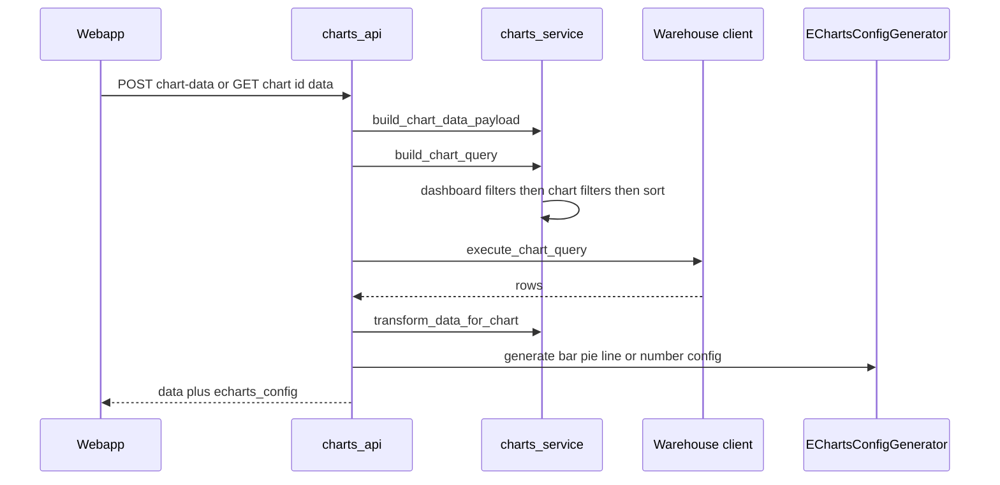
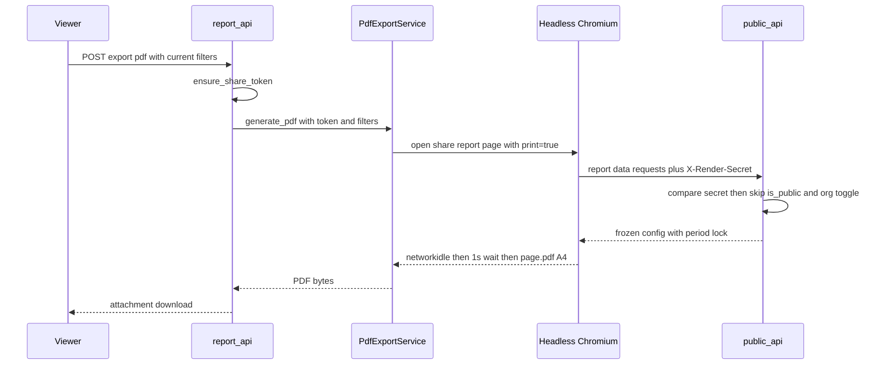

# Charts, dashboards and reports

Dalgo's native visualization stack has three layers that build on each other:

1. **Charts** (`Chart` rows) store a configuration. The backend turns that configuration into a warehouse query, runs it, and returns both the data and a ready-to-render ECharts option object.
2. **Dashboards** (`Dashboard` rows) arrange charts, KPIs and text into tabs and add dashboard-level filters. Charts are referenced by id, not copied.
3. **Reports** (`ReportSnapshot` rows) freeze a dashboard's configuration, lock it to a reporting period, and add an executive summary, threaded comments, PDF export and email sharing.

Dashboards and reports can additionally be exposed to anonymous viewers through **public share links**, served by a separate, unauthenticated API. Superset dashboards are an adjacent integration (see [Superset](#superset-adjacent-integration)).

Related pages: [auth, orgs and permissions](auth-orgs-permissions.md) (who may do what), [metrics, KPIs and alerts](metrics-kpis-alerts.md) (KPIs embedded in dashboards and reports), [warehouses](warehouses.md) (the query target), [webapp](webapp.md) (frontend conventions) and the [NGO pipeline end to end](../workflows/ngo-pipeline-end-to-end.md) workflow.

## Component map

| Concern | Backend | Frontend |
|---|---|---|
| Chart CRUD, data, preview, CSV, maps | [`api/charts_api.py`](../../backend/ddpui/api/charts_api.py), `services/chart_service.py` | `components/charts/` (builder, per-type customizations, preview, export), `app/charts/` |
| Query + config generation | [`core/charts/charts_service.py`](../../backend/ddpui/core/charts/charts_service.py), [`echarts_config_generator.py`](../../backend/ddpui/core/charts/echarts_config_generator.py), `maps_service.py`, `pivot_service.py`, `pivot_transform.py` | per-type renderers, `components/charts/pivot-table/`, `components/charts/map/` |
| Dashboards | [`api/dashboard_native_api.py`](../../backend/ddpui/api/dashboard_native_api.py), [`services/dashboard_service.py`](../../backend/ddpui/services/dashboard_service.py), [`models/dashboard.py`](../../backend/ddpui/models/dashboard.py) | `components/dashboard/` (builder v2, native view, filter panel), `app/dashboards/` |
| Filter metadata and previews | [`api/filter_api.py`](../../backend/ddpui/api/filter_api.py) | `components/dashboard/unified-filters-panel.tsx`, `lib/dashboard-filter-utils.ts` |
| Public (anonymous) access | [`api/public_api.py`](../../backend/ddpui/api/public_api.py), share-mode toggle in `api/access_api.py` | `app/share/dashboard/[token]`, `app/share/report/[token]`, legacy `app/public/dashboard/[token]` |
| Reports | [`api/report_api.py`](../../backend/ddpui/api/report_api.py), `core/reports/` (`report_service`, `comment_service`, `mention_service`, `pdf_export_service`), [`celeryworkers/report_tasks.py`](../../backend/ddpui/celeryworkers/report_tasks.py), [`models/report.py`](../../backend/ddpui/models/report.py) | `components/reports/`, `app/reports/` |
| Superset | `api/superset_api.py`, `services/superset_service.py` | `components/dashboard/superset-embed.tsx` |

Routers are mounted in `routes.py`: `/api/charts/`, `/api/dashboards/`, `/api/filters/`, `/api/reports/` and `/api/superset/` on the authenticated API, and `/api/v1/public/` on a second API object. The authenticated API uses `CustomJwtAuthMiddleware` as its default `auth`; the public API object has no auth at all.

## Charts

### Stored model

`Chart` (`models/visualization.py`) holds `chart_type` (`bar`, `pie`, `line`, `number`, `map`, `table`, `pivot_table`), a `schema_name`/`table_name` data source, and an `extra_config` JSON blob carrying everything else (columns, metrics, filters, sort, pagination, customizations, pivot and map settings). `computation_type` is deprecated and kept only for old rows. `is_private` plus the resource-sharing tables control visibility.

### From configuration to data and ECharts option

`generate_chart_data_and_config` in `charts_api.py` is the single funnel used by live charts, chart previews, dashboards, reports and public endpoints. It branches on chart type:

- **`map`** goes to `generate_map_data_and_config` (below).
- **`pivot_table`** short-circuits to `get_pivot_table_data` and returns `echarts_config: {}` - the frontend renders pivots itself.
- **`table`** builds a query and returns transformed rows with an empty `echarts_config`.
- **`bar`, `pie`, `line`, `number`** run the query, call `transform_data_for_chart`, then dispatch to the matching `EChartsConfigGenerator.generate_*_config` static method.

Stored charts enter this funnel through `charts_service.build_chart_data_payload`, which maps `extra_config` keys (`x_axis_column`, `dimension_columns`, `metrics`, pivot dimensions and so on) onto a `ChartDataPayload`. It is documented as the common builder for dashboards and reports, and it resolves `saved_metric_id` references to inline metric definitions from the `Metric` model (silently skipping ids that no longer exist).

Caption: authenticated request path for a non-map, non-pivot chart; maps and pivots take their own branches.

`build_chart_query` composes an `AggQueryBuilder` query. Filters are layered in a fixed order: dashboard filters (`apply_dashboard_filters`), then chart-level filters from `extra_config["filters"]` (`apply_chart_filters`), then sorting. Notable behaviours of `apply_chart_filters`: several `equals` values on the same column are OR-ed (several `not_equals` are AND-ed), and a date-only value compared to a timestamp column is expanded to a full-day range. Bar/line charts go through `build_multi_metric_query`; number and pie charts use the first metric only; table charts may run without metrics (a plain column select). Metrics can be inline expressions (`column_expression`) as well as `column` + `aggregation`. Time grains are applied with warehouse-specific SQL (`apply_time_grain`, Postgres vs BigQuery).

`EChartsConfigGenerator` is pure Python that builds ECharts option dicts from the transformed data plus the chart's `customizations` (orientation, stacking, legends, number format, color scheme and so on). Number charts are rendered as a gauge series with a custom detail formatter. The same class also builds KPI trendline configs (`generate_kpi_trend_config`), which is how [KPIs](metrics-kpis-alerts.md) reuse it.

### Maps

Map charts need two separate inputs: geometry and values.

- **Geometry** is a `GeoJSON` row linked to a `GeoRegion`. A chart may use default GeoJSONs or ones owned by its own org; `/api/charts/map-data/` rejects other orgs' non-default GeoJSONs with 403. Region, child-region and GeoJSON listing endpoints support drill-down hierarchies (`/regions/`, `/regions/{id}/children/`, `/regions/{id}/geojsons/`).
- **Values** come from `build_map_query`, which reuses the bar-chart query path with the geographic column as the dimension (so filters, sorting and metrics behave identically). `transform_data_for_map` then joins results to GeoJSON features by lower-cased, trimmed region name against each feature's `properties.name`, and reports `matched_regions` / `total_regions`. A region with no data gets value 0 and is not counted as matched.
- `generate_map_config` emits a normal ECharts map series plus two non-standard keys, `mapData` and `mapName`, which the frontend must register with ECharts before rendering.
- `/api/charts/map-data-overlay/` returns the values separately from the GeoJSON so the frontend can fetch geometry once and re-query values when filters change.

`webapp/hooks/useCascadingFilters.ts` is **not** the dashboard dependent-filter mechanism. It belongs to the chart builder's multi-layer drill-down maps (used by `components/charts/map/MultiSelectLayerCard.tsx`): it narrows the selectable child regions of a layer using the chart's own filters, entirely client-side.

### Pivot tables

`pivot_service.get_pivot_table_data` runs a single `ROLLUP` query (built by `build_pivot_table_query`, with `GROUPING()` flag columns) and hands the flat rows to `pivot_transform.rotate_to_pivot`. That function does not pre-shape a grid: it emits self-describing cells tagged with a `row_kind` (data, row_subtotal, grand_total) and a `col_kind` (leaf, col_subtotal, row_total), plus a canonical, globally sorted column axis computed server-side because only the backend still has native types (for example datetimes). Subtotal and grand-total visibility are chart settings (`show_row_subtotals`, `show_column_grand_total`, ...).

### Chart API surface and access

`charts_api.py` endpoints are guarded by `@has_permission([...])` role permissions (`can_view_charts`, `can_create_charts`, `can_edit_charts`, `can_delete_charts`), and per-chart routes add `@has_access(ResourceType.CHART, AccessLevel.VIEW or EDIT, ...)` for resource-level sharing; see [auth, orgs and permissions](auth-orgs-permissions.md). Updates and deletes write audit-log entries and clear the chart's `ResourceShare`/`AccessRequest` rows on delete. Other notable endpoints: `/chart-data-preview/` (paginated raw preview using the same query), `/download-csv/` (streams pages of 5000 rows), `/{id}/dashboards/` (which dashboards embed this chart), and favorite/unfavorite. The warehouse is the org's first `OrgWarehouse`; if none exists the data endpoints return 404 "Warehouse not configured". `has_schema_access` is a stub that currently allows every schema in the org.

Frontend note (from the webapp rules): chart rendering is ECharts-only, and chart types are mid-migration to a registry-based layout under `components/charts/types/<type>/`; new chart types need a renderer there, a `ChartTypes` entry and a `constants/chart-types.ts` entry.

## Dashboards

### Model

`Dashboard` stores a `tabs` JSON array (each tab has `layout_config` and `components`), grid settings, `filter_layout`, publish flags, public-share fields and an `is_org_default` landing-page flag constrained to one per org. Components are typed `chart`, `text`, `heading` or `kpi` and carry the referenced id under `config.chartId` / `config.kpiId`; `Dashboard.component_ids()` is the shared walker used by reports, KPIs and chat scope. `DashboardFilter` rows (related name `filters`) hold the filter's name, `filter_type` (`value`, `numerical`, `datetime`), source schema/table/column, a `settings` JSON and ordering. `dashboard_type` can be `native` or `superset`.

Because charts are referenced, editing a chart changes every dashboard that embeds it. `DashboardService` and `/api/charts/{id}/dashboards/` support finding those dashboards.

### Editing, locking and duplication

Editing is serialised with a `DashboardLock`: `POST /{id}/lock/` creates a lock that expires after 2 minutes, refreshed by `PUT /{id}/lock/refresh/` and also auto-refreshed when the holder saves. `update_dashboard` rejects saves from anyone other than an unexpired lock holder with HTTP 423, but a save without any lock held is allowed (the lock is cooperative, not a token check on every write). Duplicating a dashboard copies filters (including `dependent_group_id`), remaps filter ids inside `tabs`, and copies widget images, all in one transaction. Dashboard mutations write audit-log entries.

### Applying filters to charts

Filter values live only in the browser. When a chart is fetched, the client sends `dashboard_filters` as a JSON map of `{filter_id: value}`. `DashboardService.resolve_dashboard_filters_for_chart` turns that into resolved filters, and it is the one shared implementation for live dashboards, report snapshots (using the snapshot's frozen filter definitions) and public views:

- Values of `None` and unknown filter ids are skipped.
- A filter applies to a chart only if its column exists in the chart's table (`warehouse_client.column_exists`), so one State filter drives every chart whose table has a `state` column - application is by column name, not by table identity. With no warehouse client it falls back to an exact schema/table match.

### Dependent (cascading) filter groups

A dashboard can have one **dependent group**: a set of categorical filters that narrow each other in every direction (pick a district and state/country shrink too). The product spec and v2 plan live in `harness/features/dependent-filters/` (the plan marks all milestones done and browser-verified).

State and rules:

- Membership is `DashboardFilter.dependent_group_id` (nullable integer). Because a dashboard has at most one group, the value is always `1`; `Dashboard.to_json()` exposes the flat `dependent_group_filter_ids` list.
- `PUT /api/dashboards/{id}/dependent-group/` replaces the whole group through `DashboardService.set_dependent_group`, which validates server-side that every id belongs to the dashboard, every filter is `value` type, and all share one `(schema_name, table_name)`. Fewer than two ids dissolves the group (returns `[]`).
- Invariants are maintained when filters change: deleting a member removes it and dissolves the group if fewer than 2 remain; editing a member so it is no longer categorical or no longer on the same table silently removes it from the group (the frontend then toasts). Updates take row locks to avoid racing `set_dependent_group`.
- Narrowing needs no dedicated endpoint. For each member the frontend (`getGroupNarrowingInfo` in `lib/dashboard-filter-utils.ts`) builds a `constraints` list of `{column, operator: "in", value}` for every *other* member that has a value (exclude-self), JSON-encodes it, and passes it to the existing filter preview endpoint (`/api/filters/preview/`, or the two public variants). The backend validates the shape with `parse_narrowing_constraints` (HTTP 400 on bad JSON or shape), applies it through `apply_chart_filters` in `get_value_filter_options_with_fallback`, and **falls back to the unnarrowed list** if the narrowed query errors (for example a dropped column).
- Selections that become impossible are auto-cleared on the client ("just-changed wins"); Apply still gates when charts update; option lists stay capped (default limit 100).
- Report snapshots freeze `dependent_group_filter_ids` (`ReportService._freeze_dashboard`, and the field is declared on `FrozenDashboardConfig`), so narrowing also works in private and public report views; snapshots created before the feature simply lack the key.

Dashboard-level filters have two further types: `numerical` (range) and `datetime` (start/end, end date made inclusive of the whole day); neither participates in dependent groups in v1.

## Sharing and public links

Visibility is controlled by `PATCH /api/access/{rtype}/{id}/general-access` (`access_api.py`) with modes `private`, `internal` and `public` (public only for dashboards and reports, because only they have `is_public`). Rules enforced there:

- Only the owner, an admin or a user with a direct share can change visibility.
- A nested resource cannot be downgraded below a parent dashboard's visibility.
- Going public is refused with 403 when the org's `OrgPreferences.allow_public_sharing` is off.
- The first time a resource goes public a `public_share_token` is created with `secrets.token_urlsafe(48)`. Leaving public mode only flips `is_public` and records `public_disabled_at`; the token stays dormant and is reused if sharing is re-enabled. The change is audit-logged.
- The share URL is `<FRONTEND_URL>/share/dashboard/<token>` or `/share/report/<token>`.

### Public API vs authenticated API

| | Authenticated API (`/api/...`) | Public API (`/api/v1/public/...`) |
|---|---|---|
| Object | `src_api`, default `CustomJwtAuthMiddleware` | separate `public_api`, no auth |
| Identity | `request.orguser`, org taken from the session | none; org is derived from the token's resource |
| Authorization | `@has_permission` role slugs plus `@has_access` resource sharing | possession of an unguessable token plus the checks below |
| Data returned | anything the user can access | only what the token's dashboard or report implies |
| Errors | HTTP status codes | mostly HTTP 404 with `{error, is_valid: false}` so a bad token and a broken query look alike |

Token resolution is centralised. `_resolve_public_dashboard(token)` returns a dashboard only if `public_share_token` matches, `is_public` is true, and the org has public sharing enabled (an org without a preferences row counts as enabled, so a missing row does not lock everyone out). Turning the org toggle off hides all public links immediately, and turning it on again revives the same tokens. Public report lookup (`_get_public_report_snapshot`) applies the same rule, with one exception described under PDF export. Successful views bump `public_access_count` and `last_public_accessed`.

How the token bounds access, and where it does not:

- Public handlers re-use the same generators as the authenticated path (`generate_chart_data_and_config`, `get_chart_data_table_preview`, `get_chart_data_total_rows`, `execute_map_data_overlay`) but resolve the org and warehouse from the token's resource, never from a caller.
- Public **report** chart, table, total-row and map endpoints read chart definitions from `snapshot.frozen_chart_configs`, inject the snapshot's period lock, and resolve filters against the snapshot's frozen filter list. A caller cannot widen the period or retarget the table.
- Public **map overlay** endpoints (dashboard and report) overwrite `schema_name`, `table_name`, geographic column, value column and metrics from the saved or frozen chart config, so a request body cannot read an arbitrary column.
- Public **dashboard** chart endpoints look charts up by `id` within the dashboard's org (`Chart.objects.filter(id=chart_id, org=dashboard.org)`), and filter definitions are limited to the dashboard's own filters (the map overlay and total-rows handlers are looser about that). They do not verify the chart is placed on that dashboard, so the effective boundary for dashboard links is "charts of the owning org's warehouse reachable through any chart id", not "charts on this dashboard". The KPI endpoint is stricter and returns 404 if the KPI is not a component of the dashboard. Treat this as a boundary to keep in mind when changing public endpoints.
- The public data-preview and total-rows dashboard endpoints accept a `ChartDataPayload` from the request body, and the public filter-preview endpoints take `schema_name`, `table_name` and `column_name` from the query string, so those inputs are caller-influenced within the owning org's warehouse.
- Public region and GeoJSON endpoints expose only default (`is_default=True`) GeoJSONs, not org-owned ones, on the unauthenticated `/regions/...` and `/geojsons/{id}/` routes; the token-scoped `/dashboards/{token}/geojsons/{id}/` route also allows the dashboard org's own GeoJSONs.
- Public views are read-only: `PublicDashboardResponse` blanks `last_modified_by` and lock fields and adds `org_name`, `org_slug` and `org_logo_url` for branding.

On the frontend, `lib/api.ts` provides cookie-less `apiPublicGet`/`apiPublicPost` helpers and ignores auth failures on public pages. `DashboardNativeView` is reused for three contexts through props: internal view, `isPublicMode` with a `publicToken`, and `isReportMode`. Components such as `chart-element-view.tsx`, `lib/dashboard-filter-utils.ts` (`buildFilterPreviewUrl`) and `hooks/api/useKPIs.ts` switch between authenticated URLs and `/api/v1/public/dashboards/<token>/...` or `/api/v1/public/reports/<token>/...` based on those props.

## Reports

### Snapshot model

A `ReportSnapshot` is a **frozen configuration, not frozen data**. Its model docstring says it "stores frozen config - data is queried live with date filter". It has no foreign key to `Dashboard` or `Chart`, so deleting a dashboard or chart does not break existing reports. Stored fields:

- `frozen_dashboard`: dashboard layout, tabs, filter definitions and dependent-group ids at creation time.
- `frozen_chart_configs`: chart configs keyed by chart id, and KPI configs keyed by KPI id (KPIs freeze their metric definition, target, thresholds, display config and the trend `periods` computed at snapshot time).
- `date_column`, `period_start`, `period_end`: the reporting window. Both bounds are optional.
- `summary`, `is_private`, and the same public-share fields as `Dashboard`.

So a report does not live-update when its source dashboard's configuration changes, but chart numbers are re-queried against the warehouse each time the report is opened, restricted to the period.

### Creation and period lock

`ReportService.create_snapshot` validates `period_start <= period_end`, loads the dashboard in the caller's org, and, when a `date_column` is supplied, requires it to match one of the dashboard's datetime filters or else to exist as a datetime column in the warehouse. It then validates the frozen dashboard and each chart/KPI through Pydantic models (`FrozenDashboardConfig`, `FrozenChartConfig`, `FrozenKpiConfig`) before saving and audit-logging. `GET /api/reports/dashboards/{id}/datetime-columns/` discovers candidate columns across the tables the dashboard's charts use.

At view time the period is injected rather than stored in the chart configs:

- `_inject_period_into_chart_configs` appends `greater_than_equal` / `less_than_equal` filters on the date column to every frozen chart on the anchor table, and to charts on other tables whose table has a column of that name. The end bound is made inclusive with `T23:59:59`.
- `_inject_period_into_dashboard_config` marks the matching frozen datetime filter `locked: true` with default start/end dates, moving it first. If no dashboard filter matches (a warehouse-discovered column), it injects a display-only filter with a negative id so the UI can still show the locked range.
- Both inject into deep copies, so the persisted frozen config is never mutated.
- KPI data in a report uses `KPIService.compute_kpi_data` with the period as a date filter only when both period bounds are set and the KPI's metric table is the anchor table.

`get_snapshot_view_data` assembles a dashboard-shaped payload (`dashboard_data`, `report_metadata`, `frozen_chart_configs`) so that the same `DashboardNativeView` renders it.

### Authenticated report API

`/api/reports/` supports list, create, view, per-chart data/map/table endpoints, summary update, delete, PDF export, email sharing and comments. Permission slugs are `can_view_dashboards`, `can_create_dashboards`, `can_edit_dashboards`, `can_delete_dashboards` and `can_share_dashboards`, combined with `@has_access(ResourceType.REPORT, ...)`. Data endpoints rebuild payloads from the frozen config exactly like the public ones, so authenticated and public report views produce the same numbers.

### PDF export

PDF generation uses headless Chromium through Playwright (`PdfExportService.generate_pdf`):

Caption: the PDF is a screenshot-style print of the public report page, authenticated to the backend by a shared secret rather than a public flag.

- The URL is `<frontend>/share/report/<token>?print=true`, plus `&dashboard_filters=<json>` when the viewer had filters applied. The logged URL omits the filter values.
- `ensure_share_token` creates a token if needed **without** making the report public. The render request carries an `X-Render-Secret` header, added to every request the page makes through Playwright route interception, and `_get_public_report_snapshot` accepts it (compared with `hmac.compare_digest` against `settings.RENDER_SECRET`) to bypass both `is_public` and the org's `allow_public_sharing` toggle. If `RENDER_SECRET` is not configured, generation raises `ValueError`.
- In print mode the frontend (`PublicReportView` with `printMode`) renders `PrintLayout` in document flow and sets `data-pdf-ready`, does not fire the public-view analytics event, and the service waits for network idle (30s timeout) plus one second for ECharts canvases. SVG logos are re-rasterised to high-resolution PNG before printing. Output is A4, scale 0.66, with backgrounds.

### Email sharing

`POST /api/reports/{id}/share/email/` queues the Celery task `send_report_email_task`. It ensures a share token, generates one PDF for all recipients, renders the email with the private URL (and the public URL only if the report is actually public), and fans out through `notify_report_shared`, which emails the PDF and creates in-app entries for recipients who are org users. Any exception is logged and swallowed; in the `finally` block, recipients that could not be reached produce an urgent `create_notification` to the sender. The task has no automatic retries.

### Comments and mentions

Comments (`models/comment.py`, `CommentService`) anchor to a snapshot, not to the live dashboard, with target types `summary`, `chart` and `kpi`. Chart and KPI comments require a `target_id` that exists in `frozen_chart_configs`. Mentions arrive as emails from the frontend; `MentionService` keeps only emails that belong to users of the same org, stores them on the comment, and hands off to `notify_mentioned` (in-app row plus email honoring each user's `enable_email_notifications`). Per-user read cursors live in `CommentReadStatus`, and `GET .../comments/states/` computes an icon state per target with one SQL query (priority `mentioned` > `unread` > `read`). Deletion is a hard delete when nobody else has commented in the thread and a soft delete (content cleared, `is_deleted`) otherwise; the author or any user with EDIT access on the report may delete.

### Report scheduling: planned, not built

`harness/features/report-scheduling/v1/` contains only `plan.md` and `research.md` (no `tasks.md`), and nothing in the backend or webapp implements it: there is no `ReportSchedule`, `ScheduleRecipient` or `ScheduleRun` model, no schedule API, and no Celery beat task for reports. The plan (status "Draft v1") proposes an hourly Celery Beat task that finds due schedules, calls `ReportService.create_snapshot` with a rolling period, reuses `PdfExportService` and the email path, retries up to three times and then notifies the creator. It also lists open questions (gating on pipeline success, whether scheduled snapshots are public). The only trace in code is a comment in `PdfExportService.generate_pdf` that `dashboard_filters=None` is the "scheduled/emailed export path"; today the emailed export is the manual share flow above. Do not document or depend on scheduling as a working feature.

## Superset (adjacent integration)

Orgs with a Superset subscription (`Org.viz_url` set) can embed Superset dashboards instead of native ones. `api/superset_api.py` lists dashboards, obtains embed info, and issues short-lived guest tokens, using credentials stored in the secrets manager; `SupersetService` caches access, CSRF and guest tokens in Redis (guest TTL about 4 minutes) and retries on 401. A separate `embed_token/{uuid}/` endpoint serves the Dalgo usage dashboard with a row-level-security clause scoped to the org slug. The frontend component is `components/dashboard/superset-embed.tsx`. None of this shares code with native charts, filters or reports.

## Operations and failure behaviour

- **Warehouse errors** surface as HTTP 400 (validation `ValueError`) or 500 on authenticated chart endpoints, and as 404 with a generic message on public endpoints, so check backend logs when a public chart "disappears".
- **Playwright and `RENDER_SECRET`** must be available in the worker/web environment for PDF export and email sharing; Chromium launches with `--no-sandbox` and related flags.
- **Frontend and backend URLs** for share links, PDF rendering and mention deep links come from `FRONTEND_URL_V2` falling back to `FRONTEND_URL`.
- **Org kill switch**: `allow_public_sharing=false` makes every public dashboard and report token return 404 without deleting tokens.
- Route order matters in `dashboard_native_api.py` and `charts_api.py`: fixed paths such as `/images/`, `/regions/` and `/geojsons/` are registered before `/{id}/` patterns.

## Extension points

- **New chart type**: add it to `CHART_TYPE_CHOICES`, handle it in `build_chart_query`/`transform_data_for_chart`, add a `generate_*_config` method and an entry in the `config_generators` map in `generate_chart_data_and_config` (or a separate branch like maps and pivots), then add the frontend renderer and registry entries. Public and report endpoints pick it up for free only if they go through the shared payload builder.
- **New dashboard component type**: extend `DashboardComponentType` and make sure `Dashboard.component_ids`, `ReportService._freeze_chart_configs` and the public endpoints know how to freeze and serve it, otherwise reports will not contain it.
- **New filter type or dependent-group scope**: touch `DashboardFilterType`, `resolve_dashboard_filters_for_chart`, `apply_dashboard_filters`, the filter preview endpoints (authenticated and both public variants) and `set_dependent_group` validation together.
- **Any change to a public endpoint** must keep deriving org, warehouse and table from the token's resource, and should keep the `_PUBLIC_ORG_FILTER` gate.

## Tests worth knowing

Backend: `tests/api_tests/test_public_report_api.py` and `test_public_dashboard_api.py` (token gating, org toggle, `X-Render-Secret` bypass, narrowed filter previews and fallback, map endpoints using frozen config), `test_filter_api.py`, `test_charts_api.py`, `test_dashboard_native_api.py`, `tests/services/test_dashboard_service.py` (dependent group rules), `tests/core/reports/` (`test_report_service.py`, comment service tests, `test_pdf_export_service.py` with Playwright mocked), `tests/core/charts/test_apply_chart_filters.py`, `test_build_chart_data_payload.py`, and `tests/unit/test_pivot_*`. Frontend: `lib/__tests__/dashboard-filter-group-narrowing.test.ts`, `app/share/**/__tests__/`, and the component `__tests__` folders under `components/charts`, `components/dashboard` and `components/reports`.
