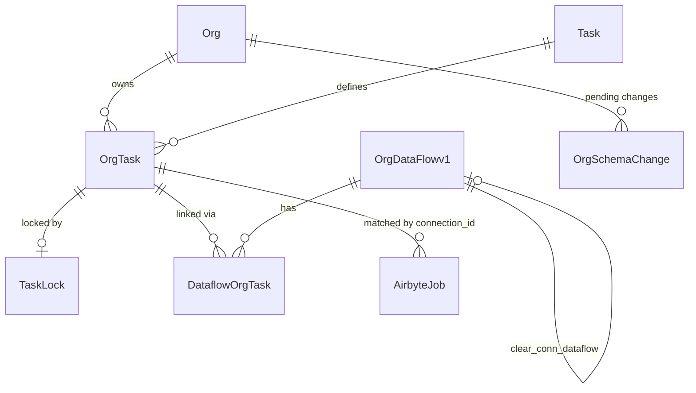
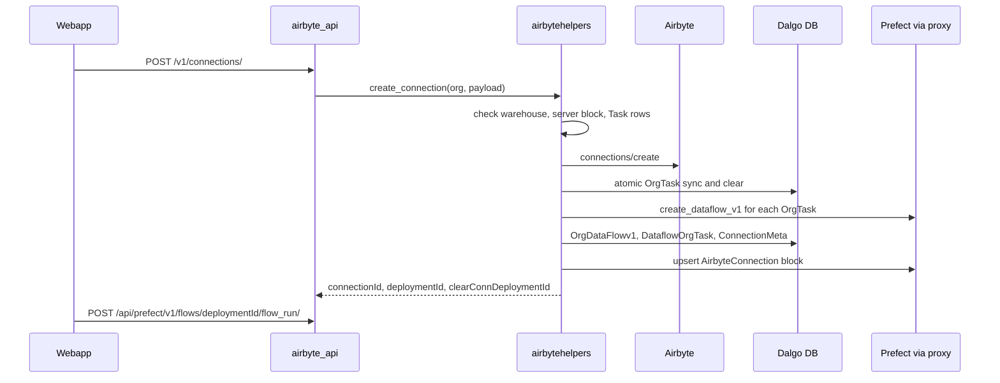
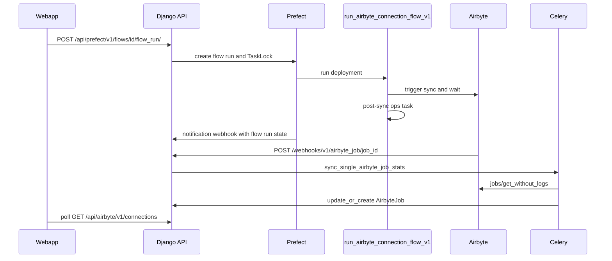

# Ingestion (Airbyte)

Ingestion is the first stage of the Dalgo data path: an NGO configures an Airbyte **source**, Dalgo points the org's **warehouse** at an Airbyte **destination**, and a **connection** moves selected streams from one to the other. Airbyte owns the configuration and the data movement. Dalgo owns org scoping, permissions, audit logs, the database records that link a connection to a Prefect deployment, and run tracking. Orchestration of the actual syncs is covered in [Orchestration](./orchestration.md), the warehouse that receives the data in [Warehouses](./warehouses.md), and the dbt stage that follows in [Transformation](./transformation.md). The whole path is walked through in [NGO pipeline end to end](../workflows/ngo-pipeline-end-to-end.md).

## Responsibilities and layering

| Layer | File | Role |
|---|---|---|
| HTTP API | `backend/ddpui/api/airbyte_api.py` | Ninja router mounted at `/api/airbyte/`. Permission checks (`has_permission`), demo-org guards, audit logs, delegation. |
| Request/response schemas | `backend/ddpui/ddpairbyte/schema.py` | Ninja `Schema` classes (`AirbyteSourceCreate`, `AirbyteConnectionCreate`, `AirbyteConnectionUpdate`, `AirbyteConnectionSchemaUpdateSchedule`, the Google OAuth variants). |
| Airbyte client | `backend/ddpui/ddpairbyte/airbyte_service.py` | Thin wrappers over Airbyte's internal config API. Documented as not touching the Dalgo database. |
| Orchestration helpers | `backend/ddpui/ddpairbyte/airbytehelpers.py` | Functions that use both Airbyte and the Dalgo DB: create/update/list connections, deployments, schema changes, job-stat sync. |
| Deletion | `backend/ddpui/ddpairbyte/deleteconnection.py` | `delete_org_connection`, shared by the API and a Celery cleanup task. |
| Async work | `backend/ddpui/celeryworkers/airbytehelpertasks.py`, `celeryworkers/tasks.py` | Background deletes, catalog reads, job-stat syncs (see [Background work](./background-work.md)). |
| Realtime | `backend/ddpui/websockets/airbyte_consumer.py` | Connection checks and schema discovery pushed over websockets. |
| Execution | `prefect-proxy/proxy/prefect_flows_runner.py`, `prefect-proxy/prefect_airbyte/` | Prefect flows that run syncs and post-sync casts. |
| UI | `webapp/components/{ingest,connections,connectors}`, `webapp/hooks/` | Ingest page, connection form, connector spec-driven forms. |

Each org has exactly one Airbyte workspace (`Org.airbyte_workspace_id`). Nearly every endpoint starts by rejecting orgs with no workspace (`400 "create an airbyte workspace first"`). `POST /api/airbyte/v1/workspace/` creates it via `airbytehelpers.setup_airbyte_workspace_v1`, which also creates (or reuses) a Prefect **Airbyte Server block** named `<org.slug>-airbyte-server` and records it as an `OrgPrefectBlockv1` of type `AIRBYTESERVER`. It then enqueues `add_custom_connectors_to_workspace` to register the custom source definitions from `settings.AIRBYTE_CUSTOM_SOURCES`.

## Talking to Airbyte

`abreq()` in `airbyte_service.py` is the single choke point for every Airbyte call. It builds the URL from `AIRBYTE_SERVER_HOST`, `AIRBYTE_SERVER_PORT`, `AIRBYTE_SERVER_APIVER` and `AIRBYTE_USE_SSL`, authenticates with `Authorization: Basic $AIRBYTE_API_TOKEN`, defaults to a 30 s timeout, and maps failures to `HttpError`. A connection error becomes HTTP 500 and a non-2xx response is re-raised with Airbyte's status code and body. It strips `icon` attributes from logged responses.

Per-call timeouts are tuned to the operation: connection checks are 60 s (sources) or 120 s (destinations), `sources/discover_schema` allows 600 s and always passes `disable_cache: True`, and `get_connection_catalog` takes its timeout from `AIRBYTE_FETCH_CONNECTION_CATALOG_TIMEOUT_SECONDS` (default 300).

Other behaviors worth knowing:

- Source definitions in `settings.AIRBYTE_SOURCE_BLACKLIST` (matched on `dockerRepository`) are filtered out of listings, and `__injected_declarative_manifest` is stripped from specs.
- Demo orgs (`OrgType.DEMO`) have the submitted source config replaced by a whitelisted config (`get_demo_whitelisted_source_config`), and the definitions list is restricted by `DEMO_AIRBYTE_SOURCE_TYPES`. `AIRBYTE_DESTINATION_TYPES` filters destination definitions for everyone.
- Source create and check calls copy any `const` property from the connector spec into the config before sending.
- Listings use `pageSize: 100` with TODOs for real pagination.
- Job history uses `jobs/list`, `jobs/get_without_logs`, `jobs/get_debug_info` and `attempt/get_for_job`. The log reader handles both the older `formatted` log shape and the newer `structured` events.

### The validate-before-external-call rule

Dalgo consistently refuses bad input *before* any Airbyte (or Prefect) side effect happens, at several levels:

1. **Request schema.** Every write endpoint declares a Ninja `Schema` from `ddpairbyte/schema.py` as its payload, so malformed bodies fail with a 4xx before the handler runs. Websocket consumers do the same by hand, instantiating `AirbyteSourceCreate` / `AirbyteDestinationCreate` (or the `...UpdateCheckConnection` variants when an id is present) from the message.
2. **Type guards in the service.** Each `airbyte_service` function checks `isinstance` on its ids, names and config (for example `workspace_id`, `source_id`, `config must be a dictionary`) and raises `HttpError(400)` before calling `abreq`.
3. **Domain validation in `create_connection` / `update_connection`.** At least one stream is required. For `incremental` + `append_dedup` streams a `primaryKey` and `cursorField` must be present, and for plain `incremental` a `cursorField`. These checks run while the sync catalog is being assembled and before `connections/create` or `connections/update` is posted. Column selections are translated to Airbyte's `fieldSelectionEnabled` / `selectedFields`, and a stream with all columns selected turns field selection off.
4. **Helper pre-conditions.** `airbytehelpers.create_connection` confirms the org has an `OrgWarehouse` with an `airbyte_destination_id`, an `AIRBYTESERVER` `OrgPrefectBlockv1`, and the `TASK_AIRBYTESYNC` and `TASK_AIRBYTECLEAR` `Task` rows *before* creating anything in Airbyte. `update_connection` checks the connection belongs to the org (an `OrgTask` exists) and that the Airbyte connection is not deprecated.
5. **Tenant ownership.** Airbyte's `sources/update` is not workspace-scoped, so `update_oauth_source` fetches the source and compares its `workspaceId` with the caller's before updating, to stop cross-org overwrites.
6. **Delete guards.** A source cannot be deleted while any connection uses it (403 listing the connection names). A connection cannot be deleted while an `orchestrate` pipeline uses it (403 listing the pipelines).

Secrets are also kept out of side channels: audit-log `resource_fields` for sources and destinations deliberately omit `config`.

## Data model

The diagram shows how an Airbyte connection is represented in Dalgo's database: two OrgTasks, two manual dataflows, and per-connection lock, schema-change and job rows.

Key records:

- **`OrgTask`** (`models/tasks.py`) has a nullable `connection_id` and the `post_sync_transform` JSON field used by ingest-cast. One Airbyte connection yields a sync `OrgTask` (task slug `TASK_AIRBYTESYNC`) and a clear `OrgTask` (`TASK_AIRBYTECLEAR`).
- **`OrgDataFlowv1`** with `dataflow_type="manual"` is the Prefect deployment record. The sync dataflow points to the clear dataflow through `clear_conn_dataflow`. `DataflowOrgTask` links each dataflow to its `OrgTask`.
- **`TaskLock`** is one-to-one with an `OrgTask` and records who started a run and which `flow_run_id` holds it.
- **`ConnectionMeta`** stores `connection_id` and `connection_name`. It is used for audit logs and kept in sync on rename.
- **`OrgSchemaChange`** stores a pending `breaking` or `non_breaking` change per connection.
- **`AirbyteJob`** (`models/airbyte.py`) mirrors Airbyte jobs. Its primary key is Airbyte's `job_id`, with `job_type`, `config_id` (the connection id), `status`, `reset_config`, `refresh_config`, `stream_stats`, emitted and committed record and byte counts, raw `attempts`, and timestamps. Derived properties give `duration`, `attempt_duration` and `last_attempt_no`. `SyncStats` is an older per-org aggregate table in the same module.

## Connection lifecycle

### Creating a connection

`POST /api/airbyte/v1/connections/` (`can_create_connection`) rejects an empty `streams` list and calls `airbytehelpers.create_connection`:

The diagram shows connection creation from the UI call through Airbyte, the database and Prefect, ending with the UI triggering the first sync.

1. The Airbyte connection is created first. The destination is always the org warehouse's `airbyte_destination_id`; `namespaceDefinition` is `customformat` with the chosen `destinationSchema`, otherwise `destination`. The connection is `manual` schedule only, because Dalgo schedules syncs itself through Prefect.
2. Inside `transaction.atomic()`, a sync `OrgTask` (carrying `post_sync_transform`) and a clear `OrgTask` are created, and `create_airbyte_deployment` runs for each.
3. **Connection to deployment.** `create_airbyte_deployment` names the deployment `manual-<org.slug>-<task.slug>-<8-char hash>`, then calls `prefect_service.create_dataflow_v1`. It passes `deployment_params = {"config": {"org_slug", "tasks": [setup_airbyte_sync_task_config(org_task, server_block).to_json()]}}` and the org's `connection_sync_queue` from `org.get_queue_config()`. The task config (`core/pipelinefunctions.py`) is a `PrefectAirbyteSyncTaskSetup` carrying the task slug, `airbyte_server_block` name, `connection_id`, a timeout (`PREFECT_AIRBYTE_TASKS_TIMEOUT`) and the `orgtask_uuid`. A `OrgDataFlowv1` row (`dataflow_type="manual"`) and a `DataflowOrgTask` link are written.
4. The sync dataflow's `clear_conn_dataflow` is set to the clear dataflow, and `ConnectionMeta` is written.
5. After the transaction, an `AirbyteConnection` **block** named by the connection id is upserted in Prefect through `PUT blocks/airbyte/connection/` on prefect-proxy (`prefect_service.upsert_airbyte_connection_block`). Its `extra` carries the post-sync ops (see ingest-cast). Failure to upsert the block is logged but does not fail the create, because the flow falls back to an inline block.
6. If anything in step 2-4 fails, the Airbyte connection just created is deleted (best-effort compensation) and the user sees "Couldn't create the connection, please try again". There is no distributed transaction, so Airbyte is the thing that gets rolled back by hand.

The response includes `deploymentId` (sync) and `clearConnDeploymentId`. The webapp immediately calls `triggerSync(deploymentId)` as a best-effort first sync.

### Updating, listing, deleting

- **Update** (`PUT /v1/connections/{id}/update`) fetches the live Airbyte connection, rewrites its catalog from the payload, always sets `skipReset = False`, and renames `ConnectionMeta`. It then stores the new `post_sync_transform` on the sync `OrgTask` and re-upserts the connection block so *every* pipeline using the connection picks up changed casts on its next run.
- **List** (`GET /v1/connections`, `airbytehelpers.get_connections`) starts from the org's manual dataflows, pairs each with its sync and clear `OrgTask`, and joins them with Airbyte's `web_backend/connections/list`. Each row gets a `lock` computed by `fetch_orgtask_lock_v1`. A lock is `queued` until its Prefect flow run is `RUNNING`, then `running`, and the lock row is deleted once the flow run reaches a terminal state. `lastRun` comes from the latest `AirbyteJob` per connection (a `RowNumber` window query), not from Prefect.
- **Self-healing.** Connections missing from Airbyte, or with `deprecated` status, are collected and deleted asynchronously by the `delete_airbyte_connections` Celery task. A short-lived Redis key `deleting-<connection_id>` (10 s) prevents two parallel list calls from enqueueing the same cleanup.
- **Delete** (`DELETE /v1/connections/{id}`) runs `delete_org_connection`: refuse if any `orchestrate` pipeline uses it, delete every `OrgTask` for the connection through `delete_orgtask`, delete the Airbyte connection, then delete its `OrgSchemaChange` rows.

### Sources and destinations

Source and destination endpoints are straightforward pass-throughs with permission decorators (`can_view_sources`, `can_create_source`, `can_edit_source`, `can_view_warehouse(s)`, and so on), `check_connection` variants for create and for update, and audit logging. Destinations are normally created through the warehouse flow: `airbytehelpers.create_warehouse` creates the Airbyte destination, stores credentials in the secrets manager, saves an `OrgWarehouse`, and creates the dbt profile secret block. `update_destination` pushes changes to Airbyte then refreshes stored credentials, resolving masked (`*`) values from the previous credentials. See [Warehouses](./warehouses.md).

Google Sheets sources support a managed OAuth path that never exposes the refresh token to the browser:

- `POST /sources/oauth/consent/` builds the Google consent URL and a server-side `state` nonce.
- `GET /sources/oauth/callback` is public (`auth=None`). The nonce is the authentication. It exchanges the code, stashes the refresh token under an opaque `refresh_token_ref`, and redirects back to the frontend carrying only that ref.
- `POST /sources/oauth/picker/` returns Google Picker config (a Drive access token) for a ref the caller owns.
- `POST /sources/oauth/create/` and `PUT /sources/oauth/{source_id}` redeem the ref server-side and merge a backend-built `credentials` block into the config (`_build_oauth_source_config`).

## Schema catalog and schema changes

**Discovering streams for a new connection** uses a websocket. `wss/airbyte/connection/schema_catalog` is routed in `ddpui/urls.py` to `SchemaCatalogConsumer`, alongside `wss/airbyte/source/check_connection` and `wss/airbyte/destination/check_connection`. On a `{"sourceId": ...}` message the consumer:

1. Errors out if the org has no workspace or the payload has no `sourceId`.
2. Looks up a `SingleTaskProgress` entry keyed by the `SOURCE_SCHEMA_CATALOG` prefix, the org slug and the source id. If one exists it just polls it.
3. Otherwise creates the entry (600 s TTL), enqueues `get_schema_catalog_task` (which calls `airbyte_service.get_source_schema_catalog`), and polls.
4. `polling_celery` loops every 2 s while the last status is `RUNNING`, then responds with `SUCCESS` and the catalog result, or `ERROR` for failed or invalid states.

Discovery can take minutes on large sources, which is why it is a Celery task plus websocket instead of a REST call. The webapp's connection form opens this socket only in create mode and sends the source id whenever the source changes. The check-connection consumers call Airbyte inline and respond with `status` and log lines.

**Detecting drift on an existing connection** uses `GET /v1/connections/{id}/catalog`. It starts `get_connection_catalog_task` (progress key built from the `SCHEMA_CHANGE` prefix, org slug and connection id, TTL `SCHEMA_REFRESH_TTL`, default 180 s) and returns a `task_id` that the UI polls at `/api/tasks/stp/{task_id}`. The task calls `fetch_and_update_org_schema_changes`, which asks Airbyte for a refreshed catalog (`web_backend/connections/get` with `withRefreshedCatalog`) and reconciles `OrgSchemaChange`:

- `no_change`, or `non_breaking` with an empty diff, deletes the row.
- `breaking`, or `non_breaking` with transforms, upserts the row.
- If the org's `OrgPreferences.auto_accept_non_breaking_schema_changes` is set, non-breaking diffs are applied immediately with `skipReset=True`, an audit entry (`SCHEMA_CHANGE_AUTO_ACCEPTED`) is written, and the row is removed. If the auto-apply fails, the row is kept and the error returned.

A `schema_change_detection` Celery task runs the same logic across all orgs (with an optional inter-org delay).

**Accepting a change** is `POST /v1/connections/{id}/schema_update/schedule` with the `catalogDiff`. `schedule_update_connection_schema` locks the connection's tasks (`lock_tasks_for_deployment`, which fails with 400 if a lock already exists), then creates a flow run on the sync deployment with a `PrefectAirbyteRefreshSchemaTaskSetup` task (`slug=UPDATE_SCHEMA`). The flow updates the catalog, resets affected streams and re-syncs. The flow run is saved as a `PrefectFlowRun` and its id is stamped onto the locks. If flow-run creation fails, the locks are deleted so the connection is not stuck.

## Running a sync and getting job stats back

Ingestion does not run syncs itself. The webapp calls `POST /api/prefect/v1/flows/{deployment_id}/flow_run/` (in `pipeline_api.py`, `can_run_pipeline`), which goes through `PipelineService.run_pipeline`, creates a `TaskLock`, and submits a Prefect flow run for the deployment. The backend never polls Airbyte for completion. Prefect does, inside the flow.

The diagram shows a sync from trigger through Prefect and Airbyte, and how job statistics flow back into `AirbyteJob` for the UI to read.

Flow body (`prefect-proxy/proxy/prefect_flows_runner.py`, `run_airbyte_connection_flow_v1`):

1. Load the persisted `AirbyteConnection` block named by `connection_id`. If it does not exist (`ValueError`), build an inline `AirbyteConnection` from the server block, with no post-sync ops.
2. `run_connection_sync` (from the vendored `prefect_airbyte` package) triggers the job through Airbyte's **public** API (`POST /api/public/v1/jobs`), polls `GET /api/public/v1/jobs/{id}`, and raises on failure. Status polling retries transient errors with exponential backoff, up to 8 attempts, but not a 404 job-not-found. See `prefect-proxy/prefect_airbyte/CLAUDE.md`.
3. Run the `post-sync-ops` task using `connection_block.extra`.

**Stats return path.** `POST /webhooks/v1/airbyte_job/{job_id}` (`api/webhook_api.py`, mounted under `/webhooks/`) is unauthenticated at the JWT layer (`auth=None`). It instead requires an `X-Notification-Key` header equal to `AIRBYTE_NOTIFICATIONS_WEBHOOK_KEY` and responds 400 `unauthorized` otherwise. It enqueues `sync_single_airbyte_job_stats(int(job_id))`, which calls `airbytehelpers.fetch_and_update_airbyte_job_details`. That function reads `jobs/get_without_logs`, takes the attempt with the highest id as the latest, uses the minimum attempt `createdAt` as `started_at`, and `update_or_create`s an `AirbyteJob` with aggregated and per-stream stats. A job with no attempts, or no `createdAt`, raises.

Two further paths backfill the same table so a missed webhook is not fatal:

- When the Prefect notification webhook (`handle_prefect_webhook`) sees a flow run whose tasks include an Airbyte sync, reset or clear slug, it calls `fetch_and_update_airbyte_jobs_for_all_connections` for that connection over the last 6 hours.
- A nightly Celery beat entry runs `sync_airbyte_job_stats_for_all_connections(last_n_days=2)`. A management command `fetch_and_sync_airbyte_jobs` does the same on demand.

The webapp reads these records for `lastRun` on the list and for `GET /v1/connections/{id}/sync/history`, which pages `AirbyteJob` rows of type `sync` and `reset_connection`. Logs are fetched live from Airbyte (`GET /v1/logs`) and an LLM summary can be requested with `GET /v1/connections/{id}/logsummary`.

Running jobs can be cancelled with `POST /v1/connections/{id}/cancel/{job_type}/`, which cancels the first `running` Airbyte job of that type.

## Post-sync column casts (ingest-cast)

Airbyte often lands numeric Google Sheets columns as strings. Users can choose a "Cast to" type per column when saving a connection, and the cast runs on the raw table after every sync. The design record is in `harness/features/ingest-cast/v1/plan.md`. The shipped shape is the later "M5" revision, which superseded baking SQL into deployment parameters.

- **UI.** `connection-form-body.tsx` shows the cast column only for sources in `CAST_SUPPORTED_SOURCES` (currently `['Google Sheets']`, matched case- and whitespace-insensitively by `isCastSupportedSource`). Types come from `CAST_TYPE_OPTIONS`: numeric, integer, bigint, boolean, date, timestamp, text. Users must confirm column types before saving. `buildPostSyncTransform()` emits `{ops: [{type: "cast", schema, table, config: {column: type}}]}`, or `null` when nothing is cast.
- **Persistence.** The backend stores the payload verbatim in `OrgTask.post_sync_transform` of the sync task. `NULL` means no post-sync work.
- **Block extra.** `build_connection_block_extra` (`core/pipelinefunctions.py`) turns it into `{"env": {"dbt-profile-secret-block": <warehouse secret block>}, "post_sync_ops": [{type, schema, table, column_casts}]}`. Column names are normalized the way Airbyte Destinations V2 does (`[^a-zA-Z0-9_$]` becomes `_`). If the warehouse is missing, or has no `dbt_profile_secret_block`, ops are skipped with a warning. The result is upserted on the `AirbyteConnection` block as `extra` at create and update time. Because the cast config lives on the block rather than on one deployment, every pipeline that includes the connection sees the same, current config.
- **Execution.** After a successful sync, `_run_post_sync_ops` (a Prefect `@task`, `retries=0`) loads the secret block to learn `wtype` and credentials. It builds dialect-specific SQL at run time and executes it: Postgres gets `ALTER TABLE ... ALTER COLUMN ... TYPE ... USING col::type`, and BigQuery gets `CREATE OR REPLACE TABLE ... SELECT * REPLACE (CAST(...))` that re-applies the live table's partition and cluster spec read from table metadata. This is why SQL is generated in prefect-proxy rather than the backend. Unsupported types raise `ValueError`, and unsupported warehouse types are skipped with an error log.
- **Failure semantics.** In `run_airbyte_connection_flow_v1` a post-sync failure is caught and logged ("sync already succeeded"), so the flow returns the sync result. The plan's earlier statement that a cast failure fails the pipeline is no longer true in the code. The failure appears in the `post-sync-ops` task's logs.
- **Analytics.** The UI reports only a boolean `has_post_sync_transform`. Cast contents are warehouse metadata and must not reach PostHog (`connection-cast-analytics.test.ts` guards this).

## Webapp ingest UI

`webapp/.claude/rules/ingest.md` is the domain map. The structure is:

- **Ingest page** (`app/ingest/page.tsx`) renders the redesigned `components/ingest/redesign/ingest-view.tsx`. `selectIngestState` in `state.ts` maps warehouse and source data to `LOADING | ERROR | NO_WAREHOUSE | NO_SOURCE | STEADY`. `ERROR` is checked before the emptiness checks, because a failed fetch otherwise looks like an empty org and would wrongly tell an org with a warehouse to set one up.
- **Sources.** `SourceForm.tsx` and the add-source wizard (`sources/wizard/`) share `hooks/useSourceSave.ts`. It opens `wss/airbyte/source/check_connection` via `useBackendWebSocket`, and only on `status === "succeeded"` calls `createSource`. For Google Sheets it runs `connectGoogleSpreadsheet` (consent, popup, Picker) then `createOAuthSource` with the returned `refresh_token_ref`. The `sources/custom/` registry supplies friendlier forms for Google Sheets and KoboToolbox.
- **Connector config forms.** `components/connectors/spec-parser.ts` parses an Airbyte JSON-Schema connection specification into field groups (ordering by `order`, then required, then title; `oneOf` discriminated by `const` or a single-value `enum`). `ConnectorConfigForm.tsx` and `fields/*` render them, so new connectors need no bespoke UI.
- **Connections.** `connection-form.tsx` is a dialog wrapper around `connection-form-body.tsx`, which the wizard also embeds directly. The body handles create, edit and view modes, discovery over `wss/airbyte/connection/schema_catalog`, stream and column selection through `hooks/useStreamConfig.ts`, validation, and save. `pending-actions.tsx` and `schema-change-form.tsx` handle pending schema changes. `connection-sync-history.tsx` shows history.
- **Polling and locks.** `useConnectionsList` (SWR on `/api/airbyte/v1/connections`) refreshes every 3 s only while some connection has a non-null `lock`, then stops. `useSyncLock` keeps a button in a loading state from the click until the lock goes `null` again, so users get instant feedback before the first poll returns. Pending schema changes are disabled while the connection is locked.
- **IDs.** Config lives in Airbyte (`connectionId`) but runs in Prefect (`deploymentId`). The UI needs both: `connectionId` for config and history, `deploymentId` to trigger a sync.

## Invariants and failure modes

- A connection should have exactly one sync `OrgTask` and one sync dataflow. `get_connections` logs and skips a dataflow with zero or several `OrgTask`s.
- Locks serialize runs. A second run attempt on a locked connection fails with "<email> is running this pipeline right now", and stale locks are cleared by flow-run state handling (`fetch_orgtask_lock_v1` and the `clear_stuck_locks` task).
- Airbyte and the Dalgo DB can drift. Cleanup is eventual (Celery deletion, Redis de-dup). Compensation on create is manual and best-effort.
- Editing a connection always resets it in Airbyte (`skipReset = False`). Accepting schema changes does not trigger a clear or resync.
- A missed Airbyte webhook only delays stats: the Prefect webhook, nightly sync and manual command all backfill `AirbyteJob`.
- Deleting a source or connection that is still referenced is blocked rather than cascaded.

## Configuration

| Variable | Purpose |
|---|---|
| `AIRBYTE_SERVER_HOST`, `AIRBYTE_SERVER_PORT`, `AIRBYTE_SERVER_APIVER`, `AIRBYTE_USE_SSL`, `AIRBYTE_API_TOKEN` | How `abreq` reaches Airbyte. The host and port are also copied into the Prefect Airbyte server block. |
| `AIRBYTE_NOTIFICATIONS_WEBHOOK_KEY` | Shared secret for `POST /webhooks/v1/airbyte_job/{job_id}`. |
| `AIRBYTE_FETCH_CONNECTION_CATALOG_TIMEOUT_SECONDS` | Timeout for refreshed-catalog fetches (default 300). |
| `SCHEMA_REFRESH_TTL` | Task-progress TTL for schema refresh (default 180). |
| `AIRBYTE_DESTINATION_TYPES`, `DEMO_AIRBYTE_SOURCE_TYPES` | Filter destination and demo source definitions. |
| `settings.AIRBYTE_SOURCE_BLACKLIST`, `settings.AIRBYTE_CUSTOM_SOURCES` | Hidden and custom (docker-image) source definitions. |
| `SCHEMA_CHANGE_DETECTION_INTER_ORG_DELAY` | Delay between orgs in periodic drift detection. |

## Extension points

- **A new cast-capable source:** add its definition name to `CAST_SUPPORTED_SOURCES` in `webapp/constants/connections.ts`. The backend path is source-agnostic.
- **A new cast type or warehouse dialect:** extend `POSTGRES_CAST_TYPE_MAP` / `BIGQUERY_CAST_TYPE_MAP` or add a `wtype` branch in `_run_post_sync_ops`, and update `CAST_TYPE_OPTIONS`.
- **A new custom source:** add it to `settings.AIRBYTE_CUSTOM_SOURCES` (`upgrade_custom_sources` reconciles versions) and, for friendlier UX, register it in `components/ingest/sources/custom/registry.tsx`.
- **A new Airbyte endpoint:** add a validated function in `airbyte_service.py` (type guards first, then `abreq`), a helper if the DB is involved, and a permissioned route.

## Tests

- `backend/ddpui/tests/services/test_airbyte_service.py` covers `abreq` error mapping and the input-validation failures of service functions.
- `backend/ddpui/tests/helper/test_airbytehelpers.py` covers connection helpers and `fetch_and_update_airbyte_job_details` (create, update, no attempts, no start time).
- `backend/ddpui/tests/api_tests/test_airbyte_api.py` and `test_airbyte_api_v1.py` cover the routes, and `tests/websockets/test_airbyte_consumer.py` covers the schema catalog consumer.
- `prefect-proxy/tests/test_post_sync_ops.py` and `test_prefect_flows_runner.py` cover cast SQL and the flow wiring. `prefect-proxy/tests/prefect_airbyte/` holds the vendored client tests, which CI runs only when that package changes.
- Webapp: `components/connections/__tests__/` (form, stream table, pending actions, schema-change form, cast analytics), `components/connectors/__tests__/` and `components/ingest/**/__tests__/`.
