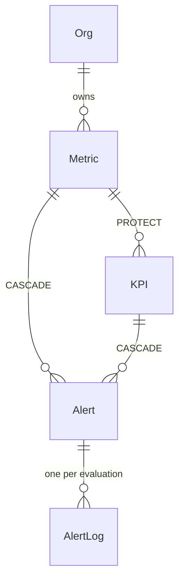
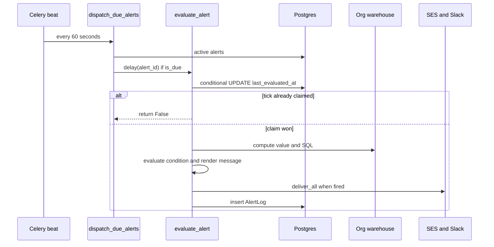

# Metrics, KPIs and alerts

This page covers a small semantic layer over the org warehouse and the alerting engine built on it. A **Metric** is a named, reusable aggregation over one warehouse table. A **KPI** promotes a Metric with a target, direction, RAG bands and a time grain. An **Alert** evaluates a Metric, a KPI or an ad-hoc aggregate on a cron schedule and notifies recipients.

Related pages: [Background work](background-work.md) for Celery, beat and queues. [Charts, dashboards and reports](charts-dashboards-reports.md) for KPI dashboard widgets and report snapshots. [Warehouses](warehouses.md) for the client that runs the SQL. [Feature specs and harness](../concepts/feature-specs-and-harness.md) for how the `harness/features` specs work.

## Responsibilities and layering

Each area follows the usual API → service → model layering. The Ninja routers hold permission checks and audit logging. The `Service` classes hold the rules.

| Area | API | Service | Models |
|---|---|---|---|
| Metrics | `api/metric_api.py` (`/api/metrics/`) | `core/metric/metric_service.py` (`MetricService`) | `Metric` in `models/metric.py` |
| KPIs | `api/kpi_api.py` (`/api/kpis/`) | `core/kpi/kpi_service.py` (`KPIService`, `compute_rag_status`) | `KPI` in `models/metric.py` |
| Alerts | `api/alert_api.py` (`/api/alerts/`, mounted in `routes.py`) | `core/alerts/*` (`AlertService`, `alert_query`, `condition`, `scheduling`, `rendering`, `delivery`) | `Alert`, `AlertLog` in `models/alert.py` |
| Alert tasks | none | `celeryworkers/alert_tasks.py` | `Alert`, `AlertLog` |
| Email notification | none | `core/notifications/triggers/alert.py`, `templates/alert.py` | none |

`api/notifications_api.py` is a different feature: the generic in-app notification feed, with history, unread counts and mark-as-read, backed by `core/notifications/notifications_functions.py`. Alerts reuse only the notifications package's email fan-out and HTML template. A fired alert never creates an in-app bell row. The trigger module's docstring says this is deliberate, because the author picks the delivery channels explicitly.

### Metrics

- A Metric is defined by exactly one of two modes. In Simple mode it is `column` plus `aggregation` (sum, avg, count, min, max or count_distinct). In Calculated mode it is a free-text `column_expression`.
- `MetricService.validate_metric_payload` enforces that exactly one mode is set. It also rejects expressions that are SQL statements, using `sqlparse` to block DML/DDL and multiple statements.
- `validate_metric_query` runs a one-row test query against the org warehouse on create and update. It is skipped when the org has no warehouse. `POST /api/metrics/validate/` exposes the same check without saving.
- Names are unique per org (`unique_metric_name_per_org`).
- Updating a Metric auto-clears the other mode's fields.
- `compute_metric_value_with_sql` builds an `AggQueryBuilder` query, compiles it with literal binds and returns `(value, sql_string)`. Its docstring says it exists so alerts can persist the exact SQL without reimplementing query building.
- `get_metric_consumers` returns `charts`, `kpis` and `alerts`. Charts are found by scanning `Chart.extra_config.metrics[].saved_metric_id`. KPIs and alerts are found by FK.

### KPIs

- `KPI.metric` is a `PROTECT` FK.
- A KPI adds `target_value`, `direction` (increase or decrease), `green_threshold_pct` and `amber_threshold_pct`. It also adds `time_grain`, `time_dimension_column`, tags, `annotations` (JSON notes), `extra_config.customizations` (number format, decimals, prefix and suffix), `is_private` and `display_order`.
- `KPIService._validate_fields` requires green ≥ amber for `increase`. For `decrease` the comparison inverts, so amber ≥ green.
- `compute_rag_status` is a pure function. It returns `None` when the value or target is missing, or when the target is 0.
  - For `increase`: achievement ≥ green gives green, ≥ amber gives amber, otherwise red.
  - For `decrease`: achievement > amber gives red, > green gives amber, otherwise green.
- RAG status is never stored. It is recomputed from the latest period each time.
- `_compute_trend` is the single source of truth for trend queries. It groups by `apply_time_grain` over the time column and returns periods in ascending order.
  - `compute_kpi_data` takes the last period as the current value and attaches an ECharts config.
  - This is also what reports use.
- KPI listing is access-controlled through `accessible_filter` and `has_access`. Metrics are not.
- Annotations are period-keyed JSON entries on the KPI. Only the creator can delete one.
- `KPIService.delete_kpi` refuses to delete a KPI that is placed on a dashboard.

## Alert data model

`Alert` is a single table for all three types (`AlertType`):

- **`metric_threshold`**: FK to `Metric` plus `{operator: lt|gt|eq, value}`.
- **`kpi_rag`**: FK to `KPI` plus `{rag_states: [1 or 2 of red|amber|green]}`.
- **`standalone`**: a `standalone_config` JSON with schema, table, column, aggregation or `column_expression`, and a list of filters. It uses the same threshold condition.

Other fields:

- **Schedule:** `schedule_cron` is a UTC cron string. It is the only schedule state.
- **Delivery:** `delivery_channels` (`email` and/or `slack`), a per-alert `slack_webhook_url`, and one `message_template` shared by both channels.
- **Recipients:** a JSON list of `orguser`, `external` (an email) or `user_group` entries.
- **State:** `is_active` and `last_evaluated_at`.
- **Ownership:** `created_by` and `last_modified_by`.
- **Constraints:** names are unique per org. An index on `(is_active, last_evaluated_at)` supports the dispatcher query.

`Alert.metric` and `Alert.kpi` use `on_delete=CASCADE`. Deleting a KPI silently deletes its alerts and, transitively, their logs. The consumer endpoints list alerts so the UI can warn about this, but alerts never block deletion.

`AlertLog` has one immutable row per evaluation, whether or not it fired. It stores `scheduled_for`, `evaluated_at`, `value`, `fired`, a frozen `alert_snapshot`, the `sql_executed`, the rendered `message`, and a `deliveries` JSON list. The snapshot includes `rag_status`, and an `error` key on failures. There is no separate delivery table. Success, partial or failed status is derived, not stored (`delivery.summarize` on the backend, `AlertLogModal` in the UI).

Caption: how Metrics, KPIs, Alerts and AlertLog reference each other and what happens on delete.

## Evaluation lifecycle

Evaluation is **schedule-driven, not pipeline-triggered**. A 60-second beat tick is the clock. Each alert's cron decides when it is due.

Caption: dispatcher-to-evaluator flow with the atomic claim.

1. `setup_periodic_tasks` in `celeryworkers/tasks.py` registers `dispatch_due_alerts` every 60 seconds. `celery.py` routes `alerts.dispatch_due_alerts` and `alerts.evaluate_alert` to a dedicated `alerts` queue. A worker must consume that queue for alerts to run. See [Background work](background-work.md).
2. The dispatcher loads active alerts with `.only("id", "schedule_cron", "last_evaluated_at")` and calls `scheduling.is_due`. An alert is due when its most recent cron tick (via `croniter`) is later than `last_evaluated_at`, falling back to `created_at`. The `created_at` floor stops a newly created alert from firing immediately for a past tick. Per-alert errors are logged and skipped.
3. `evaluate_alert` (`max_retries=0`) first claims the tick. It runs `UPDATE ... SET last_evaluated_at = now WHERE id AND is_active AND (last_evaluated_at IS NULL OR < scheduled_for)`. Only the worker whose update affects a row proceeds. This makes evaluation idempotent per tick without a lock.
4. The claim happens **before** the warehouse query. A crash after the claim loses that tick's evaluation. The module docstring accepts this at daily, weekly and monthly cadence.
5. `_run_evaluation` calls `alert_query.compute`, which returns `(value, sql, rag_status)`:
   - `metric_threshold` delegates to `MetricService.compute_metric_value_with_sql`, so the alert sees the same number as the Metrics page.
   - `kpi_rag` delegates to `KPIService.compute_latest_value`. This aggregates by the KPI's time grain, takes the most recent period, and derives RAG status. If the KPI has no time column or grain, it falls back to a whole-dataset aggregate.
   - `standalone` builds an `AggQueryBuilder` query from `standalone_config`. Filter operators are `eq`, `neq`, `gt`, `lt`, `gte` and `lte`. Either an aggregation or a `column_expression` is required.
6. `condition.evaluate` decides whether to fire. A `None` value (no rows) never fires. `kpi_rag` is checked against the RAG state. Threshold types are checked as floats with `lt`, `gt` or `eq`.
7. A missing warehouse, or any query exception, is recorded as an `error` in the snapshot with `fired=False`. The task does not crash.
8. The message is rendered on every evaluation, so the log shows what would have been sent. The email subject is hard-coded as `[Dalgo alert] <name>`.
9. Delivery runs only when the alert fired. An `AlertLog` row is always written.

There is no cooldown, de-duplication or state-change logic. The top-level alerts `spec.md` describes pipeline-triggered evaluation with a notification schedule defaulting to "notify on state change". The `v1` spec and plan replace that with a per-alert cron cadence and defer cooldowns and pipeline triggers. The code follows the v1 spec. An alert that stays in a firing state notifies on every scheduled evaluation.

### Rendering

`rendering.render` substitutes `{{token}}` through a regex. The v1 plan chose this over `pystache`, and the code has no Mustache sections or loops. Unknown tokens, and tokens whose value is `None` or empty, are left as raw `{{token}}`. `TOKENS_BY_TYPE` is the closed per-type token set: `alert_name`, `current_value` and `target_value` for all types, plus `metric_name`, `kpi_name` and `rag_status`, or `dataset_name`. The set is mirrored in the webapp's `types/alerts.ts`. For `kpi_rag`, `tokens_for_alert` formats the current and target values through `format_number_v2` using the KPI's `extra_config.customizations`, so email bodies match the KPI card.

### Delivery

`delivery.deliver_all` returns a list of delivery dicts. Each has `channel`, `target`, `status` (sent or failed), `error_reason`, `http_status` and `sent_at`. These are stored in `AlertLog.deliveries`.

- **Email** goes through `notify_alert_recipients` in `core/notifications/triggers/alert.py`. That function expands `orguser` and `user_group` recipients and passes `external` addresses through. It de-duplicates by email address, so a user who is both named and in a group gets one email. Each address is sent separately through SES `send_html_message`, so one failure does not stop the others. Unresolvable recipients are logged as failed deliveries. Group members are expanded at send time through `OrgUserGroupMember`.
- **Slack** is a plain POST of `{"text": body}` to the stored webhook URL, with a 10-second timeout. Any non-2xx response or `RequestException` becomes a failed delivery. Only the raw body is sent, with no HTML shell.

## API surface

`alert_router` endpoints are guarded by `has_permission` with `can_view_alerts`, `can_create_alerts`, `can_edit_alerts` or `can_delete_alerts`:

- **List and create:** `GET /` lists with `page`, `page_size` (default 10; a value below 1 or above 100 is not rejected but silently replaced with 10 in `api/alert_api.py`), `search`, `is_active` and `frequency`. List items include the source label, a pretty condition, a derived frequency label, `last_fire_at` and `fire_streak`. The default order is most recently fired first, with never-fired alerts last. `POST /` creates.
- **Dry-run and webhook test:** `POST /test/` is a dry run through `AlertService.dry_run`. It computes, evaluates and renders without persisting or delivering, and returns errors in the response body. `POST /test-slack-webhook/` posts a fixed test message.
- **Read, update, delete:** `GET`, `PUT` and `DELETE /{id}/`.
- **Toggle:** `PATCH /{id}/toggle/`.
- **Ownership:** `GET /{id}/transfer-candidates/` and `POST /{id}/transfer-ownership/`.
- **History:** `GET /{id}/logs/` is paginated.

Behaviours worth knowing:

- **Route order:** static paths like `/test/` are declared before `/{alert_id}/` on purpose. Django resolves in declaration order, so the reverse would return 405.
- **Validation:** create and update validate the cron (via `croniter`), the condition shape, the single-source rule per type, the channels (Slack needs a webhook URL) and the recipients. Recipients and the Metric or KPI must belong to the caller's org. `alert_type` is immutable.
- **Ownership gates:** update, toggle, delete and transfer use `is_creator_or_admin`, so only the owner or an admin can change an alert. A transfer target must be in the org and hold `can_edit_alerts` through their role.
- **Webhook masking:** responses mask the webhook URL as `.../services/****`. The wizard omits `slack_webhook_url` on edit unless the user types a new one.
- **Audit logging:** each mutation writes an audit log entry.
- **Metric endpoints:** `/api/metrics/` has list, create, update and delete, plus `/validate/`, `/{id}/preview/` and `/{id}/consumers/`. Delete returns 409 when charts or KPIs reference the Metric. Alerts do not block it.
- **KPI endpoints:** `/api/kpis/` has CRUD, `/summary/` (batch current value, RAG and period-over-period change), `/{id}/data/` (with `time_grain`, `date_from`, `date_to` and `dashboard_filters` overrides), `/{id}/dashboards/`, `/{id}/consumers/` and the `/notes/` annotation routes.
- **Permissions:** the Metric and KPI endpoints use `can_view_*`, `can_create_*`, `can_edit_*` and `can_delete_*` slugs. The KPI endpoints also apply resource-level `has_access`.

## Webapp surfaces

- **Metrics:** `app/metrics` renders `metrics-library.tsx`, with `metric-form-dialog.tsx`, `MetricPicker.tsx` and `consumer-links.tsx` ("Used by" popovers, loaded lazily per row). The delete dialog distinguishes blocking consumers (charts, KPIs) from cascade consumers (alerts, which only warn). `webapp/.claude/rules/metrics.md` notes that charts, KPIs and metric-threshold alerts are all metric consumers and must emit `metric:metric_used` analytics events with a source.
- **KPIs:** `app/kpis` renders `kpi-page.tsx`, `kpi-card.tsx` (shared with the dashboard widget), `kpi-detail-drawer.tsx` and `kpi-delete-dialog.tsx`. `kpi-form.tsx` is a three-step wizard (`KpiMetricStep`, `KpiSetupStep`, `KpiThresholdsStep`) with inline metric creation. Edit mode opens at step 2 and locks the metric, time column and time grain. KPI data is fetched live from `/api/kpis/{id}/data/`. Inside a report snapshot it comes from `/api/reports/{snapshotId}/kpis/{id}/data/`.
- **Alerts:** `app/alerts/page.tsx` shows a paginated `AlertsTable` with delete, an alert log modal and a transfer-ownership dialog. A `CreateAlertTypeModal` offers three choices: use a KPI, use a metric, or build a custom query. It disables KPI or metric options when none exist. The wizard (`AlertWizardModal`) has three steps. Define (`AlertDefineStep` with `ScheduleField`) collects the source, condition and schedule. Notify (`AlertNotifyStep`) collects channels, the Slack URL with a test button, `RecipientPicker` and `TemplateEditor`. Test (`AlertTestStep`) runs the dry run. The wizard is also opened from the Metrics row menu and the KPI drawer, and those entry points are gated on `can_create_alerts`.
- **Schedules:** the browser converts the author's local frequency (daily, weekly or monthly), day and time into a UTC cron, and converts it back when editing. `derive_frequency_label` reverse-maps only the wizard's cron shapes. Anything else shows as `cron`. DST is not modelled.

## What is actually built

This is based on `tasks.md` files in `harness/features`, checked against the code:

- **Alerts v1** (`alerts/v1/tasks.md`): milestones M1–M5 are all marked complete. They cover the model and CRUD, the wizard, the evaluation engine with dry run, the listing with log modal, and permission and polish work. The last note says validate-spec and PR cleanup were next. Current code has moved past that checkpoint. It adds `user_group` recipients, owner-or-admin gating and ownership transfer, audit logging, KPI-formatted tokens and the `CreateAlertTypeModal`. It no longer has the tasks file's `/firing/` and `recipients/orgusers/` endpoints, nor a Firing tab. The listing is a single table. `tasks.md` also lists Calculated-mode and filter UI for standalone alerts as deferred. The backend supports both.
- **Metrics & KPIs v1** (`metrics_kpis/v1/tasks.md`): all milestones are complete except for a deferred "Create Alert" KPI card menu item, which is superseded by the KPI drawer entry point. Milestone 6 (metric tags) was removed.
- **v1.1** (KPI display formatting, `metrics_kpis/v1.1/tasks.md`): M1 (backend schema and `format_number_v2`) and M2 (frontend) are checked. M3 (freeze customizations into report snapshots) and M4 (formatted alert `{{current_value}}`) are unchecked in the file. The alert formatting is already in `rendering.py`, so the checklist lags the code. `report_schema.py` carries a comment about KPI customizations for snapshots. I did not trace whether the full snapshot freeze is done.
- **v1.2** (`metrics_kpis/v1.2/tasks.md`): all five checklist items (inline metric creation and the three-step KPI wizard) are checked. It is webapp only.

## Operating and extending

- **Deployment:** run the Celery worker on the `alerts` queue and a beat process (RedBeat). Without them nothing is ever evaluated. Delivery needs AWS SES credentials (`ddpui.utils.awsses`). Slack needs only a webhook URL, with no workspace OAuth.
- **New alert type:** add a value to `AlertType`. Then extend:
  - `alert_query.compute` and `compute_from_config`;
  - `condition.validate_condition` and `evaluate`;
  - `rendering.TOKENS_BY_TYPE`, which must match the webapp token list;
  - the `_validate_source` and list-item builders;
  - the wizard.
- **New channel:** add it to `VALID_CHANNELS` and `deliver_all`, and keep the delivery dict shape so the log modal renders it.
- **Query reuse:** put Metric and KPI query logic in their services and call it from `alert_query`. Alerts should not reimplement it.
- **Failure modes:**
  - A deleted or removed recipient shows up as a failed delivery in the log.
  - The warehouse error text lands in `alert_snapshot.error`.
  - An invalid stored cron makes `evaluate_alert` log an error and return `False`.

## Tests

- **Alert engine:** `tests/core/alerts/` holds the engine tests:
  - `test_alert_tasks.py` covers the log written on fire and on no-fire, atomic-claim idempotency (a second call returns `False`), disabled alerts being skipped, warehouse errors being recorded without crashing, and dispatcher enqueueing.
  - `test_scheduling.py`, `test_condition.py`, `test_rendering.py` and `test_delivery.py` cover the pure helpers.
  - `test_recipient_groups.py` covers recipient validation.
  - `test_consumers_extension.py` covers alerts appearing in Metric and KPI consumers.
- **API and services:** `tests/api_tests/test_alert_api.py`, `test_metric_api.py` and `test_kpi_api.py`, and `tests/services/test_metric_service.py` and `test_kpi_service.py`.
- **Webapp:** Jest tests under `components/alerts/__tests__`, `components/kpis/__tests__` and `components/metrics/__tests__`.
