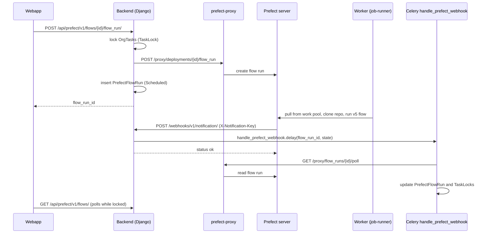

# Orchestration (Prefect, prefect-proxy, webhooks)

Dalgo runs every scheduled or manual data job (Airbyte syncs, git, dbt, Elementary) as a **Prefect deployment**. The Django backend never talks to the Prefect server directly: every call goes through **prefect-proxy**, a small FastAPI service in `prefect-proxy/`. State comes back the other way via a **Prefect notification webhook** that enqueues a Celery task. This page covers that loop end to end. For what each task does, see [Ingestion](ingestion.md) and [Transformation](transformation.md). For the Celery side, see [Background work](background-work.md). For a user-level walk-through, see [NGO pipeline end to end](../workflows/ngo-pipeline-end-to-end.md).

## Components and ownership

| Component | Role |
|---|---|
| `backend/ddpui/api/pipeline_api.py` and `core/orchestrate/pipeline_service.py` | Pipeline (orchestrate) CRUD, run, schedule toggle, history. The API layer maps `PipelineService` exceptions to 400/404/422/500. |
| `backend/ddpui/api/orgtask_api.py` and `core/orgtaskfunctions.py` | Per-org task rows and "manual" transform deployments. |
| `backend/ddpui/core/pipelinefunctions.py` | Builds the per-task config dicts embedded in deployment parameters. Also pipeline lock helpers. |
| `backend/ddpui/ddpprefect/prefect_service.py` | The only HTTP client for prefect-proxy. |
| `prefect-proxy/proxy/main.py` and `service.py` | FastAPI routes under `/proxy/...` that wrap the Prefect API and SDK. |
| `prefect-proxy/proxy/prefect_flows_runner.py` | The flow code that Prefect workers execute (`deployment_schedule_flow_v5`). |
| `backend/ddpui/api/webhook_api.py` and `core/webhooks/webhook_functions.py` | Inbound Prefect notifications, then state sync, locks, retries and failure notifications. |
| `docker/Dockerfile.job-runner` | Worker image for EKS. |
| `prefect-proxy/prefect_airbyte/` | Vendored Airbyte integration used by the flows. |

## The backend reaches Prefect only through prefect-proxy

`prefect_service.py` wraps `requests` in `prefect_get/post/put/patch/delete`. Each call goes to `{PREFECT_PROXY_API_URL}/proxy/{endpoint}`, carries an `x-ddp-org` header taken from the request logger's org slug, and uses a timeout of `PREFECT_HTTP_TIMEOUT` (default 30 s). A connection failure becomes `HttpError(500, "connection error")`. A non-2xx proxy response becomes `HttpError` with the proxy's status and body. Block deletion uses a separate `/delete-a-block/{id}` route. Everything the backend needs is exposed as a named function: deployment create/update/delete/filter, flow-run create/poll/retry/cancel/logs/graph, secret and Airbyte blocks, worker counts and late/long-running runs.

The proxy then talks to the Prefect API (`PREFECT_API_URL`) and the Prefect Python SDK. Its `/proxy/flow_runs/{id}` route recomputes the final state from task runs. That lets a failed `dbt-test` surface as the custom state name `DBT_TEST_FAILED`. The lighter `/poll` route skips that recomputation.

### Deployments

`prefect_service.create_dataflow_v1` posts to `v1/deployments/` with flow name, deployment name, org slug, parameters, optional cron and the work pool and queue taken from the org's `QueueDetailsSchema`. In the proxy, `post_deployment_v1` does the following:

- It builds the deployment from `flow.from_source` against the GitHub repo `DalgoT4D/dalgo.git`, branch `PREFECT_PROXY_GIT_BRANCH` (default `main`), sparse directory `prefect-proxy`.
- It uses the entrypoint `prefect-proxy/proxy/prefect_flows_runner.py:deployment_schedule_flow_v5` with `build=False, push=False`.
- It tags the deployment with the org slug, defaulting to work queue `ddp` and pool `default-agent-pool`.
- It adds an active `CronSchedule` when a cron is provided.

Workers therefore fetch the flow code from git at run time. This is also why `prefect_airbyte` could be vendored into the monorepo instead of installed in the image.

## Data model

- **`Task`**: master catalogue of operations (`type` is dbt/git/edr/airbyte, `slug`, `command`, `is_system`).
- **`OrgTask`**: a `Task` bound to an org, with `uuid`, optional `connection_id`, `parameters` (flags and options, rendered into a command line by `get_task_parameters()`), `generated_by` (system/client), `dbt` and `post_sync_transform`.
- **`OrgDataFlowv1`**: one Prefect deployment, with `deployment_id`, `cron` and `dataflow_type`. `orchestrate` means a user-built pipeline. `manual` means a Transform-tab deployment.
- **`DataflowOrgTask`**: ordered (`seq`) mapping of a dataflow to its OrgTasks. The deployment parameters hold the full task list. This table is the backend's mirror of it.
- **`TaskLock`**: one-to-one with `OrgTask`, with `flow_run_id`, `locked_by`, `locking_dataflow`. It prevents concurrent runs touching the same tasks.
- **`PrefectFlowRun`**: local cache of flow-run results (`deployment_id`, `flow_run_id`, times, `status`, `state_name`, `retries`, `orguser`). Dashboards read history from this table rather than hitting Prefect each time.

## Building and running a pipeline

1. **Create or update** (`PipelineService.create_pipeline` / `update_pipeline`). Airbyte sync OrgTasks come first, ordered by `seq`. Transform tasks follow. When any dbt task is present, the service auto-prepends `git-clone` (if the scheduled queue's workpool is EKS) or `git-pull`, then `dbt-clean` and `dbt-deps`. Git, `dbt-clean` and `dbt-deps` payloads from the UI are ignored because they are auto-managed. The result is a `config` dict: `{tasks, org_slug, continue_on_sync_failure}`. The deployment is named `pipeline-<slug>-<hash>`, created through the proxy, and mirrored into `OrgDataFlowv1` and `DataflowOrgTask`. On update the mapping rows are deleted and recreated.
2. **Task configs** come from `pipeline_with_orgtasks`, which emits Airbyte sync, git pull/clone shell, or dbt-core payloads. dbt tasks carry `commands` as `"<dbt_binary> <params>"`, `project_dir`, `profiles_dir`, and `env["dbt-profile-secret-block"]`. That env value is the name of the warehouse's Prefect Secret block. If the warehouse has none, a warning is logged and runner-mode deployments will fail.
3. **Manual deployments** (`create_prefect_deployment_for_dbtcore_task`) exist only for `LONG_RUNNING_TASKS`. Each chains git, clean, deps and the primary dbt task, and is stored with `dataflow_type="manual"`.
4. **Run** (`PipelineService.run_pipeline`). `lock_tasks_for_dataflow` fails with 400 if any mapped OrgTask is already locked. Otherwise it creates one `TaskLock` per task atomically. The service then calls the proxy to create a flow run and inserts a `PrefectFlowRun` row in `Scheduled` state attributed to the user. If the proxy call fails, the locks are deleted. On success, the flow-run id is written onto the locks.
5. **Lock status** shown in the UI is derived from the lock's flow run: scheduled/pending is `queued`, running is `running`, anything else is `complete`. A lock held by a different dataflow shows as `locked`. The webapp polls the list every 3 s while any pipeline has a lock.

### What runs on the worker

`deployment_schedule_flow_v5(config)` sorts `config["tasks"]` by `seq` and dispatches each task through `_run_task_runner` by block type and slug (`dbt Core Operation`, `Shell Operation`, `Airbyte Connection` with sync/clear/update-schema). With `continue_on_sync_failure`, all Airbyte syncs run first and errors are collected. A `RuntimeError` is raised after them, so the transform tasks do **not** run. Otherwise tasks run sequentially and fail fast, with a 10 s sleep between tasks.

`dbtjob_v2_runner` loads the Secret block named in `env["dbt-profile-secret-block"]`. It builds a single-output `profiles.yml` in memory (target label fixed to `default`, 4 threads, postgres or bigquery only), writes it to `profiles_dir`, and writes the Postgres root cert if supplied. For each command it drops the leading binary token and runs the worker's own `dbt` with `--profiles-dir` and `--project-dir` via `ShellOperation`. A failing `dbt-test` returns a COMPLETED state named `DBT_TEST_FAILED` instead of failing the run. `MAP_FLOW_RUN_STATE_NAME_TO_TYPE` maps that name to the COMPLETED type. The `generate-edr` shell task also generates an Elementary profile at run time from the same Secret block.

The backend writes this Secret block (`dbt-profile-<org.slug>`, JSON of `wtype`, `default_schema`, `creds`, `extras`) in `create_or_update_dbt_profile_secret_blk` whenever warehouse credentials are saved. The FK on `OrgWarehouse.dbt_profile_secret_block` is the source of truth. A mirrored FK on `OrgDbt` remains for compatibility.

## Webhook-driven state updates

Prefect does not push to Django by itself; a Prefect *notification policy* is configured to POST to `/webhooks/v1/notification/` (see the setup comment in `webhook_api.py`) with an `X-Notification-Key` header and a message of the form `Flow run <name> with id <id> entered state <State>`.

The diagram shows the manual-run path: the backend locks and records the run, the worker executes it, and the state change returns through the webhook to the Celery task.

**Authentication.** The endpoint has `auth=None` and compares the `X-Notification-Key` header with `PREFECT_NOTIFICATIONS_WEBHOOK_KEY`, raising `HttpError(400, "unauthorized")` on mismatch. The comparison is a plain `!=` on `os.getenv`, so a deployment with the variable unset would accept a request without the header. Always set the key. A sibling endpoint, `/webhooks/v1/airbyte_job/{job_id}`, uses `AIRBYTE_NOTIFICATIONS_WEBHOOK_KEY` and enqueues `sync_single_airbyte_job_stats`.

**Request handling.** The view parses `body` as JSON (a flow-run object, recognised when `state.state_details.flow_run_id == id`) or falls back to a regex on the message text to get `(flow_run_id, state)`. If no flow-run id is found it still returns `{"status": "ok"}`, so Prefect never sees errors for unrelated messages. Otherwise it calls `handle_prefect_webhook.delay(flow_run_id, state)` and returns immediately.

**The Celery task** calls `do_handle_prefect_webhook`:

1. Fetch the flow run through the proxy's `/poll` endpoint. Subflows without a `deployment_id` are not tracked in `PrefectFlowRun`.
2. For a deployment run, `update_flow_run_for_deployment`:
   - On a terminal state (Completed, Cancelled, Failed, Crashed), delete `TaskLock` rows for that flow run and upsert `PrefectFlowRun`.
   - On Failed or Crashed, optionally retry. If `PREFECT_RETRY_CRASHED_FLOW_RUNS` is `1` or `true` and `retries < 1`, call the proxy to set the state `AwaitingRetry` 5 minutes ahead, increment `retries`, and suppress the failure notification.
   - On Pending, lock the deployment's tasks as the system user (covers scheduled runs nobody clicked Run for), attach the flow-run id to those locks and upsert the run. If the system user is missing or locking fails, it only logs.
   - On Running, upsert the run.
3. On Failed/Crashed/Completed, resolve the org from `parameters.config.org_slug`. For Failed/Crashed that was not retried, `notify_users_about_failed_run` emails org managers. `orchestrate` dataflows send a generic message. `manual` dataflows list the affected connections or task slugs, and `generate-edr` alone is skipped. Platform admins are also notified when `NOTIFY_PLATFORM_ADMINS_OF_ERRORS` is set, including the failed step detected from the flow-run graph.
4. A `finally` block always runs: for Airbyte sync/reset/clear tasks in the run's config it refreshes Airbyte job history for the last 6 hours for that connection. For failed or crashed runs it enqueues `trigger_log_summarization_for_failed_flow`.

Errors in the main body are caught and logged, so a webhook never raises into Celery for business-logic failures. The lock-release and run-upsert steps therefore depend on the webhook being delivered. A missed webhook leaves a `TaskLock` and a stale `PrefectFlowRun`. For manual-dbt locks, `fetch_orgtask_lock_v1` also self-heals by deleting the lock when the cached run is already terminal.

## Job-runner image

`docker/Dockerfile.job-runner` starts from `prefecthq/prefect:${PREFECT_VERSION}-python3.10-kubernetes` (default 3.6.29). It installs `git` (workers clone the monorepo at run time). It installs all dependencies by exporting `prefect-proxy/pyproject.toml` + `uv.lock` with `uv export --frozen` and `pip install`ing the result. It also creates the `CLIENTDBT_ROOT` mount (`/mnt/appdata/clientdbts`). The build context must be `prefect-proxy/`, and EKS needs `linux/arm64` builds (`docker/README.job-runner.md`). `PREFECT_VERSION` must match the `prefect==` pin. `pyproject.toml` pins `dbt-core==1.10.19`, `dbt-postgres==1.10.2` and `dbt-bigquery==1.10.3` exactly, so every org's dbt project executes on one dbt version on the worker. There are no per-version dbt venvs in the image.

## Vendored prefect_airbyte

`prefect-proxy/prefect_airbyte/` was vendored from an external fork in October 2025. It removes the git dependency from the Docker build and lets the worker's sparse checkout pick it up automatically. It talks to the Airbyte **public** API (`POST /api/public/v1/jobs`, `GET /api/public/v1/jobs/{id}`) instead of the internal v1 API. Its `client.get_job_info` retries transient HTTP and server-health errors with exponential backoff (up to 8 attempts) but not 404 `JobNotFoundException`. Its slow test suite runs in CI only when files under `prefect_airbyte/` or `tests/prefect_airbyte/` change. See `prefect-proxy/prefect_airbyte/CLAUDE.md`.

## prefect-runner-migration: implementation status

`harness/features/prefect-runner-migration/v1/plan.md` proposes moving dbt execution off the deprecated `DbtCoreOperation` / `DbtCliProfile` onto `PrefectDbtRunner` with credentials in a Prefect Secret block. It has no `tasks.md`, so status below is judged from code. The migration is **largely implemented, but in a different shape from the plan**:

| Plan item | Status in code |
|---|---|
| New flow file `proxy/prefect_flows_runner.py` with `deployment_schedule_flow_v5`, old `prefect_flows.py` kept | Done. The new file is fully self-contained rather than re-importing task functions. `prefect_flows.py` still holds `deployment_schedule_flow_v4`. |
| Execute dbt via `PrefectDbtRunner.invoke()` (per-node Prefect tasks) | **Not done as planned.** No code imports `PrefectDbtRunner`. It appears only in docstrings, comments and the README. `dbtjob_v2_runner` runs the worker's `dbt` binary via `ShellOperation`. `dbt`, `shell` and Airbyte tasks are `@flow`s so they appear as subflows, but dbt nodes are not individual tasks. |
| Warehouse credentials in a Prefect Secret block, profile built in prefect-proxy | Done, with different names. The block is `dbt-profile-<slug>`, the FK is `OrgWarehouse.dbt_profile_secret_block` (not `secret_block`) and the value also carries `wtype` and `default_schema`. The env key is `dbt-profile-secret-block`, not three new keys. |
| New proxy endpoints `create_or_update_warehouse_secret_block` / `delete_warehouse_secret_block` | Not added. The backend reuses the generic `/proxy/blocks/secret/` upsert and `delete-a-block`. Warehouse deletion removes the block in `org_cleanup_service.py`. |
| Keep writing the old `DbtCliProfile` block for rollback | Apparently dropped. The backend keeps only a delete helper for legacy CLI-profile blocks ("defensive teardown"). Rollback to v4 relies on the old flow still existing, not on fresh CLI blocks. |
| Cutover by rewriting deployment entrypoints | Done in-repo: `migrate_deployments_to_runner_flow` (`--org`, `--dry-run`, idempotent) patches v4 to v5 through the proxy's entrypoint PATCH route. `backfill_dbt_profile_secret_blocks` and `copy_secret_block_to_warehouse` backfill the Secret block and FKs. New deployments are created on v5 directly. |
| Version pins (`dbt-core 1.10.19`, postgres 1.10.2, bigquery 1.10.3) | Done in `pyproject.toml`. |
| Image: move Dockerfile to `prefect-proxy/docker/`, drop per-version venvs | Partly. The Dockerfile now lives at `docker/Dockerfile.job-runner` (repo-level `docker/`), with no venvs, and installs from `uv.lock` rather than explicit pip pins. `backend/dbt_deps/` no longer exists. |
| Elementary stays on the old path in v1 | Diverged. The runner already generates the Elementary profile (`_prepare_elementary_profile`) from the Secret block. |
| Local verification steps, Elementary 0.22 bump, client dbt-project bumps | No code evidence. These are operational items. |

Practical consequence: treat the Secret-block + v5 flow as the production path. The `PrefectDbtRunner` language in the plan and in some docs describes intent, not current behavior.

## Operations and configuration

- Backend: `PREFECT_PROXY_API_URL`, `PREFECT_HTTP_TIMEOUT`, `PREFECT_NOTIFICATIONS_WEBHOOK_KEY`, `AIRBYTE_NOTIFICATIONS_WEBHOOK_KEY`, `PREFECT_RETRY_CRASHED_FLOW_RUNS`, `NOTIFY_PLATFORM_ADMINS_OF_ERRORS`, `FRONTEND_URL` (used in failure emails).
- prefect-proxy: `PREFECT_API_URL`, `PREFECT_PROXY_GIT_BRANCH`, Sentry settings.
- See [Environment variables](../operations/environment-variables.md) for the full list.
- Queue and workpool names come from the org's queue config (`scheduled_pipeline_queue`, `transform_task_queue`). Constants like `ddp`, `manual-dbt`, `edr`, `scheduled_pipeline` and `airbyte_sync` are in `ddpui/ddpprefect/__init__.py`.

## Extension points and gotchas

- **New task type:** add a `Task` row, a `setup_*_task_config` builder in `pipelinefunctions.py`, a branch in `_run_task_runner`, and a matching proxy-side flow. Block-type names must stay identical in `ddpprefect/__init__.py` and `prefect_flows_runner.py`.
- **Changing flow code:** deployments pull from the git branch at run time and store an `entrypoint`. Renaming a flow requires re-pointing deployments (use the entrypoint PATCH route and a management command like `migrate_deployments_to_runner_flow`).
- **Deployment parameters are the source of truth for what runs.** The `DataflowOrgTask` rows are only a mirror, so any edit must update both. `delete_orgtask` rewrites or deletes deployments that reference the task.
- The webhook handler is idempotent by construction: it upserts `PrefectFlowRun` by `flow_run_id` and deletes locks by `flow_run_id`. Repeated deliveries of the same state are harmless.

## Tests

- Backend: `ddpui/tests/api_tests/test_webhook_api.py` (auth, message parsing, orchestrate/manual notification paths, flow-run times), `tests/core/test_pipelinefunctions.py`, `tests/services/test_prefect_service.py`, `tests/core/test_backfill_dbt_profile_secret_blocks.py`, `tests/helper/test_dbthelpers.py`.
- prefect-proxy: `tests/test_prefect_flows_runner.py` (profile building, dispatch, v5 ordering and tolerance mode), `tests/test_main.py`, `tests/test_service.py`, `tests/test_post_sync_ops.py`, `tests/prefect_airbyte/`. See [Prefect-proxy and AI/LLM service testing](../testing/prefect-proxy-and-ai-llm-service.md).
