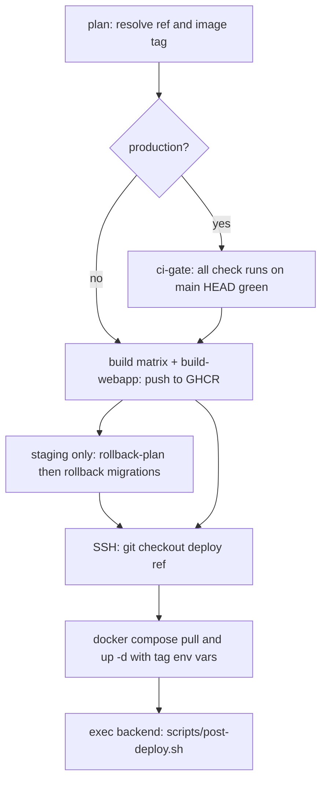

# Platform: Docker, compose and CI/CD

The monorepo ships four deployable services (`backend`, `prefect-proxy`, `webapp`, `ai-llm-service`) plus a separate Prefect **job-runner** image. Everything container-related lives in `docker/`; everything automated lives in `.github/workflows/`. This page explains how the pieces connect. For the Prefect runtime that consumes these images see [Orchestration](orchestration.md); for the variables the containers read see [Environment variables](../operations/environment-variables.md) and [Local services and dependencies](../operations/local-services-and-dependencies.md); for the step-by-step deploy procedure see [Deploy: staging and production](../workflows/deploy-staging-production.md).

## Docker images

All Dockerfiles use the **monorepo root as build context** (compose uses `context: ..`, CI uses `context: .`), so each file copies from its own service directory (`COPY backend/...`). The one exception is the job-runner image (below).

| Image | Dockerfile | Base / shape | Entrypoint |
|---|---|---|---|
| `dalgo-backend` | `docker/Dockerfile.backend` | Two-stage: uv builder on Python 3.10 (bookworm-slim), slim runtime with `git` and `libpq5` | `uvicorn ddpui.asgi:application` on port 8002, one worker |
| `dalgo-prefect-proxy` | `docker/Dockerfile.prefect-proxy` | Two-stage on `python:3.10-slim`, `uv sync --frozen` into `/opt/venv` | `gunicorn proxy.main:app` with 4 uvicorn workers on port 8080 |
| `dalgo-ai-llm` | `docker/Dockerfile.ai-llm-service` | Single stage on `python:3.12-slim`, `uv sync --frozen` | No `CMD`; compose supplies `uvicorn main:app` (port 7001) or the Celery worker command |
| `dalgo-webapp` | `docker/Dockerfile.webapp` | Three-stage Node 20 alpine (deps, builder, runner) producing a Next.js standalone build | `node server.js` on port 3001 as user `nextjs` |
| job-runner | `docker/Dockerfile.job-runner` | `prefecthq/prefect:<version>-python3.10-kubernetes` | Inherited from the Prefect base image |

Notable mechanics:

- **Lockfile-driven builds.** Backend and proxy copy `pyproject.toml` + `uv.lock` first and run `uv sync --frozen --no-install-project`, then copy source and sync again, so the dependency layer is only invalidated by lockfile changes.
- **Pinned UID 1000.** The backend image creates `dalgouser` with UID/GID 1000 deliberately: files written to bind-mounted host directories (`CLIENTDBT_ROOT_MOUNT`, `DEV_SECRETS_HOST_PATH`) get predictable ownership, so those host paths must be `chown`ed to 1000:1000 on servers.
- **Webapp build-time config.** `NEXT_PUBLIC_*` values (backend URL, embedded webapp URL, environment name, Sentry, PostHog, docs URL, Airbyte URL, usage dashboard) are Docker `ARG`s promoted to `ENV` before `npm run build`, so they are **baked into the client bundle**. Changing one requires rebuilding the image; setting them in the container at run time has no effect on the browser bundle. The deps and builder stages are pinned to `$BUILDPLATFORM` so cross-arch builds avoid emulation; only the runner stage targets the final architecture.
- **Dev variants.** `Dockerfile.backend.dev` and `Dockerfile.prefect-proxy.dev` install only the virtualenv and leave `/app` empty for a bind mount, running `uvicorn --reload`. The dev backend stage does not copy source into the image.

### The job-runner image

`docker/Dockerfile.job-runner` builds the image that Prefect work pools (EKS/Kubernetes) use to run flows. Its design points, documented in `docker/README.job-runner.md`:

- **Single source of truth for dependencies.** It copies `prefect-proxy/pyproject.toml` and `uv.lock`, runs `uv export --no-dev --frozen --no-hashes` to a requirements file, and `pip install`s that into the base image's system Python. Bumping dbt, `prefect-dbt` or adapters in `pyproject.toml` flows into the image on the next build with no Dockerfile edit.
- **Build context is `prefect-proxy/`**, not the repo root (`docker build -f docker/Dockerfile.job-runner prefect-proxy/`).
- **`PREFECT_VERSION` build arg** selects the base tag and must match the `prefect==` pin in `pyproject.toml`; otherwise pip upgrades Prefect on top of the base image. Image tags track Prefect upgrades (`0.1` for 3.1.15, `0.2` for 3.6.29).
- **`CLIENTDBT_ROOT`** (default `/mnt/appdata/clientdbts`) is created and exported as the mount point for client dbt projects; the README notes that deployments keep working because this directory layout is preserved.
- **Code is not baked in.** `git` is installed so workers can clone the monorepo at flow-run time (sparse checkout of `prefect-proxy/`); the vendored `prefect_airbyte` package is therefore on the path without being installed in the image. `PrefectDbtRunner` uses the base environment's `dbt-core`; there are no per-version dbt venvs.
- **Architecture.** Production EKS runs ARM nodes, so prod builds use `linux/arm64`; `linux/amd64` is for local x86 testing. The job-runner is built manually (README commands, tagged under the `tech4dev/prefect-eks-job-runner` repository name) and is not built by any workflow in this repo.

## Compose stacks

Three compose files share the project name `dalgo` and a common service set; they differ in how images are obtained and what is mounted.

| | `docker-compose.yml` (production) | `docker-compose.staging.yml` | `docker-compose.dev.yml` |
|---|---|---|---|
| Images | `${REGISTRY}dalgo-*:${*_IMAGE_TAG:-latest}`, builds available | Same as production | Local `dalgo-backend:dev`, `dalgo-ai-llm:dev`, `dalgo-prefect:dev` |
| Source | Baked in, no bind mounts, no hot reload | Same | Bind-mounts `../backend`, `../prefect-proxy`, `../ai-llm-service` with uv cache volumes |
| Postgres | External, configured in each service's `.env` | External | On the host via `host.docker.internal` (`DBHOST` set in compose) |
| Dev secrets | Not mounted | Mounts `DEV_SECRETS_HOST_PATH` at `/secrets` with `DEV_SECRETS_DIR=/secrets` and AWS Secrets Manager disabled | Same mount and flags |
| Redis exposure | Internal only | Internal only | Published on host ports (6370 and 6380 by default) |
| Celery beat | `--scheduler redbeat.RedBeatScheduler` | RedBeat scheduler | Default scheduler |
| Daily-backup worker | Present | Present | Absent |

Staging is described in its own header as identical to production except for the dev-secrets mount, which lets staging resolve secrets backed by `DEV_SECRETS_DIR`.

### Service topology

Common to all three stacks:

- **Two Redis instances.** `redis` serves backend Celery; `redis-llm` serves `ai-llm-service` (broker and result backend set through `CELERY_BROKER_URL`, `CELERY_RESULT_BACKEND`, `CELERY_BROKER`). Both have `redis-cli ping` health checks; backend containers wait for `redis` to be healthy.
- **Backend group.** `backend` (port 8002) plus three Celery workers on separate queues (`default`, `canvas_dbt` with `--autoscale=3,1`, `alerts`) and `celery-beat`. All share one YAML anchor so they use the same image, `backend/.env`, and the same container-networking overrides (`REDIS_HOST`, `PREFECT_PROXY_API_URL=http://prefect-proxy:8080`, `LLM_SERVICE_API_URL=http://ai-llm-service:7001`).
- **Prefect group.** `prefect-server` (port 4200, using the proxy image with a read-only `profiles.toml` mount), `prefect-proxy` (port 8080, `PREFECT_API_URL` pointing at the server), and worker containers for the `ddp` and `manual-dbt` queues in the work pool named by `PREFECT_WORK_POOL` (default `dalgo_work_pool`). Production and staging add a `dailybackup` worker on its own `dailybackup` pool. Workers mount `CLIENTDBT_ROOT_MOUNT` at the same path inside and outside the container.
- **AI group.** `ai-llm-service` (port 7001) and `ai-llm-celery-worker` consuming the `llm` queue.
- **Webapp** (port 3001), built from `Dockerfile.webapp` in all three stacks (dev does not use hot reload for the frontend; the compose comment says to rebuild when code or `webapp/.env` changes).

Design rules visible in the files:

- **Compose holds only container-networking values.** Each service's application configuration lives in its own `.env` (`../backend/.env`, `../prefect-proxy/.env`, `../webapp/.env`, `../ai-llm-service/.env`); compose `environment:` blocks override only hostnames and ports so the same `.env` can be used inside and outside containers. Never place secrets in compose files; `docker/.env.example` documents the compose-level overrides (image tags, host ports, `DEV_SECRETS_HOST_PATH`, `CLIENTDBT_ROOT_MOUNT`).
- **`CLIENTDBT_ROOT_MOUNT` must be identical on host and in containers.** Paths are stored as absolute in Prefect deployments and the Django database, so a differing mount path would break existing deployments.
- **Image tags are parameters.** `REGISTRY`, `BACKEND_IMAGE_TAG`, `PROXY_IMAGE_TAG`, `LLM_IMAGE_TAG` and `WEBAPP_IMAGE_TAG` default to `latest` and are overridden by the deploy workflows. `prefect-server` and all Prefect workers reuse the `dalgo-prefect-proxy` image, so one proxy build covers the proxy, the Prefect server and the workers.
- **Extra hosts.** Backend containers map `host.docker.internal` to the host gateway; production and staging also map the Airbyte abctl service hostname to the host gateway so the backend can reach a Kubernetes-hosted Airbyte on the same machine.

## CI workflows

Per-service CI workflows trigger on `workflow_dispatch`, and on push or pull request to `main` filtered by path (the service directory plus its Dockerfile), so unrelated changes do not run them. Each sets `working-directory` to its service.

| Workflow | Steps | Gates |
|---|---|---|
| `backend.yml` | `uv sync`, `pre-commit run --all-files`, Redis (v6) and a Postgres 15 service container, `manage.py migrate`, `coverage run -m pytest` ignoring `ddpui/tests/integration_tests`, Codecov upload with flag `backend` | `fail_ci_if_error: true`; `coverage report --fail-under=55` |
| `prefect-proxy.yml` | `uv sync`, pre-commit, writes a Google credentials file from a secret, pytest with `--asyncio-mode=auto`, Codecov flag `prefect-proxy` | Coverage threshold 68; the `prefect_airbyte` tests are only run when files under `prefect-proxy/prefect_airbyte/` or its tests changed (via `dorny/paths-filter`) or on manual dispatch |
| `ai-llm-service.yml` | `uv sync --group dev`, pytest with coverage, Codecov flag `ai-llm-service`, then a Docker build that verifies `Dockerfile.ai-llm-service` without pushing | Codecov upload must succeed |
| `webapp.yml` | `npm ci`, Prettier `format:check`, lint, `test:coverage`, Codecov flag `webapp`; on pull requests only, a verify-only Docker build of `Dockerfile.webapp` | No coverage threshold step |

Backend CI supplies throwaway test values (local Postgres, placeholder Airbyte and Django settings) as workflow `env`, not real credentials. The backend and proxy CI jobs do not build their Docker images; image builds are exercised by the AI-LLM CI, by the webapp pull-request CI, and by the deploy workflows.

**Codecov** (`codecov.yml`) disables the aggregate project status and keeps per-flag reporting: one flag per service mapped to its directory, with `carryforward: true` so a service untouched by a commit keeps its last coverage. Patch status is enabled.

### Docs and OpenWiki workflows

- `docs.yml` ("Docs CI/CD") builds the static docs site in `docs/` (Node 20, `yarn install --frozen-lockfile`, `yarn build`) on any change under `docs/`. Only pushes to `main` upload the artifact and deploy to GitHub Pages. The deploy workflows ignore `docs/**` and Markdown changes so a docs-only commit does not redeploy staging.
- `openwiki-update.yml` runs daily at 08:00 UTC and on manual dispatch. It checks out with full history (so `openwiki code --update` can diff against the commit it last documented), installs `openwiki@0.7.2` globally on Node 22 together with the optional `mermaid` and `jsdom` packages (used for high-fidelity Mermaid diagram validation), and runs `openwiki code --update --print` with `continue-on-error`. The run is configured for the Anthropic provider through environment variables: `OPENWIKI_PROVIDER=anthropic`, the `ANTHROPIC_API_KEY` repository secret, `OPENWIKI_MODEL_ID` and `OPENWIKI_TELEMETRY_DISABLED=1`; no LangSmith keys are used. The workflow then deletes the transient `openwiki/.run.json` run-state file, builds the list of paths to stage (`openwiki`, `AGENTS.md` and the workflow file itself, plus `CLAUDE.md` only when it exists, because `git add` on a missing path would stage nothing), and uses `peter-evans/create-pull-request` to open or refresh a PR on branch `openwiki/update` containing those paths. The PR body records the OpenWiki outcome. A failed OpenWiki run still produces a PR preserving completed pages, and then the final step fails the job so the failure stays visible.

## Deploy pipelines

Both deploy workflows follow the same shape: **plan, build images to GHCR, SSH to the server, sync checkout, pull and restart with compose, run post-deploy**. Images are built for `linux/arm64` only (QEMU + Buildx), pushed to `ghcr.io/<lowercased owner>/dalgo-<service>:<tag>`, and use GitHub Actions cache scoped per service. The backend, prefect-proxy and ai-llm images build in a matrix job; the webapp is a separate job because it needs the `NEXT_PUBLIC_*` build args, drawn from GitHub environment variables and secrets of the matching environment (the environment name itself is passed as `staging` or `production`).

Caption: shared deploy flow; the CI gate applies only to production and the rollback step only to staging when another PR previously held it.

### Staging (`deploy-staging.yml`)

Staging is a **single shared environment that holds either `main` or one labeled PR**. Triggers: push to `main` (deploy main), a PR labeled `staging` (deploy that PR's head), `synchronize` on a PR that already carries the label (redeploy), the label being removed (reset to main), and manual dispatch (deploys current `main`). Docs, Markdown, harness and Claude-related paths are ignored. A `staging-deploy` concurrency group serializes runs without cancelling in-flight ones.

- **Tags** are `main-<short-sha>` or `pr-<n>-<short-sha>`.
- **Takeover and rollback.** If another open PR holds the `staging` label, or the label was just removed, that PR's migrations must be undone before the new code runs. `rollback-plan` checks out `main` and computes, per Django app under `backend/ddpui`, the latest numbered migration; the deploy job then runs `manage.py migrate <app> <target>` inside the staging backend container for each app. Targets always derive from `origin/main`, which makes rollback safe across PR rebases and renumbering. Afterwards the previous PR loses its label and receives an explanatory comment, and the deployed PR gets a comment with the image tag.
- **Failure ordering.** The deploy job runs only if both builds succeeded and the rollback plan succeeded or was skipped. Rollback is executed before the checkout sync and compose restart, so older containers apply the downgrade with code that still knows the migrations.
- Compose commands use `-f docker-compose.staging.yml`. There is no CI-green gate for staging.

### Production (`deploy-production.yml`)

Production is **manual-only** (`workflow_dispatch`) and always deploys the current tip of `main`, tagged `prod-<short-sha>`. A `production-deploy` concurrency group serializes runs. The `production` GitHub environment is attached to build and deploy jobs, which is how owner approvals gate it.

- **`ci-gate`** queries every check run on the resolved commit (excluding this workflow's own check suite) and fails if any is still running or concluded anything other than success, skipped or neutral. If no check runs exist it proceeds. A failure while checks are in progress means: retry after they finish. Builds only start after the gate passes.
- **Deploy** uses plain `docker compose pull` / `up -d` (the production file) with `REGISTRY` and the four image-tag variables exported over SSH, after the server checkout is moved to the exact deploy commit. Production has no migration rollback step; schema changes only move forward.

### Post-deploy

Both pipelines finish with `docker compose exec -T backend bash scripts/post-deploy.sh`. The script runs, in order: `manage.py migrate`, `loaddata seed/*.json`, `create-system-orguser`, and `clear_role_permissions` (clears the Redis permission cache). It fails fast (`set -euo pipefail`), so a failed migration stops the remaining steps and fails the deploy job. Creating a first organization and admin user is a separate manual `createorganduser` command.

### Secrets and configuration used structurally

The workflows reference these by name only: `GITHUB_TOKEN` (GHCR login, `gh` CLI), `CODECOV_TOKEN`, `STAGING_SSH_KEY` / `PROD_SSH_KEY` with host, user and deploy-path repository variables (deploy path defaults to `/home/ddp/dalgo`), webapp build-arg secrets and variables, and, for OpenWiki, the `ANTHROPIC_API_KEY` secret (the provider, model id and telemetry flag are plain workflow environment settings). The server logs into GHCR using the workflow token each deploy, so pulls on the host depend on that short-lived login.

## Extending and changing safely

- **Add a service:** create a Dockerfile in `docker/`, add the service to all three compose files (keep the anchors' networking-only `environment` convention), add a matrix entry to both deploy workflows (and an `*_IMAGE_TAG` export plus compose variable), a path-filtered CI workflow, and a Codecov flag in `codecov.yml`.
- **Change a Dockerfile:** the path filters in CI include `docker/Dockerfile.<service>*`, so edits trigger that service's CI; backend and proxy CI will not, however, prove the image builds, so build locally with `docker compose build`.
- **Change a `NEXT_PUBLIC_*` variable:** update the `ARG`/`ENV` pair in `Dockerfile.webapp` and both deploy workflows' `build-args`.
- **Upgrade Prefect or dbt:** change `prefect-proxy/pyproject.toml` and `uv.lock`, rebuild the proxy image and the job-runner image together, and keep `PREFECT_VERSION` aligned with the `prefect==` pin.
- **Migrations and staging:** because staging rolls back to the latest migration on `main`, migrations that cannot be reversed will break the takeover step.
