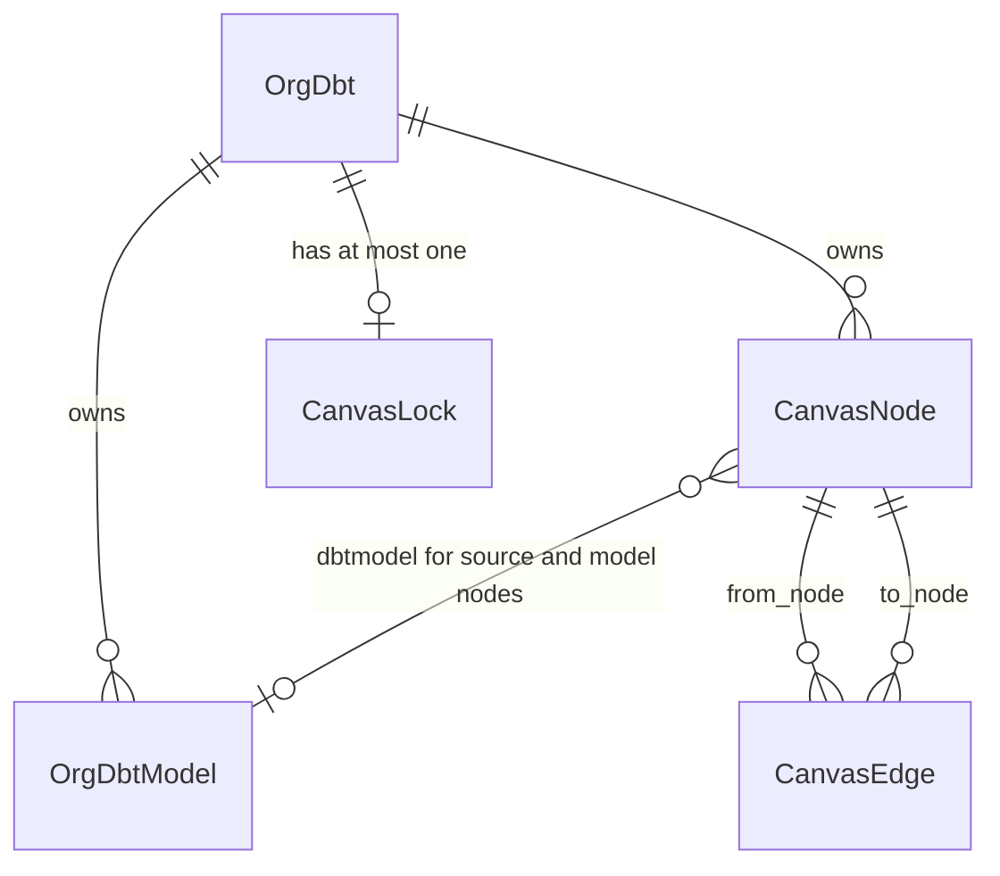
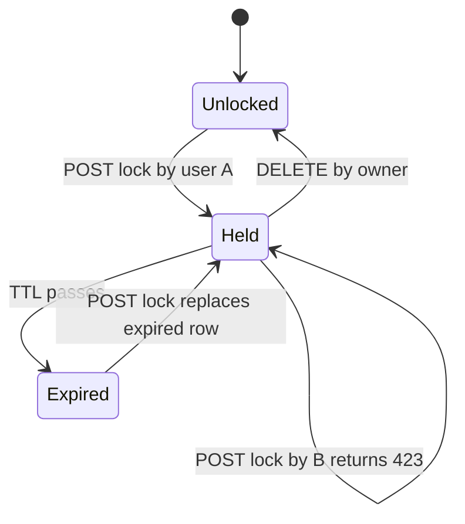
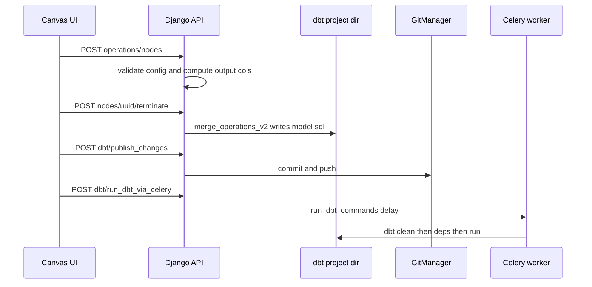

# Transformation (dbt, canvas, UI transform)

Transformation in Dalgo means **one dbt project per org on disk, backed by a git repository**. Two user-facing surfaces sit on top of that project:

- **DBT Transform tab (CLI/git workspace).** Users manage the dbt project as a normal git repository. They run `dbt` commands as Prefect deployments or schedule them in pipelines. Server code: `ddpui/api/dbt_api.py`, `ddpui/ddpdbt/`, `ddpui/core/git_manager.py`, `ddpui/core/orgdbt_manager.py`, plus the OrgTask and Prefect helpers.
- **UI Transform tab (canvas, "UI4T").** Users chain operation nodes on a React Flow canvas. Each chain is compiled into a dbt model SQL file inside the same project. Server code: `ddpui/api/transform_api.py`, `ddpui/core/dbtautomation_service.py`, `ddpui/core/dbt_automation/`, `ddpui/models/canvas_models.py`, `ddpui/models/canvaslock.py`.

The two surfaces share one `OrgDbt` row and one working tree. The canvas only writes `.sql` and source `.yml` files. Git decides what is "published". Prefect and Celery decide when dbt runs. For the scheduler side see [Orchestration](orchestration.md). For Celery see [Background work](background-work.md). For what feeds the sources see [Ingestion](ingestion.md) and [Warehouses](warehouses.md). For the end-user story see [NGO pipeline end to end](../workflows/ngo-pipeline-end-to-end.md).

## The workspace: `OrgDbt`, disk layout, transform types

`OrgDbt` (`ddpui/models/org.py`) is the workspace record. `Org.dbt` points to it.

| Field | Meaning |
|---|---|
| `project_dir` | Path relative to `CLIENTDBT_ROOT` (e.g. `<org.slug>/dbtrepo`) |
| `default_schema`, `target_type` | dbt target schema and warehouse type |
| `transform_type` | `TransformType.UI` (`"ui"`) or `TransformType.GIT` (`"github"`) |
| `gitrepo_url`, `gitrepo_access_token_secret` | Remote repo and key of the PAT in the secrets manager |
| `is_repo_managed_by_system` | True when Dalgo created the GitHub repo |
| `cli_profile_block`, `dbt_profile_secret_block`, `dbtcloud_creds_block` | Prefect block FKs. Only the Secret-block FK is used by the current runner. |

`DbtProjectManager` (`ddpui/core/orgdbt_manager.py`) resolves paths (`CLIENTDBT_ROOT/<org.slug>`, `get_dbt_project_dir`) and shells out to `dbt`. `run_dbt_command` builds the command line from `keyword_args` and `flags`. It uses the `dbt` binary that sits next to the **Django process's own Python** (`sys.executable`), so backend-side dbt (scaffolding, manifest compile, Celery runs) uses the backend's dbt install. Prefect-side dbt uses the worker image. It raises `DbtCommandError` on non-zero exit.

### Managed git is the only creation path

`POST /api/transform/dbt_project/` (`create_dbt_project`, permission `can_create_dbt_workspace`) calls `setup_managed_git_workspace` in `ddpui/ddpdbt/dbt_service.py`. The steps are, in order:

1. Require an `OrgWarehouse`.
2. Create a **private** GitHub repo `dbt-<org.slug>-<ENVIRONMENT>` under `DALGO_GITHUB_ORG` using `DALGO_ORG_ADMIN_PAT` (`GitManager.create_managed_repository`).
3. Store the PAT in the secrets manager and the oauth clone URL in a Prefect Secret block `<slug>-git-pull-url` (`update_github_pat_storage`).
4. Create or update `OrgDbt` with `transform_type=GIT` and `is_repo_managed_by_system=True`.
5. Scaffold the project with `dbt init --skip-profile-setup`, delete `models/example`, and copy `packages.yml` plus the macros from `core/dbt_automation/assets/` (`generate_schema_name.sql`, `unpivot.sql`).
6. `git init`, set the remote, and upsert the `dbt-profile-<slug>` Secret block from the warehouse credentials.
7. Sync `.gitignore` (`target/`, `dbt_packages/`, `profiles/`, `**/profiles.yml`, Elementary artefacts, `.env*`) and commit and push the initial scaffold.

Any failure is re-raised as a generic exception. The code has no rollback beyond what the caller does. On the web side, `Transform.tsx` runs `setupTransformWorkspace('intermediate')`, then `createTransformTasks`, then `syncSources`. If any step throws, it calls `deleteDbtRepo()` and shows a retry screen.

`TransformType.UI` is a legacy value for orgs whose project never had a remote. The command `manage.py migrate_ui_orgs_to_managed_git [--dry-run] [--org-slug]` upgrades such orgs. `ensure_git_pull_orgtasks` backfills the `git-pull` OrgTask for git-enabled workspaces.

`PUT /api/dbt/switch_git_repo/` (`switch_git_repository_v1`) moves a workspace to a user-owned repo:

- It validates access first. A masked PAT (all `*`) reuses the stored PAT.
- If the old repo is Dalgo-managed **and** the new repo has no `dbt_project.yml`, the current tree is pushed to the new remote.
- Otherwise the project directory is deleted and re-cloned from the new remote. This can discard unpublished work.
- In every case all `CanvasNode` rows for the workspace are deleted (edges cascade). The flag `is_repo_managed_by_system` becomes False, and the canvas is rebuilt by the next remote sync.

`DELETE /api/transform/dbt_project/{project_name}` refuses with 422 while any `CanvasNode` exists unless `force_delete=true`. `DELETE /api/dbt/workspace/` delegates to `OrgCleanupService.delete_transformation_layer`. That path tears down Elementary, git/dbt OrgTasks (and refuses if any is used in an orchestrated pipeline), manual deployments, CLI profile and git-pull blocks, the managed GitHub repo, the PAT, the directory, and finally the `OrgDbt` row.

### Warehouse credentials become a dbt profile

`preprocess_airbyte_creds_for_dbt` and `build_profile_dict` (`core/dbtfunctions.py`) translate the warehouse's Airbyte-style credentials into one profile with one output named `default` (4 threads; postgres and bigquery only). Two consumers exist:

- `create_or_update_dbt_profile_secret_blk` (`ddpdbt/dbthelpers.py`) stores `{wtype, default_schema, creds, extras}` as JSON in the Prefect Secret block `dbt-profile-<org.slug>`. It records the block on `OrgWarehouse.dbt_profile_secret_block` and mirrors it onto `OrgDbt`. It is called on workspace creation and by `PUT /api/dbt/v1/schema/` when the default schema changes.
- `write_dbt_profiles_yml` writes `<project>/profiles/profiles.yml` for backend-run dbt (manifest compile, Celery runs). It is intended to match what the Prefect runner writes at flow-run time. `profiles/` is git-ignored, so credentials never reach the repo.

## The canvas data model

The diagram shows how a workspace owns canvas nodes, dbt model records and a single lock row.

- **`CanvasNode`** has `node_type` of `source`, `model` or `operation`. Source and model nodes point at an `OrgDbtModel` (`schema`, `name`, `sql_path`, `source_name`, `output_cols`). Operation nodes carry `operation_config = {"type": <op>, "config": {...}}`. `save()` clears `operation_config` on source and model nodes. `output_cols` caches the columns the node exposes, so forms can offer them as inputs.
- **`CanvasEdge`** is unique per `(from_node, to_node)`. `seq` orders inputs: `seq=1` is the main input and higher values are the extra inputs of multi-input operations.
- **`CanvasLock`** is one-to-one with `OrgDbt`, with `locked_by`, `lock_token` and `expires_at`.
- The older `OrgDbtOperation` and `DbtEdge` models (`models/dbt_workflow.py`) and the v1 helpers in `dbtautomation_service.py` remain. `canvas_models.py` says the new models are meant to replace them. The `/v2/` endpoints use only `CanvasNode` and `CanvasEdge`, plus `OrgDbtModel` for the dbt-side identity.

### Node and edge lifecycle (`transform_api.py`, `/api/transform/v2/dbt_project/…`)

- **Add a source or model node** (`POST models/{uuid}/nodes/`). For a source, `ensure_source_yml_definition_in_project` makes sure a `sources:` entry exists. If none does, it upserts one in `models/sources/sources.yml` with source name equal to the schema name, and the `OrgDbtModel` is repointed at that YAML file. Columns are refreshed from the warehouse. The call is idempotent: an existing node for the same model is returned.
- **Add or edit an operation** (`POST operations/nodes/`, `PUT operations/nodes/{uuid}/`). `validate_operation_config_v2` checks the config against a per-op schema in `op_config_mapping` (aggregate, arithmetic, casewhen, castdatatypes, coalescecolumns, concat, dropcolumns, renamecolumns, flattenjson, generic, groupby, join, unionall, pivot, rawsql, regexextraction, replace, unpivot, where). `join` and `unionall` are the multi-input operations. They need extra inputs, which become additional `CanvasEdge`s with their own `seq`. Output columns come from `get_output_cols_for_operation`. That generates the operation's SQL against the live warehouse client just to learn the columns. Nothing is run or written to disk. The node and edges are created in one `transaction.atomic()`. On edit, the main edge is kept and the non-`seq=1` edges are rebuilt.
- **Terminate a chain into a model** (`POST operations/nodes/{uuid}/terminate/`). `tranverse_graph_and_return_operations_list` walks upstream from the terminal operation and returns the operations in application order. Each gets `as_cte` = `cte1…n`. The first takes the model or source as input, and later ones take the previous CTE. `create_or_update_dbt_model_in_project_v2` calls `merge_operations_v2`, which emits one SQL file: `{{ config(materialized='table', schema='<dest_schema>') }}` followed by a `WITH cte1 as (...) , cte2 as (...) SELECT * FROM cteN`. The file is written under `models/` by `dbtProject.write_model` with a "DO NOT EDIT" header. Then an `OrgDbtModel` (unique by `name`, because dbt `ref()` is name-based), a `MODEL` canvas node and the closing edge are created or updated.
- **Delete a node** (`DELETE nodes/{uuid}/`) also deletes the model's `.sql` file or the source's YAML entry from disk. **Delete a model record** (`DELETE model/{uuid}/`) refuses while a canvas node references it.
- **Graph read** (`GET graph/`) returns all nodes and edges. For git-backed workspaces it also asks `GitManager.get_changed_files_list()` and sets `isPublished` on model nodes. A model is *unpublished* when its `sql_path` (or a parent directory) appears in `git status`.

Invariants:

- A chain is linear. If an operation has more than one upstream operation node, traversal raises `Invalid graph state`.
- Operation inputs from outside the chain must be source or model nodes.
- Model names are unique per workspace.
- Generated SQL files are the source of truth for dbt. The canvas rows are an index and UI state.

### Importing an existing dbt project into the canvas

`POST /v2/dbt_project/sync_remote_dbtproject_to_canvas/` is a no-op unless `transform_type == github`. Otherwise `dbt_service.sync_remote_dbtproject_to_canvas` does `git pull`, runs `dbt deps` and `dbt compile` through `DbtProjectManager` (after `write_dbt_profiles_yml`), reads `target/manifest.json`, and calls `parse_dbt_manifest_to_canvas`. That function runs in a single transaction:

- It upserts an `OrgDbtModel` and a `CanvasNode` for every source and every model of the **user's own package** (dependency packages such as Elementary are filtered out by `package_name`).
- Columns come from the warehouse, and the manifest is the fallback.
- Edges come from `depends_on.nodes`. `_has_operation_chain_between_nodes` (BFS) prevents a direct edge between two nodes already connected through operation nodes, and deletes a stale direct edge.

This is how a hand-written dbt repo and canvas-built models coexist in one DAG. `cleanup_unused_sources` is a helper that removes source YAML entries and nodes that have no edges.

## Canvas lock

The lock is an advisory edit lock per workspace with a 2-minute TTL.

The diagram shows the server-side lifecycle of one `CanvasLock` row for a workspace.

- `POST /dbt_project/canvas/lock/` returns `{lock_token, expires_at, locked_by}`, or 423 if another user holds a live lock. Re-acquiring your own lock extends it. An expired lock is deleted and replaced.
- `PUT …/lock/refresh/` returns 410 if expired and 403 if you are not the owner. `DELETE` returns 403 for non-owners and is idempotent if no lock exists.
- `validate_canvas_lock` (423 if locked by someone else or not locked, 410 if expired; otherwise it extends the TTL) exists, but **only `DELETE /v2/dbt_project/model/{uuid}/` calls it**. The node and operation create/edit/terminate/delete endpoints carry `# TODO: apply canvas locking logic`. Server-side lock enforcement for canvas mutations is therefore incomplete. The UI is the main guard.

On the web side, `useCanvasLock` (mounted by `FlowEditor`) auto-acquires on mount and refreshes every 30 s. It stops refreshing while the tab is hidden and resumes on focus. It releases on unmount, SPA path change, `beforeunload` and `popstate`. The unmount release is guarded by a `hasLockRef` so React 18 Strict Mode's mount-unmount-mount cannot release someone else's lock. A 423 error message (`locked by <email>`) is parsed to show a lock badge and switch to view-only mode. If a refresh reveals the lock was lost, the hook stops refreshing and shows a toast. `transformStore.canInteractWithCanvas()` combines the view-only flag, lock-by-other, `lockUpperSection` (set while a workflow runs), `tempLockCanvas` (set during refresh) and "PAT required while view-only".

## Git integration (publish, pull, status)

`GitManager` (`ddpui/core/git_manager.py`) wraps the `git` CLI through `subprocess` and the GitHub REST API through `requests`. `GitManagerError` carries `message` and `error`. Authentication is by PAT embedded as `https://oauth2:<pat>@…` at push, pull and clone time. Clones reset the remote to the clean URL afterwards.

| Endpoint | Behaviour |
|---|---|
| `GET /api/dbt/git_status/` | `git status --porcelain` parsed into `added`, `modified` and `deleted` lists |
| `POST /api/dbt/publish_changes/` | Rejects an empty commit message. Commits all changes as the requesting user (`git add .`). Pushes **only when `transform_type == github`**. A commit or push failure returns `success: false` with `committed` and `pushed` flags rather than an HTTP error. |
| `POST /api/dbt/git_pull/` | `git pull` of the current branch |
| `GET /api/dbt/dbt_workspace` | Workspace summary. `gitrepo_access_token` is masked to `*********` when the `<slug>-git-pull-url` Secret block exists. |

`useGitIntegration` on the web only treats a missing PAT as blocking for `transform_type === 'github'`. When a PAT is present the canvas syncs the remote project into the canvas on mount. When it is missing, the PAT modal opens and the user can add a PAT (`switch_git_repo`) or stay view-only.

## From transforms to running dbt

Canvas nodes themselves never become Prefect tasks. A published canvas model is a normal `.sql` file in the repo. Anything that runs `dbt run` after a git pull picks it up. There are three execution routes:

The diagram shows canvas edits reaching disk and git, and the Celery run path. Prefect runs are not drawn. They start from a git pull on the worker and are described below.

1. **Canvas "run workflow" (Celery, backend dbt).** `POST /api/dbt/run_dbt_via_celery/` queues `run_dbt_commands`. The task takes a `TaskLock` on the workspace's `dbt-clean`, `dbt-deps` and `dbt-run` OrgTasks as the system user. It writes `profiles.yml`, then runs `dbt clean`, `dbt deps` and `dbt run` with the user's `flags` and `options`. Each output line goes to `TaskProgress` (Redis hash `RUNDBTCMDS-<org.slug>`), and the web hook `useWorkflowExecution` polls it. The locks are released in `finally`. The task re-raises on failure so Celery ends in FAILURE. This runs the **unpublished working tree** in the backend's dbt install.
2. **Manual DBT Transform deployments (Prefect).** `POST /api/prefect/tasks/transform/` calls `create_default_transform_tasks`. It creates a system OrgTask for each `dbt`/`git` Task. For the `LONG_RUNNING_TASKS` (`dbt-run`, `dbt-seed`, `dbt-test`) it calls `create_prefect_deployment_for_dbtcore_task`. That builds a chain of `git-pull` (or `git-clone` when the transform queue's workpool is EKS), `dbt-clean`, `dbt-deps` and the primary task, and renders each step with `pipeline_with_orgtasks`. dbt steps become `PrefectDbtTaskSetup` with `commands=["<dbt_binary> <params>"]`, `project_dir`, `profiles_dir=<project>/profiles/` and `env["dbt-profile-secret-block"]`. Git steps use the `…-git-pull-url` Secret block. The deployment goes to the org's `transform_task_queue` and is saved as `OrgDataFlowv1(dataflow_type="manual")` with one `DataflowOrgTask` per chained step. `GET /api/prefect/tasks/transform/` lists them with their locks. Custom tasks go through `POST /api/prefect/tasks/` (`post_orgtask`), which creates a deployment only for long-running dbt tasks.
3. **Orchestrated pipelines (Prefect).** Pipeline creation reuses the same per-task payloads, auto-prepends the git and clean/deps steps, and mixes them with Airbyte syncs. See [Orchestration](orchestration.md).

Because Prefect workers pull from the **remote**, canvas models take effect in scheduled or manual Prefect runs only after they are published (committed and pushed). Celery runs use the local tree.

The dbt-core version pin and the move from `DbtCoreOperation` to `PrefectDbtRunner` are tracked in the plan at [`harness/features/prefect-runner-migration/v1/plan.md`](../../harness/features/prefect-runner-migration/v1/plan.md). That folder has no `tasks.md`. See [Orchestration](orchestration.md) for how the current runner flow executes dbt.

## `core/dbt_automation`: the SQL generators

`ddpui/core/dbt_automation/operations/` holds one module per operation, plus `mergeoperations.py`, `mergetables.py`, `syncsources.py` and `flattenairbyte.py`. Each operation exposes up to two entry points:

- A `*_sql` function (`where_filter_sql`, `joins_sql`, `groupby_dbt_sql`, …) that takes `config` (with `source_columns` and `input`) and a warehouse client and returns `(select_sql, output_cols)`. `source_or_ref` renders the input as `{{ source(...) }}`, `{{ ref(...) }}` or a CTE name.
- A legacy function that writes a model file directly.

`dbtautomation_service.OPERATIONS_DICT` and `OPERATIONS_DICT_SQL` map operation names to these functions. The merge step in `mergeoperations.py` is a hand-written `if/elif` chain over operation type. Adding an operation therefore needs these touch points: the generator module, the dispatch chain in `merge_operations_sql_v2`, the Pydantic schema in `op_config_mapping`, and the frontend form under `components/transform/ui-transform/canvas/forms/`. `utils/` has `dbtproject.py` (models and sources paths, write and delete), `dbtsources.py` (read sources from YAML), `columnutils.py` and `tableutils.py`.

`dbtautomation_service` talks to the warehouse through the older `utils/warehouse/old_client` factory (`get_client`). `dbt_service` manifest parsing uses `WarehouseFactory` from `utils/warehouse/client`. See [Warehouses](warehouses.md).

`sync_sources_for_warehouse_v2` is a Celery task started by `POST /dbt_project/sync_sources/`. It walks every schema and table of the warehouse and creates an `OrgDbtModel(type=SOURCE)` for any table not already known. It refreshes columns for known ones and reports progress through `TaskProgress` (`SYNCSOURCES-<slug>`, 10-minute expiry). It does **not** edit `sources.yml`. YAML entries are written lazily when a source is first added to the canvas.

## Frontend map

`app/transform` renders `components/transform/Transform.tsx`. It has two tabs, `UITransformTab` (canvas) and `DBTTransformTab` (task list and `CreateTaskDialog`), and persists the last tab as a user preference. The canvas page renders `ui-transform/canvas/layout/FlowEditor.tsx`.

- `hooks/api/useCanvasGraph.ts` fetches `/api/transform/v2/dbt_project/graph/` through SWR. It can also post the remote-sync endpoint (`syncAndRefresh`), and it exports `CANVAS_GRAPH_KEY` for cache invalidation.
- `hooks/api/useCanvasOperations.ts` wraps the node, operation, terminate and delete calls. `createOperation` does not refresh the graph. The caller positions the node first and then refreshes.
- `stores/transformStore.ts` (Zustand) holds the selected node, a `canvasAction` event bus, lock and view-only state, modal flags (`PublishModal`, `PatRequiredModal`, run-workflow modal), workflow-run state and `dbtRunLogs`.
- `webapp/.claude/rules/transform.md` is the domain map for the feature, including the polling-pauses-on-hidden-tab caveat.

## Operations and failure modes

- Environment: `CLIENTDBT_ROOT` (workspace root), `DALGO_GITHUB_ORG`, `DALGO_ORG_ADMIN_PAT` and `ENVIRONMENT` (managed repo creation). Missing GitHub variables fail workspace creation.
- A missed or failed git push leaves the repo ahead of the remote. Prefect runs then use stale code. `git_status` and the `isPublished` flag are the user-visible signals.
- Lock rows do not self-clean beyond expiry. An abandoned lock blocks other users for up to 2 minutes (the UI refreshes every 30 s).
- Many canvas endpoints return a 500 that wraps the exception text. Validation problems (bad op config) surface as 422.
- Audit logs (`AuditLogResourceType.DBT`) are written for workspace, node, git and run actions.

## Tests worth reading

- `ddpui/tests/api_tests/test_transform_api.py`: lock endpoints, workspace delete guards, node, operation and terminate flows.
- `ddpui/tests/api_tests/test_dbt_api.py`: git and publish endpoints.
- `ddpui/tests/services/dbt_service/`: managed workspace setup, scaffolding, manifest parsing into the canvas, repo switching, PAT storage and workspace deletion.
- `ddpui/tests/services/test_dbtautomation_service.py` and `tests/core/dbt_automation/`: graph traversal, sources, project helpers.
- `ddpui/tests/core/test_git_manager.py`, `test_dbtfunctions.py`, `tests/helper/test_dbthelpers.py`: git wrapper, profile building, Secret block upsert.
- Web: `components/transform/ui-transform/canvas/__tests__/` (modals, canvas mock data) and `components/transform/dbt-transform/__tests__/`.
