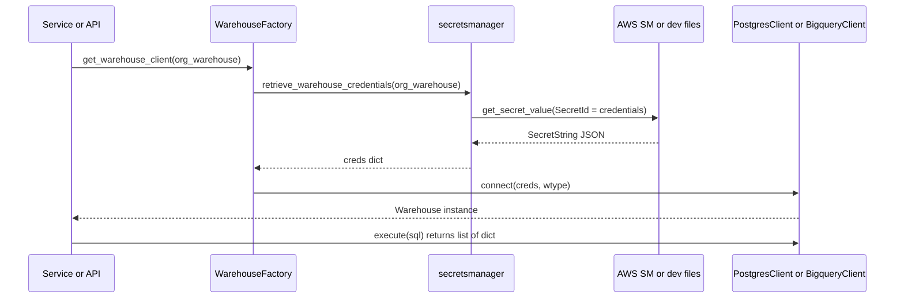
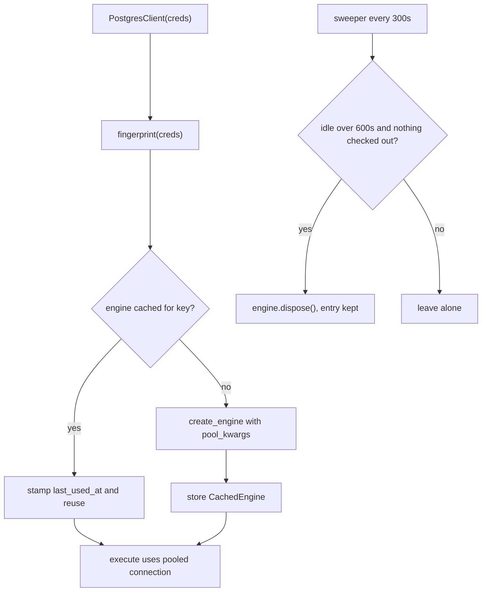

# Warehouses

Each organization has (typically) one client data warehouse, modelled as `OrgWarehouse`. Features that read client data (charts, dashboards, reports, KPIs, metrics, alerts, data insights, the AI chat agent, warehouse exploration) talk to it through one abstraction in `backend/ddpui/utils/warehouse/client/`. This page covers that abstraction, how credentials reach it, its connection pooling, and its consumers.

> **Rule:** obtain a warehouse with `WarehouseFactory.get_warehouse_client(org_warehouse)`. Never import from `ddpui.utils.warehouse.old_client` in new code. See [The legacy `old_client`](#the-legacy-old_client).

## Core pieces

| Piece | Role |
| --- | --- |
| `OrgWarehouse` (`models/org.py`) | One row per org (`org` is a unique FK). Holds `wtype` (`postgres` or `bigquery`), `bq_location`, Airbyte destination metadata, and `credentials`, which is a **Secrets Manager secret id, not the credentials**. |
| `WarehouseFactory` | Resolves credentials and returns the right concrete client. |
| `Warehouse` ABC / `WarehouseType` | The interface and the two supported types. |
| `PostgresClient`, `BigqueryClient` | SQLAlchemy-based concrete clients. |
| `postgres_engine_registry` | Process-local pool cache for Postgres engines. |
| `secretsmanager` | Saves/reads/updates/deletes credential secrets (AWS or a dev file stub). |

## Entrypoint: `WarehouseFactory`

`warehouse_factory.py` exposes two class methods:

- `get_warehouse_client(org_warehouse)` is the primary entrypoint. It raises `ValueError("Organization warehouse not configured")` if given a falsy warehouse, calls `retrieve_warehouse_credentials`, raises `ValueError("Warehouse credentials not found")` if nothing comes back, then delegates to `connect`.
- `connect(creds, wtype)` builds `PostgresClient(creds)` for `"postgres"` or `BigqueryClient(creds)` for `"bigquery"`, and raises `ValueError` for any other type. It is used directly when the caller already holds raw credentials (several call sites in the API, Celery tasks and `dbt_service` do this, e.g. `warehouse_api.get_warehouse_table_columns_spec`, `summarize_warehouse_results`, `poll_for_column_insights`).

Caption: how a caller gets a live client from an `OrgWarehouse`.

Only `postgres` and `bigquery` exist in `WarehouseType`. (The `OrgWarehouse.wtype` column comment mentions snowflake, but nothing implements it, and `airbytehelpers.create_warehouse` rejects any other type.)

## The `Warehouse` interface

`warehouse_interface.py` defines five abstract methods: `execute(sql)`, `get_table_columns(schema, table)`, `get_col_python_type(...)`, `get_wtype()` and `column_exists(schema, table, column)`. There is deliberately no schema/table listing, paging, or DDL method; the interface is for running SQL and light introspection.

- `execute` returns `list[dict]`, one dict per row keyed by column alias. Both clients open a connection from the SQLAlchemy engine per call and fetch all rows, so there is no streaming.
- `execute` takes a raw statement (a string or a compiled SQLAlchemy statement). Parameter binding is not exposed, so callers that interpolate user input own the sanitisation. Query-building code typically uses `AggQueryBuilder`, compiles it with `bind=warehouse_client.engine` and `literal_binds=True`, then calls `execute` (see `charts_service.execute_query`). The clients expose `.engine` for this purpose.
- `get_table_columns` returns dicts with `name`, `data_type`, `translated_type` (mapped through `MAP_TRANSLATE_TYPES` from data insights) and `nullable`.
- `column_exists` swallows all errors, including a missing table, and returns `False`.
- Dialect differences matter in hand-written SQL: Postgres quotes with `"col"`, BigQuery with backticks. Use `quote_columnname(name, wtype)` from `core/dbt_automation/utils/columnutils.py` with `org_warehouse.wtype` or `warehouse.get_wtype().value`.

## Postgres client and engine registry

`PostgresClient.__init__` does not create an engine per instance. It:

1. computes `postgres_engine_registry.fingerprint(WarehouseType.POSTGRES, creds)`, a SHA-256 of the full sorted credential JSON prefixed with the type;
2. translates creds into psycopg2 `connect_args` via `build_connection_args` (host, port, `database` to `dbname`, `username` to `user`, password; `ssl_mode`/`sslmode` as string, boolean, or a dict with `ca_certificate`, which is written to a temp file whose path becomes `sslrootcert`);
3. asks `get_or_create_engine(cache_key, build_engine)` for a shared pooled engine.

`build_connection_args` works on a copy so normalising `sslmode` never mutates the caller's creds, and the fingerprint is computed before the client normalises anything. This module does not open SSH tunnels.

### Why the registry exists

Endpoints used to create a new Engine (with its own never-disposed pool) per request, which made idle warehouse connections climb and then drain in a lump. The registry (`postgres_engine_registry.py`) fixes that:

- **Process-local cache** keyed by the fingerprint. Because sockets belong to a process, the peak connections to one warehouse is `n_processes * (POOL_SIZE + POOL_MAX_OVERFLOW)`.
- **Full-credential key**: trial warehouses differ only by `database`, so a narrower key could hand one org another's engine. Rotated credentials naturally land on a new key. Fingerprints do not contain the password in the clear.
- **Per-key locks** (`_engine_locks`) guarded by a global lock that is never held while building an engine, so one org's engine creation never blocks others and one org never builds two engines.
- **Pool settings** from `pool_kwargs()`: `pool_size` = env `WAREHOUSE_POOL_SIZE` (default 5), `max_overflow` 7, `pool_timeout` 30 s (under the ~60 s gateway timeout), `pool_pre_ping=True` so server-side disconnects become retries.
- **Idle sweeper**: a daemon thread started lazily on first use (not at import, because gunicorn and Celery fork workers and threads do not survive a fork). Every `SWEEP_INTERVAL_SECONDS` (300) it disposes engines unused for more than `ENGINE_IDLE_TTL_SECONDS` (600). It skips engines with a checked-out connection (counting that as activity, so a long query is not cut off) and engines with no idle sockets. `dispose()` swaps in an empty pool, so the same cached engine reopens connections on the next checkout. The sweeper uses the same per-key lock as `get_or_create_engine`, so a request either stamps `last_used_at` first or gets the engine after disposal. Failures in disposal or a sweep are logged, never fatal.
- **Known limit**: entries are disposed but never removed, so the dict only grows (a TODO suggests an LRU cap if cached engines approach the fd limit).

Caption: Postgres engine reuse and idle retirement.

## BigQuery client

`BigqueryClient` builds `create_engine("bigquery://{project_id}", credentials_info=creds, pool_size=5, pool_timeout=30)` per instance with no registry. BigQuery connections are REST clients, so there is no connection limit to protect (stated in the registry docstring). Notes:

- It patches `sqlalchemy_bigquery._types._type_map["JSON"]` to `types.JSON`; complex SQLAlchemy expressions on such types may fail.
- `get_table_columns` silently drops columns whose type SQLAlchemy cannot map, notably `STRUCT`/`RECORD` columns, and also drops their dotted child columns (names starting with the struct column name). Because the check only covers names seen earlier in the iteration, this relies on the struct column preceding its children.
- The stored BigQuery credentials are the service-account JSON plus `dataset_location` and `transformation_priority`; `OrgWarehouse.bq_location` carries the location for INFORMATION_SCHEMA queries such as `warehousefunctions.get_table_columns`.

## Credentials storage

`OrgWarehouse.credentials` holds a secret name of the form `warehouseCreds-{org.slug}-{uuid4}`. `secretsmanager.py` wraps the backend selection in `get_client()`:

- `USE_AWS_SECRETS_MANAGER == "True"` selects the AWS Secrets Manager boto3 client.
- Otherwise `DevSecretsManager` is used. It requires `DEV_SECRETS_DIR` and stores each secret as a JSON file there, to avoid AWS cost in development.

Warehouse-specific helpers: `save_warehouse_credentials`, `update_warehouse_credentials`, `retrieve_warehouse_credentials` (returns the parsed JSON, or `None` if the secret is missing or has no `SecretString`) and `delete_warehouse_credentials` (swallows errors).

Lifecycle, in `ddpairbyte/airbytehelpers.py`:

- `create_warehouse` accepts only `postgres`/`bigquery`, creates the Airbyte destination, saves the Airbyte config (BigQuery: parsed `credentials_json` plus location and priority) as a secret, stores the secret id in `OrgWarehouse.credentials`, sets `bq_location`, then creates/updates the dbt profile secret block.
- `update_destination` re-resolves credentials: Airbyte returns masked values (`*****`), so for Postgres starred values are replaced from the current secret (the payload otherwise wins); for BigQuery a fully starred `credentials_json` keeps the stored key. It then updates the secret, `bq_location`, and the dbt profile block.

Because the secret is the single source of truth, changing credentials changes the Postgres fingerprint and a new pooled engine is used automatically.

## Consumers

The `warehouse-client` skill in `backend/.claude/skills/warehouse-client/SKILL.md` documents the usage rules for contributors. Current callers of `get_warehouse_client` include:

- Charts and dashboards: `charts_api.py`, `charts_service.py` (thin `get_warehouse_client` wrapper), `public_api.py`. See [Charts, Dashboards and Reports](charts-dashboards-reports.md).
- Reports, KPIs and metrics: `report_service.py`, `kpi_service.py`, `metric_service.py`; alerts: `alert_query.py`.
- AI chat with data: `ai/agent/context_builder.build_run_context` resolves the org's warehouse, builds a client, and derives allowed schemas. See [AI Features](ai-features.md).
- Data insights (`poll_for_column_insights`) and the "ask the warehouse" LLM summary task use `retrieve_warehouse_credentials` + `connect`. dbt manifest parsing in `ddpdbt/dbt_service.py` does the same. See [Transformation](transformation.md).

### Warehouse API (`/api/warehouse/...`)

`warehouse_api.py` (router `warehouse_router`, every route gated by `@has_permission(["can_view_warehouse_data"])`) is scoped to the caller's org and uses `OrgWarehouse.objects.filter(org=org).first()`, returning 404 "Please set up your warehouse first" when absent.

| Route | Behavior |
| --- | --- |
| `GET /schemas`, `/tables/{schema}`, `/table_columns/{schema}/{table}`, `/table_data/{schema}/{table}` | Browse via `warehousefunctions.get_warehouse_data`, which converts the result with `convert_to_standard_types`; any error becomes HTTP 500 "Failed to get ...". |
| `GET /v1/table_data/{schema}/{table}` | Column types via `WarehouseFactory.connect(...).get_table_columns`; `NoSuchTableError` gives 404. Used by the statistics UI. |
| `GET /table_count/...`, `/column-values/...`, `/dbt_project/json_columnspec/` | Row counts, distinct values (max 500, built with `AggQueryBuilder`), JSON column spec. |
| `GET /download/{schema}/{table}` | Streams CSV, paging 30000 rows at a time. |
| `GET /sync_tables` | All schema/table pairs; served from Redis key `{org.slug}_warehouse_tables` (24 h TTL) while a background thread refreshes it; `fresh=1` forces a direct read. |
| `POST /insights/metrics/` | Creates a `TaskProgress` entry and queues the `poll_for_column_insights` Celery task. |
| `POST /ask/` plus `/ask/{id}/save`, `/feedback`, `GET /ask/sessions` | LLM summary of a query result. Only a single `SELECT` is allowed (checked with `sqlparse`), a `LIMIT` is appended or capped at `LIMIT_ROWS_TO_SEND_TO_LLM`, and the work runs in the `summarize_warehouse_results` Celery task, which records an `LlmSession` and marks it failed on connect, execute, or empty-result errors. |

The frontend consumes these in `webapp/hooks/api/useWarehouse.ts`: `useWarehouse` reads `/api/organizations/warehouses` (first item only, single warehouse per org), create/update/delete use the organization and Airbyte destination endpoints, and the exploration hooks (`useWarehouseTables`, `useTableColumns`, `useTableColumnTypes`, `useTableData`, `useTableCount`) hit `/api/warehouse/...`.

`WarehouseService.get_org_warehouse(org)` (`services/warehouse_service.py`) is the small service-layer lookup for an org's warehouse; it returns `None` when none is configured.

## The legacy `old_client`

`ddpui/utils/warehouse/old_client/` is the deprecated pre-SQLAlchemy client: `get_client(warehouse, conn_info, location)` returns a psycopg2-based `PostgresClient` (with SSH tunnelling) or a `google.cloud.bigquery`-based `BigQueryClient` implementing a much larger `WarehouseInterface` (`get_tables`, `get_schemas`, `get_table_data`, `ensure_table`, `drop_table`, `insert_row`, ...). It has no pooling, credential resolution or shared engine registry, and it holds a connection per instance.

New code must not import it. Be aware that it is still referenced in the repository, so the rule is "do not add to it" rather than "it is gone":

- The dbt automation operations under `core/dbt_automation/operations/` are typed against `old_client.warehouse_interface.WarehouseInterface`.
- `dbtautomation_service._get_wclient` calls `old_client.warehouse_factory.get_client` (after `map_airbyte_keys_to_postgres_keys`, which adds SSH and `user` keys). `warehousefunctions.get_warehouse_data` and several `warehouse_api` routes (`table_count`, `column-values`) reach the warehouse via this helper today. Refactor such call sites toward `WarehouseFactory` rather than copying them.
- Legacy tests under `tests/core/dbt_automation/` still target it.

## Extension points and cautions

- Adding a warehouse type means adding a `WarehouseType` value, a `Warehouse` subclass, a branch in `WarehouseFactory.connect`, matching creation/update logic in `airbytehelpers`, and dialect handling in quoting helpers. Currently nothing branches for Snowflake or Redshift.
- Any Postgres client change must keep credentials hashed whole into the fingerprint and keep pool settings sourced from `pool_kwargs()`.
- `get_col_python_type` on both clients indexes `column["type"]`, which the dicts returned by `get_table_columns` do not contain; do not rely on it without verifying.
- Tests should mock `WarehouseFactory.get_warehouse_client` (patched at the importing module, e.g. `ddpui.core.reports.report_service.WarehouseFactory.get_warehouse_client`) or `WarehouseFactory.connect` for call sites that use it. Focused tests: `tests/utils/warehouse/test_postgres_engine_registry.py` (reuse, per-database separation, credential rotation, fingerprint not leaking passwords, pool ceilings, pre-ping, sweeper TTL/in-use/dispose-failure behavior) and `tests/core/datainsights/factories/test_warehouse_factory.py` (`connect` per type, `ValueError` for unsupported).
