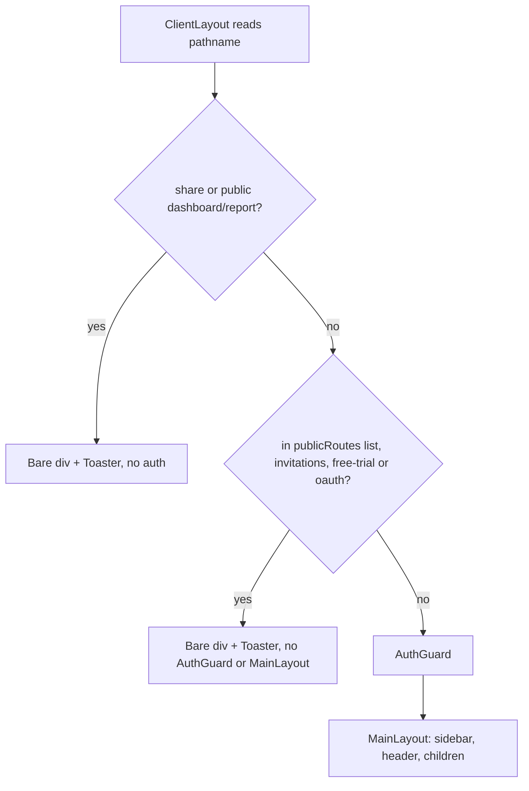
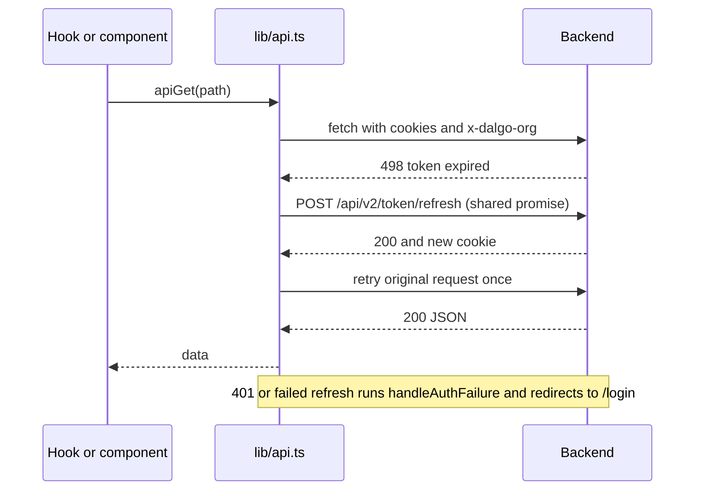

# Webapp architecture

The `webapp/` directory is the Next.js 15 (App Router) / React 19 frontend for Dalgo. It is a client-heavy single-page-style app: almost every page is a `'use client'` component that reads server data through SWR, talks to the Django backend almost entirely through one fetch wrapper (a few components call `fetch` directly; see [API access](#api-access-libapits)), and keeps cross-route state in a few Zustand stores. This page describes the moving parts and how they fit; per-feature behaviour lives in the `.claude/rules/*.md` files that the repo auto-loads by path (see [Feature map](#feature-map)).

Related pages: [Auth, orgs and permissions](auth-orgs-permissions.md) (backend side of the cookie/org/RBAC model), [Charts, dashboards and reports](charts-dashboards-reports.md), [Webapp testing](../testing/webapp-jest-playwright.md), and the [add-endpoint-and-webapp-feature workflow](../workflows/add-endpoint-and-webapp-feature.md).

## Layered structure

```
app/            thin route pages (page.tsx) + root layout, providers, global error/not-found
components/     feature folders (charts, dashboard, pipeline, ...) + components/ui primitives
hooks/api/      SWR read hooks + standalone mutation functions (one file per domain)
hooks/          non-API hooks (WebSocket, analytics, responsive layout, ...)
stores/         Zustand stores
lib/            api.ts, swr.tsx, websocket.ts, zustand.ts, analytics.ts, rbac.tsx, toast.ts, ...
constants/      app-wide constants, incl. analytics event names
types/          API response interfaces
middleware.ts   iframe/CORS headers for public share routes
```

Conventions that keep this layering intact (from [`webapp/CLAUDE.md`](../../webapp/CLAUDE.md)): no barrel `index.ts` re-exports, no `any`, no magic numbers, `data-testid` on every interactive element, stable `key`s (never array index), and toasts only via the helpers in `lib/toast.ts`. `components/ui/` is shared Radix-based presentation and must not be edited without flagging it. TypeScript and ESLint errors do **not** fail `next build` (`ignoreBuildErrors` / `ignoreDuringBuilds` in [`next.config.ts`](../../webapp/next.config.ts)), so a green build is not proof of type correctness; rely on `npm run lint` and the tests.

## Root layout and provider stack

[`app/layout.tsx`](../../webapp/app/layout.tsx) wraps every route in `PostHogProvider` > `SWRProvider` > `ClientLayout`. 

- `PostHogProvider` (`app/posthog-provider.tsx`) initialises `posthog-js` only when `NEXT_PUBLIC_POSTHOG_KEY` is set, sends events directly to `NEXT_PUBLIC_POSTHOG_INGEST_HOST` (default US cloud) rather than through the `/relay` rewrite in `next.config.ts`, creates profiles only for identified users, masks inputs in replay, and leaves exception capture to Sentry.
- `SWRProvider` ([`lib/swr.tsx`](../../webapp/lib/swr.tsx)) sets the global fetcher and defaults: no revalidate on focus, revalidate on reconnect, 2 s dedupe, 3 error retries at 5 s. The default fetcher sends URLs containing `/api/v1/public/` to `apiPublicGet` (no cookies) and everything else to `apiGet`.
- `ClientLayout` ([`components/client-layout.tsx`](../../webapp/components/client-layout.tsx)) mounts `usePostHogIdentify` and `useFeatureTracking`, then picks one of three shells by pathname (below).

`app/page.tsx` just pushes `/impact`, the default landing route.

### Route shells: public vs protected



Caption: `ClientLayout` decides which shell wraps a route; only the last branch requires authentication.

- Public shells cover `/login`, `/forgot-password`, `/resetpassword`, `/welcome`, `/invitations*`, `/free-trial*`, `/oauth/*`, `/share/dashboard/*`, `/share/report/*` and `/public/dashboard/*`. The OAuth popup callback must render bare, otherwise the guard would bounce the popup to `/login` before it relays its ref to the opener.
- Everything else is wrapped in `AuthGuard` and `MainLayout`. A **new public route must be added to the list in `client-layout.tsx`**, or it will be treated as protected.

### AuthGuard

[`components/auth-guard.tsx`](../../webapp/components/auth-guard.tsx) never looks at tokens. It runs `useSWR('/api/currentuserv2')`; a non-empty array means the HTTP-only cookie is valid, so it marks the auth store authenticated, stores `orgUsers`, and auto-selects an org (the one in `localStorage.selectedOrg` if it still exists in the list, else the first). It shows loading states ("Checking authentication", "Setting up your workspace", "Switching organization") and renders children only when `isAuthenticated && currentOrg`. When the check fails and the store is not already authenticated, it redirects once to `/login`; if the store was already authenticated, an error does not flip it back (this avoids races where the error lands before cookies propagate).

### MainLayout and navigation

[`components/main-layout.tsx`](../../webapp/components/main-layout.tsx) builds the sidebar from `getNavItems(...)`. Each nav item can be hidden by a feature flag (`useFeatureFlags`, backed by `/api/organizations/flags`, cached 5 min), by role (`visibleToRoles`, using the role groups in `lib/rbac.tsx`; an empty role is treated as most restrictive), by trial/plan state, and by transform type. Parent items route to a child the current role can actually reach (for example "Data" goes to `/pipeline` for staff but `/metrics` for Members; "Settings" goes to `/settings/branding` for admins but `/settings/access` otherwise). Collapse/submenu state lives in `stores/sidebarStore.ts` so onboarding walkthroughs can reveal a nav link from outside the layout.

## Feature map

Each nav section maps to an `app/` route tree, a `components/<feature>/` folder, a hook file in `hooks/api/`, and an auto-loaded rule file in [`webapp/.claude/rules/`](../../webapp/.claude/rules/). Read the rule file rather than restating it here.

| Nav section | Routes in `app/` | Component folders | Rule file |
|---|---|---|---|
| Impact (landing) | `impact` | - | - |
| Analytics > Charts | `charts`, `charts/[id]`, `charts/new`, `charts/[id]/edit` | `components/charts` | `charts.md` |
| Analytics > Dashboards | `dashboards`, `dashboards/[id]`, `dashboards/[id]/edit`, `dashboards/create` | `components/dashboard`, `components/dashboards` | `dashboards.md` |
| Analytics > Reports | `reports`, `reports/[snapshotId]` | `components/reports` | `reports.md` |
| Analytics > KPIs | `kpis` | `components/kpis` | `kpis.md` |
| Copilot / Alerts | `chat-with-data`, `alerts`, `notifications` | `components/chat-with-data`, `components/alerts`, `components/notifications` | - |
| Data > Overview / Orchestrate | `pipeline`, `orchestrate` (+ `create`, `[id]/edit`) | `components/pipeline` | `pipeline.md` |
| Data > Ingest | `ingest`, `oauth/airbyte/callback` | `components/ingest`, `connections`, `connectors` | `ingest.md` |
| Data > Transform | `transform`, `transform/canvas` | `components/transform` | `transform.md` |
| Data > Explore | `explore` | `components/explore` | `explore.md` |
| Data > Metrics | `metrics` | `components/metrics` | `metrics.md` |
| Data > Quality (Elementary) | no `app/data-quality` page in the current tree | none yet | `data-quality.md` |
| Settings | `settings/{branding,copilot,access,data}`, `dashboards/usage` | `components/settings`, `components/access` | `settings.md` |
| Public / auth flows | `login`, `forgot-password`, `resetpassword`, `change-password`, `invitations`, `welcome`, `free-trial/*`, `share/*`, `public/*` | - | - |

Cross-cutting rule files: `components.md` (component architecture, memoization, page layout, theme, forms, a11y), `api-hooks.md`, `analytics.md`, `testing.md`.

The `pipeline` feature is the declared **reference implementation** for file organisation: a thin page, then stateful components each in their own file under `components/pipeline/*` (`orchestrate/`, `overview/`, shared `logs-table`/`log-card`, feature-owned `utils.ts`), hooks in `hooks/api/usePipelines.ts`, types in `types/pipeline.ts`, constants in `constants/pipeline.ts`, tests co-located in `__tests__/`. Features own their own `utils.ts` and `constants.ts`; global helpers go in `lib/` and `constants/`.

## API access: `lib/api.ts`

Almost all backend traffic goes through [`lib/api.ts`](../../webapp/lib/api.ts), and hooks under `hooks/api` use it exclusively. A few components call `fetch` directly instead, bypassing the wrapper's cookie, `x-dalgo-org` and token-refresh handling:

- [`components/dashboard/chart-element-view.tsx`](../../webapp/components/dashboard/chart-element-view.tsx) - several `fetch(`${NEXT_PUBLIC_BACKEND_URL}${url}`)` calls (around lines 217, 260, 504, 553, 574 and 636, plus a few more) for map and region data, mostly in public-mode dashboards.
- [`components/dashboard/dashboard-filter-widgets.tsx`](../../webapp/components/dashboard/dashboard-filter-widgets.tsx) - region and map data for filter widgets (around lines 82 and 325).
- [`components/connectors/google-picker.ts`](../../webapp/components/connectors/google-picker.ts) - `fetchSpreadsheetName` (around line 47) calls the Google Drive metadata API with the picker access token, not the Dalgo backend.
- [`components/dashboard/dashboard-builder-v2.tsx`](../../webapp/components/dashboard/dashboard-builder-v2.tsx) - a `keepalive` `DELETE` on `/api/dashboards/{id}/lock/` when the tab becomes hidden (around line 904).

New code should use `lib/api.ts` unless it has a similar reason (public, cookie-less access or a non-Dalgo origin). Through the wrapper the frontend never reads or stores tokens - auth is HTTP-only cookies sent by the browser. (The keepalive lock release in `dashboard-builder-v2.tsx` is the exception that reads a `token` entry from `localStorage` for an `Authorization` header.)

Behaviour of `apiFetch` (used by `apiGet`, `apiPost`, `apiPut`, `apiPatch`, `apiDelete`):

- Base URL is `NEXT_PUBLIC_BACKEND_URL` (default `http://localhost:8002`).
- Always sends `credentials: 'include'`, `Content-Type: application/json` (stripped for `FormData` so the browser sets the multipart boundary), and an `x-dalgo-org` header taken from `localStorage.selectedOrg` when present. That header is how the multi-tenant backend knows which org a request targets.
- **Expired access token (HTTP 498)**: one retry only. A module-level `isRefreshing`/`refreshPromise` pair makes concurrent 498s share a single `POST /api/v2/token/refresh`; on success the original request is retried with the new cookie. If refresh fails, or the retry still gets 498, it calls `handleAuthFailure()` and throws.
- **HTTP 401** (invalid/blacklisted/refresh expired): no refresh attempt - `handleAuthFailure()` immediately and throw.
- `handleAuthFailure()` is a no-op on `/share/dashboard/`, `/public/dashboard/` and `/share/report/` paths; elsewhere it removes `selectedOrg`, calls `useAuthStore.logout()` and hard-navigates to `/login`.
- Non-OK responses are turned into `Error`s with a readable message extracted from FastAPI/Ninja style `detail` (string or validation-error array, formatted as `field: msg`), `error` or `message`, and `err.status` is set. Non-JSON bodies become an error object rather than a parse crash.
- Variants: `apiPublicGet` / `apiPublicPost` (no cookies, no org header, for tokenised public pages and trial activation), `apiPostBinary` / `apiGetBinary` (return `Blob`; they throw on non-OK but skip the 498 refresh path).

Because refresh is transparent, a call can be delayed by a refresh round-trip; callers only see success or a thrown `Error`.



Caption: the 498 refresh-and-retry path in `apiFetch`; 401 skips refresh and logs the user out.

## Server state: SWR hooks in `hooks/api`

Rules in [`.claude/rules/api-hooks.md`](../../webapp/.claude/rules/api-hooks.md):

- One plural-named file per domain (`useCharts.ts`, `usePipelines.ts`); `useThings` (list), `useThing` (single), `useCreateThing` style names for mutation hooks.
- Read hooks wrap `useSWR` and return `{ data-ish, isLoading, isError, mutate }`. Pass `null` as the key to defer fetching until inputs exist (for example `deploymentId ? url : null`).
- **Mutations are standalone async functions** that call `apiPost`/`apiPut`/`apiDelete`; the caller then calls the hook's `mutate()` to refresh. Failures surface as thrown `Error`s that components catch and show with `toastError`.
- Dynamic polling uses a `refreshInterval` callback: `usePipelines` polls every 3 s while any pipeline has a `lock` and stops (interval 0) once all are idle. `useWorkflowExecution` (transform page) polls separately.
- Use stable, unique keys. Known gotcha: SWR serves cached data instantly on navigation, so edit forms can capture stale `useMemo`/`defaultValues`. Invalidate with `useSWRConfig().mutate(key, undefined, { revalidate: false })` after mutations and give forms a `key` that includes critical fields so they remount.
- Hooks that must wait for login gate on the auth store, e.g. `useFeatureFlags` uses `isAuthenticated ? '/api/organizations/flags' : null`.

## Client state: Zustand stores

Decision tree (full version in `rules/components.md`): `useState` for local UI, Zustand for cross-route global state, SWR for server data, React Hook Form for complex forms.

- [`lib/zustand.ts`](../../webapp/lib/zustand.ts) exports `createAppStore`, a factory adding optional `persist` (localStorage) and `devtools` (default on in development).
- `stores/authStore.ts` (`useAuthStore`, built with `createAppStore`, persistence off by design) holds `isAuthenticated`, `orgUsers`, `selectedOrgSlug`, `currentOrg`, `isOrgSwitching`. `getCurrentOrgUser()` resolves the user's role/permissions in the selected org and is what `useRbac()` reads. The org slug is persisted manually in `localStorage.selectedOrg`, which is the same value `lib/api.ts` and `lib/websocket.ts` read. `logout()` clears `localStorage`/`sessionStorage`, wipes the whole SWR cache so the next user cannot see stale data, and resets state.
- Org switching (header): set switching flag, fire an analytics event with `sendInstantly`, store the new slug, then `window.location.reload()` so every request uses the new `x-dalgo-org` cleanly.
- Other stores: `sidebarStore` (nav collapse/expansion, also driven by onboarding), `exploreStore` (persisted explore selection/tab/sidebar width), `transformStore` (canvas state), `insightWalkthroughStore` (trial walkthrough). `stores/index.ts` is a small exception to the no-barrel rule that re-exports only `useAuthStore` and `Org`.

### RBAC in the UI

[`lib/rbac.tsx`](../../webapp/lib/rbac.tsx) mirrors the backend role and permission seed data and exposes `useRbac()`, `RoleGuard` (page/menu gate; renders `NoAccess` by default and renders nothing until the org user is loaded) and `PermissionGuard` (action gate; renders nothing by default). The backend remains the authority; see [Auth, orgs and permissions](auth-orgs-permissions.md).

## WebSockets

[`lib/websocket.ts`](../../webapp/lib/websocket.ts) builds URLs of the form `ws(s)://<backend>/wss/<path>?orgslug=<selectedOrg>`; no token is passed because the browser sends the HTTP-only `access_token` cookie in the handshake. It defines the custom close codes (4001 no token, 4003 invalid token, 4004 forbidden) that must match the backend's `WebsocketCloseCodes`.

[`hooks/useBackendWebSocket.ts`](../../webapp/hooks/useBackendWebSocket.ts) wraps `react-use-websocket` for every consumer: connects only when `enabled`, reconnects up to 3 times at 2 s **except** after an auth/forbidden close code (reconnecting would just be closed again), toasts "Session expired" on those codes, toasts on socket errors or unparseable messages, and offers `sendOrQueue` which stashes one pending payload until the socket opens. Current consumers are `useChatWithData` (`chat-with-data/<sessionId>/`) and `useSourceSave` (`airbyte/source/check_connection`). Note that WebSocket auth does not go through the 498 refresh logic of `lib/api.ts`; an expired session surfaces as a toast asking for a refresh.

## Middleware and config

[`middleware.ts`](../../webapp/middleware.ts) matches only `/share/dashboard/*` and `/share/report/*`. For those it deletes `X-Frame-Options` and CSP headers and sets permissive CORS headers so shared dashboards and reports can be embedded in iframes elsewhere. All other routes are untouched; there is no server-side auth redirect - protection is the client-side `AuthGuard`.

[`next.config.ts`](../../webapp/next.config.ts): `output: 'standalone'`, `@` alias to the project root, S3 remote image patterns, the `/relay` PostHog rewrites (path chosen because `/ingest` is an app route), and `withSentryConfig` (source-map upload and deletion, `/monitoring` tunnel route). Sentry is initialised via `instrumentation.ts` (server/edge) and `instrumentation-client.ts` (browser: 20% trace sampling, replay only on error sessions, text masked, no default PII).

Dev server runs on port 3001 (`npm run dev` uses Turbopack). Key env vars: `NEXT_PUBLIC_BACKEND_URL`, `NEXT_PUBLIC_POSTHOG_KEY`, `NEXT_PUBLIC_POSTHOG_INGEST_HOST`, `NEXT_PUBLIC_SENTRY_DSN`; see `.env.example`.

## Analytics (PostHog)

Rules live in [`.claude/rules/analytics.md`](../../webapp/.claude/rules/analytics.md); instrumenting every new feature is a review blocker. The mechanics:

- Event names are fixed `category:object_action` strings in `ANALYTICS_EVENTS` (`constants/analytics.ts`); variables go in properties. Fire with `trackEvent(...)` from `lib/analytics.ts`, fire-and-forget on the **success path** (gate on a success boolean for helpers that swallow their own errors).
- `trackEvent` auto-adds `is_value_action: true` for events in `VALUE_ACTION_EVENTS`.
- `usePostHogIdentify` (mounted in `ClientLayout`) identifies the person by backend `user_id` (never email; `is_internal` is derived locally from the email domain), registers `role` as a super property, and joins the `organization` group with `org_slug`/`org_name`/`org_plan` super properties; it re-runs on org switch and resets PostHog on logout. So do not put user/org/role in event properties.
- `useFeatureTracking` fires a deduped `feature:viewed` on navigation using `PATHNAME_TO_FEATURE` / `featureForPathname`. **A new page needs an entry there** (there is no generic `/settings` fallback); a Jest test, `lib/__tests__/feature-route-coverage.test.ts`, walks `app/settings` to catch unmapped pages. Tab changes need an explicit `trackFeatureView(feature, { tab })`.
- Never send PII or warehouse-derived strings (schema, table, column, file names, recipient emails). Long-running actions fire `*_triggered` only; outcomes go to Sentry and backend dashboards. Autosave and automatic background work are never tracked.

## Safe-change checklist

- Add backend calls via a hook in `hooks/api/` that uses `lib/api.ts`; add types in `types/`.
- New route: place it under `app/`, decide public vs protected in `client-layout.tsx`, add a nav entry in `main-layout.tsx` (with role/flag gating), add it to `PATHNAME_TO_FEATURE`, and fire analytics for its key actions.
- Guard browser-only APIs with `typeof window !== 'undefined'`; multi-tenant code must assume the selected org may change (a full reload happens on switch).
- Do not weaken test assertions to make tests pass; see [Webapp testing](../testing/webapp-jest-playwright.md).
