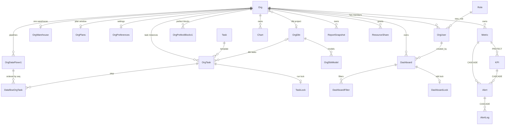

# Domain model and multi-tenancy

Dalgo is a multi-tenant platform for NGOs. The tenant is an `Org`, and nearly every persisted product object points back at one through an `org` foreign key. This page is a map for judging what else a model change touches. It covers the entity graph, the scoping rule, and the delete, protect and freeze behaviours that change a change's blast radius.

The team's product-level view of the same entities is [`harness/domain-map.md`](../../harness/domain-map.md). It labels each edge as `snapshot-of`, `compose`, `embed`, `reference`, `trigger` or `query-from`, and has a worked "change a Metric" traversal. This page does not repeat it. It records what the Django models say today, and it flags where that map has drifted (see [Drift from the product map](#drift-from-the-product-map)).

Related pages: [Auth, orgs and permissions](../architecture/auth-orgs-permissions.md) for how a request resolves to an `OrgUser`, [Backend layers](../architecture/backend-layers.md) for where models sit in the API, core and model stack, [Django migrations](../workflows/django-migrations.md) for schema changes, and [NGO pipeline end to end](../workflows/ngo-pipeline-end-to-end.md) for the data path through these objects.

## Entity graph

Caption: relational edges between the main org-owned models. Chart-to-Metric, Dashboard-to-Chart, ReportSnapshot-to-Dashboard and OrgTask-to-connection are not foreign keys, so the diagram omits them (see below).

### What is a foreign key and what is not

The important links are **soft**, so the database does not enforce them and a change will not fail loudly:

- **Airbyte connection.** There is no `Connection` table. A connection is a 36-character `connection_id` string held by `OrgTask.connection_id`, `SyncStats.connection_id`, `OrgSchemaChange.connection_id` and `ConnectionMeta`. Airbyte is the source of truth, and Dalgo's rows are keyed by that id ([`models/org.py`](../../backend/ddpui/models/org.py), [`models/airbyte.py`](../../backend/ddpui/models/airbyte.py)).
- **Chart to Metric.** A chart's `schema_name` + `table_name` + `extra_config` JSON describe its data. A saved metric is referenced by id inside `extra_config`, not by FK ([`models/visualization.py`](../../backend/ddpui/models/visualization.py)).
- **Dashboard to Chart / KPI.** `Dashboard.tabs` is a JSON array of tabs, each with `layout_config` and `components`. A component holds `chartId` or `kpiId` in its config. `Dashboard.component_ids(comp_type)` walks that JSON and is the shared helper for reports, KPIs and chat scope ([`models/dashboard.py`](../../backend/ddpui/models/dashboard.py)).
- **ResourceShare to its resource.** The pointer is a `resource_type` plus a string `resource_id`. The module docstring says not to turn it into a FK ([`models/resource_share.py`](../../backend/ddpui/models/resource_share.py)).
- **Warehouse tables.** Charts, metrics, KPIs, alerts and dashboard filters all store `schema_name` / `table_name` / column strings. A warehouse rename breaks them at query time, not at save time.

## The multi-tenancy rule

**Every product object carries an `org` FK to `Org` with `on_delete=CASCADE`.** The FK is on `OrgUser`, `OrgWarehouse`, `OrgPrefectBlockv1`, `OrgDataFlowv1`, `OrgSchemaChange`, `OrgTask`, `SyncStats`, `Chart`, `Dashboard`, `Metric`, `KPI`, `Alert`, `ReportSnapshot`, `Comment`, `ResourceShare`, `AccessRequest`, `OrgUserGroup`, the chat-with-data and LLM session models, and others. One-to-one satellites hang off `Org` the same way: `OrgPlans`, `OrgPreferences`, `OrgSupersets`, `OrgWren`, `ChatWithDataOrgConfig`.

Exceptions to know before assuming "every row has `org`":

| Model | How it relates to a tenant |
|---|---|
| `OrgDbt` | Has no `org` field. `Org.dbt` points at it with `SET_NULL`, so the dbt project belongs to an org by reference. `OrgDbtModel`, `CanvasNode` and `DbtEdge` reach the org only through `OrgDbt`. |
| `Task` | Global catalogue of runnable commands (dbt, git, edr, airbyte). `OrgTask` is the per-org instance of a `Task`. |
| `Role`, `Permission`, `RolePermission` | Global RBAC tables loaded from seed fixtures, not per tenant. |
| `Notification` | No `org`. Its `NotificationRecipient` rows point at `OrgUser`, which carries the org. |
| `OrgFeatureFlag` | `org` is nullable. A null org is a global flag, and an org row overrides it. |
| `OrgUser.org` | Nullable. A user can exist before they have registered an org. |

### How scoping is applied

Scoping is a **query convention**, not a database or ORM mechanism. There is no tenant-aware manager. The org comes from the authenticated request and is repeated in every filter:

1. `CustomJwtAuthMiddleware` resolves the `OrgUser` from the JWT and the `x-dalgo-org` header, which carries `Org.slug`. If the header is absent it takes the user's first `OrgUser`. A user belongs to an org through one `OrgUser` row, so "the org" is always `request.orguser.org` ([`auth.py`](../../backend/ddpui/auth.py), [Auth page](../architecture/auth-orgs-permissions.md)).
2. Endpoints and services then filter by it: `Dashboard.objects.get(id=dashboard_id, org=orguser.org)` and `OrgWarehouse.objects.filter(org=orguser.org)`. The same `org=orguser.org` pattern runs through the API and service layers ([`services/dashboard_service.py`](../../backend/ddpui/services/dashboard_service.py), `api/*`).
3. `core/access/shareable_types.py: get_resource(org, rtype, resource_id)` is org-scoped, so a cross-tenant id looks the same as a missing one.
4. **Public routes have no `OrgUser`.** They take the org from the shared object: `public_api.py` looks up the dashboard or snapshot by `public_share_token`, then queries `Chart` and `OrgWarehouse` with `org=dashboard.org` or `org=snapshot.org` ([`api/public_api.py`](../../backend/ddpui/api/public_api.py)). A query that omits the org there leaks across tenants.

`OrgWarehouse.org` is declared `ForeignKey(..., unique=True)`, so an org has at most one warehouse. Code does `OrgWarehouse.objects.filter(org=...).first()` and treats a missing row as "warehouse not set up". `Org.slug` is **not** DB-unique even though the header relies on it. [`core/trial/clone_service.py`](../../backend/ddpui/core/trial/clone_service.py) notes that clone-created slugs must be made unique by hand.

### Org-level configuration worth knowing

- `Org.queue_config` is a JSON of Prefect work queues and workpools for four task classes (scheduled pipeline, connection sync, transform, edr). `get_queue_config()` fills defaults from the `PREFECT_WORKER_POOL_NAME` / `PREFECT_EKS_WORKER_POOL_NAME` environment variables and accepts a legacy flat string format.
- `OrgPlans` (one-to-one, `related_name="org_plans"`) holds the base plan and the validity window. `Org.plan_window()` is documented as the single definition of a trial's dates. Do not derive them from `Org.created_at`.
- `OrgPreferences` carries `default_analyst_level`, `default_member_level` and `allow_public_sharing`, which feed per-resource access resolution. It also carries `auto_accept_non_breaking_schema_changes`.
- `OrgUser.new_role` is an FK to `Role` with `SET_NULL`. The `OrgUserRole` int enum is deprecated.

## Entity families

### Ingestion, warehouse and transform

- `OrgWarehouse` stores `wtype` (postgres, bigquery, snowflake), a `credentials` string, and the Airbyte destination id. Its `dbt_profile_secret_block` points at a Prefect block.
- `OrgPrefectBlockv1` is the org's registry of Prefect blocks. `block_id` and `block_name` are globally unique.
- `OrgDbt` holds the dbt project: repo URL, `project_dir`, target type and default schema, `transform_type` (`ui` or `github`), and FKs to Prefect blocks, all `SET_NULL`. `OrgDbtModel` (with `OrgDbtOperation`, `DbtEdge`) and the newer `CanvasNode` / `CanvasEdge` hold the UI-built transform DAG. `canvas_models.py` documents the canvas models as an eventual replacement for the older trio, so both exist today.
- `SyncStats` and `AirbyteJob` record sync history. `AirbyteJob` is keyed by Airbyte's `job_id`, with no `org` FK. `PrefectFlowRun` caches Prefect run results, keyed by deployment and flow-run ids with an optional `orguser`.

### OrgTask and pipelines

A **pipeline** is not one table. It is an `OrgDataFlowv1` (Prefect deployment id, cron, `dataflow_type` of `orchestrate` or `manual`) plus ordered `DataflowOrgTask` rows. Each row links the dataflow to an `OrgTask` with a `seq` number.

- `OrgTask` is an org's instance of a global `Task`. It carries `connection_id` for Airbyte tasks, a `dbt` FK (cascade) for transform tasks, `parameters` (flags and options used to build the CLI string), and `post_sync_transform`.
- `TaskLock` is one-to-one with `OrgTask`. It records who locked it, the flow run, and an optional `locking_dataflow` and celery task id. Locking is how concurrent runs of one task are prevented.
- `OrgDataFlowv1.reset_conn_dataflow` and `clear_conn_dataflow` are self-FKs (`SET_NULL`), linking a connection's sync pipeline to its reset and clear helper deployments.

Deleting an `OrgTask` cascades to its `DataflowOrgTask` and `TaskLock` rows. Deleting an `OrgDataFlowv1` cascades to its `DataflowOrgTask` rows. The Prefect-side deployment is not removed by the ORM, so cleanup code deletes it first (see [Org deletion](#org-deletion)).

### Analytics: charts, dashboards, metrics, KPIs

- `Chart` has a fixed `chart_type` choice list (bar, pie, line, number, map, table, pivot_table). `computation_type` is deprecated but kept for DB compatibility.
- `Dashboard` has `DashboardType` (native or superset), a `tabs` JSON, and `DashboardFilter` rows (`related_name="filters"`, cascade). Component types (`DashboardComponentType`) are chart, text, heading and kpi. `DashboardLock` is a one-to-one, token-based, expiring edit lock.
- Landing-page invariants: a partial unique constraint `unique_org_default_dashboard` allows at most one `is_org_default` dashboard per org. `OrgUser.landing_dashboard` is a personal landing choice, with `SET_NULL`.
- `Metric` is a named aggregation over a table, either simple (`column` + `aggregation`) or an expression (`column_expression`). `UniqueConstraint(org, name)` makes names unique per org.
- `KPI.metric` is `on_delete=PROTECT`. A KPI wraps a metric with target, direction, RAG thresholds, time grain, tags, annotations and `display_order`.
- Chart, Dashboard, Metric, KPI and ReportSnapshot each have `created_by`, `last_modified_by` and `is_private`. The creator is the resource's *owner* for access control, and it is nullable (`SET_NULL`).

### Reports and sharing

`ReportSnapshot` (table `report_snapshot`) deliberately has **no FK to `Dashboard` or `Chart`**. It stores `frozen_dashboard` and `frozen_chart_configs` as JSON, plus `period_start`, `period_end` and `date_column`. Deleting the source dashboard or charts never affects a snapshot. Layout and chart config are frozen, but data is queried live through the date filter. Public sharing uses the same column pattern as `Dashboard` (`is_public`, a unique `public_share_token`, disabled and accessed timestamps), but with its **own** token, so sharing a dashboard does not share its snapshots.

`ResourceShare` rows grant `view` or `edit` to a user or group principal, or to a pending `Invitation`, on a dashboard, chart, report or KPI. They have a self-FK `parent` for cascade rows, plus partial unique constraints for direct and cascade grants. `AccessRequest` is the pending-request counterpart.

### Alerts

`Alert` is one table for three types (`metric_threshold`, `kpi_rag`, `standalone`). It has nullable `metric` and `kpi` FKs, both `CASCADE`, and a `UniqueConstraint(org, name)`. `AlertLog` (cascade from `Alert`) is the immutable per-evaluation history and keeps a frozen `alert_snapshot`. `Notification` has no link to `Alert` and is a separate delivery model.

## Delete, protect and freeze semantics

These determine how far a change travels and whether it fails safely:

| Action | Result |
|---|---|
| Delete an `Org` | Cascades to every `org` FK. The ORM alone is not enough, see below. |
| Delete a `Metric` | Blocked while any `KPI` points at it (`PROTECT`). Alerts that reference it cascade-delete along with their `AlertLog` rows. |
| Delete a `KPI` | Cascades to its alerts and their logs. |
| Delete a `Dashboard` or `Chart` | `ReportSnapshot` is untouched (no FK). Other dashboards that reference a deleted chart by id in their `tabs` JSON become dangling references. |
| Delete an `OrgUser` | Resources they created are reassigned first. `OrgUser` FKs on content (`created_by`, `last_modified_by`) are `SET_NULL`, but several others cascade, such as `TaskLock.locked_by`, `DashboardLock.locked_by`, `NotificationRecipient.recipient` and `AccessRequest.requester`. |
| Delete an `OrgDbt` | Cascades to `OrgTask` (via `OrgTask.dbt`), `OrgDbtModel` and `CanvasNode`. `Org.dbt` is only nulled. |
| Change a warehouse table or column | No DB-level effect. Charts, metrics, KPIs, alerts and filters break when they next query. |

### OrgUser deletion

`delete_orguser_v1` runs in `transaction.atomic()`. For `Dashboard, Chart, Metric, KPI, ReportSnapshot, Alert` in the org, it moves `created_by` from the deleted user to the acting admin. It also deletes the invitations they issued, and refuses self-deletion or deleting a higher role. Adding a new owned model means adding it to that tuple in [`core/orguserfunctions.py`](../../backend/ddpui/core/orguserfunctions.py).

### Org deletion

`OrgCleanupService.delete_org` ([`services/org_cleanup_service.py`](../../backend/ddpui/services/org_cleanup_service.py)) defaults to `dry_run=True`. It is the supported way to delete an org because external state has to go first:

1. Delete orchestrate pipelines, both the Prefect deployments and the `OrgDataFlowv1` rows.
2. Delete the transformation layer. This includes Elementary/EDR, dbt/git `OrgTask`s, the CLI-profile and git blocks, the managed GitHub repo, the secrets-manager PAT, the on-disk dbt workspace and `OrgDbt`. It **raises `OrgCleanupServiceError`** if a dbt or git `OrgTask` is still used by an orchestrate pipeline.
3. Delete the warehouse and the Airbyte workspace, then the org's users. Each `UserPreferences` row is removed first because it does not cascade, and the Django `User` is deleted only if it has no other org membership.
4. Delete the Airbyte server block and the org directory on disk.
5. Explicitly delete `OrgPlans`, `OrgPreferences` and `LlmSession` rows, because their database constraints do not cascade even though the models declare `CASCADE`.
6. Delete `KPI` then `Metric` rows explicitly, because `KPI.metric` is `PROTECT` and would otherwise block `org.delete()`.
7. Delete the `Org`.

Any new model with an `org` FK should be checked against this list. If its FK is not truly cascading, or it blocks a cascade as `PROTECT` does, it needs an explicit step here.

## Model registration and migration notes

[`models/__init__.py`](../../backend/ddpui/models/__init__.py) imports many models so they are always registered with the app registry. Its comment says modules previously imported only by feature code left some tables unknown to processes that skipped that code, and Django's test-database `TRUNCATE` then failed on their FKs. Some models, such as `OrgDbt`, `OrgWarehouse` and `ReportSnapshot`, are not re-exported there and are imported by path. `MapLayer` is intentionally *not* imported because it has no migration, so registering it would break test-database creation. See [Django migrations](../workflows/django-migrations.md) before adding a model, an `org` FK or a constraint. A new constraint or FK changes `on_delete` behaviour for every org's data.

## Drift from the product map

[`harness/domain-map.md`](../../harness/domain-map.md) is written for product reasoning and is partly out of step with the code:

- It describes `Dashboard` with `layout_config` and a `components` blob. The model now stores a `tabs` JSON where each tab holds its own `layout_config` and `components`.
- It treats Source, Warehouse, Transform and Pipeline as product entities. In code, a Source or connection is only an Airbyte `connection_id`, a Pipeline is `OrgDataFlowv1` + `DataflowOrgTask`, and a Transform is `OrgDbt` + `OrgTask` + the dbt models and canvas nodes.
- Its entries marked `draft` (Source, Warehouse, Transform, Pipeline, OrgUser) are the ones backed by the models above. Treat the code as authoritative on FK, cascade and uniqueness behaviour, and the map as authoritative on product intent.

## Checklist when changing a model

1. Does it need an `org` FK? If it is tenant data, add one, and filter by it in every query, including public routes.
2. What does deletion do? Choose `CASCADE`, `PROTECT` or `SET_NULL` deliberately and check [Org deletion](#org-deletion) and [OrgUser deletion](#orguser-deletion).
3. Is the link a soft id in JSON (chart to metric, dashboard to chart)? If so, search for readers of that JSON, such as dashboard rendering, report freezing, public views and AI tools. The ORM will not find them.
4. Does it feed a snapshot? Changes to chart or dashboard config shapes affect `ReportSnapshot` rendering of historical `frozen_*` JSON.
5. Is it shareable? Add it to the `RTYPES` registry and `ResourceType`, per the [Auth page](../architecture/auth-orgs-permissions.md).
6. Write the migration and note any constraint that existing rows might violate.

Tests: `tests/services/test_org_cleanup_service.py` covers org deletion, and `tests/api_tests/test_user_org_api.py` covers the org-user flows. API tests under `tests/api_tests/` build an `Org` and an `OrgUser` fixture and pass the user's org into the endpoint under test.
