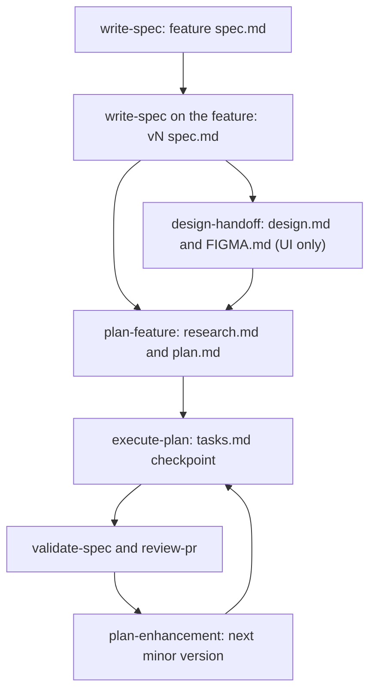

# Feature specs, plans and the harness

The `harness/` directory is a non-code part of the monorepo. It holds the written reasoning behind features (specs, research, plans, task checkpoints), a product entity graph, and a screenshot tool. Application code stays in `backend/`, `webapp/`, `prefect-proxy/`, `ai-llm-service/` and `docs/`. See [`harness/README.md`](../../harness/README.md) and the root [`CLAUDE.md`](../../CLAUDE.md), which describes the harness as "specs, scripts, prototypes (no application code)".

This page covers the `features/` tree, the workflow that produces it, and how complete each plan is. It does not cover `harness/prototypes/` or agent-memory files.

## Where the reasoning lives

| Artifact | Produced by | Role |
|---|---|---|
| `harness/features/<name>/spec.md` | `/product/write-spec` | PM's full-vision PRD for the feature |
| `<version>/spec.md` | `/product/write-spec` pointed at an existing feature | Engineering-scoped iteration of the vision |
| `<version>/design.md`, `FIGMA.md` | `/design/design-handoff` | UX decisions and Figma references (UI features only) |
| `<version>/research.md` | `/engineering/plan-feature` | Codebase and external findings, net-new only |
| `<version>/plan.md` | `/engineering/plan-feature` or `/engineering/plan-enhancement` | Blast radius, HLD, LLD, security, testing, milestones |
| `<version>/tasks.md` | `/engineering/execute-plan` | Milestone checklist and resume checkpoint |

This table follows the "Feature Artifacts" section of [`CLAUDE.md`](../../CLAUDE.md) and the command files under `.claude/commands/`.

- **Specs are PRDs.** `write-spec` says specs hold the what and why. Data models, endpoints and library choices belong in `plan.md`. A spec has no "Open Questions" section. Questions are resolved with the user or explicitly deferred first ([`write-spec.md`](../../.claude/commands/product/write-spec.md)).
- **Plans start as Draft v1.** `plan-feature` calls its output a draft that engineers refine by conversation. Its mandatory first steps are reading `harness/README.md` and `harness/domain-map.md`, then a Blast Radius table ([`plan-feature.md`](../../.claude/commands/engineering/plan-feature.md)).
- **`tasks.md` is the resume point.** `execute-plan` creates it if missing. If it exists, execution starts from the first unfinished item ([`execute-plan.md`](../../.claude/commands/engineering/execute-plan.md)).

## Directory conventions and their irregularities

The README describes `features/{name}/spec.md` plus `v1/`, `v2/` subfolders. The tree in practice is looser:

- **Versioned layout:** `alerts`, `audit_logs`, `chat-with-data`, `ingest-cast`, `metrics_kpis`, `report-scheduling`, `sentry-setup`, `prefect-runner-migration`, `dependent-filters` (only `v2/`) and `access-control/resource-sharing`. Some also keep a top-level `spec.md` (`alerts`, `audit_logs`, `dependent-filters`).
- **Minor versions are enhancements.** `/engineering/plan-enhancement` bumps the minor number on the latest version (`v1` to `v1.1`, `v1.1` to `v1.2`). It refuses if no versioned folder exists, and it does not auto-generate a `spec.md` for a paragraph-style enhancement. `metrics_kpis` is the only feature with `v1.1` and `v1.2`.
- **Flat layout:** `admin-portal` and `access-control/role-collapse` keep `spec.md`, `plan.md`, `research.md` and `tasks.md` directly in the feature folder. The admin-portal log records that an orphaned `v1/spec.md` was deleted when the flat form was chosen.
- **Grouping folder:** `access-control/` holds four related efforts that the stubs call "layers". These are `role-collapse`, `resource-sharing` (Layer 1), `dataset-access` (Layer 2) and `rls-access` (Layer 3). The stubs refer to an `ACCESS-MODEL-ROADMAP.md` that is not in the tree.
- **Extra files:** `resource-sharing/v1` also has `spec-from-pm.md`, `test-spec.md` and an `archive/` of amendments. `role-collapse` has a `spec-from-pm.md`. `metrics_kpis/v1` has `design.md` and `FIGMA.md`.

`harness/domain-map.md` is the shared input to every spec and plan. It is an entity graph with edge labels (`snapshot-of`, `compose`, `embed`, `reference`, `trigger`, `query-from`) and a per-entry confidence tag (`verified`, `draft`, `tribal-knowledge-needed`). Planners traverse `Consumed by` edges one and two hops to build the Blast Radius table, and must stop and ask about any affected surface the spec does not address.

## Lifecycle

Caption: the standard track. Spike prototypes and bug-fix commands sit outside this tree.

Execution rules live in the `executing-feature-plans` skill ([`SKILL.md`](../../.claude/skills/executing-feature-plans/SKILL.md)):

- Work in a git worktree per feature, never on `main`.
- Read each service's `CLAUDE.md` first.
- Implement inline in one session, using red-green-refactor one test at a time.
- Use subagents only for read-only orientation and review.
- Open one PR per branch. If backend and frontend can ship separately, open the backend PR first and cross-link them.
- Keep `plan.md`, `research.md` and `tasks.md` on the feature branch.

## Related tooling that is not a feature artifact

- **Commands, agents and skills** sit under the root `.claude/` (commands for `product`, `design` and `engineering`, four agents, and skills such as `design-review`, `documentation` and `executing-feature-plans`).
- **Service conventions** are separate from specs. `backend/.claude/skills/` holds backend skills (`api-endpoint`, `coding-standards`, `service-delegation`, `testing`, `typed-schemas`, `warehouse-client`, `docstrings`, `write-a-skill`). `webapp/.claude/rules/` holds per-domain rule files whose frontmatter `paths:` globs scope them to matching code. Examples are `metrics.md`, `kpis.md`, `pipeline.md` and `testing.md`.
- **The screenshot engine** is `harness/scripts/screenshot.py`. It runs one YAML recipe per feature from `harness/scripts/recipes/`. Required flows abort their recipe with exit code 2, and optional flows only warn.

## Feature status table

Status is derived from each feature's `tasks.md`. Counts are approximate tallies of `- [x]` and `- [ ]` lines, so nested sub-items are included. `tasks.md` is a self-reported checkpoint. Per [`AGENTS.md`](../../AGENTS.md), source code and tests are the authority, and a checked task is not proof the code is merged.

| Feature | Version | tasks.md status | Notes |
|---|---|---|---|
| [Resource sharing](../../harness/features/access-control/resource-sharing/v1/tasks.md) | v1 | About 276 done, 25 open (roughly 92%) | M1 to M17 are in the file. Open items are remaining tests, follow-ups and bugs found in testing (for example group edit endpoints missing the creator/admin check). |
| [Role collapse (RBAC)](../../harness/features/access-control/role-collapse/tasks.md) | flat | 37 done, 1 open | M1 to M7 are done and two PRs were opened. The only open item is removing worktrees after merge. |
| [Dataset access](../../harness/features/access-control/dataset-access/README.md) | none | Unknown, no tasks.md | The README calls it a scope stub, "not yet planned". |
| [Row/column RLS](../../harness/features/access-control/rls-access/plan.md) | none | Unknown, no tasks.md | The plan is a scoping draft, deliberately not an implementation plan. |
| [Admin portal](../../harness/features/admin-portal/tasks.md) | flat | M1 shipped, M2 to M4 not started | Milestone 1 is the admin access model over the shared session. Broadcast notifications, per-org feature flags and the Airbyte/pipeline view are marked "NOT STARTED". |
| [Alerts](../../harness/features/alerts/v1/tasks.md) | v1 | All 5 milestones marked complete | Uses status banners instead of checkboxes. M1 is the model and CRUD API, M3 is the evaluator, and M5 is polish. |
| [Audit logs](../../harness/features/audit_logs/v1/tasks.md) | v1 | 68 done, 0 open | Includes the retention command and post-implementation fixes. |
| [Chat with data](../../harness/features/chat-with-data/v1/tasks.md) | v1 | About 32 done, 14 open (roughly 70%) | M1, M2, M4 and M5 are done. M3 (sessions, REST, gating) and M6 (live validation) are unchecked. |
| [Dependent filters](../../harness/features/dependent-filters/v2/plan.md) | v2 | Unknown, no tasks.md | The plan's own banner says all milestones are done and browser-verified. This is not derived from tasks.md. |
| [Ingest cast](../../harness/features/ingest-cast/v1/tasks.md) | v1 | About 53 done, 19 open (roughly 74%) | M0 to M4 are done. The M5 rework is partly done, but M5.5 (move SQL generation to prefect-proxy) and M5.6 (deploy and verify) are open. |
| [Metrics and KPIs](../../harness/features/metrics_kpis/v1/tasks.md) | v1 | About 174 done, 1 open | Declares "v1 Status: COMPLETE". The open item is a card "Create Alert" action deferred to the alerts feature. |
| [Metrics and KPIs](../../harness/features/metrics_kpis/v1.1/tasks.md) | v1.1 | About 46 done, 22 open (roughly 68%) | M1 and M2 are done. M3 (frozen report snapshots) and M4 (formatted alert values) are unchecked. |
| [Metrics and KPIs](../../harness/features/metrics_kpis/v1.2/tasks.md) | v1.2 | 5 done, 0 open | Inline metric creation in a 3-step KPI wizard. |
| [Report scheduling](../../harness/features/report-scheduling/v1/plan.md) | v1 | Unknown, no tasks.md | Plan banner: Draft v1. |
| [Prefect runner migration](../../harness/features/prefect-runner-migration/v1/plan.md) | v1 | Unknown, no tasks.md | Plan only. |
| [Sentry setup](../../harness/features/sentry-setup/v1/plan.md) | v1 | Unknown, no tasks.md | Plan banner: Draft v1. |

How to read the table:

- Plan and spec banners often stay at "Draft v1" long after execution, so they are weak progress signals. The two exceptions here are `dependent-filters/v2/plan.md`, which was updated to say the feature is complete, and `metrics_kpis/v1.2/plan.md`, which says "Implemented".
- Checkpoints record deviations and deferrals. `chat-with-data` notes deviations inline. `admin-portal/tasks.md` documents a deliberate reversal and lists known issues found along the way.
- A feature with no `tasks.md` has never been through `execute-plan`, or its progress was not recorded there. Its status here is unknown, not "not started".

## Finding the design reasoning for a topic

Existing architecture pages cover the code. The feature folders hold the decisions behind it:

- **Metrics, KPIs and alerts:** [Metrics, KPIs and alerts](../architecture/metrics-kpis-alerts.md) describes the code. The reasoning is in `metrics_kpis/v1*` and `alerts/v1`.
- **Roles, sharing and permissions:** [Auth, orgs and permissions](../architecture/auth-orgs-permissions.md) describes the code. The reasoning is in `access-control/*`, plus `admin-portal` for the platform-admin path.
- **AI features:** [AI features](../architecture/ai-features.md) describes the code. The reasoning is in `chat-with-data/v1`.
- **Orchestration:** [Orchestration](../architecture/orchestration.md) describes the code. The reasoning is in `ingest-cast/v1` and `prefect-runner-migration/v1`, which change what runs inside Prefect flows.

## Changing the harness safely

- Add a feature by running `/product/write-spec` and then `/engineering/plan-feature`, not by hand-creating folders. Names are snake_case or kebab-case, and both appear in the tree.
- Keep `tasks.md` current as work proceeds. It is the only file that tells a resumed session where to restart, and the status table above depends on it.
- Update `harness/domain-map.md` when an entity or edge changes. Planning reads it for blast-radius analysis, and its `draft` entries are meant to be promoted after someone reads the code.
- Add a screenshot recipe by dropping a `harness/scripts/recipes/<feature>.yaml` file. The engine discovers it automatically.
