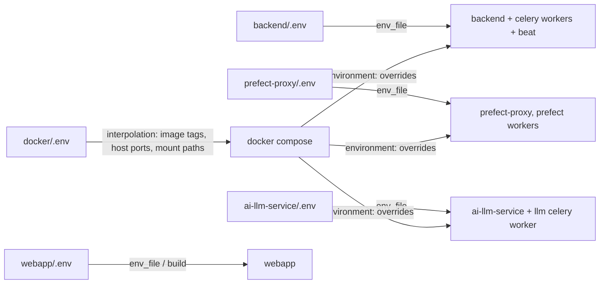

# Environment variables per service

Each deployable in this repo owns its own env file, and docker compose only layers container-networking overrides on top. This page lists variable **names** and what they do. It never records values; see each service's template for the shape of the file.

| Component | Template | Loaded by |
|---|---|---|
| Django backend + Celery | `backend/.env.template` | `load_dotenv()` in `ddpui/settings.py` (also in a few modules such as `prefect_service.py`) |
| prefect-proxy | `prefect-proxy/.env.template` | `load_dotenv()` in `proxy/service.py` |
| ai-llm-service | `ai-llm-service/.env.example` | `load_dotenv()` in `main.py` |
| webapp (Next.js) | `webapp/.env.example` | Next.js build; `NEXT_PUBLIC_*` baked into the client bundle |
| docker compose | `docker/.env.example` | compose interpolation only |

See [Platform architecture](../architecture/platform.md) and [Orchestration](../architecture/orchestration.md) for how these services connect, and [Local services and dependencies](local-services-and-dependencies.md) and the [Quickstart](../quickstart.md) for bring-up.

## How the layers combine

Key rules:

- Compose `environment:` entries **override** `env_file` values. The compose files deliberately set only container-networking variables: for the backend they set `REDIS_HOST`, `REDIS_PORT`, `PREFECT_PROXY_API_URL` and `LLM_SERVICE_API_URL` to in-network service names; for the ai-llm service they set `REDIS_HOST`, `REDIS_PORT`, `CELERY_BROKER_URL`, `CELERY_RESULT_BACKEND` and `CELERY_BROKER` to the dedicated `redis-llm` instance; for prefect-proxy and every Prefect worker they set `PREFECT_API_URL` to the compose `prefect-server`. So the same variables in the service `.env` are ignored when running under compose.
- The dev compose file additionally overrides `DBHOST` (Postgres runs on the host), `DEV_SECRETS_DIR` and `USE_AWS_SECRETS_MANAGER` for the backend.
- There are two Redis instances: one for backend Celery/cache/channels and one for the ai-llm service. `REDIS_HOST`/`REDIS_PORT` therefore mean different servers in the backend and ai-llm containers.
- `docker/.env` is read only by compose itself. It controls image tags (`BACKEND_IMAGE_TAG`, `PROXY_IMAGE_TAG`, `LLM_IMAGE_TAG`, `WEBAPP_IMAGE_TAG`, plus `REGISTRY`), host ports (`BACKEND_HOST_PORT`, `PROXY_HOST_PORT`, `WEBAPP_HOST_PORT`, `LLM_HOST_PORT`, `REDIS_HOST_PORT`, `REDIS_LLM_HOST_PORT`) and mount paths (`DEV_SECRETS_HOST_PATH`, `CLIENTDBT_ROOT_MOUNT`).

## Backend (`backend/.env`)

### Core Django, auth and CORS
- `DJANGOSECRET` – Django `SECRET_KEY`; also the fallback signing key for JWTs. Not given a default, so a missing value breaks startup/signing.
- `ENVIRONMENT` – `production` flips `PRODUCTION` and changes the auth cookie `SameSite` policy (Lax in production, None otherwise); also tags Sentry events and is used by dbt service logic and the managed-git migration command.
- `DEBUG` – only the literal `True` enables debug and DEBUG-level console logging.
- `ALLOWED_HOSTS`, `CORS_ALLOWED_ORIGINS` – comma-separated lists. CORS is credentialed with no wildcard, so a webapp origin missing from `CORS_ALLOWED_ORIGINS` will fail browser calls; a host missing from `ALLOWED_HOSTS` is rejected by Django.
- `JWT_SECRET_KEY`, `JWT_ACCESS_TOKEN_EXPIRY_MINUTES`, `JWT_REFRESH_TOKEN_EXPIRY_DAYS` – SimpleJWT signing key and lifetimes (code defaults of 30 minutes and 7 days apply when unset; the signing key falls back to `DJANGOSECRET`).
- `ROLE_PERMISSIONS_REDIS_KEY` – Redis key under which role permissions are cached; has a code default, used by `auth.py` and the `clear_role_permissions` command.
- `FRONTEND_URL`, `FRONTEND_URL_V2` – used to build links in emails, notifications, invites and OAuth redirects. Blank values produce broken links rather than errors.
- `RENDER_SECRET` – shared secret that lets Playwright reach the public render endpoints for server-side PDF generation.
- `SIGNUPCODE`, `DEMO_SIGNUPCODE` – signup gates in `orguserfunctions`; a code equal to the demo one marks the user as a demo account.

### Database, Redis, logging
- `DBNAME`, `DBHOST`, `DBPORT`, `DBUSER`, `DBPASSWORD` – the Postgres connection for Django (no defaults; migrations and every request fail without them). The same names are reused by some dbt-automation operations and legacy warehouse clients.
- `DBADMINUSER`, `DBADMINPASSWORD` – present in the template and generated by `scripts/generate-env.sh`; no reader was found in the Python code, so treat them as setup-time helpers.
- `REDIS_HOST`, `REDIS_PORT` – used by the Celery app, the Redis client, and Django Channels (websockets). Default to localhost.
- `ENABLE_FILE_LOGGING` – set false when a process manager captures stdout.

### AWS
- `AWS_DEFAULT_REGION` – shared region.
- `SECRETSMANAGER_ACCESS_KEY_ID`, `SECRETSMANAGER_SECRET_ACCESS_KEY`, `S3_AWS_ACCESS_KEY_ID`, `S3_AWS_SECRET_ACCESS_KEY`, `SES_ACCESS_KEY_ID`, `SES_SECRET_ACCESS_KEY` – each AWS client is built from its own key pair. `AWSClient` raises a `ValueError` naming the missing pair when the corresponding service is first used.
- `S3_IMAGES_BUCKET` – shared bucket for logos and dashboard images.
- `SES_SENDER_EMAIL` – From address for all platform email; blank means SES rejects the send.
- `USE_AWS_SECRETS_MANAGER` – only the literal `True` selects real AWS Secrets Manager; anything else uses the file-based `DevSecretsManager`, which requires `DEV_SECRETS_DIR` (raises if unset). Warehouse credentials and GitHub tokens go through this switch.
- `ELEMENTARY_S3_BUCKET` – read during org cleanup; not in the template.

### Airbyte
- `AIRBYTE_SERVER_HOST`, `AIRBYTE_SERVER_PORT`, `AIRBYTE_SERVER_APIVER`, `AIRBYTE_API_TOKEN`, `AIRBYTE_USE_SSL` – how the backend reaches Airbyte. The same host/port/version are also passed to prefect-proxy when creating Airbyte server blocks, so they must be reachable from Prefect workers too.
- `AIRBYTE_DESTINATION_TYPES`, `DEMO_AIRBYTE_SOURCE_TYPES`, `AIRBYTE_SOURCE_BLACKLIST` – allow/deny lists applied to the source and destination definitions shown to users.
- `AIRBYTE_OAUTH_REDIRECT_URL`, `AIRBYTE_GOOGLE_OAUTH_CLIENT_ID`, `AIRBYTE_GOOGLE_OAUTH_CLIENT_SECRET`, `AIRBYTE_GOOGLE_PICKER_API_KEY`, `AIRBYTE_GOOGLE_PICKER_APP_ID` – Google OAuth and Google Picker for Sheets-style sources.
- `AIRBYTE_FETCH_CONNECTION_CATALOG_TIMEOUT_SECONDS`, `PREFECT_AIRBYTE_TASKS_TIMEOUT_SECS` – timeouts.

### Prefect and orchestration
- `PREFECT_PROXY_API_URL` – base URL of prefect-proxy. All orchestration calls from the backend go through it, so pipelines, deployments and run status fail without it.
- `PREFECT_HTTP_TIMEOUT` – HTTP timeout for proxy calls.
- `PREFECT_WORKER_POOL_NAME`, `PREFECT_EKS_WORKER_POOL_NAME` – default and EKS work pool names; read by the `Org` queue-config defaults, a migration and `migrate_queue_config_to_nested`. Pool names are stored per org, so changing them later does not rewrite existing rows.
- `PREFECT_RETRY_CRASHED_FLOW_RUNS`, `NOTIFY_PLATFORM_ADMINS_OF_ERRORS` – behaviour of the Prefect webhook handler on failed or crashed runs.
- `PREFECT_SERVER_HOST`, `PREFECT_SERVER_PORT` – used only to report the Prefect server version; failure yields "Not available". Not in the template.
- `CLIENTDBT_ROOT` – root directory for per-org dbt projects and docs. Must be the same absolute path in the backend, the Prefect workers and the host (compose uses `CLIENTDBT_ROOT_MOUNT` for this) because paths are stored absolute in the database and Prefect deployments.
- `PREFECT_NOTIFICATIONS_WEBHOOK_KEY`, `AIRBYTE_NOTIFICATIONS_WEBHOOK_KEY` – compared with the `X-Notification-Key` header on the webhook endpoints. Because the comparison is against the env value, an unset key only matches a request that omits the header, so set them. The Airbyte key is read by code but missing from the template.
- `PREFECT_URL_FOR_NOTIFICATIONS`, `AIRBYTE_URL_FOR_NOTIFICATIONS` – deep links embedded in admin notifications.
- `SCHEMA_CHANGE_DETECTION_INTER_ORG_DELAY`, `SCHEMA_CHANGE_DETECTION_SCHEDULE_HOUR`, `SCHEMA_CHANGE_DETECTION_SCHEDULE_MINUTE` – schedule and pacing for the schema-change detection Celery task; parsed with `get_integer_env_var`, which logs and falls back to its default on bad or negative values.
- `SCHEMA_REFRESH_TTL` – TTL for the schema-refresh task progress key.
- `AUDIT_LOG_RETENTION_DAYS` – retention used by the `purge_old_audit_logs` command.

### Notifications and admin
- `ADMIN_EMAIL`, `ADMIN_DISCORD_WEBHOOK` – platform-admin alert channels; each is skipped when unset.
- `BIZ_DEV_EMAILS` – recipients of upgrade/subscription requests. When blank, the request endpoint returns an error and does not mark the org as having asked.

### Integrations
- `SUPERSET_USAGE_DASHBOARD_API_URL`, `SUPERSET_USAGE_CREDS_SECRET_ID` – Superset guest-token flow for the usage dashboard; credentials are fetched via the secrets manager.
- `DEMO_SUPERSET_USERNAME`, `DEMO_SUPERSET_PASSWORD` – demo accounts.
- `DALGO_GITHUB_ORG`, `DALGO_ORG_ADMIN_PAT` – managed Git repositories; the PAT is an org-level admin token. Missing values break repo creation.
- `DALGO_DOCS_BASE_URL` – docs base used by AI docs tools; has a code default.

### LLM service client and AI features
- `LLM_SERVICE_API_URL`, `LLM_SERVICE_API_KEY`, `LLM_SERVICE_API_VER` – address, `Authorization` header value, and optional API version segment for calling ai-llm-service. If the URL is unset, building an endpoint raises. The key must equal the service's `API_KEY`.
- `CHAT_WITH_DATA_MODEL`, `CHAT_WITH_DATA_ROUTER_MODEL`, `CHAT_WITH_DATA_TITLE_MODEL`, `CHAT_WITH_DATA_VALIDATOR_MODEL`, `CHAT_WITH_DATA_REFLECTION_MODEL` – optional per-job model overrides; the model id also selects the provider.
- `ANTHROPIC_API_KEY`, `OPENAI_API_KEY` – provider credentials read by the LangChain model clients. A user-selectable model is offered only when its key exists; `default_model_id` falls back to the first available option. These keys are not in `backend/.env.template`.
- `LANGFUSE_PUBLIC_KEY`, `LANGFUSE_SECRET_KEY`, `LANGFUSE_HOST`, `LANGFUSE_RELEASE`, `LANGFUSE_ENVIRONMENT`, `LANGFUSE_MASK_TOOL_RESULTS` – optional tracing; keys absent means tracing is off. Not in the template.

### Monitoring
- `SENTRY_DSN`, `SENTRY_TSR`, `SENTRY_PSR`, `SENTRY_ENABLE_LOGS`, `SENTRY_SEND_DEFAULT_PII` – Sentry init at settings import. Sampling rates default to full sampling when unset. LangGraph prompt capture is disabled in code regardless.

### Trial ("Try Now") flow
`TEMPLATE_ORG_SLUG`, `TRIALS_RDS_HOST`, `TRIALS_RDS_PORT`, `TRIALS_RDS_ADMIN_USER`, `TRIALS_RDS_ADMIN_PASSWORD` (the admin needs create-database and create-role rights), `TEMPLATE_SOURCE_CREDS_FILE`, `TRIAL_SCHEDULE_CALL_URL`, `TRIAL_ALERT_EMAIL`. The flow also depends on `FRONTEND_URL_V2`, `DALGO_GITHUB_ORG`, `DALGO_ORG_ADMIN_PAT` and `SES_SENDER_EMAIL`.

### Template entries with no reader
`CANVAS_LOCK`, `EDR_TTL` and `ESTIMATE_TIME_FOR_QUEUE_RUNS` appear in the template, but no `os.getenv` read of them exists in the backend Python code. Verify before relying on them as toggles.

### Test-only
`DDPUI_TEST_SES_PROBE`, `TEST_BG_SERVICEJSON`, `TESTING_AIRBYTE_DEST_CONFIG_*` and `DEV_SECRETS_DIR` are read by tests and integration tests, not by production paths.

## prefect-proxy (`prefect-proxy/.env`)

- `PREFECT_API_URL` – Prefect server API root. Every proxy call and the webhook-automation script read it; compose overrides it to the in-network server.
- `PREFECT_API_TIMEOUT`, `PREFECT_API_RETRY`, `PREFECT_API_RETRY_DELAY` – timeout and optional retry behaviour of proxy calls to Prefect.
- `PREFECT_PROXY_GIT_BRANCH` – branch from which deployed flows are sourced; point it to a feature branch on staging.
- `LOGDIR` – directory for the `prefect-proxy.log` file, created on start.
- `GOOGLE_APPLICATION_CREDENTIALS` – path to a BigQuery service-account file for flows that touch BigQuery.
- `PREFECT_WORK_POOL` – used by the compose worker commands to choose the pool (the commands fall back to a default when unset). **Gotcha:** the template spells this `PREFCT_WORK_POOL`, so copying it verbatim leaves workers on the default pool.
- `SENTRY_DSN`, `SENTRY_TSR`, `SENTRY_PSR` – Sentry setup in `proxy/main.py`.

The backend's `PREFECT_WORKER_POOL_NAME` and the pool the workers poll must agree, otherwise runs are queued to a pool nobody serves.

## ai-llm-service (`ai-llm-service/.env`)

- `API_KEY` – the expected value of the `Authorization` header on every request; callers (the backend's `LLM_SERVICE_API_KEY`) must match, else 401.
- `REDIS_HOST`, `REDIS_PORT`, `CELERY_BROKER_URL`, `CELERY_RESULT_BACKEND` – Redis client and Celery broker/result store, defaulting to localhost. Under compose these point at `redis-llm`.
- `OPENAI_API_KEY` – passed to the API layer as the OpenAI key for LLM jobs.
- `KAAPI_API_KEY`, `KAAPI_BASE_URI`, `KAAPI_REQUEST_TIMEOUT_SECS` – outbound client to the Kaapi platform. `KAAPI_BASE_URI` is checked at import time of `ai_platform_src.py`, so omitting it raises an HTTP 500 error on that module's load.
- `KAAPI_WEBHOOK_SECRET` – HMAC secret for verifying Kaapi callbacks (signature, timestamp, replay window). When unset, every callback is rejected with 401.
- `AI_LLM_SERVICE_PUBLIC_BASE` – externally reachable base URL embedded in the callback URLs sent to Kaapi; wrong or blank means Kaapi cannot call back.
- `PROJECT_ID` – Kaapi project selector (distinct IDs for staging and production). It is only consumed by the service's own `docker-compose.yml`; no Python read was found.

## webapp (`webapp/.env`)

All `NEXT_PUBLIC_*` values are inlined into the browser bundle at `next build`, so changing them requires a rebuild. `docker/Dockerfile.webapp` declares each as a build `ARG` and `ENV`; values from CI build args or the `.env` in the build context are what ship, and a runtime `env_file` does not retroactively change client code.

- `NEXT_PUBLIC_BACKEND_URL` – backend base URL for REST calls, public reports and the websocket client (see `lib/config.ts`, `lib/api.ts`, `lib/websocket.ts`). Falls back to a localhost backend address, which is wrong for any deployed build.
- `NEXT_PUBLIC_WEBAPP_ENVIRONMENT` – environment label (defaults to production).
- `NEXT_PUBLIC_USAGE_DASHBOARD_ID`, `NEXT_PUBLIC_USAGE_DASHBOARD_DOMAIN` – usage dashboard embed; empty disables meaningful rendering.
- `NEXT_PUBLIC_AIRBYTE_URL` – link target for the workspace id (super admins).
- `NEXT_PUBLIC_ENABLE_LOG_SUMMARIES` – pipeline log-summary feature gate; only the string `true` enables it. It is not in the Dockerfile build args, so set it in the build context `.env`.
- `NEXT_PUBLIC_DOCS_BASE_URL` – base for the docs-link icons.
- `NEXT_PUBLIC_EMBEDDED_WEBAPP_URL` – declared as a build arg in the Dockerfile; not in the example file.
- `NEXT_PUBLIC_SENTRY_DSN` – Sentry for client, server and edge runtimes; `SENTRY_AUTH_TOKEN` – build-time source-map upload used by `withSentryConfig` in `next.config.ts` (needed in CI for readable stack traces; source maps are deleted after upload).
- `NEXT_PUBLIC_POSTHOG_KEY`, `NEXT_PUBLIC_POSTHOG_HOST`, `NEXT_PUBLIC_POSTHOG_INGEST_HOST` – PostHog analytics; without a key the provider does not initialise. `POSTHOG_PROXY_HOST` and `POSTHOG_PROXY_ASSETS_HOST` configure the `/relay` rewrites in `next.config.ts` and default to the US hosts. Rewrites are resolved at build.
- `E2E_ADMIN_EMAIL`, `E2E_ADMIN_PASSWORD`, `E2E_BASE_URL` – Playwright only; authenticated E2E specs need the credentials, and `E2E_BASE_URL` points tests at a deployed instance instead of starting a local server.

## Practical checklist

1. Set backend secrets and DB/Redis variables first; nothing starts without `DJANGOSECRET` and the `DB*` set.
2. Make `PREFECT_PROXY_API_URL` (backend), `PREFECT_API_URL` (proxy) and the work pool names consistent with the compose topology.
3. Keep `LLM_SERVICE_API_KEY` (backend) equal to `API_KEY` (ai-llm-service), and `KAAPI_WEBHOOK_SECRET` equal to the secret configured in Kaapi.
4. Use the same absolute `CLIENTDBT_ROOT` path on host, backend and Prefect workers.
5. Rebuild the webapp image after any `NEXT_PUBLIC_*` change.
6. Never commit populated env files; the templates and examples are the only tracked artifacts.
