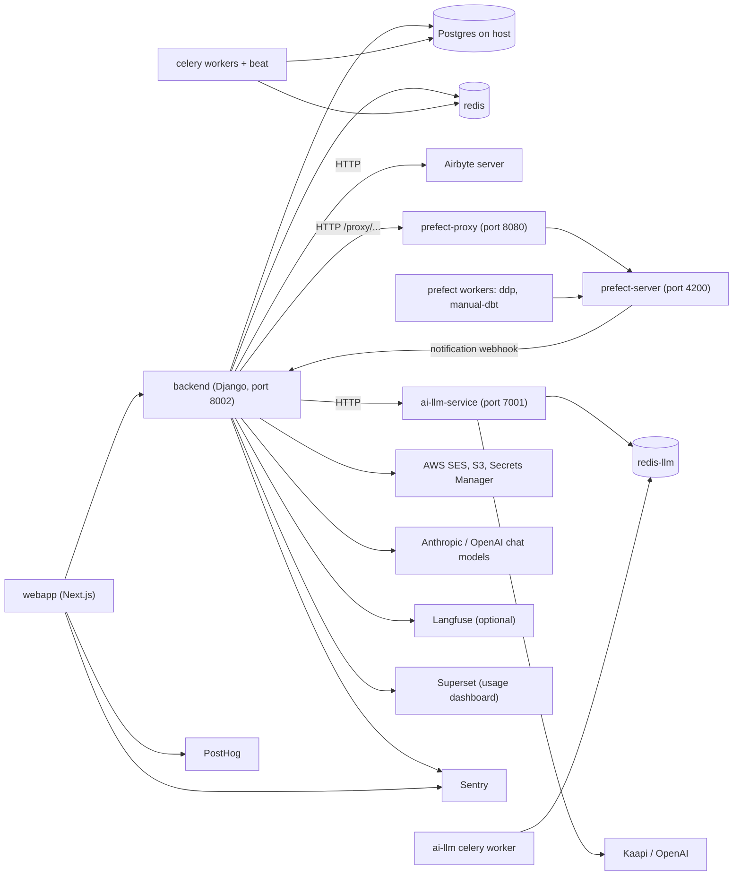

# Local services and external dependencies

Dalgo is several cooperating processes, not one app. The Django backend (`backend/`) is the hub: it calls Airbyte directly, calls Prefect only through `prefect-proxy`, calls `ai-llm-service` over HTTP, and hands background work to Celery over Redis. The Next.js `webapp/` talks to the backend and to Sentry and PostHog. This page lists what has to be running, how the pieces find each other, and which external systems are optional.

Variable names appear below; values are deliberately never shown. See [Environment variables](./environment-variables.md) for the full catalogue, [Platform architecture](../architecture/platform.md) for the system map, [Background work](../architecture/background-work.md) for Celery task design, and [Orchestration](../architecture/orchestration.md) for how Prefect flows are built.

## Topology

Caption: runtime dependencies of the dev stack. Airbyte and Postgres are not containers in the compose file; everything else on the left runs in it.

## What must run locally

### The compose stack

`docker/docker-compose.dev.yml` (project name `dalgo`) is the supported way to run everything except Postgres and Airbyte. It bind-mounts source for hot reload and reads app configuration from each service's own env file (`backend/.env`, `prefect-proxy/.env`, `webapp/.env`, `ai-llm-service/.env`). The compose file only injects container-networking overrides, so a setting that is wrong for a container (hostnames, URLs between services) is fixed in the compose file, and everything else is fixed in the service's env file.

| Service | Role | Notes |
| --- | --- | --- |
| `redis` | Backend Celery broker, result backend, redbeat state, app cache | Host port defaults to 6370 |
| `redis-llm` | Separate Redis dedicated to `ai-llm-service` | Host port defaults to 6380, has a data volume |
| `prefect-server` | Prefect API and UI | Port 4200; mounts `prefect-proxy/profiles.toml` read-only |
| `prefect-proxy` | FastAPI wrapper over the Prefect SDK | Port 8080; `PREFECT_API_URL` points at `prefect-server` |
| `prefect-worker-ddp-1`, `prefect-worker-manual-dbt-1` | Execute flow runs on the `ddp` and `manual-dbt` queues of the work pool | Mount the client dbt root so dbt projects are visible |
| `backend` | Django API (uvicorn) | Port 8002; waits for a healthy `redis` |
| `celery-worker`, `celery-canvasdbt-worker`, `celery-alerts-worker`, `celery-beat` | Backend background work | One container per queue plus the scheduler |
| `webapp` | Next.js standalone image | Port 3001; rebuild after code or env changes |
| `ai-llm-service`, `ai-llm-celery-worker` | LLM microservice (FastAPI plus its own Celery worker) | Port 7001 |

Start it from the `docker/` directory with `docker compose -f docker-compose.dev.yml up -d`.

The production compose file (`docker/docker-compose.yml`) has the same shape but no bind mounts, assumes Postgres and the Prefect server are managed externally, and starts beat with the redbeat scheduler named explicitly. A staging variant also exists.

### Postgres (host, not a container)

Postgres runs on the host and containers reach it as `host.docker.internal` (the dev compose sets the backend's DB host to that and adds the `host-gateway` extra host). For a bare-metal setup the backend README suggests a throwaway Postgres container and `.env` entries for the database name, host, port and both an app user and an admin user. Then run migrations, load seed fixtures, and create the system org user before first start (`python manage.py migrate`, `loaddata seed/*.json`, `create-system-orguser`), then `createorganduser` for the first super-admin. Chat with Data also needs `chat_with_data_setup` once to create its checkpointer tables in the app database.

### Airbyte (host, not in compose)

Airbyte is installed separately (the README pins Airbyte 0.58.0 via `run-ab-platform.sh`; the production compose adds an `extra_hosts` entry for an `abctl` Kubernetes service name, which shows production reaches Airbyte via abctl). The backend never uses an SDK: `abreq()` in `ddpairbyte/airbyte_service.py` builds `http(s)://host:port/api/<version>/<endpoint>` from `AIRBYTE_SERVER_HOST`, `AIRBYTE_SERVER_PORT`, `AIRBYTE_SERVER_APIVER`, optional `AIRBYTE_USE_SSL`, and authenticates with Basic auth using `AIRBYTE_API_TOKEN`. The default 30-second timeout and connection failures are turned into HTTP 500 `HttpError`s; non-2xx responses re-raise with Airbyte's status and body. The same connection settings are also forwarded to Prefect (through the proxy) so flows can reach Airbyte themselves. `AIRBYTE_DESTINATION_TYPES` restricts which destination types the UI offers.

Inbound, Airbyte can call the backend at `/webhooks/v1/airbyte_job/{job_id}`, guarded by an `X-Notification-Key` header compared with `AIRBYTE_NOTIFICATIONS_WEBHOOK_KEY`; it enqueues a Celery task to sync job stats.

### Prefect server, workers and prefect-proxy

Prefect exposes an async Python interface that does not mix with Django, so all Prefect traffic goes through `prefect-proxy` (see its README). Django's `ddpprefect/prefect_service.py` wraps `requests` calls to `PREFECT_PROXY_API_URL` under `/proxy/...`, sending an `x-ddp-org` header, with a timeout from `PREFECT_HTTP_TIMEOUT` (default 30s). Connection errors become `HttpError(500, "connection error")`.

The proxy talks to the Prefect API at `PREFECT_API_URL` (set to the compose `prefect-server` address in dev, `http://localhost:4200/api` for manual runs), mostly via the SDK and sometimes raw HTTP helpers. Manual (non-compose) startup, from the proxy README:

1. `uv run prefect server start` (port 4200).
2. Create the work pool (`dalgo_work_pool`) in the Prefect UI first.
3. Start workers: `prefect worker start -q ddp --pool dalgo_work_pool` and the same with `-q manual-dbt`.
4. Start the proxy with gunicorn and uvicorn workers on a chosen port, and put that URL in the backend's `PREFECT_PROXY_API_URL`.

The proxy needs `LOGDIR` (created automatically; logs go to `prefect-proxy.log`).

**Completion webhook.** Dalgo must learn when a flow run reaches a terminal state, to release locks and notify users. In the Prefect UI, add a Custom Webhook notification pointing at the backend `/webhooks/v1/notification/`, POST, with an `X-Notification-Key` header matching `PREFECT_NOTIFICATIONS_WEBHOOK_KEY` and JSON body `{"body": "{{body}}"}`, for Completed, Cancelled, Crashed, Failed and TimedOut. Then verify (and if needed PATCH) the notification policy's message template to the "Flow run ... with id ... entered state ..." form, because the backend parses that sentence when the body is not JSON. The handler rejects a wrong key with HTTP 400, extracts the flow run id and state, and queues `handle_prefect_webhook` on Celery. If this webhook is not configured, runs complete in Prefect but Dalgo never reconciles them.

### Celery workers and beat (backend)

Celery configuration lives only in `ddpui/celery.py` (do not add `CELERY_*` keys to Django settings). Redis host and port come from `REDIS_HOST` and `REDIS_PORT`; each concern uses its own numbered Redis DB from `RedisDB` in `ddpui/utils/redis_db.py` (broker 0, redbeat 1, results 2, Django channels 3, app cache 4). Beat uses `redbeat.RedBeatScheduler` so schedule state lives in Redis instead of a local file.

Task routing sends work to dedicated queues so long jobs cannot starve others:

| Queue | Tasks | Worker in compose |
| --- | --- | --- |
| `default` | Everything not routed elsewhere (notifications, webhooks, maintenance) | `celery-worker` |
| `canvas_dbt` | `run_dbt_commands` | `celery-canvasdbt-worker` (autoscale 1 to 3) |
| `alerts` | `alerts.dispatch_due_alerts`, `alerts.evaluate_alert` | `celery-alerts-worker` |
| `trial_clone` | Trial org cloning and expired-trial teardown | none |

Compose does not start a `trial_clone` worker. The backend README documents one (`celery -A ddpui worker -Q trial_clone -n trial_clone --autoscale=4,1`); without it, trial cloning and trial deletion tasks queue forever. On Windows the README tells you to add `-P solo`. Prefetch is 1 and task events are enabled so Flower or celery-exporter can observe queues.

### ai-llm-service

A FastAPI app (`main.py`, port 7001) where every request becomes a Celery task on the `llm` queue, run by its own worker against its own Redis (`redis-llm` in the root compose files; a `redis` service on host port 6370 in the service's standalone compose, which also adds a Flower dashboard on host port 5556). Endpoints under `/api` and `/api/v1` require the `Authorization` header to equal the service's `API_KEY`; `/health` is open, and `/api/v1/callbacks/*` is authenticated by an HMAC-SHA256 signature instead. The backend finds it through `LLM_SERVICE_API_URL`, sends `LLM_SERVICE_API_KEY` as the `Authorization` header, optionally inserts `LLM_SERVICE_API_VER` in the path, and polls `/api/task/{id}` every 5 seconds until a terminal Celery state. A missing URL raises immediately; an error state raises with the service's error.

Its external side is Kaapi (`KAAPI_BASE_URI`, `KAAPI_API_KEY`, `KAAPI_REQUEST_TIMEOUT_SECS`) for document upload, vector-store collections and answers, plus OpenAI (`OPENAI_API_KEY`) for file search. Kaapi calls back into the service at `AI_LLM_SERVICE_PUBLIC_BASE`, so that URL must be reachable from Kaapi. Callbacks are verified with `KAAPI_WEBHOOK_SECRET`: the request is rejected with 401 if the secret is unset, headers are missing, the timestamp is more than 300 seconds off, or the signature differs. The service also fails at import time if `KAAPI_BASE_URI` is missing. In the service's standalone compose, the API and worker containers share an upload volume.

## External dependencies

### LLM providers (chat with data and other agents)

The backend's own AI features (see [AI features](../architecture/ai-features.md)) do not go through `ai-llm-service`. `ddpui/core/ai/agent/base.py` builds a model with LangChain `init_chat_model`, and the model id decides the provider: Claude ids use Anthropic (`ANTHROPIC_API_KEY`), GPT ids use OpenAI (`OPENAI_API_KEY`), and a `provider:model` form disambiguates. Each job reads its model id from its own env var with an Anthropic default, so switching provider is a configuration change. Every model carries the tracing dispatcher described next.

### Langfuse (optional)

`ddpui/core/ai/tracing.py` is off unless both `LANGFUSE_PUBLIC_KEY` and `LANGFUSE_SECRET_KEY` are set. When on, it creates a singleton Langfuse v2 low-level client (the dbt stack's `protobuf<5` pin rules out v3) pointed at `LANGFUSE_HOST` (default `http://localhost:3000`), optionally tagged with `LANGFUSE_RELEASE` and `LANGFUSE_ENVIRONMENT`. One chat question is one trace, and a resumed question reuses the original trace id. Every hook is wrapped so a Langfuse outage cannot break a chat turn; sends are batched on a background thread. Traces hold prompts and tool inputs, and tool outputs can contain warehouse rows, so `LANGFUSE_MASK_TOOL_RESULTS` replaces them with a length stub; the developer guide says production should use only a self-hosted Langfuse. Payloads are clipped to 4000 characters and ids are opaque, never emails. Local setup is Langfuse's own docker compose on port 3000.

### Sentry

Errors are reported from three places, all driven by DSN settings:

- **Backend** (`settings.py`) initializes `sentry_sdk` at import with Django, logging (INFO breadcrumbs, ERROR events) and LangGraph integrations. `SENTRY_DSN`, `SENTRY_TSR`, `SENTRY_PSR`, `SENTRY_ENABLE_LOGS`, `SENTRY_SEND_DEFAULT_PII` and `ENVIRONMENT` tune it. Because default PII defaults to on, the LangGraph integration is set to exclude prompts so org warehouse data never reaches Sentry. Trace and profile sampling default to 100% if unset.
- **prefect-proxy** (`proxy/main.py`) initializes Sentry from `SENTRY_DSN` with the same sampling variables and exposes `/sentry-debug`, which deliberately raises a division by zero to test wiring.
- **webapp**: `instrumentation.ts` is the Next.js hook; it loads `sentry.server.config` on the Node runtime and `sentry.edge.config` on the edge runtime, and exports `onRequestError` as `Sentry.captureRequestError`. Browser setup is in `instrumentation-client.ts` (20% traces, no session replay except on error sessions, masked text, blocked media, a filtered list of benign errors, `sendDefaultPii` off). All use `NEXT_PUBLIC_SENTRY_DSN`. `next.config.ts` wraps the build with `withSentryConfig` to upload source maps (needs `SENTRY_AUTH_TOKEN` at build time), delete them afterwards, and tunnel browser events through `/monitoring` to get past ad-blockers.

The `harness/features/sentry-setup` plan and research files describe the intended hardening (an `enabled` flag, `beforeSend` PII scrubbing, 100%-on-dev replay). Check the config files before assuming those are present; the checked-in client config differs in several details.

### PostHog

Frontend only. `app/posthog-provider.tsx` initializes `posthog-js` only when `NEXT_PUBLIC_POSTHOG_KEY` is set, so local dev without analytics is silent. Events go straight to `NEXT_PUBLIC_POSTHOG_INGEST_HOST` (default US cloud) rather than the `/relay` rewrite in `next.config.ts`, because the rewrite was returning 404 in some deployments; the rewrite still exists, driven by `POSTHOG_PROXY_HOST` and `POSTHOG_PROXY_ASSETS_HOST`, and can be re-enabled by setting the ingest host to `/relay`. Person profiles are created only for identified users, exception capture is off (Sentry owns errors), session recording masks all inputs, and network timing is off to avoid capturing request URLs. The backend declares a `posthog` Python dependency, but no backend module imports it.

### AWS: SES, S3, Secrets Manager

All three go through one singleton factory, `ddpui/utils/aws_client.py` (`AWSClient.get_instance(service)`), which supports only `s3`, `ses` and `secretsmanager`, caches one boto3 client per service behind a per-service lock, and uses a region from `AWS_DEFAULT_REGION` (default `ap-south-1`). Each service has its own credential pair, so IAM scope can differ per service:

- `SECRETSMANAGER_ACCESS_KEY_ID` and `SECRETSMANAGER_SECRET_ACCESS_KEY`
- `S3_AWS_ACCESS_KEY_ID` and `S3_AWS_SECRET_ACCESS_KEY`
- `SES_ACCESS_KEY_ID` and `SES_SECRET_ACCESS_KEY`

If a pair is missing, first use raises a `ValueError` naming the service; clients are created lazily, so import does not fail but the first send or upload does.

- **SES** (`utils/awsses.py`): transport primitives for plain-text, HTML and PDF-attachment mail, all sent from `SES_SENDER_EMAIL`. Higher-level notification flows (alerts, mentions, report shares, trial lifecycle) build on these from `core/notifications/triggers`.
- **S3** (`utils/s3_utils.py`): generic upload, copy, delete, bulk delete (chunked at 1000 keys), list and existence helpers. `upload_file` and `copy_file` return a virtual-hosted-style public URL built from bucket, region and key, which is why `next.config.ts` allows `*.s3.*.amazonaws.com` images. `object_exists` raises on any error other than not found.
- **Secrets Manager** (`utils/secretsmanager.py`): holds GitHub tokens, per-org warehouse credentials and Superset credentials under generated names. `get_client()` returns real AWS only when `USE_AWS_SECRETS_MANAGER` is exactly `True`; otherwise it returns `DevSecretsManager`, which stores each secret as a JSON file in `DEV_SECRETS_DIR` (required, created if missing). The dev compose forces AWS off and mounts `DEV_SECRETS_HOST_PATH` at `/secrets`. Deletes are best-effort; a missing GitHub PAT yields `None`.

### Superset

Superset is an external service used for the usage-dashboard embed. `api/superset_api.py` requires an org with a `viz_url` and a warehouse, reads a Secrets Manager secret id from `SUPERSET_USAGE_CREDS_SECRET_ID`, then logs in to `SUPERSET_USAGE_DASHBOARD_API_URL`, fetches a CSRF token and requests a guest token for the dashboard with a row-level-security clause limiting rows to the caller's org slug. Each hop has a 10-second timeout and any request error becomes HTTP 500 "couldn't connect to superset". Without the secret id or stored credentials the endpoint returns 400. Feature flags `USAGE_DASHBOARD` and `EMBED_SUPERSET` gate it in the product.

## Failure and startup guidance

- In dev compose the `backend` container waits for Redis to be healthy and for `prefect-proxy` to have started, but not for Postgres or Airbyte, which live outside compose; start those first.
- Prefect calls fail as HTTP 500 "connection error" when the proxy is down; Airbyte calls fail the same way when Airbyte is down. Check `PREFECT_PROXY_API_URL` and the Airbyte host settings first; inside containers `localhost` is wrong, use service names or `host.docker.internal`.
- Missing AWS credentials only surface on first SES, S3 or Secrets Manager use. For local work, leave `USE_AWS_SECRETS_MANAGER` off and set `DEV_SECRETS_DIR`.
- Langfuse, Sentry and PostHog are all safe to leave unconfigured; the first two use DSN or key presence to turn on, and PostHog needs its key.
- Two Redis instances exist on purpose: do not point `ai-llm-service` at the backend Redis, whose DB indices are allocated by `RedisDB`.
- Tests mock these boundaries (for example `ddpui/tests/services/test_prefect_service.py` for the proxy client and `ddpui/tests/core/ai/test_tracing.py` for Langfuse on and off), so a green test run does not prove the local stack is wired correctly.
