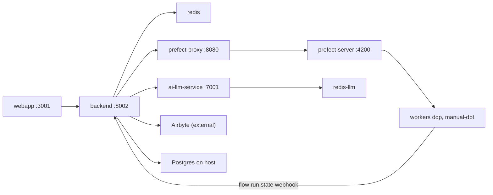

Dalgo is a monorepo with one top-level directory per service. The backend is the hub. The webapp calls it over HTTP, and it calls Airbyte, `prefect-proxy`, `ai-llm-service` and the client's warehouse. This page covers first-run commands and tells you which page to read next. It never shows the contents of any `.env` file. Each service ships a template, and [Environment variables](operations/environment-variables.md) lists what each variable does.

| Directory | Stack | Local port | Guidance file |
|---|---|---|---|
| `backend/` | Django + Django Ninja, Celery | 8002 | `backend/.claude/CLAUDE.md` |
| `webapp/` | Next.js 15, React 19 | 3001 | `webapp/CLAUDE.md` plus `webapp/.claude/rules/*.md` |
| `prefect-proxy/` | FastAPI (the only route to Prefect) | 8080 in compose | `prefect-proxy/README.md` |
| `ai-llm-service/` | FastAPI + Celery | 7001 | `ai-llm-service/README.md` |

Docker config lives in `docker/`, user-facing docs in `docs/`, and specs and plans in `harness/`. Read `CLAUDE.md` at the repo root, then the guidance file of the service you are about to change.

## Two ways to run everything

### Option A: the dev compose stack

Run these from `docker/`. Each service reads its own env file (`../backend/.env`, `../prefect-proxy/.env`, `../webapp/.env`, `../ai-llm-service/.env`), created from that service's template (`.env.template` or `.env.example`).

```bash
cd docker/
docker compose -f docker-compose.dev.yml build
docker compose -f docker-compose.dev.yml up -d

# after a pyproject.toml / uv.lock change
docker compose -f docker-compose.dev.yml build backend
docker compose -f docker-compose.dev.yml up -d --no-deps backend
```

The dev compose file (`docker/docker-compose.dev.yml`) starts these pieces:

- **Postgres runs on the host, not in compose.** Containers reach it as `host.docker.internal`.
- **Two separate Redis instances.** `redis` serves the backend's Celery and caches. `redis-llm` serves `ai-llm-service`.
- **Prefect:** `prefect-server` on 4200, `prefect-proxy`, and two workers. One worker serves queue `ddp` and the other serves queue `manual-dbt`, both in the work pool `dalgo_work_pool` by default.
- **Backend:** the `backend` container, plus four Celery processes: `celery-worker` (queue `default`), `celery-canvasdbt-worker` (queue `canvas_dbt`), `celery-alerts-worker` (queue `alerts`) and `celery-beat`.
- **`webapp`** is built as a standalone Next.js image. There is no hot reload, so rebuild it when code or `webapp/.env` changes.
- **AI:** `ai-llm-service` (uvicorn with reload) and `ai-llm-celery-worker` (queue `llm`).
- **Wiring inside compose:** the backend finds `prefect-proxy` and `ai-llm-service` through container-network URLs that compose injects. Airbyte is not in this file and must be reachable separately.



*Dev topology: the backend calls Prefect only through prefect-proxy, and Prefect reports flow-run state back to the backend through a webhook.*

For what each external system is and how it is wired, read [Local services and dependencies](operations/local-services-and-dependencies.md). For images, compose variants and CI, read [Platform](architecture/platform.md).

### Option B: run services natively

Follow the per-service sections below. You need Postgres, Redis, Airbyte, a Prefect server and `prefect-proxy` reachable. `backend/README.md` steps 3 to 5 cover Postgres, Airbyte (0.58.0 via `run-ab-platform.sh`) and the proxy URL.

## Backend (`backend/`)

Always run Python through `uv run`. This applies to tests, scripts and `manage.py`, per `backend/.claude/CLAUDE.md`.

```bash
cd backend
uv sync                                   # install deps
# create .env from .env.template, fill in DB / Airbyte / proxy settings
uv run python manage.py migrate
uv run python manage.py loaddata seed/*.json     # roles, permissions, role-permissions
uv run python manage.py create-system-orguser
uv run python manage.py createorganduser "<Org Name>" <email> --role super-admin
uv run uvicorn ddpui.asgi:application --port 8002   # API; docs at http://localhost:8002/api/docs
```

Extra one-time setup from `backend/README.md`: create the `ddpui/logs` folder and create `ddpui/assets/whitelist.py` from `.whitelist.template.py`. There is no separate dbt environment to set up: `dbt-core 1.10.19`, `dbt-postgres 1.10.2` and `dbt-bigquery 1.10.3` are pinned in `prefect-proxy/pyproject.toml` and `backend/pyproject.toml`, so the normal `uv sync` in each project installs them. The dbt section of `backend/README.md` is stale and should not be followed.

Celery runs as separate processes in the same environment, and each queue gets its own worker:

```bash
uv run celery -A ddpui worker -Q default -n ddpui
uv run celery -A ddpui worker -Q canvas_dbt -n canvas_dbt --concurrency=2
uv run celery -A ddpui worker -Q trial_clone -n trial_clone --autoscale=4,1
uv run celery -A ddpui beat
```

The dev compose file also runs an `alerts` queue worker. Add `-P solo` on Windows. Queues, locks and Redis state are in [Background work](architecture/background-work.md).

Test, lint and format commands:

```bash
uv run pytest ddpui/tests -v
uv run pytest ddpui/tests/api_tests/test_X.py::test_Y -v    # one test
uv run pytest ddpui/tests --cov
uv run black .
uv run pylint ddpui/
```

Backend rules to keep in mind before you edit:

- **Layer direction** is API → core → models, one way only.
- **Tenancy:** every query filters by `org`, taken from `request.orguser.org`.
- **Permissions:** every endpoint has `@has_permission([...])`.
- **Responses:** endpoints return through `api_response(...)`.
- **Testing:** write one test, run it, fix it, then write the next.

[Backend layers](architecture/backend-layers.md) explains why these rules exist. Feature flags are managed with `manage.py manage_feature_flags` and read through `GET /api/organizations/flags`.

## Webapp (`webapp/`)

Needs Node >= 18.17 and npm >= 10. Create `webapp/.env` from `webapp/.env.example`.

```bash
cd webapp
npm install
npm run dev              # Turbopack dev server at http://localhost:3001
npm run test             # Jest; add a path or -- --testNamePattern="name"
npm run test:coverage
npx playwright test      # e2e; authenticated specs need E2E_ADMIN_EMAIL and E2E_ADMIN_PASSWORD
npm run lint
npm run format:write
```

Things that surprise newcomers:

- TypeScript and ESLint errors do not fail `npm run build`.
- All API calls go through `lib/api.ts`. It includes cookies, sends the `x-dalgo-org` header and refreshes the JWT on a 401.
- Interactive elements need `data-testid`.
- Never edit `components/ui/` without telling the user first.
- Never change a test assertion just to make it pass.

Details: [Webapp architecture](architecture/webapp.md) and [Webapp testing](testing/webapp-jest-playwright.md).

## prefect-proxy (`prefect-proxy/`)

The proxy exists because Prefect's SDK is async and Django does not mix well with it. Only the backend (or test scripts) calls it. Endpoints are in `proxy/main.py` and mostly delegate to `proxy/service.py`. Create `.env` from `.env.template` (it needs `LOGDIR` and `PREFECT_API_URL`).

```bash
cd prefect-proxy
uv sync
uv run prefect server start                                   # Prefect on :4200
uv run prefect worker start -q ddp --pool dalgo_work_pool
uv run prefect worker start -q manual-dbt --pool dalgo_work_pool
uv run gunicorn proxy.main:app --workers 4 \
  --worker-class uvicorn.workers.UvicornWorker --bind 0.0.0.0:<port>
```

Create the work pool in the Prefect UI first. Then point the backend's `PREFECT_PROXY_API_URL` at the proxy. Add a Prefect **Custom Webhook** notification that POSTs to the backend's `/webhooks/v1/notification/` with the `X-Notification-Key` header. The run states to watch are Completed, Cancelled, Crashed, Failed and TimedOut. Dalgo relies on this webhook to learn when a run finishes, so it can clean up resources and notify users of failures. The README has the full steps. Tests: `pytest`, as described in [prefect-proxy and ai-llm-service testing](testing/prefect-proxy-and-ai-llm-service.md). Design: [Orchestration](architecture/orchestration.md).

## ai-llm-service (`ai-llm-service/`)

Every request is queued as a Celery task and retried by workers. A Redis server must be running.

```bash
cd ai-llm-service
uv sync
cp .env.example .env                                  # then fill it in
uv run celery -A main.celery worker -n llm -Q llm --loglevel=INFO
uv run celery -A main.celery flower --port=5555       # optional queue monitor
uv run main.py                                        # API; docs at http://127.0.0.1:7001/docs
```

`docker compose up --build` inside the service directory is the standalone container route. The `/api` and `/api/v1` routers require an `Authorization` header that matches the service's `API_KEY` setting. The Kaapi callback router under `/api/v1/callbacks` and `/health` are not behind that check (see `main.py`). The backend reaches the service through `LLM_SERVICE_API_URL`, and in the backend the AI code lives in `ddpui/core/ai/` and `core/llm_service.py`. Read [AI features](architecture/ai-features.md).

## Task-routing map

| If you are about to… | Read |
|---|---|
| Add or change an API endpoint, schema, service or model | [Backend layers](architecture/backend-layers.md), then [Add an endpoint and a webapp feature](workflows/add-endpoint-and-webapp-feature.md) |
| Change a model or write a migration | [Django migrations](workflows/django-migrations.md), [Domain model](concepts/domain-model.md) |
| Touch login, `x-dalgo-org`, roles or `has_permission` | [Auth, orgs and permissions](architecture/auth-orgs-permissions.md) |
| Work on sources, destinations, connections or syncs | [Ingestion](architecture/ingestion.md) |
| Work on dbt, the transform UI or the canvas | [Transformation](architecture/transformation.md) |
| Work on deployments, flow runs, webhooks or the job runner | [Orchestration](architecture/orchestration.md) |
| Query a client's warehouse | [Warehouses](architecture/warehouses.md) |
| Work on charts, dashboards, filters, sharing or reports | [Charts, dashboards and reports](architecture/charts-dashboards-reports.md) |
| Work on metrics, KPIs or alerts | [Metrics, KPIs and alerts](architecture/metrics-kpis-alerts.md) |
| Work on Chat with Data or `ai-llm-service` | [AI features](architecture/ai-features.md) |
| Add a Celery task, lock or progress tracker | [Background work](architecture/background-work.md) |
| Add a webapp page, hook, store or component | [Webapp architecture](architecture/webapp.md) |
| Understand blast radius across entities | [Domain model](concepts/domain-model.md) |
| Find the design reasoning behind a feature | [Feature specs and the harness](concepts/feature-specs-and-harness.md) |
| Trace an NGO's data from source to chart | [An NGO's pipeline end to end](workflows/ngo-pipeline-end-to-end.md) |
| Add or debug a setting or env var | [Environment variables](operations/environment-variables.md) |
| Set up Airbyte, Prefect, Redis or other dependencies locally | [Local services and dependencies](operations/local-services-and-dependencies.md) |
| Change Dockerfiles, compose or CI | [Platform](architecture/platform.md) |
| Ship to staging or production | [Deploy to staging and production](workflows/deploy-staging-production.md) |
| Write backend tests | [Backend pytest](testing/backend-pytest.md) |
| Write webapp tests | [Webapp Jest and Playwright](testing/webapp-jest-playwright.md) |
| Test prefect-proxy, ai-llm-service or the AI evals | [prefect-proxy and ai-llm-service testing](testing/prefect-proxy-and-ai-llm-service.md) |

## Pitfalls on a first run

- **Backend commands:** use `uv run`. Bare `python`, `pytest` or `celery` can pick up the wrong environment.
- **Roles and permissions:** roles, permissions and role-permissions come from the seed fixtures (`001_roles.json`, `002_permissions.json`, `003_role_permissions.json`). Load them with `loaddata`, and run `create-system-orguser`, before creating the first org and user.
- **Missing workers:** if Celery workers or beat are not running, syncs, canvas dbt runs and scheduled work will not progress. If Redis is down, progress tracking and locks fail with it.
- **Flow-run state:** run states only reach the backend through the Prefect webhook.
- **Webapp in compose:** it is not hot-reloaded. Use `npm run dev` for iterating on the UI.
- **Secrets:** wiki pages never carry env values. Start from each service's `.env.template` or `.env.example`.
