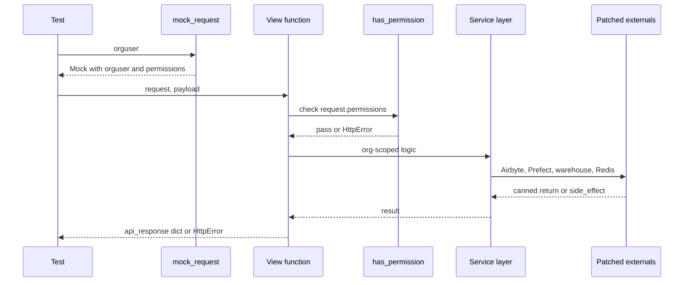

# Backend testing (pytest)

The backend (`backend/`, package `ddpui`) is tested with `pytest` + `pytest-django`. Tests are mostly **in-process**: they hit a real Postgres test database but call Python view and service functions directly, with every external system (Airbyte, Prefect proxy, client warehouses, Redis, SES, git, the filesystem) replaced by `unittest.mock`. Run every command from `backend/` and prefix it with `uv run`.

Related reading: [Backend layers](../architecture/backend-layers.md) (what api / core / service modules are being tested), [Auth, orgs and permissions](../architecture/auth-orgs-permissions.md) (the `@has_permission` decorator and roles that the fixtures seed) and [Add an endpoint and webapp feature](../workflows/add-endpoint-and-webapp-feature.md) (where tests fit in the feature workflow).

## Commands

```bash
# One test (the most common command while developing)
uv run pytest ddpui/tests/api_tests/test_widget_api.py::test_create_widget -v

# One file / one class
uv run pytest ddpui/tests/api_tests/test_widget_api.py -v
uv run pytest ddpui/tests/core/test_widget_service.py::TestWidgetService -v

# Whole suite with coverage (local)
uv run pytest ddpui/tests --cov

# Formatting (pre-commit runs black over ddpui/**/*.py, line length 100)
uv run black .
```

`widget` names above are illustrative placeholders from the testing skill, not real modules.

Pytest configuration lives in `backend/pyproject.toml` under `[tool.pytest.ini_options]`: `pythonpath = ["."]`, `DJANGO_SETTINGS_MODULE="ddpui.settings"` and `testpaths = ["ddpui/tests"]`. Dev dependencies pinned there are `pytest`, `pytest-cov`, `pytest-django` and `pytest-parametrization`. There is no `pytest-asyncio` marker use in the suite; async views are exercised with `asyncio.run(...)`.

## Test layout (`backend/ddpui/tests`)

| Directory | What lives there |
|---|---|
| `api_tests/` | One file per API module (`test_dbt_api.py`, `test_airbyte_api.py`, `test_pipeline_api.py`, `test_access_api.py`, …). Call the Ninja view functions directly. `test_user_org_api.py` also **owns the canonical shared fixtures**. |
| `core/` | Service/domain logic grouped by feature: `ai/`, `alerts/`, `charts/`, `datainsights/`, `dbt_automation/`, `notifications/`, `reports/`, `trial/`, plus top-level files such as `test_auth.py`, `test_celery_tasks.py`, `test_git_manager.py`, `test_rbac_v2_roles.py`. |
| `services/` | Tests for `ddpui.services.*` and some client wrappers (`test_prefect_service.py`, `test_airbyte_service.py`, `dbt_service/`). |
| `helper/` | Helpers such as `airbytehelpers`, `dbthelpers`, secrets managers. `test_airbyte_unit_schemas.py` holds payload/response Pydantic schemas reused elsewhere. |
| `models/`, `schema_tests/`, `unit/`, `utils/` | Model behaviour, Pydantic schema validation, pure unit tests (pivot query builder), and utilities (S3, feature flags, warehouse engine registry). |
| `websockets/` | Channels consumers, tested by instantiating the consumer and replacing `connect`/`respond` with `Mock`. |
| `integration_tests/` | Tests against real Airbyte/Prefect/warehouses. **Excluded from CI** and largely skipped (e.g. `@pytest.mark.skip` on the Airbyte class). |
| `common/fixtures/` | Shared payload builders (e.g. `chart_ui_payloads.py`). |

## Environment bootstrap boilerplate

Test modules that import Django models or settings start with explicit setup, because model imports need `django.setup()` first:

```python
os.environ.setdefault("DJANGO_SETTINGS_MODULE", "ddpui.settings")
os.environ["DJANGO_ALLOW_ASYNC_UNSAFE"] = "true"
django.setup()
...
pytestmark = pytest.mark.django_db
```

`pytestmark = pytest.mark.django_db` at module level grants DB access to every test in the file. `DJANGO_ALLOW_ASYNC_UNSAFE` lets sync ORM calls run inside async contexts used by consumers and async views.

## `conftest.py`: the suite-wide email guard

`ddpui/tests/conftest.py` contains one fixture, and it is `autouse=True` for **every** test: `_never_send_real_email` monkeypatches `ddpui.utils.awsses._get_ses_client` to return a `MagicMock`. The reason is documented in the file: a developer's `.env` normally holds real SES credentials and `awsses.send_text_message` builds the SES client unconditionally, so tests that reached trial-welcome or ops-alert paths really delivered mail (and `send_trial_ops_alert` swallows errors, so nothing failed). It is deliberately not opt-in.

This is only a floor. Tests asserting email content should still patch the specific `awsses.send_*` function (or `ddpui.utils.awsses._get_ses_client` and inspect `send_email`). Setting `DDPUI_TEST_SES_PROBE=<file>` appends the node id of every test that reaches the SES client to that file, which is a debugging aid for finding such tests.

`services/dbt_service/conftest.py` exists but only holds a docstring.

## Fixtures: import, don't redefine

The shared fixtures are defined in `ddpui/tests/api_tests/test_user_org_api.py` (not in a `conftest.py`) and imported by name into other test modules; more than forty test files do this:

```python
from ddpui.tests.api_tests.test_user_org_api import (
    seed_db, org_with_workspace, org_without_workspace,
    authuser, orguser, nonadminorguser, mock_request,
)
```

If the home ever moves, `grep "def seed_db"` finds it. Because pytest resolves fixtures by name in the importing module, importing a fixture is enough to use it, and importing the dependency chain (`orguser` needs `authuser` and `org_without_workspace`) is required too.

| Name | Behaviour |
|---|---|
| `seed_db` | **Session-scoped.** Uses `django_db_blocker.unblock()` and runs `loaddata` for `001_roles.json`, `002_permissions.json`, `003_role_permissions.json`. Files are found via `FIXTURE_DIRS = ["seed"]` in `settings.py`, i.e. `backend/seed/`. Required by any test going through permission checks. |
| `org_with_workspace` | `Org` with `airbyte_workspace_id="FAKE-WORKSPACE-ID"`. Deleted on teardown. |
| `org_without_workspace` | `Org` with `airbyte_workspace_id=None` (the "not configured yet" path). |
| `authuser` | Plain Django `User`. |
| `orguser` | `OrgUser` with the **account-manager** role on `org_without_workspace` (full permissions). |
| `nonadminorguser` | `OrgUser` with the **guest** role, used for denial tests. |
| `orguserwithoutorg` | `OrgUser` with `org=None`. |
| `mock_request(orguser)` | **A plain function, not a fixture.** Builds a `Mock` with `.orguser` and `.permissions`, where `permissions` is the list of `RolePermission` slugs of the orguser's `new_role`. |

Notes:

- `orguser` is built on `org_without_workspace`, not `org_with_workspace`. A test that needs both a workspace and an orguser must set the workspace explicitly or build its own org.
- `seed_db` is defined (identically) again in a few modules (`core/test_auth.py`, `core/test_management_commands.py`, `core/test_rbac_v2_roles.py`, and a variant in `websockets/test_chat_with_data_consumer.py`). Those are legacy local copies; new tests should import.
- `test_seed_data` asserts the seeded counts (4 roles, more than 5 permissions and role-permissions), so changing seed JSON can break it.
- One-off setup that other files will not use belongs in a local `@pytest.fixture` that `yield`s and cleans up, rather than in the shared module.
- Fixtures clean up by deleting created rows on teardown in addition to the `django_db` transaction handling, so tests creating extra rows should still avoid leaking state that other tests assume absent.

## API test pattern: call the view directly

The suite does not use Ninja's `TestClient`. A test imports the endpoint function and the request schema, builds a request with `mock_request(orguser)`, and calls the function:

```python
def test_create_widget(orguser, seed_db):
    payload = WidgetCreate(title="hello")
    request = mock_request(orguser)
    response = create_widget(request, payload)
    assert response["success"] is True
```



A direct view call from a test, with permissions supplied by `mock_request` and every external call mocked.

Why this works: the JWT middleware normally sets `request.orguser` and `request.permissions` (permission slugs from the user's role); `mock_request` imitates exactly that. `@has_permission(...)` in `ddpui/auth.py` reads only `request.permissions`. A bare `Mock()` request has no real permission list, so the decorator will deny the call. This is why `seed_db` is needed: without the seeded role-permission rows, `mock_request` yields an empty list.

### What to assert

- **Envelope and state together.** The view returns a dict from `api_response` (`success`, `message`, `data`). Assert individual fields (`response["success"] is True`, `response["data"]["id"] == ...`) rather than comparing whole dicts, and also assert the DB row exists, since a view can return success without persisting.
- **Errors** are `ninja.errors.HttpError`. Use `pytest.raises(HttpError)` and check `excinfo.value.status_code` and `str(excinfo.value)` for the message.
- **Validation / not found / cross-org.** Duplicates give 400, missing objects 404. Any endpoint reading or mutating org-scoped data needs a cross-org test: create an object in another `Org` and assert the caller gets 404, because multi-tenancy is a core invariant enforced by `filter(org=...)` in the service layer.
- **Pagination**: list endpoints nest as `response["data"]["total"]`, `["page"]`, `["data"]`.
- **External failure paths**: make the mocked dependency raise (`side_effect=Exception(...)`) and assert the view maps it to an `HttpError`, and that expected calls were (or were not) made.

### Permission-denial status codes: a known quirk

Guidance in the testing skill says a missing permission yields 403. In the current `has_permission`, the internal check raises `HttpError(403, "not allowed")` inside a `try` whose bare `except` re-raises `HttpError(404, UNAUTHORIZED)` (`"unauthorized"`). So a role lacking the required slug actually surfaces as **404** from the decorator. Existing tests acknowledge this (`test_access_api.py` notes the "decorator quirk: internal 403 → 404 UNAUTHORIZED" and accepts `status_code in (403, 404)`). Other 403s come from explicit checks in view/service code such as `has_access` or ownership rules. When writing denial tests, assert on the code the decorator really produces, or use the tolerant form, and use `nonadminorguser` (guest) as the caller.

`has_permission` also preserves async views: for coroutine functions it returns an `async` wrapper so Ninja still awaits them. `api_tests/test_has_permission_async.py` is the regression test (it builds a `SimpleNamespace(permissions=..., orguser=None)` request and uses `asyncio.run`).

## Mocking external services

Tests must never perform real I/O. Mock at the point where the code under test **looks the name up**:

1. **Module-attribute call.** The caller does `from ddpui.ddpprefect import prefect_service` and calls `prefect_service.get_flow_run(...)`. Patch on the source module: `ddpui.ddpprefect.prefect_service.get_flow_run`.
2. **Directly imported name.** The caller does `from ddpui.core.git_manager import GitManager`. The name was rebound in the caller, so patch `ddpui.api.dbt_api.GitManager`; patching the definition site has no effect.
3. **Class method.** Patching a classmethod on the class (for example `WarehouseFactory.get_warehouse_client`) works from either path since the class object is shared.

If a mock is never called, the binding was rebound in the caller: switch to the caller's namespace. Mock dependencies, never the view under test.

| Service | Typical patch targets |
|---|---|
| Airbyte | `ddpui.ddpairbyte.airbyte_service.<fn>` (e.g. `create_source`, `create_connection`), or `ddpui.ddpairbyte.airbytehelpers.<fn>` when helpers are imported. |
| Prefect | `ddpui.ddpprefect.prefect_service.<fn>` (`get_flow_run`, `create_deployment_flow_run`, `get_flow_run_poll`). Low-level HTTP is tested by patching `ddpui.ddpprefect.prefect_service.requests.get` and asserting the exact `PREFECT_PROXY_API_URL/proxy/...` call. |
| Warehouse | `ddpui.utils.warehouse.client.warehouse_factory.WarehouseFactory.get_warehouse_client` returning a `Mock` with `execute`, `get_wtype`, `get_table_columns`. |
| Redis | `ddpui.auth.RedisClient.get_instance` (or `ddpui.api.dbt_api.RedisClient`), returning a fake whose `get`/`set` you assert on. |
| Email (SES) | The autouse guard in `conftest.py`, plus `ddpui.utils.awsses.send_*` or `@patch.multiple("ddpui.utils.awsses", ...)`; deeper: `ddpui.utils.awsses._get_ses_client`. |
| Celery | Patch `.delay` at the caller's import site, e.g. `ddpui.api.dbt_api.run_dbt_command.delay`, then `assert_called_once_with`. |
| Filesystem / git | `os.path.exists` with `side_effect=[True, False]`, `builtins.open` or `mock_open(read_data=...)`, `GitManager` in the caller. |
| Websocket consumers | Instantiate the consumer, set `consumer.connect = Mock()`, `consumer.respond = Mock()`, a `Mock` orguser, and assert `respond` was called with a `WebsocketResponse`. |

Mock mechanics worth remembering:

- `side_effect=[a, b, c]` yields sequential results; a list item that is an exception instance raises. A fourth call raises `StopIteration`.
- Stacked `@patch` decorators bind arguments **bottom-up**: the decorator closest to the function is the first argument, before fixtures. When that gets confusing, use `with patch(...)` context managers, which also combine cleanly with `pytest.raises`.
- `@patch.multiple` takes `Mock(...)` values and adds no arguments.
- Prefer `assert_called_once_with(...)` / `call_args` over `assert mock.called`, so the contract with the external service is locked in.

## CI and coverage

`.github/workflows/backend.yml` ("Backend CI") runs on pushes and PRs to `main` touching `backend/**` or `docker/Dockerfile.backend*`. Steps, all with `working-directory: backend`:

1. `uv sync`, then `uv run pre-commit run --all-files` (black over `ddpui/**/*.py`).
2. Services: a `postgres:15` container (user `ddp`, db `dalgo`) and Redis 6; Python 3.10.
3. `mkdir -p ddpui/logs` and `uv run python manage.py migrate` against that database.
4. Tests, with dummy env vars for Airbyte, DB, `PREFECT_PROXY_API_URL=http://localhost:8080`, `DEV_SECRETS_DIR`, `CLIENTDBT_ROOT` and `DJANGOSECRET`:
   `uv run coverage run -m pytest --ignore=ddpui/tests/integration_tests --durations=20` then `uv run coverage xml`.
5. Upload to Codecov with flag `backend` (`fail_ci_if_error: true`).
6. `uv run coverage report --fail-under=55`: the build fails below **55%** total coverage.

Consequences: tests must be runnable with fake Airbyte/Prefect hosts (so they must mock rather than connect), and `integration_tests/` never runs in CI.

Coverage scope (`[tool.coverage.run]` in `pyproject.toml`) measures `ddpui` but omits tests, migrations, management commands, `models/*`, schemas, `celeryworkers/*.py`, `settings.py`, `urls.py`, `routes.py`, `asgi/wsgi`, `celery.py`, some utilities (`sendgrid.py`, `dbtdocs.py`) and parts of `dbt_automation` (assets, seeds, operations). The 55% gate is therefore measured over API, core, service and helper code.

`codecov.yml` at the repo root disables aggregate project status (the monorepo reports per flag), enables **patch** status, and defines flags `backend`, `prefect-proxy`, `webapp`, `ai-llm-service` with `carryforward: true`, so an untouched service keeps its last coverage. New backend code is therefore judged by patch coverage on the PR, in addition to the global floor.

## The one-test-at-a-time workflow

Write tests incrementally and run each immediately, instead of batching:

1. Write a single test.
2. Run it with `uv run pytest <file>::<test> -v`; it should fail for the right reason (assertion or missing implementation).
3. Implement or fix the code.
4. Re-run until green.
5. Run the whole class/file to catch regressions.
6. Move to the next test.

This surfaces wrong import paths, wrong patch targets and wrong assumptions about response shape one at a time instead of compounding them.

Pre-flight before opening a PR:

- Each new test passes alone and the whole file passes together (shared session fixtures like `seed_db` make order dependence a real risk).
- No external calls: Airbyte, Prefect, warehouse, Redis, SES, git are all mocked.
- Edge cases covered: empty input, missing configuration (for example `org_without_workspace`), permission denial, cross-org access, and external failure.
- `uv run black .` is clean, since CI runs it through pre-commit.

## Common pitfalls

| Pitfall | Fix |
|---|---|
| Building `Mock()` for the request | Use `mock_request(orguser)` so `permissions` is populated. |
| Forgetting `seed_db` | Add it to the test arguments; roles and permissions are not otherwise loaded. |
| Redefining fixtures locally | Import from `ddpui.tests.api_tests.test_user_org_api`. |
| Patching the definition site of a name rebound in the caller | Patch the caller's namespace. |
| Expecting 403 from `@has_permission` | The decorator surfaces 404 `unauthorized`; see the quirk above. |
| Asserting only the response | Also assert the DB state and the external mock calls. |
| Using `== True` on `success` | Use `is True`. |
| Relying on a real `.env` | The CI environment uses dummy values; a test that passes only with real credentials will fail there. |
