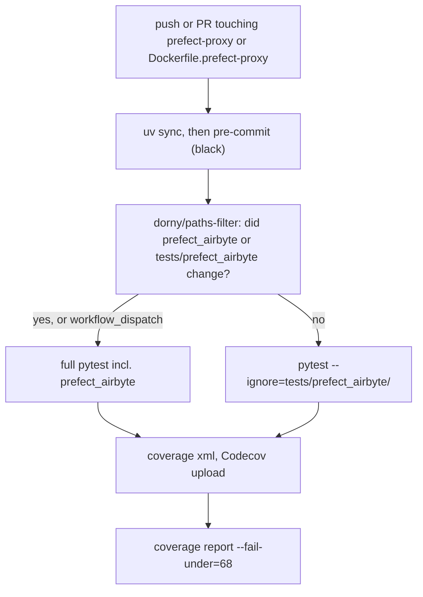

# prefect-proxy and ai-llm-service testing

Two sibling Python services live next to the Django backend, and each has its own `uv` project, `pyproject.toml`, test folder and GitHub Actions workflow. Backend tests are covered separately in [Backend pytest](./backend-pytest.md). The AI evaluation harness lives in the backend (`backend/ddpui/core/ai/evals`), so this page covers it too. Background on what the services do: [Orchestration](../architecture/orchestration.md) and [AI features](../architecture/ai-features.md).

| Project | Tests | Workflow | CI gate |
|---|---|---|---|
| `prefect-proxy/` | `prefect-proxy/tests/` (+ `tests/prefect_airbyte/`) | `.github/workflows/prefect-proxy.yml` | black via pre-commit, pytest, Codecov upload, coverage at least 68% |
| `ai-llm-service/` | `ai-llm-service/tests/` | `.github/workflows/ai-llm-service.yml` | pytest, Codecov upload, Docker image build (no push) |
| backend eval runner | `backend/ddpui/tests/core/ai/test_eval_runner.py`, `test_sql_compare.py` | part of the backend suite (see [Backend pytest](./backend-pytest.md)) | offline unit tests, no API cost |

## prefect-proxy

### Running locally

Work from `prefect-proxy/` (the CI workflow sets this as its working directory):

```bash
uv sync                      # installs the dev dependency group by default
uv run pytest                # pyproject sets testpaths=["tests"] and asyncio_mode="auto"
```

The README's form is `GOOGLE_APPLICATION_CREDENTIALS=<your/credentials.json> pytest`, and CI likewise provides a credentials file through that variable. CI also sets `LOGDIR` to a `logs/` directory it creates first (the README says logs go to `prefect-proxy.log` in `LOGDIR`), so set both locally if tests fail on logging or credentials.

To mirror CI exactly, including coverage:

```bash
uv run coverage run -m pytest --durations=20 --asyncio-mode=auto
uv run coverage xml
uv run coverage report --fail-under=68
```

Coverage is measured only for the `proxy` package. `proxy/schemas.py` and `proxy/exception.py` are omitted, so `prefect_airbyte` is not part of the 68% figure.

Formatting is enforced with `black` through `.pre-commit-config.yaml`, using the local hook `uv run black`. It is limited to `^prefect-proxy/(proxy|tests)/.*\.pyi?$`. The pylint and flake8 hooks are commented out. Run it with `uv run pre-commit run --all-files`.

### Test layout and what each file is for

- `tests/test_main.py` calls the FastAPI endpoint functions in `proxy/main.py` directly and patches the collaborators in the `proxy.main` namespace (for example `proxy.main.dbtjob_v2_runner`, `proxy.main.shellopjob`, `proxy.main.get_airbyte_server_block_id`). It pins the error contract:
  - A payload that isn't the expected pydantic schema raises `TypeError`.
  - A runner failure becomes `HTTPException` 400.
  - Unexpected failures in block lookups become 500 with `"Internal server error"`.
- `tests/test_service.py` is the largest file. It covers `proxy/service.py`: block creation, deployments, flow-run queries, log parsing and the `prefect_get`, `prefect_post`, `prefect_patch` and `prefect_delete` HTTP helpers. It uses mock classes and `AsyncMock`/`patch`, not a live Prefect server.
- `tests/test_helpers.py` covers the pure functions in `proxy/helpers.py`: block-name cleaning, extracting the command from a dbt block name, and `deployment_to_json`.
- `tests/test_prefect_flows_runner.py` covers `proxy/prefect_flows_runner.py`, the flow file that Prefect workers run:
  - `_build_output` and `build_profile_dict` produce the dbt profile (see below).
  - `dbtjob_v2_runner` loads a secret block whose value may be a dict or a JSON string, writes `profiles.yml`, writes the postgres SSL root cert from `sslrootcert_content` and rewrites the path, and removes the binary token from the dbt command.
  - dbt-test failures return a COMPLETED state named `DBT_TEST_FAILED` so downstream tasks continue. Other failures re-raise.
  - `run_airbyte_connection_flow_v1` reads post-sync ops from the `AirbyteConnection` block's `.extra`, or falls back to the inline payload.
  - It re-raises sync failures and skips post-sync ops after them.
  - It swallows post-sync errors and still returns the sync result.
  - `_run_task_runner` dispatches by task type and slug.
  - `_run_tasks_sequentially` stops on the first error.
  - `_run_tasks_with_sync_tolerance` collects sync errors and then skips transforms.
  - `deployment_schedule_flow_v5` sorts tasks by `seq` and picks the mode from a flag.
- `tests/test_post_sync_ops.py` covers `_run_post_sync_ops` and the SQL builders `_build_postgres_cast_sql` and `_build_bigquery_cast_sql`. The proxy builds this SQL itself from raw op config. BigQuery uses live table metadata, partition and cluster spec, so the generated `CREATE OR REPLACE` is accepted for Airbyte-partitioned tables. The tests mock the BigQuery client and a secret block.
- `tests/test_integration.py` is entirely `@pytest.mark.skip(reason="Integration test")`. Those classes need a real Prefect server and are not run in CI.

How the runner and post-sync tests call things matters when you add tests. Prefect tasks and flows are called through `.fn(...)`, which bypasses the Prefect runtime, for example `dbtjob_v2_runner.fn(task_config, slug)` and `run_airbyte_connection_flow_v1.fn(payload)`. `get_run_logger` needs a live task-run context, so tests patch `proxy.prefect_flows_runner.get_run_logger` (an `autouse` fixture in `test_post_sync_ops.py`, and part of `_mock_flow_deps` in the runner tests). Patch names in the module that uses them (`proxy.prefect_flows_runner.Secret`, `.ShellOperation`, `.AirbyteConnection`), not at their origin.

### Vendored `prefect_airbyte`

`prefect-proxy/prefect_airbyte/` was a standalone repo and was vendored into the monorepo so the Docker build has no external git dependency and Prefect workers, which sparse-checkout `prefect-proxy`, get it automatically. It is a plain local directory on `sys.path`, not an installed package. The package's own `prefect_airbyte/CLAUDE.md` is the maintainer note for it. It targets the public Airbyte API: `POST /api/public/v1/jobs` to trigger a sync and `GET /api/public/v1/jobs/{id}` to poll. `AirbyteSyncResult.created_at` and `updated_at` are optional because that API does not return timestamps. `client.get_job_info` retries `httpx.HTTPStatusError` and `AirbyteServerNotHealthyException` with exponential backoff, up to 8 attempts. It does not retry `JobNotFoundException`, which surfaces immediately.

Its tests are in `tests/prefect_airbyte/`:

- `conftest.py` has the shared fixtures:
  - A session-scoped, autouse `prefect_db` fixture wraps the whole run in `prefect_test_harness()`, which gives an ephemeral Prefect API and DB.
  - `respx_mock` is overridden to `respx.mock(assert_all_mocked=True, assert_all_called=False)` with `host="127.0.0.1"` passed through. This keeps the local Prefect API reachable while every Airbyte call must be mocked, and unused routes don't fail teardown.
  - Scenario fixtures such as `mock_successful_connection_sync_calls`, `mock_failed_connection_sync_calls`, `mock_cancelled_connection_sync_calls`, `mock_inactive_sync_calls`, `mock_failed_health_check_calls`, `mock_bad_connection_id_calls`, `mock_successful_job_cancel_calls`, `mock_job_cancel_not_running_calls` and `mock_job_cancel_not_found_calls` register respx routes for the public API.
- `test_flows.py` runs `run_connection_sync` and `cancel_job` standalone, as a sync subflow and as an async subflow. A cancelled sync raises `AirbyteSyncJobFailed`. `cancel_job` on a successfully cancelled job returns `job_status == "cancelled"`. A missing job raises `JobNotFoundException`, and a job that isn't running raises `AirbyteSyncJobFailed`.
- `test_connections.py` covers `AirbyteConnection` and `AirbyteServer` behaviour: inactive connections, bad IDs, failed health checks, a job that isn't found, and extra kwargs passed to trigger-sync.
- `test_configuration.py` covers the deprecated `export_configuration` task, including its failed-health-check path (`AirbyteServerNotHealthyException`).
- `test_block_standards.py` parametrizes Prefect's `BlockStandardTestSuite` over every registered `Block` whose qualified name starts with `prefect_airbyte`. A new block class in the package is automatically held to Prefect's block standards.

These tests are slow (about 30 seconds, per the package notes) because of the Prefect harness.

### CI behaviour



Caption: the `prefect-proxy.yml` job skips the slow vendored-package suite unless that package changed or the run was triggered manually.

Details worth knowing:

- Triggers are `workflow_dispatch`, and push or pull request to `main` for paths `prefect-proxy/**` and `docker/Dockerfile.prefect-proxy*`. Python is 3.10.
- The "Create Google credentials file" step writes the `GOOGLE_APPLICATION_CREDENTIALS_JSON` secret to `/tmp/google_credentials.json`, which the pytest step exposes as `GOOGLE_APPLICATION_CREDENTIALS`.
- The Codecov upload uses flag `prefect-proxy` and `fail_ci_if_error: true`.
- The coverage threshold is a separate final step, so a drop below 68% fails the job after the upload.

## ai-llm-service

`ai-llm-service` is a FastAPI plus Celery service (Redis broker, `llm` queue). The test suite is currently a single placeholder, `tests/test_placeholder.py`, which asserts `True`. The CI pipeline is real but exercises almost no service code.

```bash
cd ai-llm-service
uv sync --group dev          # dev group: pytest, pytest-asyncio, coverage
uv run coverage run -m pytest --durations=20
uv run coverage xml
```

- Coverage is configured with `source = ["src"]` and omits `tests/*`. There is no `--fail-under` gate and no pytest config, so unlike `prefect-proxy` there is no `asyncio_mode` setting. Async tests need `@pytest.mark.asyncio` or a pytest option.
- `.github/workflows/ai-llm-service.yml` runs on `ai-llm-service/**` and `docker/Dockerfile.ai-llm-service` changes. It uses Python 3.10, `uv sync --group dev`, pytest under coverage and a Codecov upload with flag `ai-llm-service` (`fail_ci_if_error: true`).
- It then builds `docker/Dockerfile.ai-llm-service` with the repo root as context, tagged `dalgo-ai-llm:ci` and not pushed. This is the check that actually catches a broken image or dependency pin.
- To run the service for manual testing, see `ai-llm-service/README.md`: a Celery worker (`uv run celery -A main.celery worker -n llm -Q llm --loglevel=INFO`), flower, and `uv run main.py`. Redis must be running and `.env` must be created from `.env.example`.

When adding real tests, put them under `ai-llm-service/tests/` and target modules under `src/` (`src/apis`, `src/services`, `src/file_search`, `src/utils`) and `config/`. Note that `source = ["src"]` means `config/` and `main.py` won't count toward coverage.

## Backend AI eval runner

The eval harness answers whether a change made the chat-with-data agent better or worse. The code is `backend/ddpui/core/ai/evals/`: `runner.py` (orchestration), `sql_compare.py` (the execution-based hard metric) and `README.md` (the user guide). The item schema is `EvalItem` in `backend/ddpui/schemas/chat_with_data_schemas.py`.

### What the runner does

For each `EvalItem`, `run_item` builds a fresh `TurnGraph` with an `InMemorySaver`. The two agents are built with `human_in_the_loop=False`, so no human answers evals. The product validator is not used (`validate_fn=None`). The item question goes through the graph with a new `thread_id` and the shared `RECURSION_LIMIT`. Then:

- `eval_routing` is a hard metric: the routed intent must equal `expected_intent`.
- `eval_sql_correct` is a hard metric:
  - With `gold_sql`, the gold SQL is **executed** against the warehouse and compared with the agent's result table through `gold_satisfied`.
  - With `expected_value`, `answer_contains_value` checks the answer text instead. It ignores thousands separators and case.
  - If the gold SQL itself fails, the item gets an `error`.
- `eval_faithful`, `eval_expectations` and `eval_sql_judge` are LLM judges built on `autoevals` (`ClosedQA` and `Sql`) with an explicit `openai.OpenAI()` client. They are skipped when routing already failed, and every judge is fail-open: an exception returns `None` and is logged.

`ItemResult.hard_pass` is true when there is no error and neither hard metric is `False`. `None` means "not applicable" and counts as a pass. A gate failure blocks, and judges only inform. The README records that on one judged run the SQL judge disagreed with execution on 8 of 11 items, so judges must never veto a merge. `RunSummary.render()` prints pass counts, a hard-vs-judge agreement line and failure diagnostics (agent SQL, agent rows, gold rows).

`run_items` runs items sequentially. When given a Langfuse client, `_record` creates a trace named `chat_eval_turn` tagged `eval`, attaches the scores, and links it to the dataset item (matched by question) under the run name. Recording and flushing errors are logged and never lose the local result.

### How `eval_sql_correct` compares results

`sql_compare.py` encodes the comparison rules. Each rule is meant to have a regression test and a real failure behind it.

- Result sets compare as multisets: row order and column names are ignored, numbers use a 1e-6 relative tolerance, and values are normalized so `700`, `700.0` and `"700"` agree.
- Column order inside a row still matters.
- Labels are fuzzy: a shorter string of at least 2 characters contained in the longer one matches.
- A scalar gold (1×1) must be present in the result, or equal the row count, and must also appear in the narrated answer.
- A single-row gold must appear among the agent's rows and the answer must name its text cells.
- For other gold results, some projection of the agent's columns must equal the gold rows. Extra columns are fine and extra or missing rows are not.
- There is a label-tolerant fallback for invented category labels, used only when numeric parts are distinct and every gold label appears in the answer.

Because of this, a pass-rate change after editing `sql_compare.py` reflects changed scoring, not a changed agent. The README says to compare runs only within the same metric version.

### Tests (offline, zero cost)

```bash
cd backend
uv run pytest ddpui/tests/core/ai/test_eval_runner.py ddpui/tests/core/ai/test_sql_compare.py -v
```

- `test_eval_runner.py` uses `ScriptedChatModel`, `make_context` and `sql_call` from `test_agent_loop.py` and `FakeWarehouse` from `test_tools.py`. An `autouse` fixture monkeypatches `eval_runner.route_question` and `eval_runner.casual_reply`, so the router makes no network call. The `routed_as` dict controls the intent. Tests call `run_item(..., judge=False)`, so no judge hits OpenAI. They cover:
  - gold-SQL match and mismatch (the "grain trap" of `COUNT(*)` versus `COUNT(DISTINCT ...)`);
  - the `expected_value` fallback and routing mismatch;
  - small talk, where `sql_ok` is `None` and the item still passes;
  - the summary's disagreement report;
  - `run_items` pushing scores and dataset links to a fake Langfuse client.
- `test_sql_compare.py` pins the rules above, including that an enriched result passes only when the answer asserts the right number.

To add a rule to `sql_compare.py`, add a failing case to `test_sql_compare.py` first, with real gold and agent rows.

### Running a real eval, and a gap

`evals/README.md` documents a workflow driven by `uv run python manage.py chat_with_data_eval --org <slug> --file <jsonl> --dataset-name <name> [--run-name ...] [--tag canary] [--no-judge] [--seed] [--schemas ...]`. It describes seeding to Langfuse (idempotent, keyed by question hash) and `canary` tagging for a cheap subset.

In the current tree, `backend/ddpui/management/commands/` contains `chat_with_data_setup.py` and `chat_with_data_dashboards.py` but **no** `chat_with_data_eval` command, and no `golden_*.jsonl` file exists under `backend`. The README's quickstart therefore can't be run as written. `runner.py` can still be driven programmatically through `run_items`, and the unit tests above work. Check for the command before relying on the README.

The README's guidance for authoring items still applies:

- Questions must be unambiguous.
- Verify every `gold_sql` by executing it.
- Use `answer_expectations` for absence questions.
- Pin the agent's schemas.
- Filter `eval`-tagged traces out of production dashboards.
