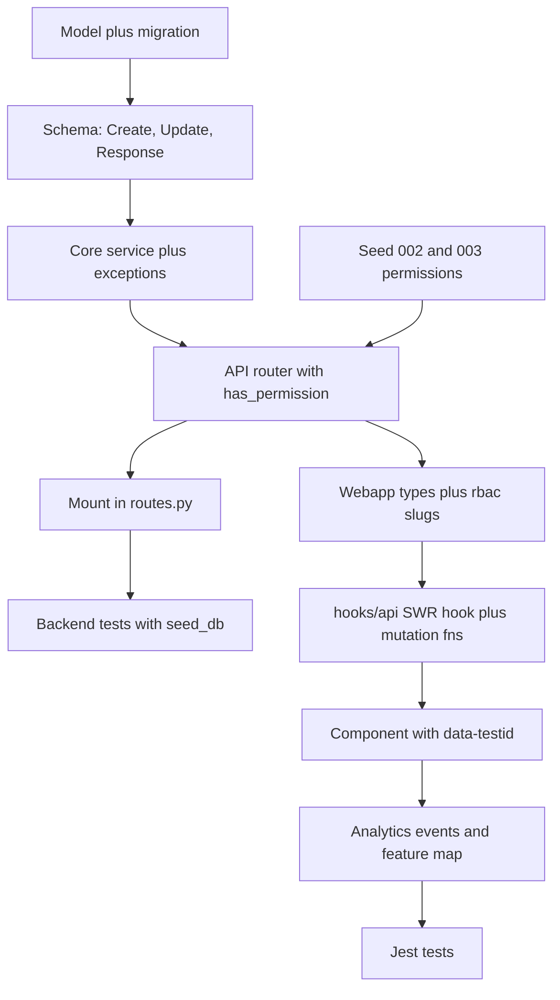

# Workflow: add a backend endpoint and a webapp feature

This is the order of work for a feature that needs new server behaviour and UI for it. The backend half follows the one-way layering in [Backend layers](../architecture/backend-layers.md). The webapp half follows [Webapp](../architecture/webapp.md). Authentication, `has_permission` and the permission seed files are explained in [Auth, orgs, roles and permissions](../architecture/auth-orgs-permissions.md). This page is the checklist that ties them together.

## Worked example: KPIs

The KPI feature is the reference because it touches every layer and is the most recently extended one with a complete trail:

| Layer | Where it lives for KPIs |
|---|---|
| Model | `KPI` in [`models/metric.py`](../../backend/ddpui/models/metric.py), with an `org` FK, `created_by`, `last_modified_by` and (v1.1) an `extra_config` JSONField |
| Migration | [`0166_kpi_extra_config.py`](../../backend/ddpui/migrations/0166_kpi_extra_config.py): one `AddField` with `default=dict`, so existing rows backfill without a data migration |
| Schemas | [`schemas/kpi_schema.py`](../../backend/ddpui/schemas/kpi_schema.py): `KPICreate`, `KPIUpdate`, `KPIResponse`, `KPIListResponse`, and the typed `KPIExtraConfig` |
| Service and exceptions | [`core/kpi/kpi_service.py`](../../backend/ddpui/core/kpi/kpi_service.py) and `core/kpi/exceptions.py` |
| Router | [`api/kpi_api.py`](../../backend/ddpui/api/kpi_api.py), `kpi_router`, mounted in [`routes.py`](../../backend/ddpui/routes.py) at `/api/kpis/` |
| Permissions | `can_view_kpis`, `can_create_kpis`, `can_edit_kpis`, `can_delete_kpis` in `seed/002_permissions.json` (pk 78 to 81), granted in `seed/003_role_permissions.json` |
| Webapp | `types/kpis.ts`, `hooks/api/useKPIs.ts`, `components/kpis/*`, `app/kpis/page.tsx`, `constants/analytics.ts`, `lib/rbac.tsx`, nav item in `components/main-layout.tsx` |

The v1.1 change (`extra_config`, used for number format and prefix/suffix) is a compact example of a vertical slice: field, migration, `KPIExtraConfig` schema, create/update in the service, a matching TypeScript type, and tests on both sides.



Caption: build order for a full-stack feature. The permission seeds must exist before any endpoint is reachable.

## Backend checklist

### 1. Model and migration

- Every domain model gets an `org` foreign key. The KPI model also records `created_by` and `last_modified_by` (`OrgUser`, `SET_NULL`), which the service fills on create and update.
- Add the field or model, then generate and apply a migration as described in [Django migrations](./django-migrations.md). Give new columns a `default` so existing rows backfill cleanly (as `0166` does with `default=dict`).
- If a model might not be imported by every process, register it in `models/__init__.py` (see the models-package note in [Backend layers](../architecture/backend-layers.md)).

### 2. Schemas

Put payload and response shapes in `schemas/{module}_schema.py` as Ninja `Schema` classes. The KPI module shows the conventions that matter:

- Separate `Create`, `Update` and `Response` shapes. `KPIUpdate` is a genuine partial patch: the service uses `payload.model_dump(exclude_unset=True)`, so a missing field means "not touched", not "cleared".
- JSON blobs get a typed schema. `KPIExtraConfig` sets `extra="forbid"` so unknown keys fail loudly, and is required on both create and update.
- A list response carries pagination (`total`, `page`, `page_size`, `total_pages`).
- Responses are built by a converter rather than `to_dict()`. The KPI module does this in `KPIService.kpi_to_response`; the written rule asks for `from_model()` on the schema.

### 3. Core service and exceptions

Business logic lives in `core/{module}/{module}_service.py`; custom exceptions live beside it in `exceptions.py`, and the package `__init__.py` stays empty.

- Service methods take the payload schema plus the `OrgUser`: `create_kpi(payload, orguser)`. Single-value lookups such as `get_kpi(kpi_id, org)` take plain arguments.
- **Filter by org in every query.** `get_kpi` does `KPI.objects.get(id=kpi_id, org=org)` and `list_kpis` starts from `Q(org=org) & accessible_filter(orguser, ResourceType.KPI)`. The org always comes from `request.orguser.org`.
- Validate domain rules in the service (`_validate_fields` checks direction, time grain, metric type tag and green/amber threshold ordering) and raise module exceptions (`KPINotFoundError`, `KPIValidationError`, `KPIPermissionError`).
- Re-load with `select_related` before returning an object that the response converter will walk, so serialisation does not fire lazy queries.
- Record audit rows for create, update and delete through `create_audit_log` with an `AuditLogResourceType`.
- Cross-domain data comes from the owning service (`MetricService.get_metric` verifies that the metric belongs to the org).

### 4. API router

Create `api/{module}_api.py` with a router named `{module}_router`, never plain `router`. The pattern in `kpi_api.py`:

```python
kpi_router = Router()

@kpi_router.get("/{kpi_id}/", response=KPIResponse)
@has_permission(["can_view_kpis"])
@has_access(ResourceType.KPI, AccessLevel.VIEW, get_resource_id=lambda kwargs: kwargs.get("kpi_id"))
def get_kpi(request, kpi_id: int):
    orguser: OrgUser = request.orguser
    try:
        kpi = KPIService.get_kpi(kpi_id, orguser.org)
    except KPINotFoundError:
        raise HttpError(404, "KPI not found") from None
    return KPIService.kpi_to_response(kpi, access_level=request.access_level)
```

Rules to apply:

1. **`@has_permission([...])` on every endpoint**, outermost. It checks that `request.permissions` is a superset of the listed slugs and is what makes `request.orguser` available.
2. **`@has_access(...)` underneath it** when the resource is individually shareable (dashboards, charts, reports, KPIs). It needs a `get_resource_id` callable, returns 404 for a missing or cross-org resource and 403 for insufficient level, and sets `request.access_level`. Role permission says what kind of action is allowed; `has_access` says whether it is allowed on this row.
3. **Parse, call service, convert, return.** No ORM and no business logic in the API file. Route-level parameter hygiene (for example clamping `page` and `page_size` in `list_kpis`) is fine.
4. **Map exceptions explicitly** and chain them: `NotFound` to 404, `Validation` to 400, `Permission` to 403, external-service failure to 502. Use `from err`, or `from None` to suppress the cause on purpose. Anything unmapped falls to the global handler in `routes.py`, which returns `{"detail": str(exc)}` with status 500.
5. **Return through `api_response(success=True, data=..., message=...)`** for new endpoints, with `response=ApiResponse[YourSchema]` so OpenAPI documents the envelope. Note that most of `kpi_api.py` does not follow this: reads and writes return the response schema directly (`response=KPIResponse`), and only delete and annotation delete use `api_response(success=True)`. The webapp hooks for KPIs therefore read plain objects, not `{success, data}`. Whichever shape an endpoint uses, the hook and its TypeScript type must match it.
6. **No inline imports.** The skill file forbids them. `kpi_service.py` has one documented exception: a late `Alert` import to avoid a circular dependency.

### 5. Permission seeds (do not skip)

Roles and permissions are data. A new `@has_permission` slug has to be added to two fixture files in `backend/seed/`:

1. **`002_permissions.json`**: add a `ddpui.Permission` row with a **new, unused `pk`**, a display `name` and the `slug`. The KPI slugs are pk 78 to 81. The current file ends at pk 94, so the next free pk is 95.
2. **`003_role_permissions.json`**: add `ddpui.RolePermission` rows that grant the new permission to each role that should have it. Roles are referenced by numeric pk: 1 super-admin, 2 admin, 4 analyst, 5 member (`001_roles.json`). Permission is also a numeric pk, not the slug, so look up the pk you just added. Use fresh `RolePermission` pks as well. For `can_view_kpis` (pk 78) there are rows for roles 1, 2, 4 and 5.

`loaddata` upserts by pk, so reusing an existing pk silently overwrites another permission or grant. Deploys run `python manage.py loaddata seed/*.json` from `scripts/post-deploy.sh`, followed by `clear_role_permissions`, so the new rows reach staging and production on the next deploy without a hand-written data migration.

What breaks if this step is skipped or half-done:

| Omission | Effect |
|---|---|
| Slug missing from `002` | The slug cannot be granted. Every caller, admins included, is blocked on that endpoint. |
| No `003` grant for a role | That role is blocked. `has_permission` converts its own 403 into **HTTP 404 "unauthorized"**, so the symptom is "not found", not "forbidden". |
| Redis permission cache not cleared | The role-to-permissions map is cached in Redis, so a changed fixture has no effect until `python manage.py clear_role_permissions` runs. Post-deploy does it. Locally, run it yourself after reloading seeds. |
| Webapp `PERMISSIONS` not updated | The `Permission` type has no entry for the slug, so UI gating cannot reference it. |
| Tests do not load seeds | Tests that call the decorated view build `request.permissions` from `RolePermission` rows, so without the `seed_db` fixture the call raises `HttpError`. |

Two follow-ups to check when the grant policy matters:

- `ddpui/tests/core/test_rbac_v2_roles.py` pins what analyst and member roles can do (for example member must have `can_create_kpis`, `can_edit_kpis`, `can_delete_kpis`, and no infra write slugs). Update it if you change a role's grants on purpose, and expect it to fail if you accidentally grant infra slugs.
- `management/commands/migrate_rbac_v2_roles.py` sets the member role **exactly** from its `MEMBER_SLUGS` list when converting a pre-v2 database. If the new slug belongs to members, add it there too, otherwise re-running that command on an old database would strip it. The command raises if a listed slug is absent from the `Permission` table.

### 6. Mount the router

Edit `ddpui/routes.py` in three places, as KPIs do:

1. `from ddpui.api.kpi_api import kpi_router` at the top.
2. `kpi_router.tags = ["KPIs"]` in the tag block (used for the `/api/docs` sections).
3. `src_api.add_router("/api/kpis/", kpi_router)` in the mount block.

Forgetting the mount is silent: the module imports fine, tests that call the view function directly still pass, and the route simply 404s over HTTP. `src_api` has `CustomJwtAuthMiddleware` as its default `auth`, so every mounted route is authenticated. Only the separate `public_api` is unauthenticated, and it is for shared-dashboard endpoints, not normal features.

### 7. Backend tests

Add service tests (`tests/services/test_{module}_service.py`) and API tests (`tests/api_tests/test_{module}_api.py`). For how the fixtures work, see [Backend pytest](../testing/backend-pytest.md). The KPI pair shows the working shape:

- `pytestmark = pytest.mark.django_db`, and the `seed_db` fixture imported from `test_user_org_api` in every test that crosses a permission check.
- Fixtures create `Org`, `User`, `OrgUser` (role `ACCOUNT_MANAGER_ROLE`, which resolves to admin) and the model rows, and delete them afterwards.
- API tests call the endpoint function directly with `mock_request(orguser)`, which fills `request.permissions` from the role's `RolePermission` rows. That exercises `has_permission` for real. Assert response fields and, for errors, `pytest.raises(HttpError)` with `status_code` 404 or 400.
- Cover the exception mapping (invalid metric gives 404, invalid direction gives 400), org scoping (a resource in another org is not found), and any new field, as `test_kpi_service.py` does for `extra_config` (stored as `{"customizations": None}` by default, round-tripped when set).
- Run `uv run pytest ddpui/tests -v`, then `uv run black .` and `uv run pylint ddpui/`.

## Webapp checklist

### 1. Types and permission slugs

- Mirror the response and request shapes in `types/{feature}.ts`. `types/kpis.ts` keeps `KPI`, `KPICreate`, `KPIUpdate` and `KPIListResponse` aligned with the Pydantic schemas, including nullable fields and the always-present `extra_config`.
- Add the new slugs to `PERMISSIONS` in `lib/rbac.tsx` by hand (for example `CAN_VIEW_KPIS: 'can_view_kpis'`). They are not generated from the seed files. The UI reads grants from the `permissions` list on the current org user via `useRbac()`.

### 2. SWR hooks and mutation functions

Network calls go through `lib/api.ts` (`apiGet`, `apiPost`, `apiPut`, `apiDelete`) rather than raw `fetch`. A few existing components do call `fetch` directly (see [Webapp architecture](../architecture/webapp.md#api-access-libapits)); do not copy them for ordinary authenticated calls. That module sends cookies and the `x-dalgo-org` header, refreshes the token on a 498 and retries once, and throws an `Error` whose message is extracted from `detail`, `error` or `message` in the response body. Rules from `hooks/api/` (see `.claude/rules/api-hooks.md`), as `useKPIs.ts` applies them:

- File name is plural: `hooks/api/useKPIs.ts`. Read hooks are `useKPIs` (list), `useKPI(id)` (single) and so on.
- **Pass `null` as the SWR key when an id is not ready**: `useSWR(id ? \`/api/kpis/${id}/\` : null, apiGet)`.
- Query parameters are built with `URLSearchParams` and the snake_case names the backend expects (`page_size`, `program_tag`).
- Mutations are standalone async functions, not hooks: `createKPI`, `updateKPI`, `deleteKPI`. Callers then call `mutate()` or write the returned object into the cache with `mutate(key, updated, { revalidate: false })`.
- `revalidateOnFocus: false` for data that rarely changes (`useKPIDashboards`, `useKPIConsumers`). `fetchKPI` bypasses the cache to get a fresh snapshot before opening an editor.
- Surface failures in the component with `toastError` from `lib/toast.ts`. Do not swallow errors in the hook.

### 3. Components

From `.claude/rules/components.md`:

- Thin route file, feature component, hook, types. `app/kpis/page.tsx` just renders `KPIPageComponent` from `components/kpis/kpi-page.tsx`. The reference feature is `pipeline`.
- Stateful sub-pieces get their own files (`kpi-form.tsx`, `kpi-card.tsx`, `kpi-detail-drawer.tsx`, `kpi-delete-dialog.tsx`). Presentation-only primitives stay in `components/ui/`, which should not be modified without telling the user.
- Gate actions with permissions, not roles: `kpi-page.tsx` shows the CREATE KPI button only when `hasPermission(PERMISSIONS.CAN_CREATE_KPIS)`. For per-item edit, use the server-provided `access_level` (`'view' | 'edit'`) on the row, because creation is role-based while editing depends on sharing.
- Every component gets an `id`, a stable `key` (never an array index) and a `data-testid`. KPI examples are `create-kpi-btn`, `kpi-card-${id}`, `kpi-form`, `kpi-form-submit-btn` and `kpi-detail-add-note-btn`. Tests and the onboarding walkthrough select on these.
- A new top-level page also needs a nav entry in `components/main-layout.tsx` (the KPI item is `href: '/kpis'`).
- Use `<Button variant="primary">` for the CTA, theme classes rather than hard-coded hex, and `React.memo`, `useMemo` and `useCallback` where a parent re-render would otherwise churn children.

### 4. Analytics

Instrumenting a new feature is a review blocker (`.claude/rules/analytics.md`). In practice:

1. **Add event names to `ANALYTICS_EVENTS`** in `constants/analytics.ts`, as fixed `category:object_action` strings (`kpi:kpi_created`, `kpi:kpi_updated`, `kpi:kpi_deleted`). Never interpolate variables into a name. Put segments such as origin into a `source` property from a named constant (`KPI_CREATE_SOURCES`, `KPI_VIEW_SOURCES`).
2. **Fire `trackEvent(ANALYTICS_EVENTS.X, { props })` on the success path**, fire-and-forget. `kpi-form.tsx` fires `KPI_CREATED` only after `createKPI` resolves, using `created.id` from the response, and `KPI_UPDATED` only on the edit branch. `kpi-page.tsx` fires `KPI_DELETED` after `deleteKPI` resolves, reading the id before `mutate()` removes the row. Never fire after an `await` of a helper that swallows its own errors unless it returns a success boolean.
3. **Full CRUD**: created, updated and deleted, plus primary actions such as view, export and share. Skip pure UI mechanics (sort, filter, paginate, open a form).
4. **Include the resource id** (`kpi_id`) so created, viewed and deleted can be joined. Do not add user, org or role properties, because super properties already carry them. Never send emails, schema or table names, or other warehouse-derived strings.
5. **New page or route**: add a `FEATURES` entry and a `PATHNAME_TO_FEATURE` prefix (`{ prefix: '/kpis', feature: FEATURES.KPIS }`), which makes `feature:viewed` fire on navigation. Tabs held in local state need an explicit `trackFeatureView`. `lib/__tests__/feature-route-coverage.test.ts` walks `app/settings/*` on disk so an unmapped settings page fails the test rather than going unmeasured. Other new routes rely on you remembering.
6. Value actions: if the event signals real product value, add it to `VALUE_ACTION_EVENTS` (the KPI view, create, update, export and annotation events are listed).
7. Long-running work fires a `*_triggered` event on request acceptance only. Outcomes belong to Sentry and backend dashboards, not PostHog.

### 5. Webapp tests

Tests sit in a `__tests__/` folder beside the code and the global `@/lib/api` mock applies; see [Webapp Jest and Playwright](../testing/webapp-jest-playwright.md). The `components/kpis/__tests__/` folder shows the useful patterns:

- `kpi-page-deep-link.test.tsx` renders the real page with an `SWRConfig` that has a fresh cache, mocks `next/navigation`, `useKPIs`, toasts and analytics, and mocks `useRbac` while spreading `jest.requireActual('@/lib/rbac')`. It drives behaviour through `data-testid` selectors and `mockApiGet`.
- `kpi-card-export-analytics.test.tsx` asserts `trackEvent` is called with the exact event and properties, and that it is **not** called when an export fails.
- `kpi-types.test.ts` and `kpi-form-types.test.ts` cover the pure logic around the types.
- Put mock factories in a `*-mock-data.ts` file in the same folder (`createMockKpi`).
- Keep `testMatch` in mind: a test outside the allow-listed `__tests__` folders silently does not run.

## Final pre-merge sweep

- Backend: model and migration present, schema, service with org filter, router with `has_permission` (and `has_access` for shareable resources), router mounted and tagged, `002` and `003` seeds updated with unique pks, role-pinning tests still pass, black and pylint clean.
- Deploy awareness: `loaddata` and `clear_role_permissions` are in the post-deploy script, so no manual step is needed on staging or production, but a local environment needs both run by hand.
- Webapp: types match the schemas, `PERMISSIONS` updated, hook uses `null` keys and `lib/api.ts`, `data-testid` on interactive elements, analytics events plus `FEATURES` mapping, nav entry, tests colocated.
- Because `has_permission` hides 403 behind 404, a "route not found" during manual testing is as likely to be a missing permission seed or a stale Redis cache as a missing mount. Check the mount, then the grants, then the cache.
