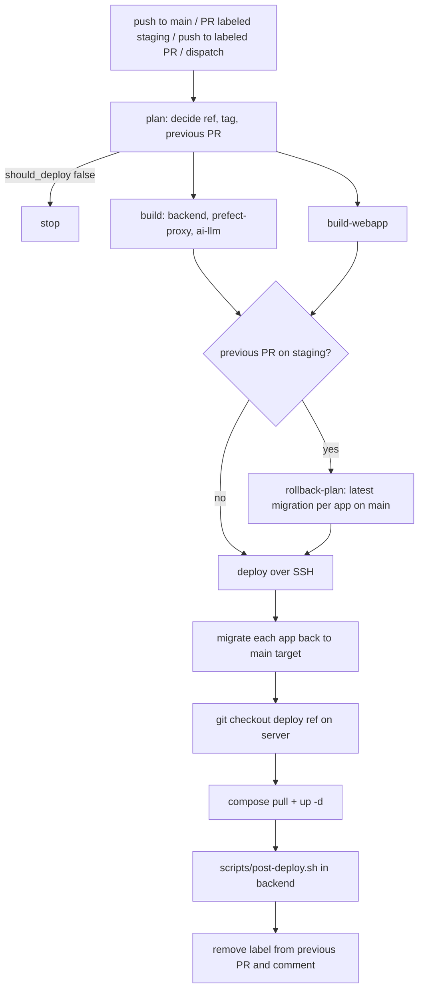

# Workflow: deploy to staging and production

Dalgo deploys through two GitHub Actions workflows that share the same shape: **plan → build images → SSH to a server → `docker compose pull` / `up -d` → run `scripts/post-deploy.sh` in the backend container**. They differ in triggers, gating and migration rollback.

| | Staging (`deploy-staging.yml`) | Production (`deploy-production.yml`) |
|---|---|---|
| Triggers | push to `main`, PR labeled `staging`, push to a labeled PR, manual dispatch | manual dispatch only |
| What is deployed | `main` tip, or a PR head | always the current tip of `main` |
| Image tag | `main-<short-sha>` or `pr-<n>-<short-sha>` | `prod-<short-sha>` |
| Pre-build gate | none | `ci-gate` (all CI check runs on the commit must be green) |
| Approval | `staging` GitHub environment | `production` environment (owner reviewers) |
| Migration rollback | yes, of the PR that previously held staging | none |
| Concurrency group | `staging-deploy` | `production-deploy` (neither cancels in progress) |

Related: [orchestration](../architecture/orchestration.md) and [platform](../architecture/platform.md) describe the services being deployed; [environment variables](../operations/environment-variables.md) covers the `.env` files the compose stack reads; [Django migrations](./django-migrations.md) covers migration authoring rules that this workflow's rollback relies on.

## Services and images

Both workflows build the same four images from the monorepo root as context, for `linux/arm64` only, and push them to GHCR under the lowercased repository owner (GHCR requires lowercase):

- `dalgo-backend` from `docker/Dockerfile.backend`
- `dalgo-prefect-proxy` from `docker/Dockerfile.prefect-proxy`
- `dalgo-ai-llm` from `docker/Dockerfile.ai-llm-service`
- `dalgo-webapp` from `docker/Dockerfile.webapp`

The first three are built in one `build` matrix job (`fail-fast: true`, with per-service GitHub Actions layer cache; production uses separate cache scopes prefixed `prod-`). The webapp is a **separate `build-webapp` job** because Next.js bakes `NEXT_PUBLIC_*` values into the bundle at build time: the job passes build args sourced from GitHub environment variables and secrets (backend URL, embedded webapp URL, dashboard, docs, Airbyte URL, Sentry, PostHog settings) and hard-codes `NEXT_PUBLIC_WEBAPP_ENVIRONMENT` to `staging` or `production`. Because those values are environment-scoped, the webapp image is rebuilt per environment, never promoted from staging to production. Both jobs run in the named GitHub environment so they see that environment's values.

Every image for a deploy carries the same tag. The deploy step exports that tag as `BACKEND_IMAGE_TAG`, `LLM_IMAGE_TAG`, `PROXY_IMAGE_TAG` and `WEBAPP_IMAGE_TAG`, plus `REGISTRY=ghcr.io/<owner>/`, which the compose files interpolate into `image:` (defaulting to `latest` and an empty registry for local use).

## Staging flow

*Staging pipeline; the rollback branch only runs when another PR currently owns staging.*

### Plan job

The `plan` job runs only for relevant events (non-`staging` label changes are skipped) and outputs `should_deploy`, `deploy_ref`, `short_sha`, `image_tag`, `pr_number`, `previous_pr` and `owner_lc`. Decisions:

- **push to `main`** deploys `github.sha` as `main-<sha7>`. **`workflow_dispatch`** resolves the current `main` HEAD through the GitHub API instead (so it is a way to reset staging to main).
- **PR `labeled` with `staging`** deploys the PR head SHA as `pr-<n>-<sha7>`.
- **PR `synchronize`** redeploys only if the PR currently has the `staging` label (checked live via `gh pr view`); otherwise `should_deploy` stays false.
- **PR `unlabeled` of `staging`** resets staging to `main` HEAD, and the unlabeled PR is the one whose migrations get rolled back.

Pushes that touch only docs, Markdown, `harness/`, `.claude/`, `CLAUDE.md` or the docs workflow are filtered out by `paths-ignore` for both the push and pull_request triggers.

`previous_pr` is the PR whose schema changes must be undone: the just-unlabeled PR, or otherwise the first open PR carrying the `staging` label, cleared if it equals the PR being deployed (a redeploy of the same PR needs no rollback). Staging is meant to hold at most one PR; the code picks the first labeled PR from `gh pr list`, so if two PRs are labeled at once the outcome depends on listing order.

### Rollback of the previous PR's migrations

`rollback-plan` checks out `main` and, for every `migrations/` directory under `backend/ddpui`, takes the highest-numbered `NNNN_*.py` file as that app's target, emitting a JSON map of app → migration name. The rollback target is therefore always derived from `origin/main` ("undo whatever is above main's migrations"), which stays correct when a PR is rebased or its migrations are renumbered.

The `deploy` job then runs `python manage.py migrate <app> <target>` for each app via `docker compose -f docker-compose.staging.yml exec -T backend` over SSH. This happens **before** the server checkout and containers are updated, so it executes inside the still-running backend container that holds the previous PR's code and migration files, which is what makes reversing those migrations possible. Rollback-plan itself waits for both image builds to succeed, so a failed build leaves staging untouched. This is the staging-only safety mechanism; see [Django migrations](./django-migrations.md) for why migrations need to be reversible.

### Deploy job

The `deploy` job runs in the `staging` environment with `always()` plus explicit conditions: planning said deploy, both build jobs succeeded, and `rollback-plan` either succeeded or was skipped. Steps, all over SSH using an agent loaded with the staging key and a `ssh-keyscan`-trusted host (host, user and deploy path come from environment variables, with the deploy path defaulting to `/home/ddp/dalgo`):

1. Roll back previous PR migrations (conditional, above).
2. **Sync checkout**: `git fetch origin <ref>` and a detached `git checkout` of the deploy ref in the server's repo. This matters because compose files, `profiles.toml`, `scripts/post-deploy.sh` and the Dockerfiles' bind-mounted config come from the checkout, not from the image.
3. **Pull and restart**: log in to GHCR using the workflow's `GITHUB_TOKEN`, export the registry and tag variables, then `docker compose -f docker-compose.staging.yml pull` and `up -d`.
4. **Post-deploy**: `docker compose ... exec -T backend bash scripts/post-deploy.sh`.
5. Housekeeping: remove the `staging` label from the previous PR, comment on it that staging was taken over (or reset to main) and migrations rolled back, and comment the deployed image tag on the PR now on staging.

## Production flow

Production is manually dispatched and has no label or PR logic.

1. **plan** resolves `main` HEAD via the API and computes `prod-<sha7>` and the owner.
2. **ci-gate** lists all check runs on that commit, excluding this workflow's own check suite. It fails if any is still running ("retry once they finish") or if any conclusion is not `success`, `skipped` or `neutral`. If the commit has no check runs at all it proceeds. Nothing is built until the gate passes.
3. **build** and **build-webapp** run in the `production` environment, which is where required reviewers gate the run; they use production values for the webapp build args.
4. **deploy** (environment `production`) syncs the server checkout to the SHA, pulls and runs `docker compose up -d` (plain `docker-compose.yml`, no `-f`), then executes `scripts/post-deploy.sh` in the backend container and writes the ref and image tag to the job summary.

Production has no migration rollback step, no health check and no automatic revert. Recovery is forward: land a fix or revert on `main`, wait for CI, and dispatch the workflow again. Because it always deploys `main` HEAD, you cannot redeploy an older tag from this workflow; the previously pushed `prod-<sha>` images remain in GHCR for manual `compose` use on the host.

## Post-deploy script

`backend/scripts/post-deploy.sh` runs (with `set -euo pipefail`, so the first failure fails the workflow step) inside the backend container:

1. `python manage.py migrate` — forward migration for all apps. Staging relies on this to re-apply the new PR's migrations after rolling back the old ones.
2. `loaddata seed/*.json` — reloads seed fixtures.
3. `create-system-orguser` — ensures the system org user exists.
4. `clear_role_permissions` — clears the Redis permission cache key so role changes take effect.

Creating a first organization and admin is deliberately not part of it (`createorganduser` is run by hand).

Note the ordering consequence: the new containers are started with `up -d` **before** migrations run, so there is a window where new code runs against the old schema. Migrations should be backwards-compatible with the previous release for that reason.

## Compose stacks

`docker/docker-compose.yml` (production) and `docker/docker-compose.staging.yml` define the same project (`name: dalgo`): two Redis instances (`redis` for backend Celery, `redis-llm` for the LLM service, both with health checks), `backend` plus Celery workers (`default`, `canvas_dbt` autoscaled, `alerts`) and `celery-beat` using the RedBeat scheduler, `prefect-server`, `prefect-proxy`, Prefect workers for the `ddp`, `manual-dbt` and daily-backup pools, `webapp`, and `ai-llm-service` with its Celery worker. Postgres is external (the production file header says so, although it also mentions the Prefect server as externally managed while the file does define a `prefect-server` service); each service reads its config from its own `.env` file (`backend/.env`, `prefect-proxy/.env`, `ai-llm-service/.env`, `webapp/.env`), while the compose `environment:` blocks only set container-networking values such as Redis hosts and inter-service URLs.

The staging file differs by additionally bind-mounting a host secrets directory (`DEV_SECRETS_HOST_PATH`) at `/secrets` into the backend and Celery containers, setting `DEV_SECRETS_DIR` to it and `USE_AWS_SECRETS_MANAGER` to false, so staging resolves secrets from files rather than AWS. That variable must be set on the staging host (in `docker/.env` or the shell). Host paths mounted into the backend (client dbt root, secrets) must be owned by UID/GID 1000 because the image runs as the pinned `dalgouser`.

The backend image's default command is `uvicorn ddpui.asgi:application` on port 8002; Celery services override the command in compose, and all of them reuse the same backend image and tag.

Compose services have no deploy-time health gating beyond Redis health checks and `depends_on`. "Verification" in these workflows is therefore limited to the step exit codes (pull, `up -d`, `post-deploy.sh`) and, for production, the pre-build CI gate.

## Related CI: Backend CI

`backend.yml` is not a deploy workflow but feeds the production gate. On pushes and PRs to `main` touching `backend/**` or `docker/Dockerfile.backend*`, it installs with `uv sync`, runs pre-commit, starts Postgres 15 and Redis 6, applies migrations, runs pytest (excluding `ddpui/tests/integration_tests`) with coverage uploaded to Codecov, and fails if coverage is under 55%. Because it is path-filtered, a commit that did not touch the backend may have no Backend CI check run, and `ci-gate` considers only the check runs that exist. See [backend pytest testing](../testing/backend-pytest.md).

## Job-runner image (not part of these workflows)

`docker/Dockerfile.job-runner` builds the image that runs Dalgo Prefect flows on EKS work pools. Neither deploy workflow builds or pushes it; it is built by hand as described in `docker/README.job-runner.md` and referenced in the EKS work pool configuration.

- Base: `prefecthq/prefect:<PREFECT_VERSION>-python3.10-kubernetes`; the `PREFECT_VERSION` build arg must match the `prefect==` pin in `prefect-proxy/pyproject.toml`, otherwise pip upgrades Prefect on top of the base.
- Dependencies come from `prefect-proxy/pyproject.toml` and `uv.lock` (exported frozen, no dev deps), so bumping a dependency there flows into the next image build with no Dockerfile edit.
- The build **context is `prefect-proxy/`**, run from the monorepo root. EKS runs on ARM nodes, so production builds use `--platform linux/arm64`; `linux/amd64` is for local testing.
- The vendored `prefect_airbyte` package is not installed in the image: workers clone the monorepo (sparse checkout of `prefect-proxy/`) at flow-run time, which is why `git` is installed in the image.
- `CLIENTDBT_ROOT` (default `/mnt/appdata/clientdbts`) is the mount point for client dbt projects and must stay consistent with deployment parameters.
- Tags follow Prefect upgrades (`0.1` for Prefect 3.1.15, `0.2` for 3.6.29). Verify a build by printing the dbt-core and adapter versions and comparing them with the pins.

Changing the Prefect version therefore touches three places that are deployed independently: the proxy image (via these workflows), the job-runner image (manual), and the work pool image reference.

## Operating notes

- To reset staging to main: remove the `staging` label from the PR (or dispatch the staging workflow). Both roll back the previous PR's migrations first.
- To put a PR on staging: add the `staging` label; later pushes redeploy it automatically.
- Deploys are serialized per environment and queued rather than cancelled, so a deploy in flight is never interrupted mid-migration.
- Secret and variable values live in GitHub environments (`staging`, `production`) and on the hosts; this page and the workflows reference them by name only.
