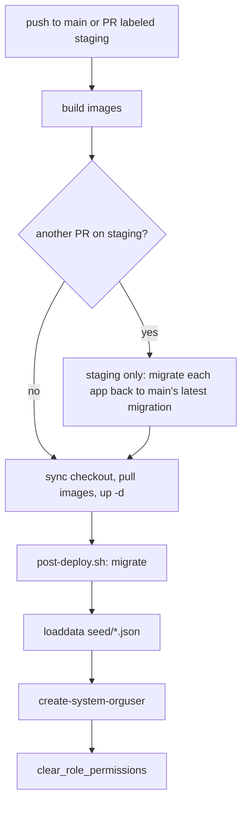

# Workflow: write and apply a Django migration

<!-- openwiki: broken internal link [../../backend/ddpui/migrations] file "../../backend/ddpui/migrations" does not exist. Fix the href or restore the target, then delete this comment. -->
<!-- openwiki: broken internal link [../../backend/seed] file "../../backend/seed" does not exist. Fix the href or restore the target, then delete this comment. -->
The backend is one Django app, `ddpui`, so there is a single linear migration history in [`backend/ddpui/migrations`](../../backend/ddpui/migrations) (currently `0001_initial` up to `0189_dashboard_filter_dependent_group_id`). Every schema change, and every data change that must reach existing databases, goes there. Reference data that fresh installs need lives in the separate [`backend/seed`](../../backend/seed) fixtures. Those two mechanisms are deliberately different, and most migration mistakes come from mixing them up. This page covers authoring, review, testing, the seed-fixture split, and what the deploy pipeline does with migrations.

Related pages: [Domain model](../concepts/domain-model.md) for the entities, [Auth, orgs and permissions](../architecture/auth-orgs-permissions.md) for roles and permissions, [Deploy staging and production](./deploy-staging-production.md) for the pipeline, [Backend layers](../architecture/backend-layers.md) for where models sit, and [Backend pytest](../testing/backend-pytest.md) for test setup.

## Commands

Always run Python through `uv` from `backend/` (the project guide in `backend/.claude/CLAUDE.md` requires this for `manage.py` too).

```bash
uv run python manage.py makemigrations ddpui          # generate from model changes
uv run python manage.py makemigrations --check --dry-run   # fail if model changes lack a migration
uv run python manage.py migrate                       # apply everything pending
uv run python manage.py migrate ddpui 0188            # move to a named state (forward or back)
uv run python manage.py loaddata seed/*.json          # (re)load reference fixtures
uv run python manage.py create-system-orguser
```

The `makemigrations --check --dry-run` form is the check the repository's validate-spec command asks for. CI does not run it: `.github/workflows/backend.yml` only runs `migrate` against a throwaway Postgres 15 before pytest, so an ungenerated migration is caught only by the tests that hit the missing column or by that manual check. `manage.py` itself is the stock Django entrypoint with `DJANGO_SETTINGS_MODULE=ddpui.settings`. The database comes from the `DBNAME`, `DBHOST`, `DBPORT`, `DBUSER` and `DBPASSWORD` variables, which have no defaults (see [Environment variables](../operations/environment-variables.md)).

## Authoring a migration

1. **Change the model** under `backend/ddpui/models/`. Models live in many modules but share the one `ddpui` app label.
2. **Make sure the model is registered.** `makemigrations` and the test database only know models whose modules have been imported. [`models/__init__.py`](../../backend/ddpui/models/__init__.py) therefore imports a second group of modules "not for API use" so their tables are always known. If your model sits in a new module that nothing else imports early, add it there. `MapLayer` is the deliberate exception: it has no migration (its table is loaded out of band from geojson dumps), so importing it would break test-database creation.
3. **Generate** with `makemigrations`, then read the file. Rename an auto-named file if the name is unhelpful (`0188_alter_auditlog_action`-style names are fine for small changes, but descriptive names such as `0182_chat_with_data` are preferred for new tables).
4. **Add data steps by hand** when existing rows need values (see below).
5. **Run it both ways** on a scratch database: `migrate`, then `migrate ddpui <previous migration>`, then `migrate` again. Staging depends on the backward direction (see [Deploy-time behaviour](#deploy-time-behaviour-and-pitfalls)).
6. **Format** with `uv run black .`. The pre-commit hook runs black over `ddpui/`, including migrations.

### Dependency chain and merges

Each migration names its predecessor in `dependencies`. When two branches both add `NNNN_*` from the same parent, Django sees two leaf nodes and refuses to migrate. The history shows the established fix: an empty merge migration such as `0153_merge_20260314_1816`, with both leaves in `dependencies` and `operations = []`. Duplicate numbers are common in the folder (for example two `0157_*` files) and harmless as long as the graph has one leaf. After rebasing a branch that carries migrations, re-check for a second leaf and either renumber or add a merge.

### Data migrations

Hand-written data steps use `migrations.RunPython(forward, reverse)` and fetch models with `apps.get_model("ddpui", "<Model>")`, never by importing the real class. Existing examples to copy from:

- Backfills after `AddField` (`0143`, `0144`, `0151`, `0161`) do the schema change and the row backfill in the same migration, with nullable columns first and old columns dropped only after the copy (`0161` copies `snapshot_chart_id` and `chart_id` into `target_id` before `RemoveField`).
- Permission data changes (`0137`, `0183`) edit `RolePermission` rows because `loaddata` never deletes rows. These handlers tolerate missing rows: `0183` says outright that "fresh databases have no seeds yet at migrate time". A fresh database migrates before any fixture is loaded, so a data migration that assumes seeded roles or permissions exist would crash on first install.

Rules of thumb drawn from those files:

- **Supply a real reverse function** or `migrations.RunPython.noop` when reversal is a safe no-op. `0122_set_uuid_in_orgtask` passes no reverse at all, so migrating backward past it raises an irreversible-migration error. That would break staging takeover if it ever sat above `main`'s latest migration.
- **Do not import application code that can change.** `0143` inlines two Prefect block-type strings with a comment that migrations must not depend on app code, because the constants were later deleted. `0144` (imports `TaskType` from `ddpui.models.tasks`) and `0151` (imports `ddpui.models.org.get_default_queue_config` and reads `PREFECT_WORKER_POOL_NAME` from the environment) show the opposite pattern and are the ones that will break if those symbols move. Inline constants where you can. The queue-config default is still read from the environment at migrate time, so existing orgs are backfilled with whichever pool name the migrating host has.
- **Editing an applied migration is only safe when it changes no schema or data.** A branch of `0143` was edited just to replace imported constants with literals. Django never re-runs an applied migration, so this was safe, but it is the only kind of edit that is.
- **Keep the backfill cheap or batched.** Several migrations loop over every row with `save(update_fields=...)`. That is acceptable for tables like `Org` or `OrgTask`, and a poor fit for very large tables.

### Constraints and relations

A new `unique=True`, `ForeignKey` or `on_delete` setting applies to every org's data at once. `0171_orgwarehouse_org_unique` makes `OrgWarehouse.org` unique, which fails on any database holding two warehouse rows for one org. Check existing data before you ship a constraint, and note it in the PR. New domain tables should carry an `org` foreign key (the multi-tenancy invariant in the project guide), so decide `on_delete` deliberately.

## `oldmigrations` is inert

<!-- openwiki: broken internal link [../../backend/ddpui/oldmigrations] file "../../backend/ddpui/oldmigrations" does not exist. Fix the href or restore the target, then delete this comment. -->
[`backend/ddpui/oldmigrations`](../../backend/ddpui/oldmigrations) holds six files (`0001_initial` to `0006_alter_clientorg_dbt`) from the earliest `ClientOrg`/`ClientDbt`/`ClientPrefectBlock` era. It has no `__init__.py`, nothing in the repository references it, and `MIGRATION_MODULES` is not set, so Django never loads it. The live history starts again at `ddpui/migrations/0001_initial`. Do not add new migrations there, and do not fix problems by editing it. The staging rollback script also ignores it because it only walks directories literally named `migrations`.

## Seed fixtures versus migrations

<!-- openwiki: broken internal link [../../backend/seed] file "../../backend/seed" does not exist. Fix the href or restore the target, then delete this comment. -->
[`backend/seed`](../../backend/seed) contains JSON fixtures for roles, permissions, role-permission links, the system `Task` catalogue and assistant/user prompt text. This page does not describe their contents. What matters operationally:

- **Where they are loaded.**
  - `scripts/post-deploy.sh` runs `python manage.py loaddata seed/*.json` right after `migrate` on every staging and production deploy.
  - Local setup follows the same order in the backend README (`migrate`, `loaddata seed/*.json`, `create-system-orguser`).
  - Tests load them through `seed_db` fixtures and `call_command("loaddata", ...)`.
  - `settings.FIXTURE_DIRS = ["seed"]`, which is why tests and ad-hoc commands can use bare names like `tasks.json`.
- **Why migrations do not load them.** They are plain `loaddata` input, applied after the schema exists. Management commands such as `createorganduser` and `ensure_git_pull_orgtasks` fail with a message telling you to run `loaddata seed/*.json` if the rows are absent.
- **When to re-run.**
  - After a fresh `migrate` on a new database, before creating the first org or user.
  - After any change to a fixture file. Deploys do this automatically, but a local or hand-managed database needs it by hand, for example `loaddata seed/002_permissions.json seed/003_role_permissions.json` after adding a permission.
  - After a schema migration that changes a seeded model's columns.
  - If a test fails with missing roles or tasks.
- **Fixtures only add and update.** `loaddata` upserts by primary key and never removes rows. Removing or revoking something that already exists in deployed databases (a permission grant, a role) needs a data migration, as `0183_copilot_permissions` states, or a one-off command such as `migrate_rbac_v2_roles` (idempotent, supports `--dry-run`).
- **Edit both when changing seeded behaviour.** Change the fixture for fresh installs and ship a migration or command for existing ones. The role-collapse work did exactly this.
- **Clear the permission cache.** Reloading permission fixtures does not change what running processes see until the Redis role-permission map is cleared with `uv run python manage.py clear_role_permissions`. Post-deploy already does this as its last step. Locally or on a hand-run database, run it yourself. See [Auth, orgs and permissions](../architecture/auth-orgs-permissions.md).
- **Map data is separate.** GeoRegion/GeoJSON data is loaded by the `seed_map_data` command, not `loaddata`, and `MapLayer` data is out of band as noted above.

## Deploy-time behaviour and pitfalls



Caption: order of migration-related steps in the staging workflow (production is the same minus the rollback branch).

Key facts, from `deploy-staging.yml`, `deploy-production.yml` and `scripts/post-deploy.sh`:

- **The image never migrates on start.** `docker/Dockerfile.backend` starts uvicorn directly. Migrations are applied only by the post-deploy step, which executes `bash scripts/post-deploy.sh` inside the running backend container over SSH.
- **Ordering and failure.** The script is `set -euo pipefail` and runs `migrate`, then `loaddata`, then `create-system-orguser`, then `clear_role_permissions`. A failed migration stops the script and fails the deploy job, but containers were already restarted with the new image.
- **Schema window.** Because `docker compose up -d` happens before `migrate`, new code runs briefly against the old schema. Make migrations additive and tolerant: add nullable columns or defaults first, and split destructive steps (dropping a column or table that old code still reads) into a later release.
- **Staging takeover rolls back.** When a different PR currently holds the `staging` label, or its label was removed, the `rollback-plan` job checks out `main` and computes, per `migrations` directory under `backend/ddpui`, the highest-sorted `NNNN_*.py` name. The deploy job then runs `python manage.py migrate <app> <target>` in the still-running old backend container before pulling the new image. That only works if the previous PR's migrations are reversible and its files are still in the container. The target is the lexicographically last filename, so if `main` ever had two files with the same top number, the alphabetically later one wins. Keep a single leaf.
- **Production has no rollback.** Schema moves only forward. Recovery is a fix-forward migration, not `migrate <app> <older>`. Treat reverse functions as a staging and local-dev safety net, not a production undo.
- **Concurrency.** Deploys are serialized per environment and queued, never cancelled, so a migration is not interrupted mid-run by a newer push.
- **Chat with Data tables are separate.** Its checkpointer tables are created by the `chat_with_data_setup` command, not by `migrate`. See [Local services and dependencies](../operations/local-services-and-dependencies.md).

## Testing and review checklist

- Apply the new migration to an empty database and to a copy of realistic data, then reverse it one step and re-apply.
- Run `makemigrations --check --dry-run` to confirm there is no model drift.
- Run the affected tests with `uv run pytest ddpui/tests/...`. The `backend.yml` workflow runs `migrate` before pytest, so a broken migration fails CI early. Coverage is not measured for migrations because `ddpui/migrations/*` is omitted in `pyproject.toml`, so a data migration only gets tested if you test it explicitly. `ddpui/tests/core/test_rbac_v2_migration.py` shows the pattern for a data transformation: it builds the old state inside the test transaction, loads `002_permissions.json`, runs the transform and asserts the result. It tests the `migrate_rbac_v2_roles` management command rather than a migration file.
- In review, ask: is it reversible, does it assume seeded rows, does it import app code, does it rewrite large tables, will old code still run against the new schema for the minutes between `up -d` and `migrate`, and if a fixture changed, is there a migration or command for existing databases?
