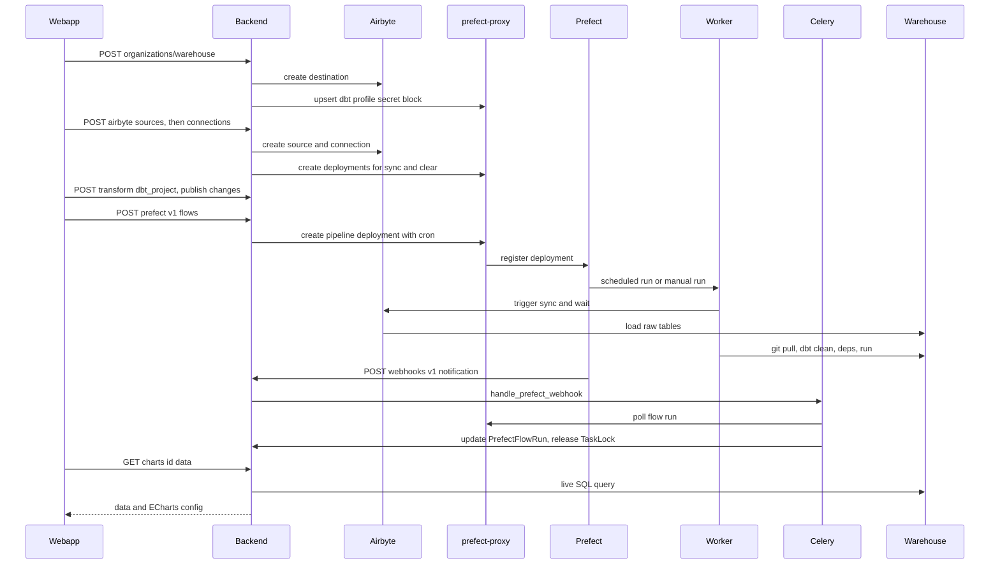

# Workflow: an NGO's pipeline end to end

This page follows one organization from an empty account to a chart on a dashboard. It records which component does the work at each hop, what state is written, and where the chain can break. It does not repeat the user-facing click paths. Those are in the product docs: [Data overview](../../docs/docs/data/overview.md), [Ingest](../../docs/docs/data/ingest/index.md), [Transform](../../docs/docs/data/transform/index.md), [Orchestrate](../../docs/docs/data/orchestrate.md), [Creating a chart](../../docs/docs/charts/creating-a-chart.md), [Creating a dashboard](../../docs/docs/dashboards/creating.md) and [Warehouse settings](../../docs/docs/settings/warehouse.md).

Each stage has a deeper page: [Warehouses](../architecture/warehouses.md), [Ingestion](../architecture/ingestion.md), [Transformation](../architecture/transformation.md), [Orchestration](../architecture/orchestration.md), [Background work](../architecture/background-work.md) and [Charts, dashboards and reports](../architecture/charts-dashboards-reports.md).

## The shape of the path

The path has three kinds of hop.

- **Configuration hops.** The webapp calls the Django backend, which writes Dalgo rows and calls Airbyte or Prefect, through prefect-proxy for Prefect. These are warehouse, source, connection, transform setup and pipeline creation. Each is a synchronous request that returns before any data moves.
- **Execution hops.** A Prefect worker runs the deployment and calls Airbyte and dbt. The backend only requests a flow run and records it.
- **Read hops.** Charts query the warehouse live when they are viewed. Nothing in the backend pushes a "new data is ready" signal to charts.

The diagram shows the whole path in order. The first four message groups are configuration, the middle are execution and state return, and the last is the chart read.

## Stage 1: connect the warehouse

`POST /api/organizations/warehouse/` (`user_org_api.post_organization_warehouse`, permission `can_create_warehouse`) calls `airbytehelpers.create_warehouse`. The sequence inside it:

1. Reject any `wtype` other than `postgres` or `bigquery` with a 400.
2. Create the Airbyte **destination** in the org's workspace.
3. Save the credentials to the secrets manager and store the secret id in `OrgWarehouse.credentials`.
4. Save the `OrgWarehouse` row with the Airbyte destination id and image info.
5. Call `create_or_update_dbt_profile_secret_blk`, which upserts the Prefect Secret block `dbt-profile-<org.slug>` through prefect-proxy.

The warehouse therefore plays three roles at once. It is Airbyte's destination, it is the target of the dbt profile that workers build from the Secret block, and it is what the backend queries for charts through `WarehouseFactory`. See [Warehouses](../architecture/warehouses.md) and [Transformation](../architecture/transformation.md).

The org needs an Airbyte workspace first (`POST /api/airbyte/v1/workspace/`, which also creates the Prefect Airbyte Server block). The destination call uses `org.airbyte_workspace_id`. The webapp's `selectIngestState` reads the warehouse and sources lists, and only a successful empty warehouse response produces the "no warehouse" screen. A failed fetch is a separate error state.

**Failure points.**

- The steps are not one transaction. The Airbyte destination exists before the secret and the row do. A failure in steps 3 to 5 leaves an Airbyte destination with no `OrgWarehouse`, and the endpoint returns a generic 500.
- If the dbt profile block is missing or stale, dbt tasks fail at run time rather than at setup, because workers read it only then.

## Stage 2: add a source

Sources are created with `POST /api/airbyte/sources/` and checked with the `check_connection` endpoints or websocket consumers. They are thin pass-throughs to Airbyte with permission checks. Dalgo keeps no source row of its own, and the source list is read from Airbyte. The validation rules, demo-org whitelisting and the Google Sheets OAuth path are in [Ingestion](../architecture/ingestion.md).

## Stage 3: create a connection

`POST /api/airbyte/v1/connections/` (`can_create_connection`) rejects an empty stream list and calls `airbytehelpers.create_connection`.

- **Pre-conditions.** The org needs a warehouse with an `airbyte_destination_id`, an `AIRBYTESERVER` Prefect block record, and the `airbyte-sync` and `airbyte-clear` `Task` rows. These are checked before anything is created in Airbyte.
- **Airbyte first.** The Airbyte connection is created first, with the warehouse destination.
- **Then the Dalgo side, in one DB transaction.** The sync `OrgTask`, a Prefect deployment named `manual-<slug>-<task>-<hash>`, the clear `OrgTask` and its deployment, the `OrgDataFlowv1` rows (type `manual`) with `DataflowOrgTask` links, and `ConnectionMeta`.
- **Then the Prefect connection block.** An `AirbyteConnection` block is upserted. A failure here is logged and ignored.
- **Result.** The response carries `deploymentId` and `clearConnDeploymentId`.

**Failure points.**

- If anything after the Airbyte call fails, the handler deletes the Airbyte connection and returns "Couldn't create the connection, please try again". Prefect deployments created inside the failed transaction are not deleted by that handler, because the compensation only covers Airbyte. The DB rows roll back, so such a deployment would be orphaned in Prefect.
- A missing connection block is tolerated because the flow falls back to an inline block, but post-sync operations such as column casts are skipped in that case.

## Stage 4: sync

A sync is a Prefect flow run of the connection's manual deployment. The webapp calls `POST /api/prefect/v1/flows/{deployment_id}/flow_run/`.

1. `PipelineService.run_pipeline` loads the mapped `OrgTask`s in `seq` order.
2. `lock_tasks_for_dataflow` fails with 400 if any of those tasks already has a `TaskLock`, naming the user who holds it. Otherwise it creates one lock per task in a transaction.
3. The backend asks prefect-proxy to create the flow run and inserts a `PrefectFlowRun` row in `Scheduled`. If the proxy call fails, the locks are deleted and the user sees "failed to start a run". On success the flow-run id is written onto the locks.
4. A worker picks the run up and executes the flow. For Airbyte, `run_airbyte_connection_flow_v1` triggers the Airbyte job and polls it, then runs post-sync operations.
5. Airbyte loads raw tables into the warehouse.

Two separate callbacks bring state back, described in the state-return section below. The Airbyte job webhook updates `AirbyteJob`, and the Prefect notification webhook updates the flow-run and lock state.

**Failure points.**

- A held lock blocks both manual and scheduled runs of any pipeline sharing an `OrgTask`.
- The Airbyte job can fail while Prefect itself works. The flow raises, the flow run ends `Failed`, and the failure path below sends notifications.

## Stage 5: transform with dbt

Transform setup (`POST /api/transform/dbt_project/`) creates a managed GitHub repo and a scaffolded dbt project for the org, with `OrgDbt` as the workspace record. Users then build models on the canvas or edit the repo directly. The details are in [Transformation](../architecture/transformation.md).

The coupling between the transform stage and the scheduled pipeline is git:

- Canvas models are plain `.sql` files in the working tree on the backend host. Prefect workers do not read that tree. They clone or pull the **remote** repo at run time, so a model reaches a scheduled run only after it is published (committed and pushed through `POST /api/dbt/publish_changes/`).
- The canvas's own "run workflow" action goes the other way. It runs dbt in a Celery task against the local working tree and the backend's dbt install, which is a different execution path from Prefect.
- dbt reads its inputs from the schemas Airbyte wrote. The canvas can only offer tables that already exist in the warehouse, so at least one successful sync must come before the first source node.

`pipeline_with_orgtasks` renders each dbt step into a task config with the dbt command line, `project_dir`, `profiles_dir` and `env["dbt-profile-secret-block"]`. The worker builds `profiles.yml` from that Secret block at run time.

**Failure points.**

- Unpublished canvas models pass in the Celery run but are absent from Prefect runs.
- A `dbt-test` failure does not fail the flow. The runner returns a `COMPLETED` state named `DBT_TEST_FAILED`, so a "green" run can contain failed tests. The proxy recomputes this name when reading a flow run.
- Any other dbt step failure raises, which fails the flow run.

## Stage 6: build and run a pipeline

A **pipeline** is an `orchestrate` `OrgDataFlowv1` whose single Prefect deployment holds Airbyte syncs followed by dbt steps. It is created with `POST /api/prefect/v1/flows/` (`can_create_pipeline`) and `PipelineService.create_pipeline`:

- It requires a name.
- Airbyte syncs come first, in the order the user gave. Connections with no sync `OrgTask` are silently dropped from the pipeline. If connections were requested but the org has no Airbyte server block, it raises a configuration error (HTTP 422).
- For transform tasks, the service ignores any git, `dbt-clean` or `dbt-deps` tasks the UI sends. When at least one dbt task remains, it prepends `git-clone` on an EKS workpool or `git-pull` otherwise, then `dbt-clean` and `dbt-deps`.
- The config `{tasks, org_slug, continue_on_sync_failure}` becomes the deployment parameters. The deployment is named `pipeline-<slug>-<hash>`, created through prefect-proxy with the org's scheduled-pipeline queue and an optional cron, and mirrored into `OrgDataFlowv1` and `DataflowOrgTask`.
- `update_pipeline` rewrites the deployment parameters, then deletes and recreates the `DataflowOrgTask` rows. `set_schedule/{active|inactive}` toggles the Prefect schedule only.

A run is then either a cron firing in Prefect or a manual `POST .../flow_run/`, the same call used for a sync. On the worker, `deployment_schedule_flow_v5` sorts the tasks by `seq`. By default it runs them sequentially and stops at the first failure. With `continue_on_sync_failure` it runs all Airbyte syncs first and collects their errors. It then raises before any transform step if a sync failed. So a pipeline never transforms a partially loaded set of tables, whichever mode is used.

Scheduled runs nobody clicked have no `TaskLock` yet. The backend creates the locks as the system user when the `Pending` webhook arrives, so the UI still shows the pipeline as busy.

**Failure points.**

- The deployment parameters decide what runs. The `DataflowOrgTask` rows only mirror them, so an update that fails after the proxy call and before the remap leaves the mapping stale.
- A manual run is refused with 400 if another pipeline or manual job holds a lock on any shared `OrgTask`.

## State return: webhooks, Celery and the UI

Prefect does not call the backend by itself. A notification policy is configured to POST to `/webhooks/v1/notification/` with an `X-Notification-Key` header.

- The view compares the header with `PREFECT_NOTIFICATIONS_WEBHOOK_KEY` and returns 400 on mismatch. It parses the flow-run id and state from the body. A message with no flow-run id is acknowledged with `{"status": "ok"}`. Otherwise it enqueues `handle_prefect_webhook` and returns at once.
- The Celery task polls the flow run through prefect-proxy and calls `update_flow_run_for_deployment`. On a terminal state (`Completed`, `Cancelled`, `Failed`, `Crashed`) it deletes the `TaskLock` rows for that run and upserts `PrefectFlowRun`. On `Pending` it locks the tasks as the system user. On `Running` it upserts the run.
- On `Failed` or `Crashed`, if `PREFECT_RETRY_CRASHED_FLOW_RUNS` is `1` or `true` and the run has retried less than once, it schedules a retry 5 minutes later. That retry suppresses the failure notification. Otherwise `notify_users_about_failed_run` emails the org managers. It also notifies platform admins when `NOTIFY_PLATFORM_ADMINS_OF_ERRORS` is set.
- In a `finally` block, runs whose config includes Airbyte sync, reset or clear tasks refresh `AirbyteJob` history for that connection over the last 6 hours. Failed or crashed runs also queue log summarization.

The Airbyte job webhook is separate: `POST /webhooks/v1/airbyte_job/{job_id}` checks `AIRBYTE_NOTIFICATIONS_WEBHOOK_KEY` and enqueues `sync_single_airbyte_job_stats`.

The webapp learns about progress by polling. `usePipelines` re-fetches `/api/prefect/v1/flows/` every 3 seconds while any returned pipeline has a lock. `usePipelineOverview` does the same for `/api/dashboard/v1`, which feeds the `/pipeline` run-history page with up to 50 recent runs per pipeline. The lock status shown in `get_pipelines` comes from the cached `PrefectFlowRun` row, not from a live Prefect call.

**Failure points.**

- If the webhook is missed, because Prefect, the key or the Celery queue is down, the `PrefectFlowRun` stays stale and the `TaskLock` stays in place. The UI then shows the pipeline as busy and refuses new runs. Lock recovery otherwise relies on a later webhook for the same run or on the stuck-lock cleanup described in [Background work](../architecture/background-work.md).
- Webhook handling catches business-logic errors and logs them, so a failure inside it never reaches Prefect as an HTTP error.
- If `PREFECT_NOTIFICATIONS_WEBHOOK_KEY` is unset, the header comparison is against `None`. A request with no header would pass. Always set the key.

## Stage 7: charts and dashboards

Charts read the warehouse tables that Airbyte and dbt populated. Both the `/{chart_id}/data/` route (saved charts) and the `/chart-data/` route (the builder's unsaved config) go through `generate_chart_data_and_config`. It builds a query for the chart's `schema_name` and `table_name`, runs it through a client from `WarehouseFactory`, and shapes the rows into an ECharts config. Maps and pivot tables take their own branches. The builder's tables come from the warehouse browse API, so a chart can only target something the pipeline has already created.

Chart data is computed on every request. There is no Redis or other cache in `core/charts`, and no hook from pipeline completion to charts. A dashboard is "fresh" simply because each view re-queries the warehouse. It follows that:

- A chart shows whatever is in the table when it is opened. Mid-run it can show a mixture, for example freshly loaded raw data and not-yet-rebuilt dbt models.
- If a dbt model is dropped or renamed, or its columns change, the saved chart (which stores schema, table and columns) fails with an error at view time. `get_chart_data_by_id` returns 400 for `ValueError` and a generic 500 for anything else.
- `has_schema_access` is a stub that returns `True`. Access to a table is gated by org membership and the `can_view_charts` permission, not by per-schema rules.
- A missing `OrgWarehouse` returns 404 "Warehouse not configured".

## Failure map

| Hop | Owner | Typical failure | What the user sees or what remains |
|---|---|---|---|
| Warehouse create | `airbytehelpers.create_warehouse` | Airbyte destination made, then secret or block write fails | Generic 500. Orphan Airbyte destination. |
| Connection create | `airbytehelpers.create_connection` | Failure after the Airbyte call | Airbyte connection deleted, retry message. Prefect deployment may be orphaned. |
| Run request | `PipelineService.run_pipeline` | Existing `TaskLock` | 400 naming the lock holder. |
| Run request | `PipelineService.run_pipeline` | prefect-proxy or Prefect unreachable | `PipelineServiceError`, locks deleted. |
| Worker | `deployment_schedule_flow_v5` | Airbyte sync error | Flow run `Failed`. With tolerance on, transforms are skipped. |
| Worker | dbt runner | Missing Secret block, unpublished model, dbt error | Flow run `Failed`. |
| Worker | dbt runner | `dbt-test` failure | Flow run `Completed` with state name `DBT_TEST_FAILED`. |
| State return | webhook and Celery | Webhook not delivered or key wrong | Stale `PrefectFlowRun`, lingering `TaskLock`. |
| Notification | `notify_users_about_failed_run` | Retry enabled and first failure | Notification suppressed until the retry fails. |
| Read | `charts_api` | Table or column no longer exists | 400 or 500 on chart data. |

## Operating notes

- The backend reaches Prefect only through prefect-proxy. The proxy URL and timeout come from `PREFECT_PROXY_API_URL` and `PREFECT_HTTP_TIMEOUT`.
- Workers fetch flow code from git at run time, so changing flow code needs a deployment-entrypoint update, not just a merge. See [Orchestration](../architecture/orchestration.md).
- Four things must agree for the path to work. They are the org's Airbyte workspace, the warehouse destination, the `dbt-profile-<slug>` Secret block, and the notification-policy URL and key. Check these first when a new org's pipeline does nothing.

## Tests worth reading

- `backend/ddpui/tests/api_tests/test_pipeline_api.py` and `tests/core/test_pipelinefunctions.py` cover pipeline create, update and run, lock behavior and task config building.
- `backend/ddpui/tests/api_tests/test_webhook_api.py` covers webhook auth, message parsing and the notification paths.
- `backend/ddpui/tests/helper/test_airbytehelpers.py` covers connection and warehouse helpers.
- `backend/ddpui/tests/api_tests/test_charts_api.py` covers chart data endpoints.
- `webapp/components/pipeline/orchestrate/__tests__/pipeline.integration.test.tsx` shows the API calls the pipeline UI makes.
